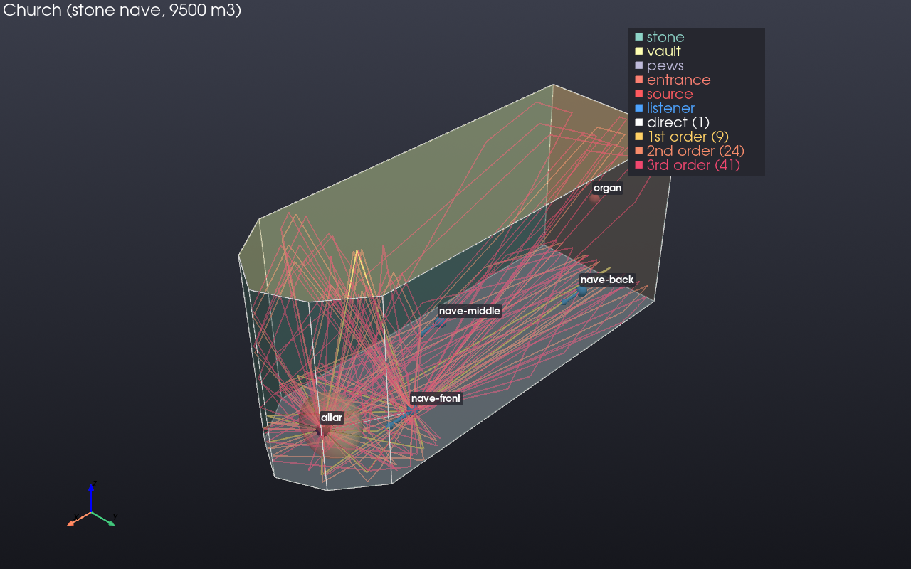
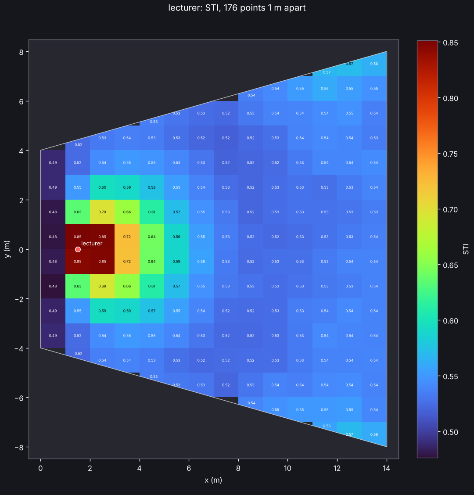
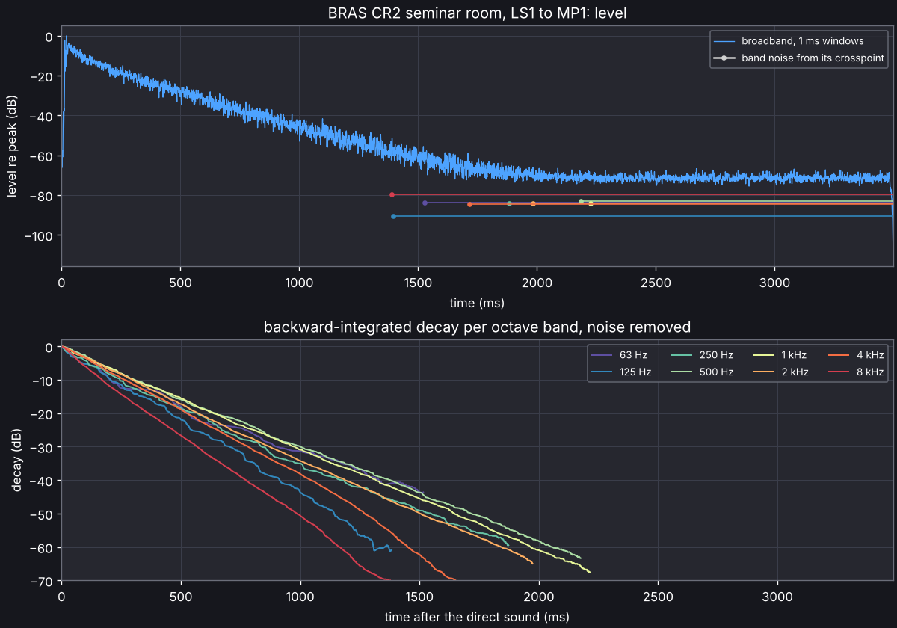

# acoustic_spaces

Open-source room acoustics simulator and auralisation toolkit, in the spirit of
CATT-Acoustic and ODEON: load a 3D model of a space, place sources and listeners,
compute impulse responses, and listen to the result in binaural, Ambisonics or
loudspeaker formats.

**Status: 2.0.** Rooms come from CAD models, from their dimensions or from a floor plan
drawn in the editor, with a material database and directional sources. Simulations
combine ray-traced early reflections, edge diffraction, a stochastic late tail and,
for the lowest bands, a wave solver, and give impulse responses in mono, binaural,
Ambisonics (AmbiX) and loudspeaker formats as WAV files, ISO 3382-1 parameters, and
coverage maps of them and of the speech transmission index over the audience. Dry
recordings can be run through the responses offline or in real time on the sound card,
head-tracked on headphones; real rooms can be measured with sine sweeps and compared
with their model. Reflection paths and sound particles can be watched in 3D, animated,
and exported to Blender. The
[validation report](https://github.com/naelolaiz/acoustic_spaces_simulator/blob/main/docs/validation.md)
says how far the results can be trusted. A [graphical editor](#graphical-editor) does
all of this in one window, starting from the bundled example rooms.



## Design in one paragraph

Python is the main language; a small C++ core (bound with nanobind) carries the
parts that have hard real-time deadlines. Every simulation runs in two stages with
selectable methods: deterministic ray tracing (or image sources) for the early
reflections and stochastic processing for the late reverberation. Both write a
format-independent *directional reflectogram*, from which binaural, Ambisonics and
loudspeaker impulse responses are encoded, so one simulation serves every output
format.

## Install

Every release has wheels for Linux, macOS and Windows (CPython 3.10 to 3.14), with the
compiled core inside, on its
[GitHub release page](https://github.com/naelolaiz/acoustic_spaces_simulator/releases):
`pip install` the wheel for your platform, with the extras below in brackets after its
file name if you want them, such as
`pip install "acoustic_spaces-2.0.0-cp312-cp312-win_amd64.whl[viz,gui]"`. The package is
not on PyPI, so `pip install acoustic-spaces` does not find it; between releases, install
from source.

The documentation (this README, the validation report and an API reference generated
from the docstrings) builds with Sphinx; see CONTRIBUTING.md.

## Install from source

Requirements: Python 3.10+, a C++17 compiler and CMake 3.18+.

```sh
git clone https://github.com/naelolaiz/acoustic_spaces_simulator
cd acoustic_spaces_simulator
```

With [uv](https://docs.astral.sh/uv/), `uv sync` builds the package into `.venv` together
with the test tools (pytest, ruff), and `--extra` adds the optional parts:

```sh
uv sync --extra viz                    # viz: the 3D view (PyVista) and plots (matplotlib)
uv sync --extra viz --extra measure    # measure: sounddevice, for sweeps and playback
uv sync --extra gui                    # gui: the graphical editor (Qt, PySide6)
uv sync --all-extras                   # everything, with sofa (h5py), sketchup and docs
```

`uv sync` installs exactly what it is asked for, so name every extra each time. It
rebuilds the compiled core when the C++ sources change.

With pip, in a virtual environment:

```sh
python -m pip install -e ".[dev,viz]"     # viz adds the 3D view (PyVista)
python -m pip install -e ".[measure]"     # sounddevice: sweeps, real-time playback
python -m pip install -e ".[sofa]"        # h5py, to read HRTFs from SOFA files
python -m pip install -e ".[sketchup]"    # openskp, to read SketchUp files (experimental)
python -m pip install -e ".[gui]"         # the graphical editor (Qt, PySide6)
```

Check the installation and look at the example scene. The commands run in the environment
you installed into: activate it (`source .venv/bin/activate`, or `.venv\Scripts\activate`
on Windows), or with uv put `uv run` in front of each.

```sh
acoustic-spaces info
acoustic-spaces validate examples/shoebox/scene.yaml   # errors exit with status 1
acoustic-spaces inspect examples/shoebox/scene.yaml    # geometry, materials, RT estimates
acoustic-spaces view examples/shoebox/scene.yaml       # 3D window; --screenshot out.png
acoustic-spaces view examples/shoebox/scene.yaml --paths --max-order 2  # reflection paths
acoustic-spaces view examples/gallery/scene.yaml --paths --listener "round the corner"  # diffraction
acoustic-spaces animate examples/lecture_hall/scene.yaml               # sound particles
acoustic-spaces export examples/concert_hall/scene.yaml hall.glb --paths --particles  # Blender
acoustic-spaces materials carpet                       # search the material database
acoustic-spaces directivity hypercardioid --plot polar.png  # a source directivity
acoustic-spaces simulate examples/shoebox/scene.yaml --out results --plot
acoustic-spaces map examples/lecture_hall/scene.yaml --plot sti.png --parameter sti
python -m pytest                                       # the test suite
```

`animate` shows sound particles leaving a source and spreading through the room, each
reflecting off the walls (specularly, or diffusely with the surface's scattering
coefficient) and losing the absorbed share of its energy at every hit, coloured by
level or by reflection order. It opens a window with a time slider, or saves a GIF
(`--out particles.gif`) or, with `imageio[ffmpeg]` installed, an MP4 video.


`simulate` writes impulse responses for every source and listener in each format the
scene's `outputs` list (`results/talker__seat-a.wav` in mono, `.binaural.wav`,
`.ambix3.wav`, `.5.0.wav` and so on, 32-bit float), `parameters.json` with the room
acoustic parameters of every response per octave band, its STI and its echo criteria,
and with `--plot` an echogram, decay curves and a map of arrival directions as PNG.
`--output ambisonics:3` (repeatable) picks formats on the command line. It prints the
parameters as it goes:

```
talker -> seat-a: direct sound at 11.7 ms, 63 early paths
             63 Hz  125 Hz  250 Hz  500 Hz   1 kHz   2 kHz   4 kHz   8 kHz
EDT (s)      1.823   1.811   1.720   1.429   1.330   1.231   0.963   0.529
T30 (s)      3.093   3.070   3.004   2.494   2.424   2.206   1.591   0.860
C80 (dB)       1.3     1.3     1.8     2.9     3.9     4.6     5.9     9.3
G (dB)        22.9    22.9    22.2    21.0    19.3    18.1    16.9    15.5
LF           0.332   0.332   0.335   0.337   0.344   0.346   0.343   0.327
IACC_E       0.973   0.970   0.843   0.473   0.496   0.629   0.521   0.571
T30_X (s)    3.336   3.315   3.297   2.662   2.609   2.390   1.656   0.859
T30_Z (s)    2.657   2.638   2.566   2.106   2.034   1.886   1.447   0.809
...
STI 0.60 (STIPA 0.61), echo criterion 0.68 for speech (echo above 1.0), 0.69 for music (echo above 1.8)
```

With `--plot`, each response gets an echogram (the late energy per millisecond and the
early paths by order) with the decay curves of every band, and a map of where the sound
comes from:


T30 comes out several times the Sabine and Eyring estimates that `inspect` prints, and
that is the room, not a fault. Its absorption sits on the ceiling and the carpet while
the walls are hard and smooth (scattering 0.05), so sound running between the walls meets
little absorption and dies away slowly. Sabine and Eyring assume a diffuse field, where
sound meets every surface alike; `inspect` says when a room is far from that and adds the
Arau-Puchades estimate, which allows for absorption that faces one way. With every surface
fully diffusing, the same room decays in Eyring's 0.37 s at 1 kHz; with every surface
scattering 0.3, in about 0.6 s. The
[validation report](https://github.com/naelolaiz/acoustic_spaces_simulator/blob/main/docs/validation.md)
checks both kinds of room.

From Python:

```python
from acoustic_spaces import Room, simulate
from acoustic_spaces.audio import write_wav
from acoustic_spaces.engine import early_paths, trace_particles
from acoustic_spaces.spatial import Ambisonics, Binaural, Loudspeakers
from acoustic_spaces.viz import animate_particles, plot_directions, plot_response, show_room

room = Room.from_yaml("examples/shoebox/scene.yaml")
print(room.report.summary())
print(room.problems(), room.warnings())
print(room.reverberation_time("eyring"))  # per octave band, seconds
show_room(room, paths=early_paths(room, max_order=2))
animate_particles(room, trace_particles(room, duration=0.1), "particles.gif")

result = simulate(room)
response = result["talker", "seat-a"]
print(response.parameters().table())
write_wav("talker__seat-a.wav", response.impulse_response(48_000), 48_000)
plot_response(response, "talker__seat-a.png")

binaural = response.spatial_impulse_response(Binaural(), 48_000)  # (samples, 2)
ambix = response.spatial_impulse_response(Ambisonics(order=3), 48_000)  # 16 channels
surround = response.spatial_impulse_response(Loudspeakers.layout("5.0"), 48_000)
plot_directions(response, "talker__seat-a.directions.png")
```

## Graphical editor

The editor needs the `gui` extra: `uv sync --extra gui` in a source checkout, then
`uv run acoustic-spaces edit`, or a release wheel installed with `[gui]` after its file
name.

```sh
acoustic-spaces edit                              # a new box room
acoustic-spaces edit examples/studio/scene.yaml   # or open a scene file
```


The editor works on the same scene files as the command line:

- **File > Open example** opens the bundled rooms. Saving one asks where to keep your
  copy and takes its model file along. **New box room**, **New room from a floor plan**
  and **New from model file** (OBJ, STL, PLY, OFF, glTF, DXF or SketchUp) start from
  scratch.
- The **Plan** tab, next to the 3D view, shows the room from above and draws rooms (see
  below).
- The **scene tree** lists the geometry and its surfaces, the materials, sources,
  listeners, simulation settings and output formats. Selecting an entry, there or by
  clicking it in the 3D view, shows its form under **Properties**. Every change is
  checked against the scene schema; a refused change says why under **Messages**, and
  every change can be undone.
- **Place source** and **Place listener**, then click a surface: on a floor the new
  point stands at ear or mouth height, on a wall or ceiling it goes half a metre into
  the room. In the plan, the click places it above the floor there. Sources and
  listeners move by dragging, in the 3D view or the plan, and keep their height above
  the floor (up a raked floor too); with Shift in the 3D view they move up and down.
  Surfaces take materials from their form, or from a new material picked from the
  database (**Edit > Add material**).
- **Simulation > Run coverage map** (F6) maps every source over the audience area (see
  [Coverage maps](#coverage-maps)). The **Coverage map** panel shows any parameter
  and band from above, for one source or all of them together, and **Map in 3D** lays
  it over the room; **Save** writes the picture or every map as JSON. The scene tree's
  **Coverage map** entry sets the surfaces, height, spacing, rays and background noise.

  

- **Simulation > Run** (F5) works in the background. The **Results** panel shows the
  ISO 3382-1 parameters, the echogram and decay curves and the arrival directions of
  any source and listener, and draws their reflection paths in the room. **Export**
  writes the same files as `simulate`; **Listen** plays a dry WAV file through the
  response on the sound card (binaural when the scene has a binaural output; needs the
  `measure` extra), or head-tracked with **Head tracking** ticked (see
  [Head tracking](#head-tracking)).
- A source's form sets its directivity: a pattern, or a SOFA or CSV file of measured
  data. It shows the directivity index per band, opens the polar patterns, and the
  selected source shows its balloon in the 3D view.
- The status bar keeps the volume and the Eyring reverberation time at 1 kHz up to date
  as you edit.
- **File > Export to Blender** writes the room with the reflection paths on show, and
  **File > Export particle animation to Blender** the sound particles leaving the
  selected source (see below).

### Drawing rooms


The **Plan** tab shows the room from above on a grid in metres. In a floor plan or box
room every corner is a handle:

- Drag a corner to move it; the two walls it joins show their lengths as it moves. A
  box becomes a floor plan with the same walls, so its materials stay where they were.
- Double-click a wall to add a corner there, or right-click a corner to remove it.
  Clicking a wall selects that surface, to give it a material.
- **Draw room** (or **Edit > Draw floor plan**) draws a new floor plan: click its corners
  in turn and close it on the first one, with a double-click or with Enter. Backspace
  takes the last corner back and Esc stops. The new room keeps the old one's height
  (change it under **Geometry**). Sources and listeners that would end up outside move
  inside, keeping their arrangement. Over a model file, the editor asks before
  replacing it.
- Corners and points snap to the grid chosen under **Snap** (10 cm unless changed);
  hold Shift to place them freely. A move that would make walls cross is refused, with
  the reason under **Messages**.
- The wheel zooms, dragging empty space pans and **Fit** shows the whole room again.

Rooms from model files show their outline, and their sources and listeners move the
same way. Every change can be undone.

### Exporting to Blender

`acoustic-spaces export` writes a scene as glTF 2.0 (`.glb`) for Blender or another 3D
tool; the editor does the same from its File menu.

```sh
acoustic-spaces export examples/concert_hall/scene.yaml hall.glb              # the room
acoustic-spaces export examples/concert_hall/scene.yaml hall.glb --paths      # + reflection paths
acoustic-spaces export examples/concert_hall/scene.yaml hall.glb --particles  # + particle animation
```

In Blender, use **File > Import > glTF 2.0 (.glb/.gltf)** and pick the file. The axes are
the scene's (+z up, metres).

- Each surface is an object named as in the editor, with a see-through material per
  scene material; the material's custom properties hold its absorption and scattering
  per octave band. Sources (red) and listeners (blue) are spheres turned the way they
  face, with an arrow along the aim.
- `--paths` adds the early reflection paths from `--source` to `--listener` up to
  `--max-order`, one object of edges per order. Edges do not render: to render them,
  use Object > Convert > Curve and give the curve a bevel depth.
- `--particles` adds the particles of `animate` as small spheres that move with them and
  shrink with their level, gone 60 dB down. The animation runs 40 times slower than the
  sound (`--slow-motion`): the default 100 ms take 4 s, 96 frames at 24 fps. If the
  timeline ends sooner, set its end frame, then press play. With the default 1000
  particles (`--count`) the file is about 3 MB.

### Example scenes

| Example | What it is |
| --- | --- |
| `shoebox` | An 8 × 6 × 3 m room from an OBJ file, the simplest case every method must get right. |
| `lecture_hall` | A fan-shaped lecture hall built from its floor plan, no CAD file needed. |
| `concert_hall` | A 32 × 20 × 15 m shoebox hall with a raised stage and upholstered seats; two sources on stage, three seats in the stalls. |
| `studio` | A 6 × 4.5 × 3 m control room with side panels, a diffuser and stereo loudspeakers at ±30°. |
| `church` | A stone nave with an apse, 18 m high, with about six seconds of reverberation. |
| `gallery` | An L-shaped gallery: one listener sees the guide, the other stands round the corner and hears the guide by [edge diffraction](#edge-diffraction). |

`acoustic-spaces examples` lists them with where they are installed, and
`acoustic-spaces examples --copy my-rooms` copies them to a folder you can edit. From
Python, `acoustic_spaces.examples.example_path("church")` gives a scene file.

## Scene files

A scene is a YAML file that names the geometry, the materials, which surface gets
which material, and where the sources and listeners are. See
[`examples/shoebox/scene.yaml`](https://github.com/naelolaiz/acoustic_spaces_simulator/blob/main/examples/shoebox/scene.yaml) and the schema in
[`src/acoustic_spaces/scene/model.py`](https://github.com/naelolaiz/acoustic_spaces_simulator/blob/main/src/acoustic_spaces/scene/model.py).
Frequency-dependent data uses eight octave bands from 63 Hz to 8 kHz.

### Geometry

| Format | Read with | Names used for material assignment |
| --- | --- | --- |
| OBJ | built-in reader | `usemtl` material, `g` groups, `o` object |
| DXF | [ezdxf](https://ezdxf.mozman.de/) (3DFACE, MESH, polyface, block references) | layer |
| glTF / GLB | [trimesh](https://trimesh.org/) | material, node and mesh names |
| STL, PLY, OFF | trimesh | file name |
| SketchUp (`.skp`), experimental | [openskp](https://github.com/iamahsanmehmood/openskp), the `sketchup` extra | material |

Simple rooms need no CAD file: `geometry: {box: [8, 6, 3]}` builds a rectangular
room from the origin, and a floor plan is raised to a height (see
[`examples/lecture_hall/scene.yaml`](https://github.com/naelolaiz/acoustic_spaces_simulator/blob/main/examples/lecture_hall/scene.yaml)):

```yaml
geometry:
  floor_plan: [[0, -4], [0, 4], [14, 8], [14, -8]]  # corners, in order, any shape
  height: 6
assignments:
  floor: audience
  ceiling: plaster
  wall_1: wood       # the edge from the first corner to the second
  walls: concrete    # every other wall
```

OBJ is the recommended exchange format: SketchUp, Rhino, Revit and Blender all
export it with material names. Set `geometry.units` (`m`, `cm`, `mm`, `in`, `ft`)
and, when the file is +y up (Blender's OBJ default, glTF always), `geometry.up_axis: y`.
Without `units`, a DXF file is read in the units its header records (`$INSUNITS`),
and any other file in metres.

SketchUp files can also be read as they are, with the `sketchup` extra: openskp reads
them without SketchUp, in metres. That reader is young. Faces are matched to materials
by colour, so give each material its own colour; a face painted differently on its two
sides takes its front's material; and some files do not read at all (the BRAS
auditorium, for one). An OBJ export from SketchUp is then the way.

Polygons are triangulated, duplicate vertices merged and degenerate faces dropped,
and faces that meet along an edge are turned to agree with each other (each part of
the model keeps the orientation most of its area has), so a few faces flipped by the
exporter do not spoil the volume or the inside checks. Where a face's edge runs past
the corners of faces on its other side (a T-junction, which SketchUp stitches with
faces of zero area), the edge is split at those corners, so the model stays closed.
Two rooms touching along an edge, with four faces on it, also count as closed. A model
with no faces left is refused. `validate` then reports surfaces without a material, sources or listeners
outside the room and listeners within 1 cm of a source; it warns about models that
are not closed (rays would escape) and assignments that match nothing. Normals may
point either way: absorption is applied on both sides.

### Materials

Each entry in `materials` takes coefficients from one of:

- `preset: <id>`: the built-in database (`acoustic-spaces materials` lists it);
- `file: <csv>`: a table of centre frequencies, absorption and optionally
  scattering, one row each, at any band resolution (the layout the
  [BRAS](https://doi.org/10.14279/depositonce-6726.3) benchmark uses);
- `absorption: [...]` with eight octave values, which also overrides a preset or file.

`scattering` is a number, eight values, or the id of a built-in scattering entry.
Data in other bands is averaged onto octaves; octaves with no data (63 Hz in most
tables) take the nearest octave's value and the material's `source` says which.
Surfaces get a material through `assignments` (any geometry name to a material),
by having the same name as a material, or through `default_material`.

Two rooms of the BRAS benchmark, converted from its SketchUp models, are in
[`validation/bras`](https://github.com/naelolaiz/acoustic_spaces_simulator/blob/main/validation/bras)
as scenes with their surface data and measurements.

### Sources and directivity

A source has a position, an orientation (`yaw`, `pitch` and `roll` in degrees; all zero
faces +x with +z up), a sound power level (`level_db`, dB re 1 pW) and a
`directivity`:

```yaml
sources:
  - name: talker
    position: [2.0, 3.0, 1.5]
    orientation: {yaw: 30}
    directivity: cardioid   # or omni, subcardioid, supercardioid, hypercardioid, figure8
  - name: monitor
    position: [0.7, 1.3, 1.2]
    directivity:            # a pattern, or the a of a + (1 - a) cos(theta), per octave band
      pattern: [omni, omni, omni, subcardioid, subcardioid, cardioid, cardioid, 0.3]
  - name: loudspeaker
    position: [0.7, 3.3, 1.2]
    directivity: {file: speaker.sofa}   # measured data: SOFA or CSV
```

- A directivity says where the sound power goes, not how much: its weights average 1
  over the sphere in every band. It shapes the direct sound, each early path (by the
  direction it leaves the source in), the rays of the late part and the particles of
  `animate`.
- **SOFA** files follow the AES69 `FreeFieldDirectivityTF` convention (spectra measured
  by microphones around the source, as published for loudspeakers and instruments), or
  hold impulse responses in `Data.IR`. Directions are the microphones' positions as the
  source sees them (`SourceView` and `SourceUp`). `measurement: 3` picks one
  measurement, for example one note of an instrument; by default all are averaged.
  Reading SOFA files needs the `sofa` extra (h5py).
- A **CSV** table has the header `azimuth, elevation` followed by frequencies in Hz,
  then one row per direction with levels in dB (any reference; only differences
  matter). Azimuth turns from the front towards the source's left and elevation is
  positive upwards, in degrees. Any set of directions works: they are interpolated
  onto a 5 degree grid. Bands are averaged into octaves, and octaves with no data copy
  the nearest one.
- CLF (Common Loudspeaker Format) files are not read: their specification is not
  public. Convert them to SOFA or CSV.

`acoustic-spaces directivity speaker.sofa --plot polar.png` prints the directivity
index and front-to-back ratio per octave band and draws the polar patterns;
`acoustic-spaces inspect` lists every source's directivity index.


## Simulation

Each source and listener pair is simulated in two parts that add up without a
crossfade.

**Early reflections** (`simulation.early`) are exact specular paths up to
`max_order` reflections, with delay, arrival direction and energy per band. Candidate
image sources come from deterministic specular rays (`method: ray_tracing`, the
default; cost grows with `rays`, not with the number of surfaces) or from every
sequence of planes (`method: image_sources`; complete, but grows as planes to the
power of the order). Every candidate is then traced back from the listener, so the
paths found are exact either way, including paths that reflect exactly on an edge
or in a corner. Sound that bends round edges is added to them (see
[Edge diffraction](#edge-diffraction)).

**Late reverberation** (`simulation.late`) is either:

- `stochastic_ray_tracing` (default): `rays` rays leave the source and reflect
  specularly or diffusely by each surface's scattering coefficient, losing energy
  to absorption and air. Specular paths the early part already computed are left
  out. How energy reaches the listener is set by `reception`:
  - `diffuse_rain` (default): the scattered part of every reflection radiates to
    each listener it can see; specular rays count when they cross a detector
    sphere (`receiver_radius`, 0.5 to 1 m by default and kept clear of walls).
  - `secondary_sources`: all reflected energy radiates that way, as in ODEON's late
    method. Much smoother tails, but it treats specular energy as diffuse: in the
    example box (smooth walls, absorbing ceiling) EDT comes out about 20 % shorter.
  - `detector`: classic ray tracing, everything counted by the sphere.

  In rooms with absorption in one place and smooth walls, most late energy rides on
  the few rays that keep clear of the absorber, and the tail breaks up where those
  run out. With `splitting` (on by default), a first tenth of the rays measures how
  much energy a ray usually carries over time; the rest are split into copies when
  they carry more than 4 times that and thinned out by Russian roulette when they
  carry less than a quarter (a weight window). The expected result is unchanged; in
  the example box the late tail (0.5 to 2.5 s) misses a 1-million-ray reference by
  0.5 to 2 dB per band instead of 1 to 8 dB at the default 100k rays (1 to 4 dB
  instead of 4 to 17 dB at 10k), for about 1.5 times the run time.
- `statistical`: the reflected energy of Barron's revised theory, an exponential
  decay at the Eyring reverberation time T from the direct sound on, less what the
  early paths carry. Early paths end `transition_ms` after the direct sound (by
  default the mixing time, the square root of the volume in milliseconds), so the
  late part holds the scattered share of every early reflection, the orders above
  `max_order` before the transition and everything after it. The total is Barron's,
  c T / (13.8 V) for a unit source: the Sabine form 4 / A with Eyring's absorption
  area, which reads 0.2 dB above the classical 4 (1 - α) / (α S) at a mean
  absorption of 0.1 and 0.8 dB above at 0.3.

The two parts hand over by reflection order by default. Set `transition_ms` to
keep early paths only that long after the direct sound.

**Impulse responses** are built per octave band: early paths become fractional-delay
impulses, the late energy shapes a Dirac sequence with the density of reflections in
the room, and a zero-phase crossover bank sums the bands. The direct sound at r
metres is an impulse of height 1/r, so levels compare between files and the energy
of the direct sound at 10 m (0.01) is the reference for strength G.

**Parameters** follow ISO 3382-1 per octave band: EDT, T20, T30, C50, C80, D50, Ts
and G. `Response.parameters()` computes them from the simulated energies;
`acoustic_spaces.parameters.from_impulse_response` does the same for any mono IR (see
[Measuring impulse responses](#measuring-impulse-responses)). A response that ends
before it has decayed is extended by its fitted decay rate; one that ends before it
has decayed by 20 dB leaves too much to that estimate, and all its parameters are NaN.
Air absorption follows ISO 9613-1 for the scene's temperature, humidity and pressure.

The directions the sound arrives from give more of them:

- LF, LFC and LJ (ISO 3382-1, annex A), from a figure of eight with its null on the
  source: the share of the early energy that arrives from the sides, which widens the
  source, and the level of the late lateral sound, which envelops the listener.
- IACC early and late (annex B), from the binaural response when the scene writes one.
- Stage support ST early (Gade's ST1) and ST late (annex C) for listeners within 1.5 m
  of a source, where musicians hear themselves and each other.
- T30 of figures of eight facing forward, left and up from the listener: where sound
  keeps running between two hard walls, the decay along that axis is longer. In the
  example above, front to back is the room's 8 m length.
- STI and STIPA (IEC 60268-16) and U50, at the level the source's `level_db` gives and
  the background noise of `coverage.noise_db`, as the coverage maps take them; and the
  echo criteria of Dietsch and Kraak for speech and music.

The echogram adds the arrivals in energy, as ODEON and CATT do. A figure of eight on
the centre line of a symmetric room hears the two side walls' reflections arrive
together with opposite signs, and they cancel in the rendered Ambisonics response.
LF read from that response with `analyze --ambisonic` is then lower than the
echogram's; off the centre line the two agree on average, band by band within the
interference of reflections close in time.

### Edge diffraction

Sound bends round the edges of walls, screens and balconies: a listener round a corner
still hears the source, quieter and duller, and the level does not drop off a cliff
where a wall cuts a path off. `simulation.early.diffraction` adds this to the early
part with the uniform theory of diffraction (UTD, Kouyoumjian and Pathak), averaged over
each octave band:

- `first_order` (default): the direct sound and the first-order reflections bend round
  edges, with the reflection before or after the edge.
- `direct`: only the direct sound.
- `none`: specular paths only.

The edges are found in the model: corners where two faces meet with more than 195° of
open air round them (the inside corner of an L-shaped room, the front of a stage or a
balcony) and the free edges of thin screens. Each source and listener get the shortest
path over each edge they can both see. In the shadow of the edge that path carries the
diffracted sound; on the lit side, near the boundary, it changes the energy of the
specular path it borders. Across a boundary the level is continuous: the tests cross one
in an L-shaped room in millimetre steps, with first-order reflections, and the level
changes by less than 0.25 dB where specular paths alone drop by more than 5 dB; where a
reflection off one of the corner's walls ends and the direct sound carries on, by less
than 0.05 dB. The
diffraction coefficient matches the exact solutions for a half-plane and for wedges
(within 0.25 dB), and a thin screen matches Maekawa's chart within 1.5 dB.

```sh
acoustic-spaces simulate examples/gallery/scene.yaml --out gallery
acoustic-spaces view examples/gallery/scene.yaml --paths --listener "round the corner"
acoustic-spaces simulate examples/gallery/scene.yaml --out plain --diffraction none
```


The figure walks round the corner of the `gallery` example, away from the guide. Without
diffraction (dotted) the direct sound and each reflection stop at the line where the
corner hides them; with it, the level falls smoothly, by more at high frequencies.
Paths with two or more reflections still stop at their boundaries: with `max_order: 3`
in the gallery, the early energy still steps by up to 3 dB where the reflections off the
long wall go out of sight. The late part is unchanged, since its
scattered rays already find their way round corners.

`view --paths` and the Blender export draw diffracted paths in their own colour, the
response's `early.diffracted` marks them, and `simulate` reports how many there are. The
cost grows with the number of edges: in a hall with about 100 edges, `first_order` adds
about 17 ms per source and listener.

### Low frequencies: the wave solver

Rays treat sound as rays, which holds while a room is large next to the wavelength. At
low frequencies it is not: a small room rings at its modes, so the bass booms at one
seat and vanishes at the next, and sound bends round everything. With
`simulation.wave`, the lowest octave bands come from the sound field itself:

```yaml
simulation:
  wave:
    enabled: true
    max_band_hz: 125           # the highest band it computes: 63, 125 (default), 250 or 500
    points_per_wavelength: 8   # grid cells per wavelength at the top of that band
```

- The sound field is computed with finite differences in time on a cubic grid over the
  room (the standard leapfrog scheme at its stability limit), in the compiled core, on
  all cores. Up to the 125 Hz band the cells are 20 cm.
- Surfaces absorb as their materials do in each band: each coefficient becomes the
  locally reacting admittance with that random-incidence absorption. Bands whose
  coefficients differ get runs of their own on the same grid.
- Closed rooms, open models (the air at the edge of the grid absorbs) and thin screens
  all work.
- The listener records the pressure and its gradient, so the low end keeps its
  direction in Ambisonics, binaural and loudspeaker outputs (to first order).
- The result replaces the rays from 22 Hz up to the top of the highest wave band (177
  Hz for 125), through the same crossovers the impulse response synthesis uses. The
  parameters of those bands come from it too.

```sh
acoustic-spaces simulate examples/concert_hall/scene.yaml --out hall --wave
acoustic-spaces simulate examples/studio/scene.yaml --out studio --wave --wave-band 250
```

The editor's Simulation page has the same switch. Each octave higher costs about 16
times as much: on 4 cores, up to the 125 Hz band, the studio takes 0.1 s, the concert
hall (9,400 m³, 3.5 s responses) 13 s, and the church (7 s responses, materials that
absorb differently at 63 and 125 Hz, so two runs) 45 s. Grids of more than 40 million
cells are refused.


In a 7 x 5 x 3 m box with 15 % absorption, the wave solver follows the sum of the box's
modes from 22 Hz up; rays give the average level instead. In the 63 and 125 Hz bands,
G is within 1 dB of the modes and T20 within 5 %; rays are up to 5.4 dB and 8 % off.

What it leaves out: the absorption of a surface is real-valued and the same across a
band; walls on the grid lie within half a cell of the model's, which can move a small
room's modes by a few percent (more `points_per_wavelength` moves them less); waves on
the grid travel slower the shorter they are, by up to 1.7 % at the top of the highest
band with 8 points per wavelength (along the grid's axes, not at all along its
diagonals), which nothing corrects, so the modes there come out up to that much low;
sources radiate equally in all directions in the wave bands; and air absorption,
negligible there, is left out.

### Validation

The tests check the simulation against theory on Linux, macOS and Windows: exact image
sources in a box, Eyring's reverberation time and Barron's revised theory in a diffusing
box, ISO 3382-1 parameters of known decays, spatial encoders against closed forms, the
convolvers against direct convolution, and sweep measurements of synthetic rooms. A
cross-check against pyroomacoustics in four rooms agrees within 6 % on T30 where both
programs model the same physics, and shows where their scattering models part ways.
Against measurements in two rooms of the BRAS benchmark, a seminar room comes out
within one to two JNDs on reverberation time and one on clarity, and a chamber music
hall within one on clarity but 20 to 32 % long on reverberation time. Edge diffraction
is checked against the exact solutions for a half-plane and for wedges, and against
Maekawa's chart. The
wave solver matches the frequencies and decay rates of a box's modes within 0.5 %, the
reflection and absorption of walls, and the free-field level within 0.35 dB.
The [validation report](https://github.com/naelolaiz/acoustic_spaces_simulator/blob/main/docs/validation.md)
has the details, the numbers and the scripts to reproduce them.

## Coverage maps

A coverage map gives the parameters on a grid over the audience area, the way CATT and
ODEON draw them: strength G and sound pressure level, C50, C80, D50, EDT, T20, T30 and
Ts per octave band, and the A-weighted level and speech transmission index.

```sh
acoustic-spaces map examples/lecture_hall/scene.yaml --plot sti.png --parameter sti
acoustic-spaces map examples/concert_hall/scene.yaml --spacing 0.5 --json map.json \
    --screenshot c80.png --parameter c80 --band 1000
```



The map covers the surfaces named in `coverage.surfaces` (by default those whose names
contain "audience", else the floor) with square columns `spacing` metres wide, with a
point at the listening `height` above the surface in each; a balcony over the stalls
gets a second level of points. Columns along a slanted wall keep the part over the
surface. The early part is exact at every point, as at a listener. The late part comes
from one ray tracing run per source in which every ray adds its path length through a
slab of air around each point (a track-length estimate), so a map of hundreds of
points costs about as much as a few listeners: the concert hall example (480 points,
two sources) takes about 15 s. In the shoebox example, full simulations at map points
give G within 0.3 dB of the map and T30 within 5 %. With the statistical late method
each point gets the late part a listener there would, and G agrees within 0.01 dB.

Each source radiates its `level_db` (sound power, dB re 1 pW) spread evenly over the
octave bands, which sets the sound pressure levels. The STI (IEC 60268-16, male
weighting) takes that as the speech level, with auditory masking and the reception
threshold, and `noise_db` as the background noise. `map` prints the range of every
parameter, `--plot` saves the top view, `--screenshot` the 3D view and `--json` every
value of every point. Settings live in the scene:

```yaml
coverage:
  surfaces: [audience_floor]   # default: names with "audience", else "floor"
  height: 1.2                  # listening height above the surface, m
  spacing: 1.0                 # distance between points, m
  rays: 200000                 # rays per source (default: simulation.late.rays)
  noise_db: 35                 # background noise for the STI, dB SPL (or one per band)
```

From Python:

```python
from acoustic_spaces.engine import coverage_map
from acoustic_spaces.viz import plot_map, show_room

result = coverage_map("examples/concert_hall/scene.yaml")
both = result.get()  # all sources together; result.get("soloist") for one
c80 = both.value("c80", band=4)  # one value per point, 1 kHz
plot_map(both, "c80.png", parameter="c80", room=result.room)
show_room(result.room, coverage=both, parameter="sti")
```

## Spatial outputs

The scene's `outputs` list says which formats `simulate` writes (mono by default):

```yaml
outputs:
  - mono
  - binaural                              # spherical head model
  - {format: binaural, hrtf: kemar.sofa}  # measured HRTFs
  - {format: ambisonics, order: 3}        # AmbiX: ACN order, SN3D, orders 0 to 7
  - {format: loudspeakers, layout: "5.1"} # stereo, 5.0, 7.0, 5.0.4, 7.0.4, and .1 with LFE
  - format: loudspeakers                  # or any layout, in channel order
    speakers: [{name: L, azimuth: 30}, {name: R, azimuth: -30}, {name: Top, azimuth: 0, elevation: 60}]
```

Directions are those of the listener's head as its `orientation` turns it: azimuth
counts to the left, elevation up, as in SOFA and AmbiX. Every early reflection keeps
its exact arrival direction. For the late part the stochastic tracer sorts arriving
energy into 64 directions (`simulation.late.directions`) every 10 ms; each impulse of
the synthesized tail then comes from one of them, drawn in proportion to that energy.
The statistical tail arrives evenly from all around.

- **Ambisonics** channels are the real spherical harmonics with SN3D normalisation, so
  W is the mono response exactly.
- **Loudspeakers** get vector base amplitude panning (VBAP, unit power). Layouts with
  height but nothing below the listener get an imaginary speaker straight down whose
  share is dropped. A gap of more than 90 degrees between the speakers on the horizon,
  as behind the listener in 5.x.4, gets imaginary speakers on the horizon that the two
  speakers either side play, so arrivals there pan as in 5.0. Named layouts carry their WAV channel mask; the LFE channel of the
  `.1` layouts stays silent, leaving bass management to the playback system.
- **Binaural** uses the HRTF of the nearest measured direction for every reflection and
  for each late direction. Without a SOFA file it uses Brown and Duda's spherical head
  model: interaural time and level differences, but no pinna cues. `read_sofa` reads
  SimpleFreeFieldHRIR files, which most HRTF databases (for example those listed by
  [sofaconventions.org](https://www.sofaconventions.org)) provide; it needs h5py.

Levels match the mono response: an arrival from straight ahead has the same height in
W, in the speaker it is panned to, and, below the head's influence, at both ears.

## Listening: convolution and real-time playback

Run a dry (anechoic) recording through a simulated or measured response:

```sh
acoustic-spaces convolve speech.wav results/talker__seat-a.binaural.wav --out wet.wav
acoustic-spaces auralize results talker=speech.wav piano=piano.wav --format 5.0 --out mix.wav
acoustic-spaces play results/talker__seat-a.binaural.wav speech.wav   # real time
acoustic-spaces play results/talker__seat-a.binaural.wav --live      # microphone in
```

`convolve` takes any response WAV, with any number of channels; `auralize` reads a
`simulate` folder and mixes every source's own signal as heard at one `--listener`, in
one of the formats it wrote (`mono`, `binaural`, `ambix3`, `5.0`, ...), keeping the
levels the simulation gives each source. Dry signals are mixed down to mono, as
sources are points, and resampled to the response's rate. The results are 32-bit float
WAV files; `--normalize` scales them to a -1 dBFS peak.

`play` convolves in real time on the sound card (it needs the `measure` extra). The
compiled convolver adds no latency beyond one `--block` of frames (256 by default, 5.3
ms at 48 kHz), and nothing allocates memory while it runs. It cuts the response into
partitions that grow along it, from the block size up to 8192 frames, and spreads the
work of the long ones evenly over the blocks in between (non-uniform partitioning), so
long and multichannel responses stay cheap: a 3 s, 16-channel third-order Ambisonics
response in blocks of 128 frames takes about 0.3 ms of the 2.7 ms each block lasts, on
one current x86-64 core, where uniform partitions took 3.6 ms. By default the response
is scaled to unit energy so the result plays about as loud as the dry signal;
`--absolute` keeps the simulated level.

From Python:

```python
from acoustic_spaces.render import Convolver, auralize, convolve, play, resample
from acoustic_spaces.spatial import Binaural

mix = auralize(result, {"talker": (speech, 44_100)}, "seat-a", Binaural())  # (samples, 2)
wet = convolve(speech_48k, binaural)  # offline, float64
convolver = Convolver(binaural, block=256)  # block by block, float32
out = convolver.process(next_block)  # (256, 2)
play(binaural, 48_000, speech_48k)  # through the sound card
```

### Dry recordings to try

These anechoic recordings are free to download, and each one tests something different:

- **BRAS anechoic audio** ([BRAS](https://doi.org/10.14279/depositonce-6726.3), folder
  `4 Additional data/Audio/AnechoicAudio`; CC BY-SA 4.0; WAV, 32-bit float, 44.1 kHz):
  noise pulses and a string quartet with one instrument per channel. Next to them,
  `Audio/Auralization` holds the authors' renderings through the measured BRIRs of each
  room (quartet channels 1 to 4 from LS3 to LS6, the noise pulses from LS7, all heard at
  MP6), so a simulation of the same room, sources and seat can be heard side by side
  with the real one. The noise pulses make the decay and its colour easy to hear.
- **Beethoven, Symphony No. 8** ([TU Berlin](https://doi.org/10.14279/depositonce-6729.2);
  Böhm, Ackermann and Weinzierl; CC BY 4.0; WAV, 32-bit float, 48 kHz): movements
  1, 2 and 4 of a full orchestra, 61 mono tracks per movement (zips of 590 to 740 MB),
  for `auralize` with one source per instrument or section on a stage, as in the
  `concert_hall` example.
- **Speech**: Cicero's [3rd Catiline Oration](https://doi.org/10.14279/depositonce-8536)
  in Italian, Latin and German, and Demosthenes' [1st Olynthic
  Oration](https://doi.org/10.14279/depositonce-8537) in German (TU Berlin; CC BY-NC-SA
  4.0, non-commercial; mono WAV, 48 kHz), for clarity, intelligibility and echoes in
  lecture rooms and churches.
- **University of Iowa [Musical Instrument
  Samples](https://theremin.music.uiowa.edu/MIS.html)** (free for any use; AIFF, 16-bit
  44.1 kHz, or 24-bit 96 kHz for those recorded since 2011): single notes of orchestral
  instruments, all but the piano recorded in an anechoic chamber. Short attacks
  (xylophone, marimba, pizzicato) make discrete echoes and any click at the convolver's
  partition boundaries easy to hear.
- **Aalto anechoic symphonic recordings**
  ([Aalto University](https://research.cs.aalto.fi/acoustics/virtual-acoustics/research/acoustic-measurement-and-analysis/85-anechoic-recordings.html);
  Pätynen, Pulkki and Lokki, 2008; free for academic research; MP3, PCM on request):
  orchestral excerpts recorded one instrument at a time.

The commands read WAV files only (16, 24 or 32-bit PCM, or float), so convert AIFF, FLAC
or MP3 first, for example with `ffmpeg -i note.aiff -c:a pcm_f32le note.wav`. A dry file
at another rate is resampled to the response's, with a note. A file with several
channels is averaged to mono, so split a multitrack file into one file per source
first; channels that are present but silent also lower the level (the BRAS files have
five channels, of which the noise pulses use one and the quartet four):

```python
from acoustic_spaces.audio import read_wav, write_wav

quartet, rate = read_wav("StringQuartet_4channel.wav")
for n in range(4):
    write_wav(f"quartet_{n + 1}.wav", quartet[:, n], rate)
```

A unit impulse at the response's rate checks the convolution itself: `convolve` gives
the response back to float precision.

### Head tracking

With headphones and a head tracker, a binaural rendering stays put in the room while the
head turns. `play --head-tracking` takes an Ambisonics response (`--output
ambisonics:3` writes `.ambix3.wav`), runs the dry signal through it in real time, turns
the sound field against the head once per block and decodes it to the ears:

```sh
acoustic-spaces simulate examples/church/scene.yaml --out church --output ambisonics:3
acoustic-spaces play church/organ__nave-middle.ambix3.wav organ.wav --head-tracking
```

The head's orientation comes from OSC messages on UDP port 9000 (`--osc-port`) of this
computer (`--osc-host 0.0.0.0` takes them from the network too, as from a phone): `/ypr`
with yaw, pitch and roll in degrees, `/quaternion` (or `/quaternions`, `/quat`) with w,
x, y and z, or `/yaw`, `/pitch` and `/roll` on their own, under any prefix
(`/SceneRotator/ypr` too). Yaw turns left, pitch looks up and roll tilts the head to the
right; `--invert yaw,pitch` flips the axes a tracker counts the other way round. Each
turn crossfades over one block, so the head moves without clicks, and the latency is
still the block.

The decoder fits the HRTF (a SOFA file with `--hrtf`, or the spherical head model) with
the spherical harmonics up to the response's order. Above 600 Hz per order it fits the
magnitudes only (MagLS, after Schörkhuber, Zaunschirm and Höldrich, 2018): with the
spherical head at third order, every octave from 125 Hz to 16 kHz keeps its level within
0.1 dB, and the level difference between the ears is within 0.5 dB rms over all
directions, where a plain least-squares fit (`--decoder ls`) is 16 dB short at 16 kHz.

In the editor, tick **Head tracking** in the Results panel: the yaw and pitch sliders
turn the head by hand, a tracker sending to the **OSC port** turns it as you move
(**Centre** takes your current orientation as straight ahead), and **Listen** plays
through the head-tracked rendering.

From Python:

```python
from acoustic_spaces.headtracking import HeadTrackedBinaural, OscReceiver
from acoustic_spaces.render import play
from acoustic_spaces.spatial import Ambisonics

ambix = response.spatial_impulse_response(Ambisonics(order=3), 48_000)
renderer = HeadTrackedBinaural(ambix, 48_000, block=256)
renderer.orientation.look(yaw=30)  # by hand, or let a tracker turn it:
with OscReceiver(renderer.orientation, port=9000):
    play(renderer, 48_000, speech_48k)
```

## Measuring impulse responses

The same parameters can be measured in a real room with an exponential sine sweep,
a loudspeaker, a measurement microphone and an audio interface:

```sh
acoustic-spaces devices                                # pick the interface
acoustic-spaces measure --out hall --device 3 --input 1 2 --loopback 4 \
    --duration 10 --silence 4 --repeats 3 --plot
```

`measure` plays the sweep on `--output` (1 by default), records every `--input`,
deconvolves the recording and prints the parameters of each microphone. It writes
`sweep.wav` and its settings, the raw `recording.wav`, the impulse responses in
`ir.wav` (one channel per input), `measurement.json` and, with `--plot`, a level and
decay plot per input. A `--loopback` input wired straight to the output removes the
latency of the interface, so arrival times are true times of flight.

Any other player and recorder works too: write the excitation, play it while
recording, then deconvolve and analyse:

```sh
acoustic-spaces sweep sweep.wav --duration 10 --silence 4 --repeats 3
# ... play sweep.wav and record recording.wav, starting together ...
acoustic-spaces deconvolve recording.wav --sweep sweep.json --out ir.wav
acoustic-spaces analyze ir.wav --plot ir.png --json ir.json
```

How it works:

- The sweep is synchronized (Novak et al., 2015), so harmonic distortion of the
  loudspeaker lands before the linear response and is cut away. Make the silence
  after each sweep longer than the reverberation time; repeats are averaged, each
  doubling lowering the background noise by 3 dB.
- Deconvolution divides spectra, regularised outside the swept band.
- `analyze` filters with IEC 61260-1 octave filters (Butterworth, order 3, zero
  phase), finds where each band sinks into the background noise (Lundeby et al.,
  1995), cuts it there, subtracts the noise and adds the missing tail (ISO 3382-1,
  5.3.4). Digital silence at the end of a file (zero padding, or the shift that
  removes latency) is not taken for noise: the noise floor is looked for before it.
  Decay times are left out when a band's decay does not clear the noise by enough:
  20 dB for EDT, 35 dB for T20, 45 dB for T30.
- G needs the source's free-field level: `--free-field ff.wav --distance 3` uses a
  measurement of the same source in free field (or with reflections windowed out),
  and `--reference-energy 0.01` suits responses made by `simulate`.
- `analyze` also prints the STI and STIPA of the room alone and the echo criteria.
  `--lateral 2` takes channel 2 as a figure of eight with its null on the source, for
  LF, LFC and LJ; `--ambisonic` reads first-order AmbiX (W, Y, Z, X) facing the source,
  for those and the T30 of X, Y and Z; `--binaural` takes two channels as the ears and
  adds IACC; `--stage` adds stage support for a response measured 1 m from the source.



The response above was measured in a seminar room of the BRAS benchmark (Aspöck et al.,
DOI 10.14279/depositonce-6726.3, CC BY-SA 4.0, which the picture keeps): room CR2,
loudspeaker 1 to microphone 1.

From Python:

```python
from acoustic_spaces.measurement import Sweep, deconvolve, measure
from acoustic_spaces.parameters import from_impulse_response

sweep = Sweep(duration_s=10, silence_s=4, repeats=3)
result = measure(sweep, inputs=[1, 2], loopback=4, device=3)
for ir in result.impulse_responses.T:
    print(from_impulse_response(ir, sweep.sample_rate).table())
```

## Comparing with measurements

A model is checked against the room it stands for by comparing its parameters with
those measured there. `compare` analyses a simulated and a measured impulse response
the same way, each at its own sample rate, and shows band by band how far apart they
are in just noticeable differences (JNDs, ISO 3382-1:2009, annex A): 5 % of the
measured EDT, T20 and T30, 1 dB of C50, C80 and G, 0.05 of D50 and 10 ms of Ts.

```sh
acoustic-spaces simulate hall.yaml --out sim
acoustic-spaces compare sim/talker__seat-a.wav hall/ir.wav --measured-channel 2 \
    --simulated-reference-energy 0.01 --measured-free-field ff.wav --measured-distance 3 \
    --plot compare.png --json compare.json
```

```
simulated: talker__seat-a.wav, channel 1, 48000 Hz, direct sound at 10.1 ms
measured:  ir.wav, channel 2, 48000 Hz, direct sound at 10.0 ms

                  63 Hz  125 Hz  250 Hz  500 Hz   1 kHz   2 kHz   4 kHz   8 kHz
...
T30 (s)   sim     1.533   1.372   1.267   1.111   1.030   1.004   0.899   0.761
          meas        -   1.252   1.214   1.029   1.040   0.959   0.852   0.731
          JNDs        -    +1.9*   +0.9    +1.6*   -0.2    +0.9    +1.1*   +0.8
C50 (dB)  sim      -1.6     2.0    -2.0    -1.9     1.5    -0.1     0.3     1.8
          meas     -1.9     0.7     2.2    -1.2     1.8     0.5     1.3     2.3
          JNDs     +0.2    +1.3*   -4.1*   -0.7    -0.4    -0.6    -1.1*   -0.5
...
JNDs: simulated minus measured, in just noticeable differences; * beyond one
missing:
  T20 at 63 Hz: the measured decay clears the noise by 34 dB, T20 needs 35 dB
  T30 at 63 Hz: the measured decay clears the noise by 34 dB, T30 needs 45 dB

            within 1 JND   mean |JNDs|
EDT (s)           4 of 8           2.0
...
```

- Each JNDs row is the simulated value minus the measured one; `*` marks the bands
  more than one JND apart, where the difference can be heard.
- The summary gives, per parameter, how many of the compared bands are within one JND,
  and the mean absolute difference in JNDs from 125 Hz to 4 kHz.
- A band where either side has no value shows `-` and is listed with the reason, never
  counted as a difference of zero: a response that decays by less than 20 dB, a decay
  time whose range does not clear the background noise, or G without a reference.
- Each file has its own channel (`--simulated-channel`, `--measured-channel`, 1 by
  default) and its own reference for G, given as for `analyze`:
  `--simulated-reference-energy 0.01` suits responses made by `simulate`, and the
  measured side takes `--measured-free-field` with `--measured-distance`, or
  `--measured-reference-energy`. G is compared only when both sides have one.
- `--filters` and `--no-noise` apply to both files. `--json` writes every value and
  reason, and `--plot` overlays the two decays in each octave band (viz extra).

From Python, `compare_impulse_responses` does the same, and `compare_parameters`
compares two sets of parameters already computed:

```python
from acoustic_spaces.audio import read_wav
from acoustic_spaces.compare import compare_impulse_responses

sim, sim_rate = read_wav("sim/talker__seat-a.wav")
meas, meas_rate = read_wav("hall/ir.wav")
comparison = compare_impulse_responses(
    sim[:, 0], sim_rate, meas[:, 1], meas_rate, simulated_reference=0.01
)
print(comparison.table())
t30 = comparison["t30"]
print(t30.difference_jnd, t30.within_jnd, t30.mean_abs_jnd, t30.missing)
```

## Repository layout

```
src/acoustic_spaces/   Python package
  scene/               scene model and YAML schema
  geometry/            CAD import, triangulation, mesh cleanup and checks
  materials/           material database and coefficient files
  directivity.py       source directivity: patterns per band, SOFA and CSV balloons
  room.py              a scene with its geometry loaded: materials per face, checks
  engine/              early reflections, edge diffraction, late reverberation, the
                       wave solver, responses, simulate(), coverage maps
  air.py               ISO 9613-1 air absorption and speed of sound
  synthesis.py         octave filter bank and impulse response synthesis
  spatial/             Ambisonics, VBAP loudspeaker layouts, HRTFs, spatial rendering,
                       sound field rotation, binaural decoding of Ambisonics
  parameters.py        ISO 3382-1 parameters, octave filters, noise floor detection
  render.py            convolution, resampling, auralisation, real-time playback
  headtracking.py      head-tracked binaural playback, OSC head trackers
  measurement.py       sine sweeps, playback and recording, deconvolution
  compare.py           simulated against measured parameters, in JNDs (ISO 3382-1)
  audio.py             WAV files
  viz.py               3D view, reflection paths, particle animations, response plots
  gltf.py              export to glTF (.glb) for Blender: room, paths, particle animation
  results.py           writing a simulation's responses and parameters to a folder
  examples.py          the example scenes that ship with the package
  gui/                 the graphical editor (Qt)
  cli.py               command-line interface
cpp/include/           header-only C++ core: BVH, ray tracer, wave solver (FDTD), FFT,
                       partitioned convolver (no Python, so a plugin or player can
                       reuse it)
cpp/bindings/          nanobind module exposing the core as acoustic_spaces._native
tests/                 pytest suite, run on Linux, macOS and Windows in CI
examples/              example scenes, installed with the package
validation/            the longer checks behind the validation report; bras/ has the
                       measured rooms of the BRAS benchmark
docs/                  the Sphinx documentation, the validation report and the pictures
```

## Roadmap

v1, version 1.0.0:

- [x] M0 Foundations: package layout, compiled core, scene schema, CI.
- [x] M1 Scene and geometry: CAD import, material database, 3D view.
- [x] M2 Mono simulation: ray-traced early reflections, stochastic tail, IR synthesis, ISO 3382 parameters.
- [x] M2b IR measurement: exponential sine sweeps, playback and recording, deconvolution, parameters of measured IRs.
- [x] M3 Spatial outputs: binaural (SOFA HRTFs or a spherical head), Ambisonics (AmbiX) up to 7th order, VBAP loudspeaker layouts.
- [x] M4 Rendering: offline convolution and auralisation in Python, real-time partitioned convolver in C++, playback.
- [x] M5 v1 release: validation report, documentation, wheels and release workflow.

v2, version 2.0.0 (version 1.1.0 had the first three):

- [x] A graphical editor: scenes, materials, sources and listeners, runs, results and listening.
- [x] Export to Blender: rooms, reflection paths and particle animations as glTF.
- [x] Source directivity per octave band: patterns, and measured data from SOFA or CSV files.
- [ ] CLF loudspeaker files, once their specification is available.
- [x] Head tracking: binaural playback of Ambisonics that turns with the head, from OSC
  head trackers or by hand.
- [x] A wave-based solver for low frequencies: room modes from finite differences in
  time, joined to the rays.
- [x] Coverage maps: parameters and STI over the audience area.
- [x] Edge diffraction (UTD) of the direct sound and first-order reflections.
- [x] Editing geometry in the editor: drawing floor plans, dragging corners, sources and
  listeners.

v3, version 3.0.0, in progress (scene files may change; the changelog will say how):

- [x] Comparing a simulation with a measurement in just noticeable differences
  (`acoustic-spaces compare`).
- [x] Validation against measured rooms: two rooms of the BRAS benchmark.
- [x] SketchUp files read directly (experimental, the `sketchup` extra).
- [x] More parameters: LF, LFC, LJ, IACC, ST early and late, U50, STIPA, echo criteria,
  directional decay.
- [ ] Scattering that follows surface size and frequency, and third-octave bands.
- [ ] Sources with their own spectra, delay and EQ, line and surface sources, arrays.
- [ ] Sound through walls and between coupled rooms.
- [ ] Fitting absorption to measured parameters.
- [ ] The wave solver with impedance boundaries and a GPU path through WebGPU (AMD,
  NVIDIA, Intel and Apple GPUs alike).
- [ ] Second-order edge diffraction.
- [ ] Walkthroughs with moving sources and listeners; IFC and Collada import; CATT and
  ODEON material libraries.

## Contributing

Pull requests are welcome. Run `ruff check . && ruff format --check . && pytest`
before opening one; CI runs the same checks on all three platforms.
[CONTRIBUTING.md](https://github.com/naelolaiz/acoustic_spaces_simulator/blob/main/CONTRIBUTING.md)
covers the development setup, the documentation, the validation scripts and releases.

## License

GPL-3.0-or-later. See [LICENSE](https://github.com/naelolaiz/acoustic_spaces_simulator/blob/main/LICENSE).

The built-in material table comes from
[pyroomacoustics](https://github.com/LCAV/pyroomacoustics) (MIT, see
[`materials/data/LICENSE-pyroomacoustics.txt`](https://github.com/naelolaiz/acoustic_spaces_simulator/blob/main/src/acoustic_spaces/materials/data/LICENSE-pyroomacoustics.txt)).
That table does not cite a source for most entries; check values that matter
against manufacturer data or a measured database.
