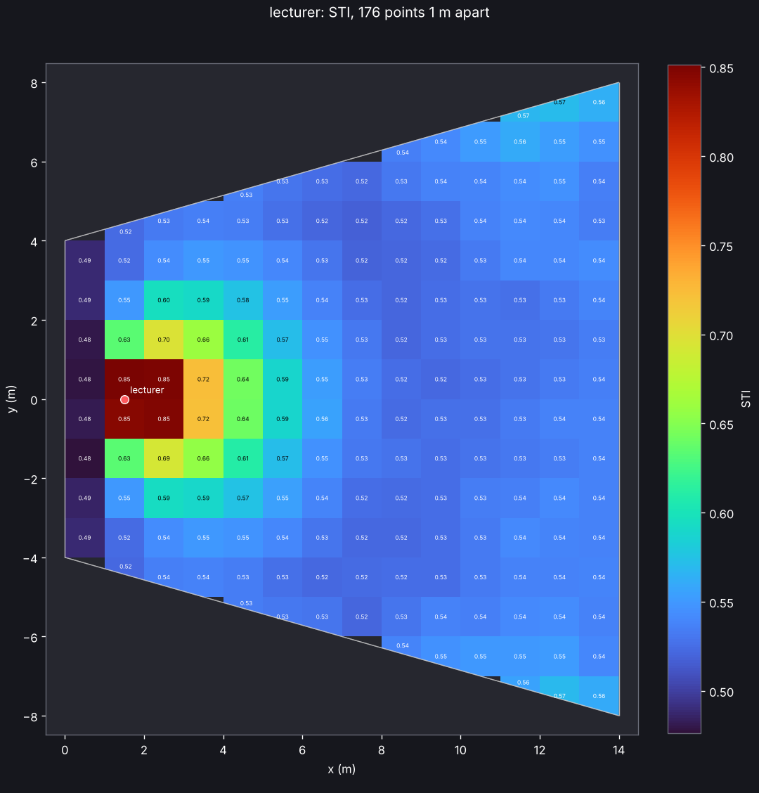

# Coverage maps

A coverage map gives the parameters on a grid over the audience area, the way CATT and
ODEON draw them: strength G and sound pressure level, C50, C80, D50, EDT, T20, T30 and
Ts per octave band, and the A-weighted level and speech transmission index; outdoors
also the level relative to free field, and the insertion loss of the buildings,
barriers or vegetation the map was also run without (see
[Results outdoors](outdoor.md#results-outdoors)).

```sh
acoustic-spaces map examples/lecture_hall/scene.yaml --plot sti.png --parameter sti
acoustic-spaces map examples/concert_hall/scene.yaml --spacing 0.5 --json map.json \
    --screenshot c80.png --parameter c80 --band 1000
```



The map covers the surfaces named in `coverage.surfaces` (by default those whose names
contain "audience", else the floor; [outdoors](outdoor.md), the ground, leaving out the
points inside buildings) with square columns `spacing` metres wide, with a point at the
listening `height` above the surface in each (above its top, when a slab's underside is
in the same group); a balcony over the stalls gets a second level of points. Columns
along a slanted wall keep the part over the surface. A model that holds several rooms is
mapped in every room (with the sound that passes between them), and a column that a wall
between two rooms crosses gets a point on each side that holds at least a fifth of it.
The early part is exact at every point, as at a listener. The late part comes from one
ray tracing run per source in which every ray adds its path length through a slab of air
around each point (a track-length estimate, with a vector reflection's specular share on
a leg of its own, as at a listener: see [Simulation](simulation.md#scattering)),
counting only the rays in the point's room and only the part of the slab in its air:
what lies past a wall, in the next room or inside a building is left out. A map of
hundreds of points costs about as much as a few listeners: the concert hall example (480
points, two sources, 50,000 rays per band) takes under two minutes on 4 cores. In the
shoebox example, full simulations at three of the map's points give G within 0.3 dB of
the map and T30 within 5 % from 125 Hz to 4 kHz (the tests, with one seed); at other
points and seeds T30 strays further now and then, as both carry the late rays' noise.
With the statistical late method each point gets the late part a listener there would,
and G agrees within 0.01 dB.

Each source radiates its sound power per band (its `level_db`, `spectrum`, `gain_db`
and `eq_db`; see [Sources and directivity](scenes.md#sources-and-directivity)), which sets the
sound pressure levels. The STI (IEC 60268-16, with the male weighting, or the female
one for a `speech_female` source) takes that as the speech level, with auditory masking
and the reception threshold, and `noise_db` as the background noise. In the map of all
sources together, each source's sound arrives its `delay_ms` later (the `town_hall_pa`
example's `delays.py` maps its sound system with and without its delay loudspeakers).
Line and surface sources add up the sound of their points and arrays radiate their
beams, as they do at a listener (the `workshop` example maps the A-weighted noise of
both). `map` prints the range of every parameter, `--plot` saves the top view,
`--screenshot` the 3D view and `--json` every value of every point. Settings live in
the scene:

```yaml
coverage:
  surfaces: [audience_floor]   # default: names with "audience", else "floor"
  height: 1.2                  # listening height above the surface, m
  spacing: 1.0                 # distance between points, m
  rays: 50000                  # rays per source and band (default: simulation.late.rays)
  noise_db: 35                 # background noise for the STI, dB SPL (or one per band)
  spread: false                # also every value's uncertainty (see Uncertainty below)
```

From Python:

```python
from acoustic_spaces.engine import coverage_map
from acoustic_spaces.viz import plot_map, show_room

result = coverage_map("examples/concert_hall/scene.yaml")
both = result.get()  # all sources together; result.get("soloist") for one
c80 = both.value("c80", band=4)  # one value per point, 1 kHz
plot_map(both, "c80.png", parameter="c80", room=result.room)
show_room(result.room, coverage=both, parameter="sti")
```

Maps do not run the wave solver: whatever `simulation.wave` says, their lowest bands
come from the early paths, in pressure up to `simulation.early.coherent_max_band_hz`
(see [Low frequencies](simulation.md#low-frequencies-early-reflections-in-pressure)),
and the rays. For a small room's modes, put listeners where they matter and run them
with the [wave solver](simulation.md#low-frequencies-the-wave-solver). Nor do maps give
ISO 3382-3's quantities for open-plan offices (D2,S, Lp,A,S,4m, the distraction distance
rD and the privacy and comfort distances); listeners on a line from an omnidirectional
source with the standard's speech spectrum and level give the A-weighted level and the
STI they are read from (see [Simulation](simulation.md)).

## Uncertainty

With `spread: true` in the map's settings (`--spread` on the command line,
**Uncertainty** on the coverage map's page in the editor) every value of the map gets
the standard uncertainty that the materials' absorption uncertainty leads to (see
[Materials](scenes.md#materials)), an insertion loss and the long-term levels too. A map
keeps no response at its points to re-weight, as a listener's spread does, so it follows
the law of propagation of uncertainty (GUM, JCGM 100:2008, 5.1.2): for each material
with an uncertainty the map is traced twice more, on the same points and with the same
rays, with its absorption one standard uncertainty up and down. Half the difference of
the two maps is that material's part, and the root of the sum of the parts' squares the
standard uncertainty of each value at each point. A map with M such materials takes
2 M + 1 times as long.

`map` prints the least, the median and the largest standard uncertainty of every
parameter beside its range, and `--json` writes every point's with each material's part
(`uncertainty` in each map). `--show standard` draws the standard uncertainty in place
of the value, `--show low` or `high` an end of the 95 % interval and `--show at_least`
or `at_most` a one-sided bound (of 95 %, or of `simulation.uncertainty.one_sided`); the
editor's map panel has them under **Show**. The interval and the bounds take the result
as normal about the map's value: the value less and plus 1.96 standard uncertainties, or
1.645 for a one-sided 95 %, held to what the parameter can be. From Python,
`acoustic_spaces.engine.sensitivity.coverage_map(scene, spread=True)` gives each map its
`spread`, and the map's `spread_of(parameter, part, band)` the values that `--show`
draws.

The law is first order, so where a value bends over a material's uncertainty the
standard uncertainty comes out low. In a box of 8 by 6 by 3.5 m, against the Monte Carlo
of a listener at one of the map's points (2 000 draws): with standard uncertainties of
0.02 to 0.03 on its three materials every parameter's is within 7 %; with a tolerance of
0.1 on each, the A-weighted level's is 4 % low, the STI's 3 %, T30's up to 13 % and, at
63 Hz, EDT's and Ts's a quarter. The rays' random error is not counted, as it is in a
listener's spread, nor what a listener's spread leaves out.
