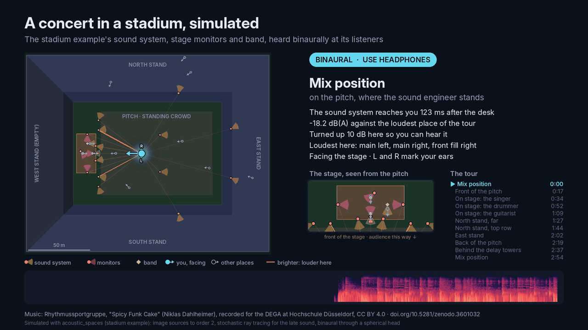

# Demos

Three demos run dry recordings through example scenes, mix them at the scenes' listeners
and make a video of the result. Each shows one space and one kind of music: a symphony
orchestra on the stage of a shoebox concert hall, a choir and an organ in a reverberant
stone church, and a band with its sound system and stage monitors in a stadium. None of
them stands for what the simulator does elsewhere; the [examples](examples.md) cover far
more.

The scripts come with the examples: `acoustic-spaces examples --copy . NAME` copies them
with the scene. The recordings do not: they are other people's work under their own
licences, named below with each demo, and the church and stadium scripts download them
from where their authors publish them. The videos need [ffmpeg](https://ffmpeg.org) on
the PATH and the pictures Pillow (the `viz` extra brings it). The mixes are binaural:
use headphones. The videos of the three demos are in one
[playlist](https://www.youtube.com/playlist?list=PLWz5JDREfod8).

## An orchestra in the concert hall

[](https://www.youtube.com/watch?v=c0-5F-iNhIE)

[The video](https://www.youtube.com/watch?v=c0-5F-iNhIE) plays the first movement of
Beethoven's 8th symphony from the TU Berlin's anechoic recording (one of the [dry
recordings to try](spatial-audio.md#dry-recordings-to-try)) as heard from the middle of
the stalls of the concert hall example, binaurally (use headphones). Each of the 61
tracks is one source on the stage, in German seating: violins on both sides of the
conductor, the winds and brass on risers, every player facing the conductor with a
directivity that narrows above 1 kHz, horn bells pointing back. The `orchestra` example
is that scene, with four seats from the conductor's podium to the back of the hall, and
the scripts that made the video:

```sh
acoustic-spaces examples --copy . orchestra && cd orchestra
unzip movement1.zip -d movement1  # from https://doi.org/10.14279/depositonce-6729.2
acoustic-spaces simulate scene.yaml --out results
bash auralize.sh results movement1/anechoic stalls-middle binaural
python make_images.py --seat stalls-middle --movement 1  # cover, seating, thumbnail
bash make_video.sh beethoven8_movement1_stalls-middle.binaural.wav  # needs ffmpeg
```

`auralize.sh` maps each source to its track and calls `auralize`; the mix is
normalized to -1 dBFS. All sources have the same power, so the balance between the
instruments is the recording's own. `make_images.py` draws the pictures with Pillow
(`viz` extra) and `make_video.sh` puts a scrolling spectrogram of the mix under the
cover. Movements 2 and 4 work the same way.

**Recording.** Böhm, Ackermann and Weinzierl, *Beethoven, Symphony No. 8*, TU Berlin,
<https://doi.org/10.14279/depositonce-6729.2>, CC BY 4.0: movements 1, 2 and 4, 61 mono
tracks each (zips of 590 to 740 MB), downloaded by hand.

## A choir and an organ in the church


`church_demo.py` puts a choir of 19 real singers in front of the altar of the `church`
example and the organ in the gallery over the entrance, and plays the round "Dona nobis
pacem" three times: the organ alone on full stops, the choir alone, then the choir with
the organ on quiet stops, slowing into a held last chord and the church's reverberation
(1:26 in all). It mixes the piece at six places and makes a video that tours them: under
the organ at the back, along the south wall, the front pews, the conductor, the back row
of the choir and the middle of the nave.

```sh
acoustic-spaces examples --copy . church && cd church
python church_demo.py music     # 19 takes, their annotations, 27 organ samples (about 100 MB)
python church_demo.py scene     # scene_choir.yaml: the church with the choir and the organ
acoustic-spaces simulate scene_choir.yaml --out results_choir --output binaural   # 10-20 min on 4 cores
python church_demo.py feeds     # demo/feeds: one WAV per singer and per side of the organ
python church_demo.py render    # demo/seats: the whole piece at each listener
python church_demo.py video     # demo/tour.wav, demo/stills, demo/tour.mp4, demo/thumbnail.png
```

Options: `--tour nave_back:0,conductor:25,...` (listener:start in seconds),
`--listeners a,b` for `render`, `--format` for another output the simulation wrote
(`ambix3`, `5.0`, ...; the video takes its first two channels), `--no-mp4` for the audio
and stills only. Everything goes to `./demo` (`--work`).

- **The choir.** Each singer sang the tune alone in a recording booth, at their own tempo
  and a little off pitch here and there. `feeds` moves each take towards the tune (each
  singer's own offset fully, 60 % of each note's error) and warps it in time so that every
  note starts on the beat, from the dataset's note annotations; after that the voices
  start within about 40 ms of each other and sit about 16 cents from the tune on average,
  as a real choir does. The women stand in the front row, the men on a step behind them,
  0.6 m apart, facing the nave (sources with a voice-like pattern: omni in the bass,
  cardioid from 2 kHz), 88 dB sound power each.
- **The organ.** A four-part harmonisation of the tune, written for the demo, played from
  a sampled church organ: an open 8' with the same rank an octave up as a 4' and the pedal
  with its 16' for verse 1, quiet stops 11 dB down for verse 3. As in a real organ, each
  division's pipes stand in two halves, C side and C# side, so the organ is four sources
  across the gallery, 9.5 m up for the manual and 8.6 m for the pedal towers, facing the
  nave (105 dB for each half of the manual, 102 dB for each pedal tower).
- **How loud.** The responses are per unit of sound power and `auralize` scales each
  source by its `level_db`; the feeds are brought to one gated RMS where they play
  loudest, so the balance between the singers and the organ is the scene's.
- **One gain for all listeners.** `render` scales the six mixes by one gain (the loudest
  peak at -1 dBFS), so the level differences between places are the simulation's.
- **The cuts** fall where the music breathes (the rest in the middle of the tune, the gaps
  between verses), with a 1 s crossfade. Time is the performers': a listener far from the
  choir hears it up to 80 ms later than one near it, as in the church.
- **The pictures** draw the church from above and from the side, each listener with an
  arrow the way they face and the current one with L and R at its ears, the sources as
  dots with see-through cones the way they face, and lines from each source playing to
  the listener, brighter where it is louder. The caption gives the clarity C80 there.

**Limits.** A "virtual choir": the takes were recorded separately, so the singers do not
hear each other or the room; their timing and tuning are evened out by the script, not by
listening. The organ samples hold a little of the room they were recorded in, and the
organ is four points, not a case full of pipes. The model is the example's: the floor
plan raised 18 m, with no gallery floor under the organ and no columns or furniture;
`ir_length_s` is raised to 9 s, as the bass rings for nearly ten. Binaural is through the
spherical head model; `simulate --hrtf file.sofa` uses measured HRTFs instead.

**Recordings and licences.** `music` writes these credits to `demo/music/SOURCES.txt`.

- The singers: Wilkins, Seetharaman, Wahl and Pardo, **VocalSet: A Singing Voice
  Dataset** (ISMIR 2018), <https://doi.org/10.5281/zenodo.1442513>, **CC BY 4.0**. The
  straight-tone takes of "Dona nobis pacem" of 19 of its 20 professional singers, close to
  a cardioid microphone in a booth (mono, 44.1 kHz). The countertenor is left out: the
  annotation of that take belongs to a longer take than the one in the archive.
- Where the notes are: Faghih and Timoney, **Annotated-VocalSet** (Applied Sciences
  12(18), 2022), <https://doi.org/10.5281/zenodo.7061507>, **CC BY 4.0**: the start, end
  and mean F0 of each sung note. Its ground truth for the fourth note says F4; the score
  and the singers have G4, which the demo uses. Both archives are read by HTTP range
  requests, so only the files needed (about 36 MB) are downloaded, not the 2.5 GB.
- The organ: the Versilian Community Sample Library's pipe organ, sampled by Simon
  Dalzell of Ivy Audio, Versilian Studios, <https://github.com/sgossner/VCSL> (pinned
  commit), **CC0 1.0**, credited as its notes encourage. Sampled every minor third; each
  note comes from the nearest sample, retuned by up to two semitones. The samples hold
  about a second of the room they were recorded in (30 dB down after 0.7 to 0.9 s); the
  release fade removes most of it.
- The music: "Dona nobis pacem" is a traditional round (public domain). The organ's
  harmonisation (`ORGAN` in `church_demo.py`) was written for the demo; use it freely.
- Changes, as CC BY asks to say: each take is retuned towards the tune by resampling,
  time-warped so that its notes start on the beat (WSOLA, which keeps the pitch), cut
  into two verses, brought to one level and mixed through the simulated church. The organ
  samples are evened out in level along the keyboard and cut at each key's release with a
  90 ms fade.

Whoever shares a render (the video on a video site, say) has to credit VocalSet, link
the licence and say that the takes were changed, for example:

> Singers: VocalSet by J. Wilkins, P. Seetharaman, A. Wahl, B. Pardo (CC BY 4.0,
> doi:10.5281/zenodo.1442513), with note annotations from Annotated-VocalSet by B. Faghih
> and J. Timoney (CC BY 4.0, doi:10.5281/zenodo.7061507); retuned, time-aligned and placed
> in a simulated church. Organ: VCSL pipe organ, sampled by Simon Dalzell (Ivy Audio),
> Versilian Studios (CC0). License: https://creativecommons.org/licenses/by/4.0/

No multitrack recording of a real choir could be used: Dagstuhl ChoirSet, the Choral
Singing Dataset, the ESMUC Choir Dataset and Cantoría are all for non-commercial use only
(CC BY-NC 4.0).

## A concert in the stadium



`stadium_demo.py` plays a song by a band on the stage of the `stadium_concert` example,
through its sound system and stage monitors, and mixes it at each of its 12 listeners.
The video plays the song once while the listener moves, on phrase boundaries, from the
mix position to the front of the pitch, onto the stage (singer, drummer, guitarist),
round the stands to the far end and back: ten of the listeners, as the song (3:15) has
eleven phrases.

```sh
acoustic-spaces examples --copy . stadium_concert && cd stadium_concert
python stadium_demo.py music     # the reference mix and 7 stems (WAV, 450 MB)
python stadium_demo.py band      # scene_band.yaml: the scene with the band on the stage
acoustic-spaces simulate scene_band.yaml --out results_band --output binaural   # ~3 min on 4 cores
python stadium_demo.py feeds     # demo/feeds: one WAV per loudspeaker and player
python stadium_demo.py render    # demo/seats: one binaural WAV per listener (~1 min each)
python stadium_demo.py video     # demo/tour.wav, demo/stills, demo/tour.mp4, demo/thumbnail.png
```

Options: `--tour mix_position:1,singer:0.5,east_stand:1` (listener:phrases of 8 bars,
0.5 for 4; the last one runs to the end), `--listeners a,b` for `render`, `--format` for
another output the simulation wrote, `--no-mp4` for the audio and stills only.

- **The band.** The example has loudspeakers only, so `band` adds the players as sources
  on the stage, in a group of their own: a drum kit beside the drummer (116 dB sound
  power, omni) playing the drums, the singer's voice (98 dB, subcardioid, facing the
  audience) playing the vocal, and an amplifier behind the guitarist (112 dB, cardioid,
  tilted up) playing the guitar, each from its own stem. On stage and near it the players
  are heard from where they stand; further out the sound system covers them.
- **Who plays what.** The sound system plays the stereo reference mix: the arrays, fills,
  towers and delays on the audience's left (-y) take the left channel, those on its right
  (+y; the scene's `*_left`, named from the stage) the right one, the subwoofers both.
  The monitors play mixes of the stems: the singer's wedges the vocal over the shouts, the
  keys and a little of the guitar, bass and drums; the drum fill the drums and bass with
  the vocal, guitar and keys under them; the side fills a stage mix with the vocal 3 dB
  up and the drums 20 dB down (the kit is loud on stage by itself).
- **How loud.** `feeds` brings every signal to the same gated RMS and then scales it by
  its `level_db` against the loudest's: the main arrays and subwoofers 0 dB, towers -2,
  delays -4 and -6, out-fills -4, side fills -12, front fills -18, wedges and drum fill
  -19. So the feed files are what each loudspeaker plays, and `render` runs `auralize`
  with `--equal-power`, so that the levels are applied once.
- **One gain for all listeners, then each stop turned up.** `render` scales the 12 mixes
  by one gain (the loudest peak at -1 dBFS), so the level differences between places in
  `demo/seats` are the simulation's: on stage, between the monitors and beside the drum
  kit, it is 7 to 20 dB(A) louder than in the audience, and the mix position is
  18 dB(A) below the singer's place. That is too much to hear both in one video, so the
  tour turns each stop up to the loudness of the loudest one and its caption gives the
  real level and how much it was turned up. Loudness is weighted as loudness meters
  weigh it (K, ITU-R BS.1770), which counts the subwoofers' bass that the A weighting of
  the levels all but leaves out: on the pitch the stops are turned up less than their
  dB(A) alone would say.
- **The cuts.** Every listener's mix is shifted earlier by the time the loudest sound
  takes to reach them (the peak of the energy of their responses, each weighted by how
  loud its source plays: 0.12 s at the mix position, 0.38 s at the far end), so the beat
  runs on across each 1 s crossfade; the caption gives that time. The stops last 8 bars,
  and as the song's first downbeat comes half a second in, each crossfade ends on a
  downbeat.

**Limits.** The band is three point sources at typical sound powers, not measured
instruments; the bass, keys and brass on stage come only through the monitors and the
sound system, and there is no crowd noise. The reference mix and the stems are a
finished studio production, reverberation and all, so a little of the studio plays in
the stadium too. Binaural is through the spherical head model. Some listeners stand
nearer the arrays than their far-field patterns hold, which the scene's arrays handle by
adding up their boxes one by one (`near_field.py` in the example puts numbers on it).

**Recording and licence.** "Spicy Funk Cake" by the Rhythmussportgruppe, a nine-piece
funk band (guitar, drums, bass, keys, saxophone, two trumpets, trombone and voice;
composed by Niklas Dahlheimer, sung by Juliane Blum; 110 BPM, 3:15), recorded in 2017
for the sound database of the DEGA (German Acoustical Society) at Hochschule
Düsseldorf's studio, <https://doi.org/10.5281/zenodo.3601032>, **CC BY 4.0**. `music`
reads the reference mix and the seven processed stems (drums, bass, guitar, keys, brass,
vocal, shouts; stereo WAV, 24-bit, 48 kHz) out of the release's 3.5 GB archive by HTTP
range requests, so only those 450 MB are downloaded, and writes the credit to
`demo/music/SOURCES.txt`. The reference mix plays through the sound system; the stems
play through the monitors and the band. The stems start 58 ms before the reference mix;
`feeds` lines them up with it by cross-correlation.

Whoever shares a render has to credit the band and the DEGA, link the licence and say
what was changed, for example:

> Music: "Spicy Funk Cake" by Rhythmussportgruppe (composed by Niklas Dahlheimer),
> recorded for the DEGA at Hochschule Düsseldorf, CC BY 4.0, doi:10.5281/zenodo.3601032;
> the mix and its stems played through a simulated stadium sound system and stage and
> rendered binaurally. License: https://creativecommons.org/licenses/by/4.0/

Other band multitracks were left out: Cambridge-MT's are for education only, MedleyDB's
and MUSDB18's non-commercial or restricted, and the OnAir Music dataset's (CC BY-SA 4.0)
share-alike clause would bind the renders too.
