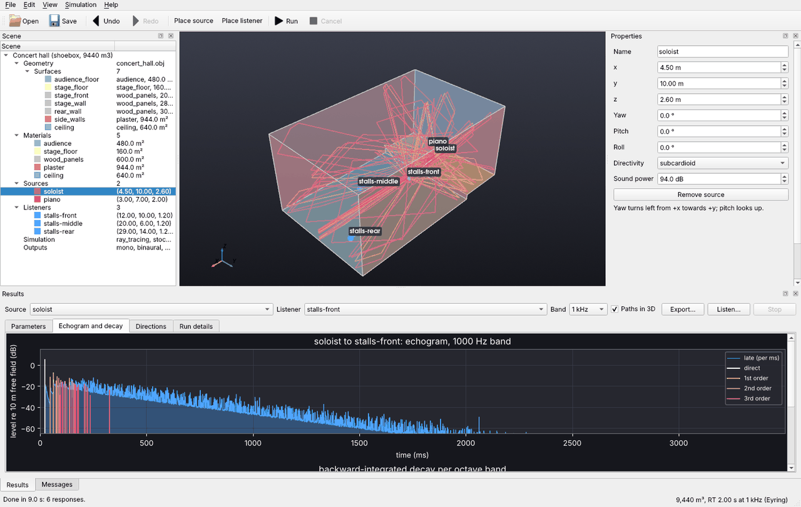
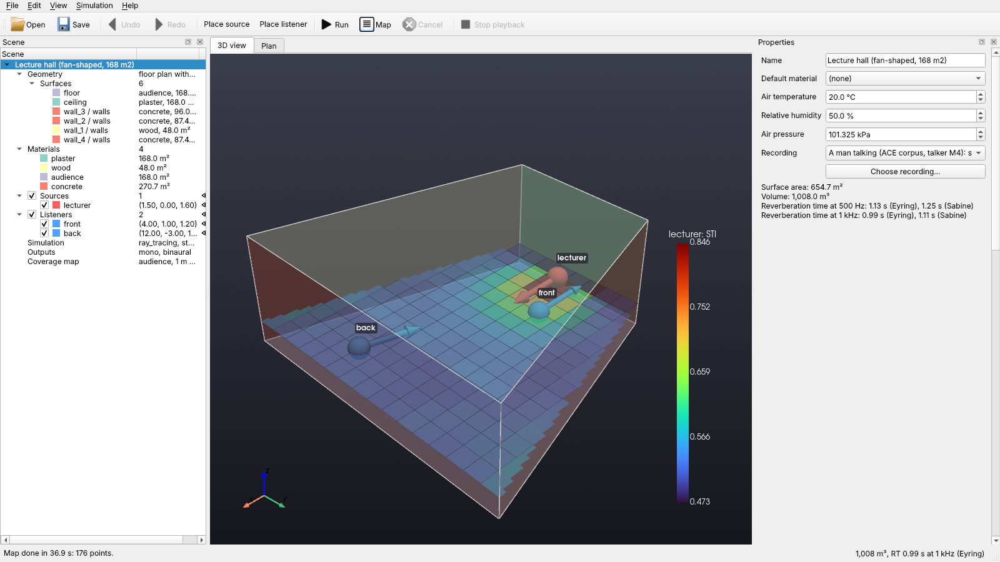
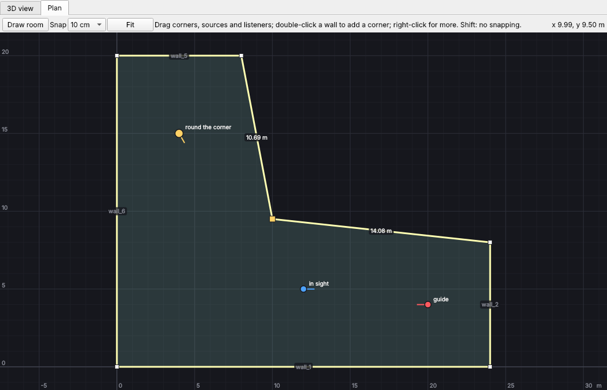

# Graphical editor

The editor needs the `gui` extra: `uv sync --extra gui` in a source checkout, then
`uv run acoustic-spaces`, or a release wheel installed with `[gui]` after its file
name.

```sh
acoustic-spaces                                   # alone, it opens the editor on a new box room
acoustic-spaces edit examples/studio/scene.yaml   # or open a scene file
```

`acoustic-spaces` with no command opens the editor; `acoustic-spaces -h` lists the
commands. Without the `gui` extra, or with no display to show the editor on (over SSH,
say), it prints the short usage instead, with the reason.



The editor works on the same scene files as the command line. Rest the mouse on any
label, field, button or column header for a tip that says what it means, with its unit:
the rows of the Results table say what each parameter measures, and the band columns
which frequencies each octave band holds.

- **File > Open example** opens the bundled rooms. Saving one asks where to keep your
  copy and takes its model file along; an example whose model needs an extra that is not
  installed is greyed out, and its tip says how to install it. **New box room**, **New
  room from a floor plan** and **New from model file** (OBJ, STL, PLY, OFF, glTF, DXF,
  IFC, Collada or SketchUp) start from scratch. For an IFC model, the geometry's form
  picks one room of the building (**IFC room**) or every element.
- The **Plan** tab, next to the 3D view, shows the room from above and draws rooms (see
  below).
- The **scene tree** lists the geometry and its surfaces, the materials, sources,
  listeners, simulation settings and output formats. Selecting an entry, there or by
  clicking it in the 3D view, shows its form under **Properties**. Every change is
  checked against the scene schema; a refused change says why under **Messages**, and
  every change can be undone.
- **Place source** and **Place listener**, then click a surface: on a floor the new
  point stands at ear or mouth height, on a wall or ceiling it goes half a metre into
  the room. In the plan, the click places it above the floor there. Sources and
  listeners move by dragging, in the 3D view or the plan, and keep their height above
  the floor (up a raked floor too); with Shift in the 3D view they move up and down.
  Surfaces take materials from their form, or from a new material picked from the
  database (**Edit > Add material from the database**) or from a CATT-Acoustic or ODEON
  library (**Edit > Add material from a library**).
- A material's form sets its absorption and scattering per band (24 columns when it
  has third-octave data), whether it **Lets through** nothing, part of the sound (with
  its sound reduction index per band in the table) or everything (an opening), and
  **Audience seating** for the seats (see
  [Walls, doors and openings](scenes.md#walls-doors-and-openings)).
- The editor does not draw or edit walks (`walk` in a listener's or source's entry,
  see [Walkthroughs](spatial-audio.md#walkthroughs)), but keeps them when it saves.
- The scene tree's **Simulation** entry has the settings of
  [Simulation](simulation.md): the early part's method, highest order, rays,
  diffraction and **In pressure up to**; the late part's method, rays per band,
  reception, ray splitting and **Run on** (*default*: this computer's default, the CPU
  unless the tune window made it *auto*; or the CPU, a GPU, both, or *auto*); the
  scattering model; the wave solver, its highest band and where it runs; **Performance** (CPU
  threads and the ray search tree); and, under **Response**, the length, the sample
  rate, octave or third-octave **Bands**, the early-to-late transition and the seed.
  The scene's own entry sets the air's temperature, humidity and pressure, and shows
  the volume and the rooms the model holds.
- **Simulation > Tune CPU and GPU…** times the CPU and the GPU on the open scene (or
  on the concert hall example when the scene cannot run as it is), as
  `acoustic-spaces tune` does (see
  [Tuning the devices for a computer](simulation.md#tuning-the-devices-for-a-computer);
  needs the `gpu` extra). It runs in the background, once per computer, and then shows
  the table of times with a check box, **Make auto the default on this computer**
  (ticked): scenes whose **Run on** is *default* then run on the fastest device found,
  in the editor and on the command line. When the open scene names its own devices, a
  second check box (ticked) sets its **Run on** back to *default* (an edit like any
  other, undone with Undo). **OK** saves the timings and these choices; **Cancel**
  saves nothing, not even the timings.
- **Simulation > Run coverage map** (F6) maps every source over the audience area (see
  [Coverage maps](coverage-maps.md#coverage-maps)). The **Coverage map** panel shows any parameter
  and band from above, for one source or all of them together, and **Map in 3D** lays
  it over the room; **Save** writes the picture or every map as JSON. The scene tree's
  **Coverage map** entry sets the surfaces, height, spacing, rays and background noise.

  

- **Simulation > Run** (F5) works in the background. The **Results** panel shows the
  ISO 3382-1 parameters, the echogram and decay curves and the arrival directions of
  any source and listener, and draws their reflection paths in the room. **Export**
  writes the same files as `simulate`; **Listen** plays a dry WAV file through the
  response on the sound card, binaurally (through the HRTF of the scene's binaural
  output if it has one, else a spherical head; needs the `measure` extra), or
  head-tracked with **Head tracking** ticked (see
  [Head tracking](spatial-audio.md#head-tracking)). While it plays, the status bar says
  so, with **Stop playback** (also in the toolbar and the Simulation menu, or Esc).
  Picking another source or listener (in the scene or the panel), or ticking **Head
  tracking**, plays on from the same point with that response, at the same level so
  the difference stays audible. What plays does not follow changes to the scene (moving
  a source, say): the status bar marks it as from before them, and Listen again plays
  them.
- Change a material's absorption after a run and the results follow at once: the run
  counted each ray's reflections off each material, and is re-weighted for the new
  values instead of traced again (as `calibrate` does). The panel says so; **Run**
  traces afresh. Other changes, and runs with the statistical method, third-octave
  bands or the wave solver, leave the results marked out of date until the next run.
- A source's form sets its **Shape** (a point, a line or a surface, with its length,
  height and spacing), its directivity (a pattern, a SOFA or CSV file of measured data,
  or an array file), its sound power per band, its **Spectrum** (flat, or male or female
  speech) and the **Gain**, **Equalizer** and **Delay** of its feed. It shows the
  directivity index per band, opens the polar patterns, and the selected source shows
  its balloon in the 3D view.
- The status bar keeps the volume and the Eyring reverberation time at 1 kHz up to date
  as you edit, with the number of problems in red.
- **Messages** shows warnings (leaks, results from before the latest changes, dropouts
  while playing) in amber and errors (a refused change, a run that cannot start or
  failed, a file that cannot be read or written) in red; so does the scene's own form
  for its problems and warnings.
- When a run, a coverage map or a tuning ends while another window is in front, the
  editor's entry in the taskbar flashes (on macOS, its Dock icon bounces). Nothing pops
  up: the results come to the front and **Messages** says how it went.
- **View > Show leaks** traces rays from the sources and shows where they escape from a
  model that is not closed: its open edges, the escaping rays and a marker on each gap,
  with the report in the messages (see [Finding leaks](scenes.md#finding-leaks)). It
  traces again when the geometry, the materials or the sources change.
- **View > Language** shows the editor and the command line in English, Spanish or
  Catalan, or in the computer's language, from their next start (see
  [Language](getting-started.md#language)). Numbers in the editor follow the
  computer's regional settings: 0,85 where the decimal mark is a comma, with lists of
  numbers (an equalizer's gains) apart by semicolons there.
- **File > Export to Blender** writes the room with the reflection paths on show, and
  **File > Export particle animation to Blender** the sound particles leaving the
  selected source (see below).

## Drawing rooms



The **Plan** tab shows the room from above on a grid in metres. In a floor plan or box
room every corner is a handle:

- Drag a corner to move it; the two walls it joins show their lengths as it moves. A
  box becomes a floor plan with the same walls, so its materials stay where they were.
- Double-click a wall to add a corner there, or right-click a corner to remove it.
  Clicking a wall selects that surface, to give it a material.
- **Draw room** (or **Edit > Draw floor plan**) draws a new floor plan: click its corners
  in turn and close it on the first one, with a double-click or with Enter. Backspace
  takes the last corner back and Esc stops. The new room keeps the old one's height
  (change it under **Geometry**). Sources and listeners that would end up outside move
  inside, keeping their arrangement. Over a model file, the editor asks before
  replacing it.
- Corners and points snap to the grid chosen under **Snap** (10 cm unless changed);
  hold Shift to place them freely. A move that would make walls cross is refused, with
  the reason under **Messages**.
- The wheel zooms, dragging empty space pans and **Fit** shows the whole room again.

Rooms from model files show their outline, and their sources and listeners move the
same way. Every change can be undone.

## Exporting to Blender

`acoustic-spaces export` writes a scene as glTF 2.0 (`.glb`) for Blender or another 3D
tool; the editor does the same from its File menu.

```sh
acoustic-spaces export examples/concert_hall/scene.yaml hall.glb              # the room
acoustic-spaces export examples/concert_hall/scene.yaml hall.glb --paths      # + reflection paths
acoustic-spaces export examples/concert_hall/scene.yaml hall.glb --particles  # + particle animation
```

In Blender, use **File > Import > glTF 2.0 (.glb/.gltf)** and pick the file. The axes are
the scene's (+z up, metres).

- Each surface is an object named as in the editor, with a see-through material per
  scene material; the material's custom properties hold its absorption and scattering
  per octave band. Sources (red) and listeners (blue) are spheres turned the way they
  face, with an arrow along the aim.
- `--paths` adds the early reflection paths from `--source` to `--listener` up to
  `--max-order`, as long after the direct sound as a simulation keeps them
  (`transition_ms`, or the mixing time with the statistical late method, see
  [Simulation](simulation.md)), one object of edges per order. Edges do not render: to
  render them, use Object > Convert > Curve and give the curve a bevel depth.
- `--particles` adds the particles of `animate` as small spheres that move with them and
  shrink with their level, gone 60 dB down. The animation runs 40 times slower than the
  sound (`--slow-motion`): the default 100 ms take 4 s, 96 frames at 24 fps. If the
  timeline ends sooner, set its end frame, then press play. With the default 1000
  particles (`--count`) the file is about 3 MB.
