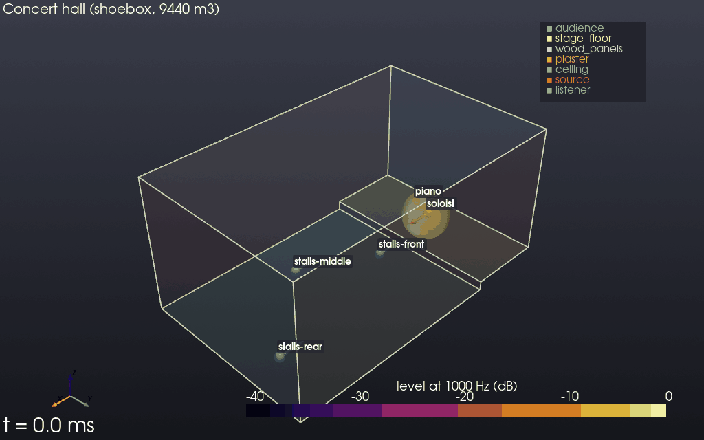
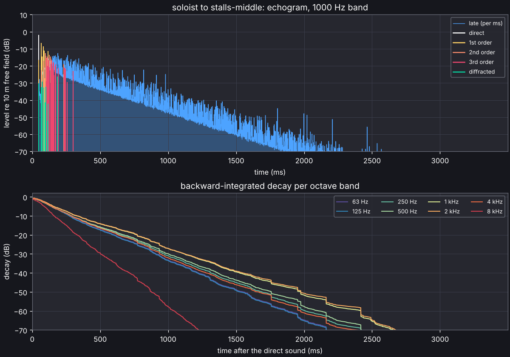
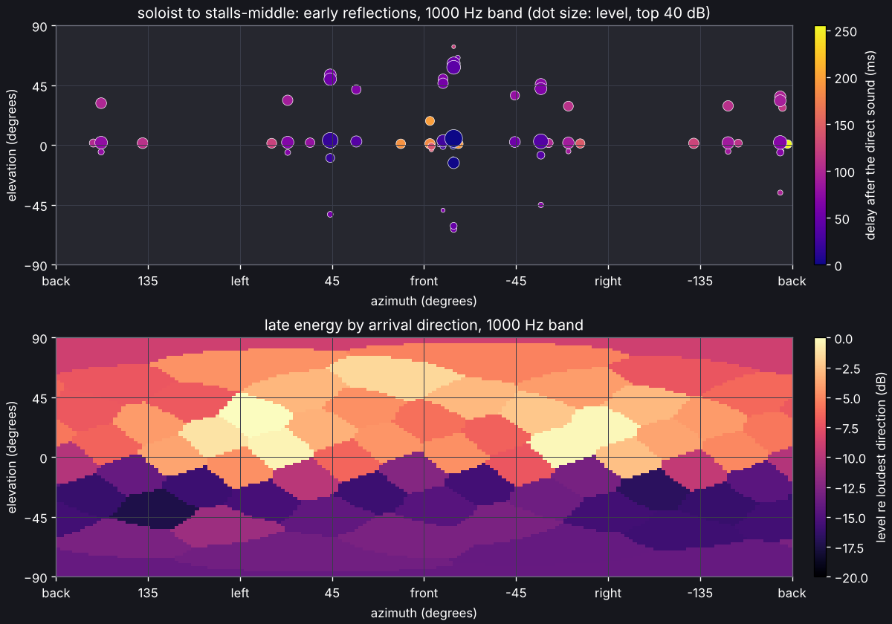

# Getting started

## Install

Every release has wheels for Linux, macOS and Windows (CPython 3.10 to 3.14), with the
compiled core inside, on its
[GitHub release page](https://github.com/naelolaiz/acoustic_spaces_simulator/releases):
`pip install` the wheel for your platform, with the extras below in brackets after its
file name if you want them, such as
`pip install "acoustic_spaces-2.0.0-cp312-cp312-win_amd64.whl[viz,gui]"`. The package is
not on PyPI, so `pip install acoustic-spaces` does not find it; between releases, install
from source.

The documentation (these pages, the validation report and an API reference generated
from the docstrings) builds with Sphinx; see
[CONTRIBUTING.md](https://github.com/naelolaiz/acoustic_spaces_simulator/blob/main/CONTRIBUTING.md).


## Install from source

Requirements: Python 3.10+, a C++17 compiler and CMake 3.18+.

```sh
git clone https://github.com/naelolaiz/acoustic_spaces_simulator
cd acoustic_spaces_simulator
```

With [uv](https://docs.astral.sh/uv/), `uv sync` builds the package into `.venv` together
with the test tools (pytest, ruff), and `--extra` adds the optional parts:

```sh
uv sync --extra viz                    # viz: the 3D view (PyVista), plots, MP4 videos
uv sync --extra viz --extra measure    # measure: sounddevice, for sweeps and playback
uv sync --extra gui                    # gui: the graphical editor (Qt, PySide6)
uv sync --extra gpu                    # gpu: the wave solver on a GPU (wgpu, WebGPU)
uv sync --extra ifc                    # ifc: BIM models (IFC files, IfcOpenShell)
uv sync --all-extras                   # everything, with sofa (h5py), sketchup and docs
```

`uv sync` installs exactly what it is asked for, so name every extra each time. It
rebuilds the compiled core when the C++ sources change.

With pip, in a virtual environment:

```sh
python -m pip install -e ".[dev,viz]"     # viz adds the 3D view (PyVista) and videos
python -m pip install -e ".[measure]"     # sounddevice: sweeps, real-time playback
python -m pip install -e ".[sofa]"        # h5py, to read HRTFs from SOFA files
python -m pip install -e ".[sketchup]"    # openskp, to read SketchUp files (experimental)
python -m pip install -e ".[ifc]"         # IfcOpenShell, to read IFC files (BIM models)
python -m pip install -e ".[gui]"         # the graphical editor (Qt, PySide6)
python -m pip install -e ".[gpu]"         # wgpu: the wave solver on a GPU (WebGPU)
```

Check the installation and look at the example scene. The commands run in the environment
you installed into: activate it (`source .venv/bin/activate`, or `.venv\Scripts\activate`
on Windows), or with uv put `uv run` in front of each.

```sh
acoustic-spaces info
acoustic-spaces validate examples/shoebox/scene.yaml   # errors exit with status 1
acoustic-spaces validate examples/leaky_classroom/scene.yaml --leaks  # where rays escape
acoustic-spaces inspect examples/shoebox/scene.yaml    # geometry, materials, RT estimates
acoustic-spaces view examples/shoebox/scene.yaml       # 3D window; --screenshot out.png
acoustic-spaces view examples/shoebox/scene.yaml --paths --max-order 2  # reflection paths
acoustic-spaces view examples/gallery/scene.yaml --paths --listener "round the corner"  # diffraction
acoustic-spaces animate examples/lecture_hall/scene.yaml               # sound particles
acoustic-spaces export examples/concert_hall/scene.yaml hall.glb --paths --particles  # Blender
acoustic-spaces materials carpet                       # search the material database
acoustic-spaces directivity hypercardioid --plot polar.png  # a source directivity
acoustic-spaces simulate examples/shoebox/scene.yaml --out results --plot
acoustic-spaces map examples/lecture_hall/scene.yaml --plot sti.png --parameter sti
python -m pytest                                       # the test suite
```

`animate` shows sound particles leaving a source and spreading through the room, each
reflecting off the walls (turned from the specular direction by as much as the surface
scatters; see [Scattering](simulation.md#scattering)) and losing the absorbed share of its energy at
every hit, coloured by level or by reflection order. It opens a window with a time
slider, or saves a GIF (`--out particles.gif`) or an MP4 video (`--out particles.mp4`).



`simulate` writes impulse responses for every source and listener in each format the
scene's `outputs` list (`results/talker__seat-a.wav` in mono, `.binaural.wav`,
`.ambix3.wav`, `.5.0.wav` and so on, 32-bit float), `parameters.json` with the room
acoustic parameters of every response per octave band, its STI and its echo criteria,
and with `--plot` an echogram, decay curves and a map of arrival directions as PNG.
`--output ambisonics:3` (repeatable) picks formats on the command line. It prints the
parameters as it goes:

```
talker -> seat-a: direct sound at 11.7 ms, 63 early paths
             63 Hz  125 Hz  250 Hz  500 Hz   1 kHz   2 kHz   4 kHz   8 kHz
EDT (s)      0.691   0.506   0.695   0.738   0.869   0.981   0.932   0.604
T30 (s)      0.713   0.860   0.936   1.202   1.265   1.278   1.156   0.769
C80 (dB)       6.0     8.9     6.2     6.3     5.9     5.5     5.7     8.6
G (dB)        22.2    24.5    20.8    20.0    18.7    17.9    17.0    15.7
LF           0.184   0.089   0.302   0.302   0.330   0.344   0.345   0.329
IACC_E       0.988   0.991   0.779   0.513   0.391   0.635   0.558   0.478
T30_X (s)    0.712   0.792   0.968   1.177   1.239   1.231   1.128   0.751
T30_Z (s)    0.711   0.816   0.874   1.077   1.195   1.204   1.134   0.755
...
SPL 79.0 dB(A); per octave band, dB: 76.2 78.5 74.8 73.9 72.7 71.8 71.0 69.6
STI 0.66 (STIPA 0.66), echo criterion 0.73 for speech (echo above 1.0), 0.70 for music (echo above 1.8)
```

With `--plot`, each response gets an echogram (the late energy per millisecond and the
early paths by order) with the decay curves of every band, and a map of where the sound
comes from:





From 500 Hz up, T30 comes out two to four and a half times the Sabine and Eyring
estimates that `inspect` prints, and that is the room, not a fault. Its absorption sits
on the ceiling and the carpet while the walls are hard and smooth (scattering 0.05), so
sound running between the walls meets little absorption and dies away slowly. Sabine and
Eyring assume a diffuse field, where sound meets every surface alike; `inspect` says
when a room is far from that and adds the Arau-Puchades estimate, which allows for
absorption that faces one way. With every surface fully diffusing, the same room decays
in Eyring's 0.37 s at 1 kHz; with every surface scattering 0.3, in about 0.53 s. The
[validation report](validation.md)
checks both kinds of room.

From Python:

```python
from acoustic_spaces import Room, simulate
from acoustic_spaces.audio import write_wav
from acoustic_spaces.engine import early_paths, trace_particles
from acoustic_spaces.spatial import Ambisonics, Binaural, Loudspeakers
from acoustic_spaces.viz import animate_particles, plot_directions, plot_response, show_room

room = Room.from_yaml("examples/shoebox/scene.yaml")
print(room.report.summary())
print(room.problems(), room.warnings())
print(room.reverberation_time("eyring"))  # per octave band, seconds
show_room(room, paths=early_paths(room, max_order=2))
animate_particles(room, trace_particles(room, duration=0.1), "particles.gif")

result = simulate(room)
response = result["talker", "seat-a"]
print(response.parameters().table())
write_wav("talker__seat-a.wav", response.impulse_response(48_000), 48_000)
plot_response(response, "talker__seat-a.png")

binaural = response.spatial_impulse_response(Binaural(), 48_000)  # (samples, 2)
ambix = response.spatial_impulse_response(Ambisonics(order=3), 48_000)  # 16 channels
surround = response.spatial_impulse_response(Loudspeakers.layout("5.0"), 48_000)
plot_directions(response, "talker__seat-a.directions.png")
```
