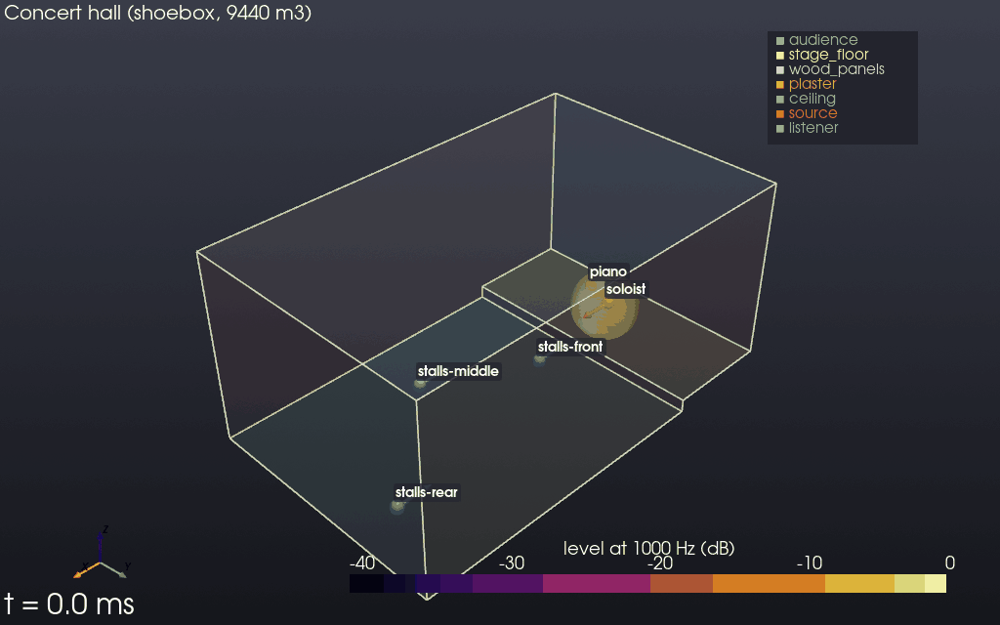
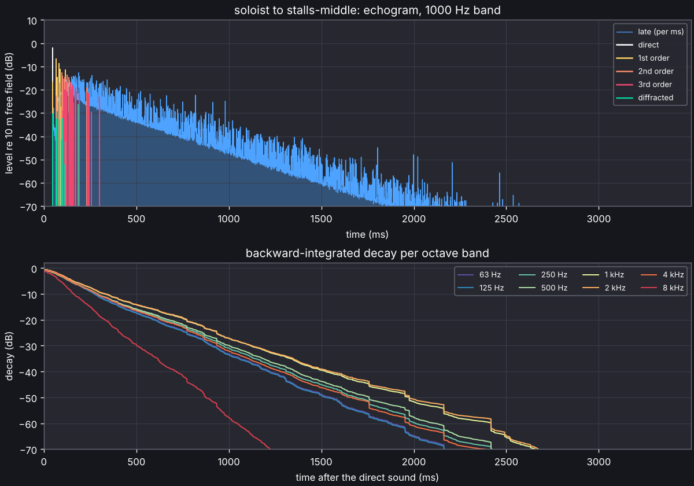
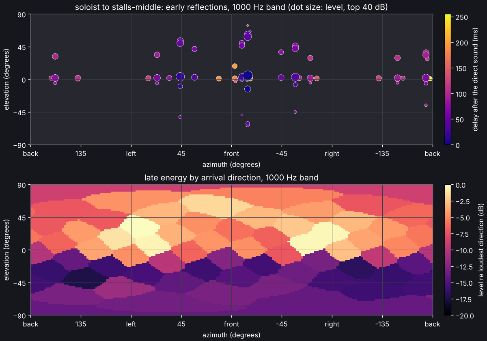

# Getting started

## Install

```sh
pip install acoustic-spaces                # simulation, rendering and the command line
pip install "acoustic-spaces[viz,gui]"     # with the 3D view and the graphical editor
pip install "acoustic-spaces[viz,gui,measure,sofa,gpu,ifc,sketchup]"  # every optional part
```

PyPI has wheels with the compiled core inside for Linux (x86-64), macOS (Apple silicon
and Intel) and Windows (x86-64), CPython 3.10 to 3.14; elsewhere pip builds the package
from source, which needs a C++17 compiler. Every
[GitHub release](https://github.com/naelolaiz/acoustic-spaces/releases) has the same
wheels, to `pip install` with the extras after the file name, such as
`pip install "acoustic_spaces-4.3.0-cp312-cp312-win_amd64.whl[viz,gui]"`. Between
releases, install from source.

### Extras

The extras in brackets add the optional parts:

| Extra | Adds | For |
| --- | --- | --- |
| `viz` | matplotlib, PyVista, imageio, imageio-ffmpeg | plots of responses and coverage maps (`--plot`), the 3D view (`view`, `--screenshot`), sound particles and walks as GIF or MP4 videos |
| `gui` | PySide6, pyvistaqt, PyVista, matplotlib | the [graphical editor](editor.md) |
| `measure` | sounddevice | the sound card: measuring a room with sweeps (`measure`, `devices`) and real-time playback (`play`, the editor's Listen) |
| `sofa` | h5py | HRTFs and source directivities from SOFA files |
| `gpu` | wgpu | the late stage's rays, the wave solver and `tune` on a GPU, through Vulkan, Metal or Direct3D 12 |
| `ifc` | IfcOpenShell, mapbox-earcut | BIM models: IFC files |
| `sketchup` | openskp | SketchUp files (experimental) |
| `test` | pytest, h5py | running the tests |
| `dev` | pytest, h5py, ruff, mypy, types-PyYAML | the tests, the linter and the type checks ([CONTRIBUTING.md](https://github.com/naelolaiz/acoustic-spaces/blob/main/CONTRIBUTING.md)) |
| `docs` | Sphinx, Furo, MyST-Parser, pypdf | building this documentation and its PDF |

A command or function that needs an extra that is not installed says which one to
install.

The documentation (these pages, the validation report and an API reference generated
from the docstrings) builds with Sphinx; see
[CONTRIBUTING.md](https://github.com/naelolaiz/acoustic-spaces/blob/main/CONTRIBUTING.md).


## Install from source

Requirements: Python 3.10+, a C++17 compiler and CMake 3.18+.

```sh
git clone https://github.com/naelolaiz/acoustic-spaces
cd acoustic-spaces
```

With [uv](https://docs.astral.sh/uv/), `uv sync` builds the package into `.venv` together
with the `dev` tools (pytest, h5py, ruff, mypy), and `--extra` adds the
[extras](#extras):

```sh
uv sync --extra viz --extra gui        # the 3D view and the editor
uv sync --all-extras                   # every extra in the table, docs included
```

`uv sync` installs exactly what it is asked for, so name every extra each time. It
rebuilds the compiled core when the C++ sources change.

With pip, in a virtual environment, the extras go in brackets after the `.`:

```sh
python -m pip install -e ".[dev,viz,gui]"   # the development tools, the 3D view and the editor
```

Check the installation and look at the example scene. The commands run in the environment
you installed into: activate it (`source .venv/bin/activate`, or `.venv\Scripts\activate`
on Windows), or with uv put `uv run` in front of each.

```sh
acoustic-spaces info
acoustic-spaces validate examples/shoebox/scene.yaml   # errors exit with status 1
acoustic-spaces validate examples/leaky_classroom/scene.yaml --strict  # warnings too
acoustic-spaces validate examples/leaky_classroom/scene.yaml --leaks  # where rays escape
acoustic-spaces inspect examples/shoebox/scene.yaml    # geometry, materials, RT estimates
acoustic-spaces view examples/shoebox/scene.yaml       # 3D window; --screenshot out.png
acoustic-spaces view examples/shoebox/scene.yaml --paths --max-order 2  # reflection paths
acoustic-spaces view examples/gallery/scene.yaml --paths --listener "round the corner"  # diffraction
acoustic-spaces animate examples/lecture_hall/scene.yaml               # sound particles
acoustic-spaces export examples/concert_hall/scene.yaml hall.glb --paths --particles  # Blender
acoustic-spaces materials carpet                       # search the material database
acoustic-spaces directivity hypercardioid --plot polar.png  # a source directivity
acoustic-spaces simulate examples/shoebox/scene.yaml --out results --plot
acoustic-spaces map examples/lecture_hall/scene.yaml --plot sti.png --parameter sti
acoustic-spaces walkthrough examples/gallery/scene.yaml guide=speech.wav --out walk.wav  # a visitor walks
acoustic-spaces demo my_room/scene.yaml                # each source plays its signal: a video of every listener
acoustic-spaces examples                               # the bundled rooms, and where they are
acoustic-spaces hrtf                                   # free HRTF sets to download, with their licences
acoustic-spaces pack examples/hillside/scene.yaml hillside.zip  # one zip to run elsewhere
acoustic-spaces tune --default auto                    # with the gpu extra: run on the fastest device here
python -m pytest                                       # the test suite
```

`pack` puts a scene and every file it names in one zip, which every command that reads
a scene takes in its place, to run on a server or a cloud job: see
[Running on another computer](remote.md).

Errors start with `error:` and warnings with `warning:`, in red and yellow in a
terminal (`NO_COLOR=1` turns colours off).

`animate` shows sound particles leaving a source and spreading through the room, each
reflecting off the walls (turned from the specular direction by as much as the surface
scatters; see [Scattering](simulation.md#scattering)) and losing the absorbed share of its energy at
every hit, coloured by level or by reflection order. It opens a window with a time
slider, or saves a GIF (`--out particles.gif`) or an MP4 video (`--out particles.mp4`).



`simulate` writes impulse responses for every source and listener in each format the
scene's `outputs` list (`results/talker__seat-a.wav` in mono, `.binaural.wav`,
`.ambix3.wav`, `.5.0.wav` and so on, 32-bit float, scaled by one gain to a -1 dBFS peak
with `--normalize`, `ir_gain` in `parameters.json`; names that would give one file
name, as `A/B` and `A_B` do, get `-2`, `-3`... after the later ones), `parameters.json`
with the room acoustic parameters of every response per octave band, its STI and its
echo criteria, and with `--plot` an echogram, decay curves and a map of arrival
directions as PNG. The files go into the folder once all of them are written,
`parameters.json` last, so a run that cannot write them all (a full disk, say) leaves
the folder as it was; the editor's Export does the same. A file where the folder should
be stops `simulate` before its run. Files of an earlier run whose names this one does
not write stay in the folder.
`--output ambisonics:3` (repeatable) picks formats on the command line. It prints the
parameters as it goes:

```
talker -> seat-a: direct sound at 11.7 ms, 63 early paths
                 63 Hz  125 Hz  250 Hz  500 Hz   1 kHz   2 kHz   4 kHz   8 kHz
EDT (s)          0.680   0.519   0.703   0.764   0.921   1.004   0.942   0.605
T20 (s)          0.712   0.781   0.876   1.173   1.353   1.369   1.169   0.764
T30 (s)          0.708   0.841   0.925   1.292   1.378   1.359   1.174   0.778
C50 (dB)           2.7     5.8     2.8     3.1     3.1     2.7     3.0     5.3
C80 (dB)           6.1     8.7     6.1     6.1     5.7     5.3     5.6     8.6
D50              0.652   0.793   0.655   0.670   0.669   0.650   0.664   0.771
Ts (s)           0.049   0.037   0.050   0.052   0.056   0.058   0.054   0.036
G (dB)            22.0    24.1    20.6    19.8    18.5    17.8    17.0    15.6
LF               0.170   0.093   0.300   0.304   0.330   0.343   0.345   0.328
LFC              0.254   0.138   0.433   0.432   0.446   0.454   0.451   0.430
LJ (dB)           10.4    10.7     9.5     9.4     8.9     8.6     7.4     3.7
IACC_E           0.998   0.989   0.817   0.586   0.495   0.739   0.604   0.611
IACC_L           0.973   0.947   0.577   0.183   0.298   0.122   0.078   0.067
T30_X (s)        0.707   0.787   0.927   1.265   1.363   1.341   1.146   0.775
T30_Y (s)        0.708   0.952   0.940   1.341   1.398   1.372   1.209   0.784
T30_Z (s)        0.707   0.821   0.895   1.083   1.279   1.265   1.154   0.753
ξ_T20 (‰)          0.0     0.9     2.7     5.5     3.8     1.8     0.6     0.9
ξ_T30 (‰)          0.0     2.9     2.2     6.5     2.1     1.4     0.8     0.5
Curvature (%)     -0.6     7.7     5.7    10.1     1.9    -0.8     0.4     1.7
standard errors from 10 batches of rays: at most 1.58 JND from 125 Hz to 4 kHz (T30 at 500 Hz); more rays (simulation.late.rays) would change the parameters less from seed to seed
uncertainty from the absorption and the rays (10 batches), 400 draws: at most 5.23 JND from 125 Hz to 4 kHz (T20 at 1 kHz: u = 0.354 s (absorption 0.34, rays 0.097), 95 % within 0.678 to 1.71 s, 95 % at least 0.707 s and 95 % at most 1.67 s); built-in materials of unknown source taken at plus or minus 0.1 (simulation.uncertainty.presets): painted_concrete, carpet_on_concrete, acoustic_ceiling
SPL 60.0 dB(A) (u = 0.7, 95 % within 58.4 to 61.0, 95 % at most 60.8); per octave band, dB: 52.8 66.9 63.4 58.9 51.6 44.9 38.1 30.7
STI 0.66 (u = 0.041, 95 % within 0.63 to 0.74, 95 % at least 0.63), STIPA 0.66, echo criterion 0.65 for speech (echo above 1.0), 0.69 for music (echo above 1.8)
```

Unless the scene sets `simulation.seed`, its rays and the noise of its rendered late part
are drawn anew on each run, so these numbers move from run to run: IACC most, as it is
read from one rendered response, and the others about as much as the standard errors
say.

With `--plot`, each response gets an echogram (the late energy per millisecond and the
early paths by order) with the decay curves of every band, and a map of where the sound
comes from:





From 500 Hz up, T30 comes out two to more than four times the Sabine and Eyring
estimates that `inspect` prints, and that is the room, not a fault. Its absorption sits
on the ceiling and the carpet while the walls are hard and smooth (scattering 0.05), so
sound running between the walls meets little absorption and dies away slowly. Sabine and
Eyring assume a diffuse field, where sound meets every surface alike; `inspect` says
when a room is far from that and adds the Arau-Puchades estimate, which allows for
absorption that faces one way. With every surface fully diffusing, the same room decays
in Eyring's 0.37 s at 1 kHz; with every surface scattering 0.3, in about 0.53 s. The
[validation report](validation.md)
checks both kinds of room.

From Python:

```python
from acoustic_spaces import Room, simulate
from acoustic_spaces.audio import write_wav
from acoustic_spaces.engine import early_paths, trace_particles
from acoustic_spaces.spatial import Ambisonics, Binaural, Loudspeakers
from acoustic_spaces.viz import animate_particles, plot_directions, plot_response, show_room

room = Room.from_yaml("examples/shoebox/scene.yaml")
print(room.report.summary())
print(room.problems(), room.warnings())
print(room.reverberation_time("eyring"))  # per octave band, seconds
show_room(room, paths=early_paths(room, max_order=2))
animate_particles(room, trace_particles(room, duration=0.1), "particles.gif")

result = simulate(room)
response = result["talker", "seat-a"]
print(response.parameters().table())
write_wav("talker__seat-a.wav", response.impulse_response(48_000), 48_000)
plot_response(response, "talker__seat-a.png")

binaural = response.spatial_impulse_response(Binaural(), 48_000)  # (samples, 2)
ambix = response.spatial_impulse_response(Ambisonics(order=3), 48_000)  # 16 channels
surround = response.spatial_impulse_response(Loudspeakers.layout("5.0"), 48_000)
plot_directions(response, "talker__seat-a.directions.png")
```

## Where the results go

A simulation gives one response for each source and listener in use, all side by side:
none of them is *the* result until a mix or the editor's results panel picks a
listener. Sources and listeners left out of simulations (`enabled: false`) get none.

- `acoustic-spaces simulate scene.yaml --out DIR` (`--out` has no default) writes every
  pair into `DIR`, as above: `SOURCE__LISTENER.wav` for the mono output,
  `SOURCE__LISTENER.binaural.wav`, `.ambix3.wav`, `.5.0.wav`... for the others, and
  `parameters.json` with the parameters of every pair. The stadium concert, with 19
  sources and 12 listeners in use and a mono output, gives 228 WAV files;
  `ls DIR/*__mix_position.wav` lists one listener's. A listener with a microphone
  (`pattern`) has its mono files picked up through it, which `parameters.json` names
  (`microphone`).
- The editor's **Simulation > Run** (F5) keeps the results in memory: the results panel
  shows one source and one listener at a time, picked above it or by selecting them in
  the scene. **Export…** there, or **File > Export results…**, writes them all into a
  folder you pick, as `simulate` does.
- `acoustic-spaces auralize DIR SOURCE=WAV... --out mix.wav` mixes the sources as heard
  at one listener, which `--listener` names when the results have more than one;
  `acoustic-spaces walkthrough --all --out walk.wav` writes one file per listener,
  `walk_LISTENER.wav`.
- `acoustic-spaces demo scene.yaml` (*This scene* in the editor's **Simulation > Run
  demo…**) writes into `demo/` beside the scene (`--work` elsewhere): the simulation in
  `results/`, one mix per listener in `seats/` (`moving/` when something walks), named
  `LISTENER.binaural.wav`, and `tour.wav`, the stills in `stills/`, `thumbnail.png` and
  `tour.mp4`, which visits every listener in use in the scene's order (`--listeners`
  picks them). An example's own demo writes its scene and simulation beside its script (the
  stadium's `scene_band.yaml` and `results_band/`) and the rest into `demo/` there
  ([Demos](demos.md)).
- The editor runs a demo in the open scene's folder, where the command line runs it,
  but for the examples of an installed copy (opened from **File > Open example**) and a
  folder it cannot write: those run in a folder of the same name in
  `~/acoustic-spaces/` (*This scene* in its `demo/`), so that nothing goes among the
  package's files, which an upgrade replaces. The **Run demo** window says where (*Runs
  in …*).

## Language

The editor and the command line show their text in English, Spanish, Catalan, Italian,
German or Dutch, following the computer's language unless told otherwise:

- **View > Language** in the editor picks one for this user, or **System** to follow the
  computer again. It applies from the next start of the editor and of the command line.
- `ACOUSTIC_SPACES_LANG=nl` (or `de`, `it`, `ca`, `es` or `en`) in the environment sets it
  over both, for one shell or one script. In the editor, choose **Nederlands** for Dutch,
  **Deutsch** for German, **Italiano** for Italian or **Català** for Catalan.

`acoustic-spaces info` says which language is in use and what chose it. Scene files,
command and option names and the files the commands write stay in English whatever the
language, so scripts keep working. The editor writes numbers as the computer's
regional settings do (0,85 in Spain, 0.85 in Mexico) and reads them typed either way;
the command line keeps the decimal point. The Spanish, Catalan, Italian, German and Dutch
translations come in steps: the editor is translated, with its plots and the examples'
descriptions; the command line and the library's messages (which the editor shows too,
such as the room's checks) come next (see the [roadmap](roadmap.md)); text not yet
translated shows in English. [Translating](translating.md) explains how the catalogs work and
the terms the translations use.
