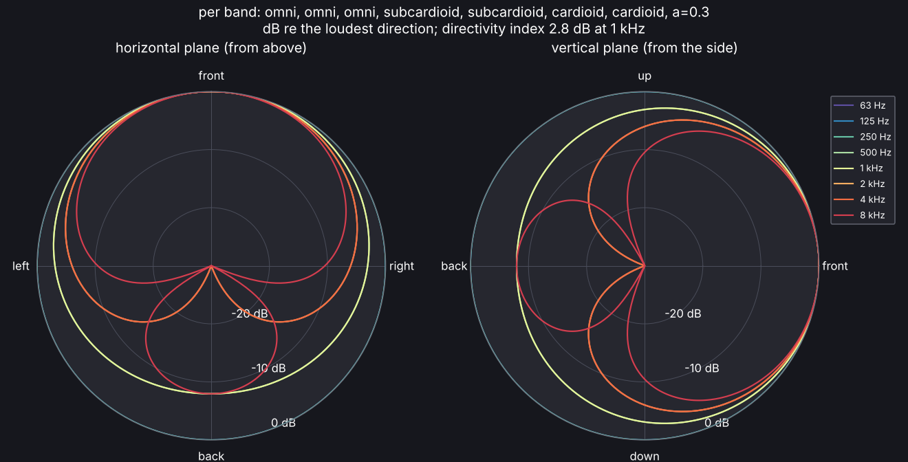

# Scene files

A scene is a YAML file that names the geometry, the materials, which surface gets
which material, and where the sources and listeners are. See
[`examples/shoebox/scene.yaml`](https://github.com/naelolaiz/acoustic-spaces/blob/main/examples/shoebox/scene.yaml) and the schema in
[`src/acoustic_spaces/scene/model.py`](https://github.com/naelolaiz/acoustic-spaces/blob/main/src/acoustic_spaces/scene/model.py).
Frequency-dependent data uses eight octave bands from 63 Hz to 8 kHz, or 24
third-octave bands from 50 Hz to 10 kHz (see [Frequency bands](simulation.md#frequency-bands)).

## Geometry

| Format | Read with | Names used for material assignment |
| --- | --- | --- |
| OBJ | built-in reader | `usemtl` material, `g` groups, `o` object |
| DXF | [ezdxf](https://ezdxf.mozman.de/) (3DFACE, MESH, polyface and polygon meshes, closed 3D polylines, block references) | layer |
| glTF / GLB | [trimesh](https://trimesh.org/) | material, node and mesh names |
| STL, PLY, OFF | trimesh | file name |
| IFC (`.ifc`) | [IfcOpenShell](https://ifcopenshell.org/), the `ifc` extra | element name, type name, materials, IFC class |
| Collada (`.dae`) | built-in reader (triangles, polylists, polygons, nodes and instanced nodes) | material, geometry name |
| SketchUp (`.skp`), experimental | [openskp](https://github.com/iamahsanmehmood/openskp), the `sketchup` extra | material |

Simple rooms need no CAD file: `geometry: {box: [8, 6, 3]}` builds a rectangular
room from the origin, and a floor plan is raised to a height (see
[`examples/lecture_hall/scene.yaml`](https://github.com/naelolaiz/acoustic-spaces/blob/main/examples/lecture_hall/scene.yaml)):

```yaml
geometry:
  floor_plan: [[0, -4], [0, 4], [14, 8], [14, -8]]  # corners, in order, any shape
  height: 6
assignments:
  floor: audience
  ceiling: plaster
  wall_1: wood       # the edge from the first corner to the second
  walls: concrete    # every other wall
```

OBJ is the recommended exchange format: SketchUp, Rhino, Revit and Blender all
export it with material names. Set `geometry.units` (`m`, `cm`, `mm`, `in`, `ft`)
and, when the file is +y up (Blender's OBJ default, glTF always), `geometry.up_axis: y`.
Without `units`, a DXF file is read in the units its header records (`$INSUNITS`), an
IFC or Collada file in the units it records, and any other file in metres; a Collada
file's up axis is the one it records (X_UP, Y_UP or Z_UP). SketchUp's Collada export
(`.dae`) is read as it is (see [`examples/rehearsal_room`](https://github.com/naelolaiz/acoustic-spaces/blob/main/examples/rehearsal_room/scene.yaml)).

SketchUp files can also be read as they are, with the `sketchup` extra: openskp reads
them without SketchUp, in metres. That reader is young. Faces are matched to materials
by colour, so give each material its own colour; a face painted differently on its two
sides takes its front's material; and some files do not read at all (the BRAS
auditorium, for one). An OBJ export from SketchUp is then the way.

Polygons are triangulated, duplicate vertices merged and degenerate faces dropped,
and faces that meet along an edge are turned to agree with each other (each part of
the model keeps the orientation most of its area has), so a few faces flipped by the
exporter do not spoil the volume or the inside checks. Where a face's edge runs past
the corners of faces on its other side (a T-junction, which SketchUp stitches with
faces of zero area), the edge is split at those corners, so the model stays closed.
A model with no faces left is refused. `validate` then reports surfaces without a
material, sources or listeners outside the room and listeners within 1 cm of a source;
it warns about models that are not closed (rays would escape) and assignments that
match nothing. Normals may point either way: the room is the space the faces close off,
found from the faces themselves (see [Walls, doors and openings](#walls-doors-and-openings)),
and a panel standing in the room, with air on both sides, reflects and absorbs on both.

### BIM models (IFC)

IFC files from Revit, ArchiCAD, Vectorworks or any other BIM program are read with the
`ifc` extra (IfcOpenShell). There are two ways, and
[`examples/bim_office`](https://github.com/naelolaiz/acoustic-spaces/blob/main/examples/bim_office/scene.yaml)
shows both:

```yaml
geometry:
  file: office.ifc
  space: Office        # one room, from its space boundaries; leave out for every element
assignments:
  Plaster on brick: plaster   # an IFC material
  IfcWindow: glass            # every element of a class
  Door: wood                  # one element, by name
```

- With `space`, only that room (an IfcSpace, by name, long name or GlobalId) is read: the
  faces of the room that each element bounds, as BIM programs export them as space
  boundaries (Revit: export with space boundaries, first or second level). Each face is
  named after its element; one with no element behind it, an opening to another room, is
  a `virtual boundary`. This gives a closed room with one face per surface, which is
  what the simulation wants. A file without space boundaries gives the space's own
  solid, cut into triangles of at most 50 cm, each named after the element behind its
  middle: windows and doors then have ragged edges, so export boundaries where you can.
- Without `space`, every building element is read as IfcOpenShell builds it: walls,
  slabs, roofs, windows, doors, stairs and furniture, with their openings cut. Openings,
  virtual elements and building services (ducts, pipes, lights) are left out. Walls then
  have both sides and their thickness, and solids that only touch do not share edges, so
  the model reads as not closed even when no ray escapes (the leak finder tells); the
  volume and the inside checks are skipped.

Each face's names, for assignments, are its element's name, its type's name, its
materials (a layer set's name, then each layer's material) and its IFC class
(`IfcWallStandardCase` also as `IfcWall`); the first that an assignment names gives its
material.

### Finding leaks

A model that is not closed lets rays escape, and its reverberation comes out too short.
The warning counts its open edges; the leak finder shows where the holes are:

```sh
acoustic-spaces validate examples/leaky_classroom/scene.yaml --leaks
acoustic-spaces view examples/leaky_classroom/scene.yaml --leaks
```

```text
leaks: 5000 rays, up to 100 reflections each: 4084 escaped (81.7 %)
  1. 3813 rays (76.3 %) through a gap of about 3.6 m2 (3.00 x 1.20 m) by east_wall
     at (9.00, 3.51, 1.59) m
  2. 271 rays (5.4 %) through a gap of about 0.27 m2 (9.00 x 0.03 m) by ceiling,
     north_wall, west_wall
     at (4.08, 6.99, 3.00) m
```

It traces rays from the sources (5,000 by default, `--rays` sets how many), reflecting
them diffusely off every surface whatever its material, so that they reach every corner,
for up to 100 reflections each. Each ray that finds no surface ahead has escaped, and is
put down to the gap it went through: the open edges round a hole, with open edges that
come within 2 % of the model's size of each other counted as one gap (a ceiling that
stops short of a wall leaves open edges on both). For each gap the report gives the rays
that escaped through it, its area and size (from its open edges, which run round it),
where the rays crossed it and the surfaces next to it, those with the longest open edges
first. In the example the window glass is missing from the east wall and the ceiling
stops 3 cm short of the north wall. `view --leaks` draws the open edges in red, the
escaping rays from their last reflection to past the hole, and a numbered marker on each
gap; in the editor, **View > Show leaks** does the same and writes the report to the
messages.

Rays that leave through a surface letting sound through (an opening to the outside, see
[Walls, doors and openings](#walls-doors-and-openings)) are listed as such, not as a
leak. A closed model keeps every ray; one that loses some all the same has faces that
meet without closing, and the report names them. From Python,
`acoustic_spaces.engine.leaks.find_leaks(room)` gives the same as a `Leaks` object, and
`acoustic_spaces.viz.plot_leaks` draws it.

## Materials

Each entry in `materials` takes coefficients from one of:

- `preset: <id>`: the built-in database (`acoustic-spaces materials` lists it);
- `file: <csv>`: a table of centre frequencies, absorption and optionally
  scattering, one row each, at any band resolution (the layout the
  [BRAS](https://doi.org/10.14279/depositonce-6726.3) benchmark uses);
- `file: <library>` with `entry: <name>`: a material of a CATT-Acoustic or ODEON
  material library (see below);
- `absorption: [...]` with eight octave values or 24 third-octave values, which also
  overrides a preset or file.

`scattering` is a number, eight or 24 values, or the id of a built-in scattering entry.
File data with more than one value in some octave (third-octave tables) stays in
third-octave bands; other data is averaged onto octaves. Bands with no data (63 Hz in
most tables) take the nearest band's value and the material's `source` says which.
Surfaces get a material through `assignments` (any geometry name to a material),
by having the same name as a material, or through `default_material`. Names match
whatever their case (`brick_rough` names SketchUp's `Brick_Rough`), though a name
written the same way wins over one in another case.

### Material libraries of CATT-Acoustic and ODEON

Materials kept for CATT-Acoustic or ODEON can be used as they are. `file` names the
library and `entry` the material in it: its name (in any case), or for ODEON its
number or description.

```yaml
materials:
  carpet:
    file: catt_materials.geo   # CATT-Acoustic: ABS lines, in a geometry or library file
    entry: carpet
  ceiling_tiles:
    file: odeon_materials.li8  # ODEON: Material.Li8 or a library of the same layout
    entry: 1001
    scattering: 0.1
```

- CATT-Acoustic writes `ABS name = <a125 a250 a500 a1k a2k a4k> L <s125 ... s4k> {r g b}`:
  absorption and scattering in percent from 125 Hz to 4 kHz, 8 and 16 kHz optional
  (`<a125 ... a4k : a8k a16k>`), `;` before a comment; `ABS1` gives them as fractions
  from 0 to 1. `ABS name = other` gives a material another's values. Any file with
  such lines will do (a `.geo` file with its geometry, or a library). Scattering that
  CATT estimates itself (`L <estimate(...)>`) is not read, so give `scattering`.
- ODEON's library has each material on two lines, its number and description, then
  eight absorption coefficients from 63 Hz to 8 kHz (six, from 125 Hz to 4 kHz, in
  older libraries). Where the description has ODEON's `{Product name*=...}` and
  `{Category=...}` fields, as in its own `Material.Li8`, the product name is the
  material's name, and `materials --file` lists the materials by category. Materials
  made with ODEON's Material calculator are read by their octave values, which ODEON
  simulates with; their third-octave values are not read. ODEON gives scattering to
  surfaces, so give it with `scattering` (0.1 otherwise).

The 63 Hz band takes the 125 Hz value where a library has none, 8 kHz the 4 kHz value,
and 16 kHz is left out. `acoustic-spaces materials --file <library>` lists a library's
materials, with words to search for as in the built-in database, and in the editor
**Edit > Add material from a library** picks one. The `material_libraries` example
takes its carpet and walls from a CATT file and its ceiling from an ODEON one.

Two rooms of the BRAS benchmark, converted from its SketchUp models, are in
[`validation/bras`](https://github.com/naelolaiz/acoustic-spaces/blob/main/validation/bras)
as scenes with their surface data and measurements.

## Walls, doors and openings

A model can hold several rooms. Sound passes between them through surfaces whose
material lets some through: `transmission`, the share that passes (1 for an opening),
or `transmission_loss`, the sound reduction index R in dB (the share is 10^(-R/10)),
one value or one per band.

```yaml
materials:
  partition:                 # 12 cm of brick
    absorption: [0.02, 0.02, 0.03, 0.04, 0.05, 0.07, 0.07, 0.07]
    transmission_loss: [30, 35, 40, 46, 52, 57, 60, 60]
  door:
    absorption: [0.1, 0.1, 0.1, 0.1, 0.1, 0.1, 0.1, 0.1]
    transmission_loss: 25
  doorway: {transmission: 1}  # an opening: all of it passes
assignments:
  wall_between: partition
  door_leaf: door
  door_hole: doorway
```

- What passes through counts as absorbed on the side it comes from, so the absorption
  must be at least the transmission in every band. A material without absorption
  values, preset or file absorbs what it lets through: an opening absorbs 1.
- The rooms are found from the faces: every space the faces close off on all sides is
  one, whichever way the normals point. The space inside a thick wall or a column, with
  rooms all round it, is solid; it is air when a source or listener stands in it, and
  so is any space it opens into through surfaces that let sound through. The faces
  between two rooms have a room on both sides and reflect and absorb in both.
  `inspect` lists the rooms ("closed, 2 rooms of 48.00, 72.00 m3"), the editor too,
  and the volume is theirs together. When the sources and listeners stand in air that
  the model's rooms do not include (walls drawn as a closed shell inside another),
  `inspect` also gives that "air volume", the one its reverberation times use.
- Early reflections pass through those surfaces, keeping the share that passes at each;
  through openings they pass unchanged. The rays of the late part that hit a partition
  go on as two: the reflection, and a copy behind it with the share that passes, so even
  a 60 dB wall has rays behind it. Each room's rays are thinned and split for the level
  that room is expected to reach (from the rooms' power balance in a diffuse field),
  so a quiet room behind a wall is traced as finely as the loud one. Sound goes straight
  through, in the direction it came.
- Coverage maps cover the audience areas of every room and find at each point what a
  listener there would. The statistical late method follows coupled-room theory: each
  room's diffuse field decays as the energy the rooms exchange through the faces
  between them has it, with Eyring's absorption in each, so a room behind a partition
  holds less and a dry room opening into a live one decays in two slopes. The
  statistical reverberation times of `inspect` count each face between two rooms on
  both its sides, as for one room.
- For diffraction an opening is a hole: the edges of a doorway are the free edges of
  the wall round it, and sound bends round them into the next room. Diffraction through
  a wall is left out, as it is far weaker than what passes straight through.
- The wave solver lets its air flow through openings; it does not model walls that let
  part of the sound through, and says so. Particles in animations pass through
  openings, and through partitions as often as the sound does.
- A listener in a room that no surface joins to the source's room is warned about.
- In the editor, a material's **Lets through** chooses nothing, part of the sound (the
  sound reduction index per band in the table) or everything (an opening).

The tests check the level behind a 30 and a 50 dB partition between two rooms against
diffuse-field theory (within 0.3 dB), two rooms joined by an opening the size of the
wall against one room of both their sizes, and the double-sloped decay of a dry room
opening into a live one against the two-room model (within 1 dB down to -40 dB). The
statistical method follows that model in both rooms, and maps over both rooms match
listeners at their points.

The `apartment` example has a wall and a door, closed or open, between the living room
and the bedroom of a flat.

## Audience seating

Sound that reaches a listener low over rows of seats loses much more than the seats'
absorption says, as it passes heads and seat backs on the way. Mark the seating's
material with `audience: true` (in the editor, **Audience seating**):

```yaml
materials:
  seats: {preset: audience_wooden_chairs_1_m2, scattering: 0.7, audience: true}
```

- The attenuation is the fit of Jurkiewicz, Rummler, Green, Wulfrank and Kahle
  (["Impact of grazing incidence attenuation on early reflection design"](https://www.ioa.org.uk/system/files/publications/Y.%20Jurkiewicz%2C%20N.%20Rummler%20%2C%20E.%20Green%20%2C%20T.%20Wulfrank%20and%20E.%20Kahle%20IMPACT%20OF%20GRAZING%20INCIDENCE%20ATTENUATION%20ON%20EARLY%20REFLECTION%20DESIGN.pdf),
  Proc. IOA 47 Pt. 1, 2025) to scale-model measurements over a seated audience: sound
  arriving at an elevation φ above the audience, having run d metres over it, keeps
  min(1, (3.40 sin²φ + 2.17 sin φ + 0.02)^((d - 1)/10)) of its energy. That is 17 dB
  less at grazing incidence after 11 m, 0.6 dB per metre at 5°, and nothing lost from
  17.8° up.
- It applies to the last leg of every early path (the direct sound, reflections and
  diffracted sound) to listeners and map points up to 2 m above audience surfaces: φ
  is the leg's elevation above the surface under the listener, and d how far the leg
  runs over audience surfaces no more than 2 m higher than the listener's ears are
  above theirs, so the stalls do not shade a balcony seat.
- Only in the 500 Hz to 2 kHz octaves (third octaves from 400 Hz to 2.5 kHz), the bands
  of the fit, where it hardly changed with frequency. The seat dip lower down depends on
  the seats themselves, and the fit has no data higher up. The late part is left as it
  is, and the statistical method does not make up what the seats take from the early
  paths. Leaving out the leg from the source to the first reflection, as the fit does,
  errs on the side of too little attenuation.
- In a flat lecture hall with the talker at 1.6 m, it takes 10 dB off the direct sound
  at the back row in those bands and 1.3 dB off C50 there.

The `town_hall_pa` example marks its seats as audience.

## Sources and directivity

A source has a position, an orientation (`yaw`, `pitch` and `roll` in degrees; all zero
faces +x with +z up), a sound power level (`level_db`, dB re 1 pW) and a
`directivity`:

```yaml
sources:
  - name: talker
    position: [2.0, 3.0, 1.5]
    orientation: {yaw: 30}
    directivity: cardioid   # or omni, subcardioid, supercardioid, hypercardioid, figure8
  - name: monitor
    position: [0.7, 1.3, 1.2]
    directivity:            # a pattern, or the a of a + (1 - a) cos(theta), per octave band
      pattern: [omni, omni, omni, subcardioid, subcardioid, cardioid, cardioid, 0.3]
  - name: loudspeaker
    position: [0.7, 3.3, 1.2]
    directivity: {file: speaker.sofa}   # measured data: SOFA or CSV
```

- A directivity says where the sound power goes, not how much: its weights average 1
  over the sphere in every band. It shapes the direct sound, each early path (by the
  direction it leaves the source in), the rays of the late part and the particles of
  `animate`.
- **SOFA** files follow the AES69 `FreeFieldDirectivityTF` convention (spectra measured
  by microphones around the source, as published for loudspeakers and instruments), or
  hold impulse responses in `Data.IR`. Directions are the microphones' positions as the
  source sees them (`SourceView` and `SourceUp`). `measurement: 3` picks one
  measurement, for example one note of an instrument; by default all are averaged.
  Reading SOFA files needs the `sofa` extra (h5py).
- A **CSV** table has the header `azimuth, elevation` followed by frequencies in Hz,
  then one row per direction with levels in dB (any reference; only differences
  matter). Azimuth turns from the front towards the source's left and elevation is
  positive upwards, in degrees. Any set of directions works: they are interpolated
  onto a 5 degree grid. Bands are averaged into octaves, and octaves with no data copy
  the nearest one; in third-octave runs each octave's pattern holds for its thirds.
- CLF (Common Loudspeaker Format) files are not read: their specification is not
  public. Convert them to SOFA or CSV.

`acoustic-spaces directivity speaker.sofa --plot polar.png` prints the directivity
index and front-to-back ratio per octave band and draws the polar patterns;
`acoustic-spaces inspect` lists every source's directivity index.

A coherent array, such as a column loudspeaker or a line array, is a source whose
directivity is the sum of its elements' sound with its phase:

```yaml
sources:
  - name: column
    position: [0.5, 3.0, 2.0]
    directivity:
      array:
        element: cardioid    # each element's pattern, along its aim (default omni)
        count: 8             # a straight column along the up axis, centred...
        spacing_m: 0.15      # ...and this far apart
        steer_deg: -8        # delays that tilt the beam 8 degrees down
  - name: flown
    position: [6.0, 3.0, 6.0]
    directivity: {file: line_array.yaml}   # the same fields in a YAML file
```

```yaml
# line_array.yaml: elements one by one, in the source's frame (x forward, y left, z up)
element: {file: cabinet.sofa}   # or a pattern, as for a source
elements:
  - {position: [0, 0, 0.0], orientation: {pitch: 0}}
  - {position: [0, 0, -0.35], orientation: {pitch: -3}, gain_db: -1, delay_ms: 0.05}
  - {position: [-0.02, 0, -0.70], orientation: {pitch: -7}, gain_db: -2}
  - {position: [0, 0, -1.05], invert: true}   # polarity inverted
```

- The elements' pressures add up with their path differences, their feeds' gains,
  delays and polarities, the steering, and each element's pattern along its aim
  (first-order patterns with their sign, measured ones by magnitude). The energy is
  the exact mean over each third-octave band, on a grid of 1 to 5 degrees fine enough
  for the beam, and with the room's speed of sound. A column of 8 takes about a second.
- The result is the array's **far-field** pattern, a balloon like a measured one, so
  the source stays one point: right beyond about the array's length squared over the
  wavelength, L² f / c (16 m for a 2 m array at 1.4 kHz). Closer to a long array, its
  sound spreads as a line's and its beam has not formed yet; a `line_m` source is the
  better model there. The room's warnings name every listener nearer to an array than
  that distance at 1 kHz: `validate`, `inspect`, `simulate` and `map` print them, and
  the editor lists them under **Properties** when the scene itself is selected. Higher
  up the far field starts farther still:

  | array length | far field from, at 1 kHz | at 4 kHz |
  |---|---|---|
  | 0.5 m | 0.7 m | 2.9 m |
  | 1 m | 2.9 m | 11.7 m |
  | 2 m | 11.7 m | 46.6 m |
- As for any source, `level_db` is the array's sound power in all; the pattern only
  says where it goes. A single element's array has the element's own pattern.
- The tests check a column against the analytic sums of a line array (the
  directivity index within 0.05 dB in every band, the vertical pattern within 0.3
  dB), steering against delays given element by element, a dipole made of two
  elements in opposite polarity, and splayed cardioids against their exact sum.
- In the editor, pick the YAML file with "Measured data or an array from a file…";
  `acoustic-spaces directivity line_array.yaml --plot polar.png` shows its pattern.

How loud a source is, and how it is fed:

```yaml
sources:
  - name: talker
    position: [2.0, 3.0, 1.5]
    level_db: 78            # sound power in all, dB re 1 pW
    spectrum: speech_male   # or flat (default) or speech_female
  - name: delay-speaker
    position: [12.0, 3.0, 2.5]
    level_db: [95, 98, 100, 100, 100, 99, 97, 92]   # or per band (8 or 24 values)
    gain_db: -6                        # gain of the feed
    eq_db: [0, 0, -3, 0, 0, 0, 2, 4]   # equalizer per band, dB
    delay_ms: 18.5                     # plays this long after emission starts
```

- `level_db` is the sound power level, in all or per band. A level in all is spread
  by `spectrum`: evenly over the octave bands (`flat`), or as the long-term spectrum of
  male or female speech (IEC 60268-16), for which the STI then takes the male or female
  weighting. The standard's normal voice, 60 dB(A) at 1 m, is about 78 dB of sound
  power with either speech spectrum and an omnidirectional source. It gives no level
  at 63 Hz, nor at 125 Hz for female speech; those bands are taken 12 dB below the next
  one up, an assumption that does not reach the STI.
- `gain_db` and `eq_db` are the gain and equalizer of the source's feed. Both act on
  the sound power and on the impulse responses, so a mix made with `auralize` hears
  them. G stays the room's: it is measured against the same source, fed the same way,
  in free field. The impulse responses are per unit of sound power, and `auralize`
  scales each source's signal by its `level_db` against the loudest source's, so a
  mix keeps the balance between sources of different power too.
- `delay_ms` delays everything the source sends. Its impulse responses start that much
  later, and in the coverage map of all sources together its sound arrives that much
  later, as when delay loudspeakers are aligned with a stage.
- `simulate` reports the sound pressure level per octave band and A-weighted
  (`spl_db` and `spl_a_db` in `parameters.json`), the editor's results show it per
  band, and `inspect` lists each source's sound power. In free field, the level 4 m from
  a source comes out as its sound power less 10 log10(4 π r²) = 23 dB and the air's
  absorption over the 4 m, to within 0.01 dB.

The `town_hall_pa` example feeds two delay loudspeakers with their own gain, equalizer
and delay, behind two columns that are coherent arrays.

Line and surface sources, such as a road, a row of loudspeakers fed alike, a choir
or a vibrating wall:

```yaml
sources:
  - name: traffic
    position: [0.0, 20.0, 0.5]
    orientation: {yaw: 90}   # the line runs along the source's left axis: here -x
    line_m: 40
  - name: panel
    position: [6.0, 0.05, 1.5]
    orientation: {yaw: 90}   # facing +y, into the room
    surface_m: [2.0, 1.2]    # width along the left axis, height along the up axis
    spacing_m: 0.25          # at most this far apart (default 0.5 m)
    directivity: lambert     # a vibrating surface's: in proportion to the cosine
```

- A line or surface is made of uncorrelated point sources, at most `spacing_m` apart,
  each in the middle of an equal share of it. They share the source's sound power and
  its rays equally, each with a seed of its own, and keep its directivity, orientation
  and feed. A source is made of at most 400 of them; their sound adds up in energy, as
  for incoherent sources such as traffic or a crowd. Close to a long line, the level
  falls about 3 dB per doubling of distance rather than a point source's 6 dB (3.3 dB
  between 2 and 4 m from a 40 m line in the tests).
- `lambert` radiates as a vibrating surface, in proportion to the cosine of the angle
  to the forward axis and nothing behind (a directivity index of 6 dB).
- All of a line or surface must be inside the room; `inspect` lists its length or size
  and its number of points. The wave solver takes point sources only. The editor
  draws lines and surfaces in the 3D view and the plan, and the Blender export has
  them too.

The `workshop` example maps the noise of a conveyor (a line), a machine's casing (a
surface) and a compressor (a point).



## Walks

A listener or a point source can walk through the room, for
[walkthroughs](spatial-audio.md#walkthroughs):

```yaml
listeners:
  - name: visitor
    position: [17.0, 4.0, 1.6]   # where the walk starts
    walk:
      to: [[4.0, 4.0, 1.6], [4.0, 16.0, 1.6]]   # the corners it goes through
      speed_m_s: 1.2       # walking pace (default 1.2 m/s)
      face_forward: true   # turn to face the way it goes (default); false keeps its yaw
      turn_deg_s: 90       # how fast it turns through a corner (default 90 degrees/s)
```

- A walk goes in straight lines from the position through each point of `to`, at an
  even pace, and stops at the last one. Facing forward sets the yaw along each leg and
  keeps the pitch and roll; on a leg straight up or down the yaw stays as it was. At a
  corner the walker turns the shorter way round at `turn_deg_s`, half of the turn
  before the corner and half after it (no further than half-way along either leg), so
  a sound to one side moves round the head instead of jumping.
- Everything else (`simulate`, `map`, the editor) sees the walker standing where its
  walk starts; `inspect` lists how far each walk goes and for how long. Lines and
  surfaces do not walk.

## Air, response length and seed

```yaml
air:
  temperature_c: 20         # default 20 °C
  humidity_percent: 50      # default 50 %
  pressure_kpa: 101.325     # default 101.325 kPa
simulation:
  ir_length_s: 2.0          # length of the impulse responses (s), default 2
  sample_rate: 48000        # of the impulse responses (Hz), default 48000
  seed: 1                   # random seed, 0 or more; unset, every run draws its own
```

- `air` sets the speed of sound and the air absorption per band (ISO 9613-1), for the
  rays, the wave solver and the statistical reverberation times alike.
- A response that ends before the room has decayed is extended by its fitted decay
  rate when the parameters are computed (see [Simulation](simulation.md)); a longer
  `ir_length_s` makes longer files, and more time steps for the wave solver.
  `--sample-rate` on the command line overrides `sample_rate` for one run.
- With a `seed`, the late rays, the scattering and the coverage maps draw the same
  random numbers every run, so a scene's results repeat from run to run (`--seed` sets
  it for one run). A GPU draws random numbers of its own, and its results can vary
  slightly from run to run, as do those of the CPU and a GPU sharing the rays (see
  [The late stage on a GPU](simulation.md#the-late-stage-on-a-gpu)). The editor's
  **Simulation** entry has these under **Response**, and the scene's own entry the air.
