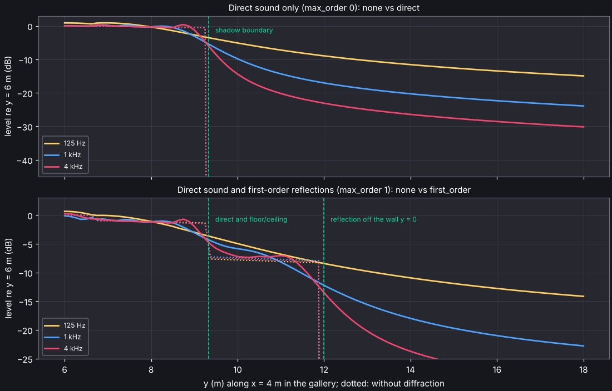
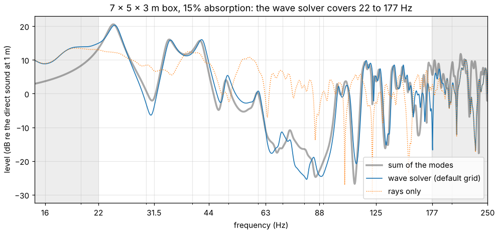

# Simulation

Each source and listener pair is simulated in two parts that add up without a
crossfade.

**Early reflections** (`simulation.early`) are exact specular paths up to
`max_order` reflections, with delay, arrival direction and energy per band. Candidate
image sources come from deterministic specular rays (`method: ray_tracing`, the
default; cost grows with `rays`, not with the number of surfaces) or from every
sequence of planes (`method: image_sources`; complete, but grows as planes to the
power of the order). Every candidate is then traced back from the listener, so the
paths found are exact either way, including paths that reflect exactly on an edge
or in a corner. Sound that bends round edges is added to them (see
[Edge diffraction](#edge-diffraction)).

**Late reverberation** (`simulation.late`) is either:

- `stochastic_ray_tracing` (default): `rays` rays per band (50,000 by default)
  leave the source and reflect off the surfaces as [Scattering](#scattering) says,
  losing energy to absorption and air.
  Specular paths the early part already computed are left out. How energy reaches the
  listener is set by `reception`:
  - `diffuse_rain` (default): the scattered part of every reflection radiates to
    each listener it can see; the rest counts when a ray crosses a detector
    sphere (`receiver_radius`, 0.5 to 1 m by default and kept clear of walls).
  - `secondary_sources`: all reflected energy radiates that way, as in ODEON's late
    method. Much smoother tails, but it treats specular energy as diffuse: in the
    example box (smooth walls, absorbing ceiling) EDT comes out about 20 % shorter.
  - `detector`: classic ray tracing, everything counted by the sphere.

  In rooms with absorption in one place and smooth walls, most late energy rides on
  the few rays that keep clear of the absorber, and the tail breaks up where those
  run out. With `splitting` (on by default), a first tenth of the rays measures how
  much energy a ray usually carries over time; the rest are split into copies when
  they carry more than 4 times that and thinned out by Russian roulette when they
  carry less than a quarter (a weight window). The expected result is unchanged; with
  random scattering, the example box's late tail (0.5 to 2.5 s) misses a 1-million-ray
  reference by 0.5 to 2 dB per band instead of 1 to 8 dB at 100k rays (1 to 4 dB
  instead of 4 to 17 dB at 10k), for about 1.5 times the run time.

  Nearly all of the run time goes into ray queries: which surface a ray meets next,
  and whether each listener can see a reflection (see [Performance](#performance)).
- `statistical`: the reflected energy of Barron's revised theory, an exponential
  decay at the Eyring reverberation time T from the direct sound on, less what the
  early paths carry. Early paths end `transition_ms` after the direct sound (by
  default the mixing time, the square root of the volume in milliseconds), so the
  late part holds the scattered share of every early reflection, the orders above
  `max_order` before the transition and everything after it. The total is Barron's,
  c T / (13.8 V) for a unit source: the Sabine form 4 / A with Eyring's absorption
  area, which reads 0.2 dB above the classical 4 (1 - α) / (α S) at a mean
  absorption of 0.1 and 0.8 dB above at 0.3.

The two parts hand over by reflection order by default. Set `transition_ms` to
keep early paths only that long after the direct sound.

**Impulse responses** are built per band: early paths become fractional-delay
impulses (in the lowest bands with the phase of their reflections, see
[Low frequencies: early reflections in pressure](#low-frequencies-early-reflections-in-pressure)),
the late energy shapes a Dirac sequence with the density of reflections in
the room, and a zero-phase crossover bank sums the bands. The direct sound at r
metres is an impulse of height 1/r, so levels compare between files and the energy
of the direct sound at 10 m (0.01) is the reference for strength G.

**Parameters** follow ISO 3382-1 per octave band: EDT, T20, T30, C50, C80, D50, Ts
and G. `Response.parameters()` computes them from the simulated energies;
`acoustic_spaces.parameters.from_impulse_response` does the same for any mono IR (see
[Measuring impulse responses](measurements.md#measuring-impulse-responses)). A response that ends
before it has decayed is extended by its fitted decay rate; one that ends before it
has decayed by 20 dB leaves too much to that estimate, and all its parameters are NaN.
Outdoors, where a response may hold no decay at all, G is then that of the energy it
holds, and so are the levels and the STI that take it; the other parameters stay NaN
(see [Results outdoors](outdoor.md#results-outdoors)).
Air absorption follows ISO 9613-1 for the scene's temperature, humidity and pressure.

The directions the sound arrives from give more of them:

- LF, LFC and LJ (ISO 3382-1, annex A), from a figure of eight with its null on the
  source: the share of the early energy that arrives from the sides, which widens the
  source, and the level of the late lateral sound, which envelops the listener.
- IACC early and late (annex B), from the binaural response when the scene writes one
  (through the spherical head or a SOFA file; the first, if it writes several).
- Stage support ST early (Gade's ST1) and ST late (annex C) for listeners within 1.5 m
  of a source, where musicians hear themselves and each other.
- T30 of figures of eight facing forward, left and up from the listener: where sound
  keeps running between two hard walls, the decay along that axis is longer.
- STI and STIPA (IEC 60268-16) and U50, at the level the source's `level_db` gives and
  the background noise of `coverage.noise_db`, as the coverage maps take them (NaN,
  like G, when a band from 125 Hz up is undefined); and the echo criteria of Dietsch
  and Kraak for speech and music.

The echogram adds the arrivals in energy, as ODEON and CATT do, except the early
reflections in the lowest bands, which add in pressure (see
[below](#low-frequencies-early-reflections-in-pressure)). A figure of eight on
the centre line of a symmetric room hears the two side walls' reflections arrive
together with opposite signs, and they cancel in the rendered Ambisonics response.
LF read from that response with `analyze --ambisonic` is then lower than the
echogram's; off the centre line the two agree on average, band by band within the
interference of reflections close in time.

## Scattering

A surface's scattering coefficient (ISO 17497-1) is the share of the reflected energy
that leaves it diffusely rather than specularly. `simulation.scattering` says how rays
carry it out:

```yaml
simulation:
  scattering:
    method: vector     # or random
    from_size: true    # small, distant and grazed surfaces scatter more
    by_band: true      # each band follows its own scattering (vector only)
```

- `vector` (default): every reflection sends the ray in the direction of the sum of its
  specular direction and a random Lambert direction, weighted by the scattering
  coefficient, as ODEON and pyroomacoustics do. The ray keeps all the reflected energy:
  the diffuse rain sends the scattered share to the listeners, and the detector spheres
  count only the rest. Where the bands' coefficients differ, each band is traced with
  rays of its own, so a wall that scatters the bass and reflects the treble does both;
  one direction for all bands (pyroomacoustics takes their mean) made the example box's
  treble decay twice as fast as it should. For the same rays per band, tracing band by
  band takes 3 to 5 times as long as one ray for all bands; at the default 50,000 per
  band a simulation takes 1.5 to 4 times as long as version 2's 100,000 shared rays.
  `by_band: false` goes back to one ray for all bands, turned by their mean scattering.
- `random`: the ray reflects specularly or, with the coefficient as probability, in a
  Lambert direction. This was the only model up to version 2. With smooth walls a few
  rays then keep running between them, and the decay comes out longer.
- `from_size` (default on): a surface also scatters for its size, after Christensen and
  Rindel (2005), as in ODEON. The specular share falls below f_w = c d / (2 (w cos θ)²)
  and again below f_l = c d / (2 l²), where w and l are the surface's width and length,
  d the distance the sound came from and θ its angle of incidence. A large wall reflects
  specularly down to low frequencies, while a small panel, a distant one or one met at a
  grazing angle scatters. Each flat surface (the faces of one plane joined at their
  edges, of any material) counts as the rectangle with its area and perimeter. Early
  reflections lose that share too and the late part picks it up. Reflections that
  [edge diffraction](#edge-diffraction) already completes keep their own coefficient:
  the first two orders with `first_order` diffraction (the default) or `second_order`,
  the first with `direct`.

In the two measured rooms of the [validation report](validation.md),
the default model brings the reverberation time of a chamber music hall from 20 to 32 %
long down to 7 to 20 %, and keeps a seminar room within 2 % from 500 Hz to 4 kHz.
Without the surfaces' sizes, neither model fits both rooms.

## Frequency bands

Simulations run in the eight octave bands from 63 Hz to 8 kHz by default, or in the 24
third-octave bands from 50 Hz to 10 kHz:

```yaml
simulation:
  bands: third_octave   # or octave (default)
```

- Everything that depends on frequency follows the bands: materials, air absorption,
  source directivity, the scattering of a surface's size, the rays (`rays` per band)
  and the filter bank the impulse response is built with. With the wave solver on, it
  computes the third octaves of the octaves up to `max_band_hz`.
- Materials hold 8 or 24 values. An octave value holds for each of its three third
  octaves, and an octave simulation takes the mean of a third-octave material's three.
- Room parameters, the STI, coverage maps, plots and the editor's results stay in
  octave bands: each octave's energy is the mean of its three thirds'. A response's
  `energy()` has all 24 bands and `octave_energy()` the octaves.
- Third octaves pay where coefficients change within an octave: absorbers narrower
  than an octave (a Helmholtz resonator, a slot absorber), and the 8 kHz octave, across
  which the air absorbs about twice as much at 10 kHz as at 6.3 kHz. Its decay is then
  no single slope, and in the shoebox example its T30 comes out 8 % longer in third
  octaves. In the measured seminar room of the
  [validation report](validation.md)
  they bring the reverberation time at 250 Hz and 8 kHz from 13 and 18 % short to
  within 4 %. They trace three times the rays and take about three times as long.
- `acoustic-spaces simulate --bands third_octave` sets them for one run, and the
  editor's simulation page has them. A material with third-octave data shows its 24
  values in the editor, and `inspect` lists its octave averages.

## Edge diffraction

Sound bends round the edges of walls, screens and balconies: a listener round a corner
still hears the source, quieter and duller, and the level does not drop off a cliff
where a wall cuts a path off. `simulation.early.diffraction` adds this to the early
part with the uniform theory of diffraction (UTD, Kouyoumjian and Pathak), averaged over
each octave band:

- `first_order` (default): the direct sound and the first-order reflections bend round
  edges, with the reflection before or after the edge.
- `second_order`: as `first_order`, and the direct sound bends round two edges in turn:
  over a thick wall or barrier, round both corners of a doorway's jamb, over two screens
  in a row.
- `direct`: only the direct sound.
- `none`: specular paths only.

With `first_order` and `second_order`, `simulation.early.diffraction_reflections` says
where a path over one edge may reflect: `one_side` (the default), before or after the
edge, off the ground on the way to a barrier or off a façade behind it; or
`both_sides`, before and after, which adds the path reflected off the ground on the
way to a barrier and again behind it, the fourth of the four paths over a barrier on
the ground. Over a hard ground that path carries a quarter of the sound over the
barrier, and without it the insertion loss comes out 0.3 to 0.8 dB too high from 1 kHz
up and a few decibels off in the bands below, where the four paths interfere; with it
the engine is within 0.15 dB of the exact solution (see the
[validation report](validation.md#outdoor-results-against-exact-solutions)). Over grass
and other soft grounds, whose reflections near grazing are weak, the path matters
less. `both_sides` pairs every reflection before an edge with every one after it, so
it costs more where many faces reflect (in the `street` example about a sixth more
diffracted paths and a few tens of milliseconds per listener);
`--diffraction-reflections` sets it for one run of `simulate` or `map`, and the editor
has it as **Reflections over an edge** under **Early reflections**.

The edges are found in the model: corners where two faces meet with more than 195° of
open air round them (the inside corner of an L-shaped room, the front of a stage or a
balcony) and the free edges of thin screens. Each source and listener get the shortest
path over each edge they can both see. In the shadow of the edge that path carries the
diffracted sound; on the lit side, near the boundary, it changes the energy of the
specular path it borders. Across a boundary the level is continuous: the tests cross one
in an L-shaped room in millimetre steps, with first-order reflections, and the level
changes by less than 0.25 dB where specular paths alone drop by more than 5 dB; where a
reflection off one of the corner's walls ends and the direct sound carries on, by less
than 0.05 dB. The
diffraction coefficient matches the exact solutions for a half-plane and for wedges
(within 0.25 dB), and a thin screen matches Maekawa's chart within 1.5 dB.

Behind a thick wall or barrier, whose two corners share its top, no edge sees both the
source and the listener: `first_order` finds nothing there, or only a way round one
corner of a doorway. `second_order` follows the shortest path over each pair of edges
that see each other. The first edge's wave reaches the second as the UTD has it, with
the second edge's distance parameter from the curvature of that wave where it gets
there, since near the first edge's boundaries it is still curved like the source's.
Where one of the two edges' waves is lit, the path continues a path over the other edge
alone and shares its energy with it, so the level is continuous where a path over one
edge appears: as the listener rises past the top of a barrier, it changes by at most
0.1 dB from 1 kHz up, and 0.01 dB at 63 Hz, where the waves add in pressure (0.8 dB in
energy). Against the exact solution (BTM, in the
[validation report](validation.md#edge-diffraction-against-the-exact-solution)),
the level over barriers 0.3 to 3 m thick is within 0.35 dB from 500 Hz up, and over two
screens in a row within 0.75 dB; at 63 and 125 Hz, in pressure, within 0.6 and 0.12 dB
(2 and 2.7 dB with the waves in energy).

```sh
acoustic-spaces simulate examples/gallery/scene.yaml --out gallery
acoustic-spaces view examples/gallery/scene.yaml --paths --listener "round the corner"
acoustic-spaces simulate examples/gallery/scene.yaml --out plain --diffraction none
acoustic-spaces view examples/archway/scene.yaml --paths --listener "behind the wall"
acoustic-spaces simulate examples/archway/scene.yaml --out archway --diffraction first_order
```



The figure walks round the corner of the `gallery` example, away from the guide. Without
diffraction (dotted) the direct sound and each reflection stop at the line where the
corner hides them; with it, the level falls smoothly, by more at high frequencies.
Paths with two or more reflections still stop at their boundaries: with `max_order: 3`
in the gallery, the early energy still steps by up to 3 dB where the reflections off the
long wall go out of sight. The late part is unchanged, since its
scattered rays already find their way round corners.

`view --paths` and the Blender export draw diffracted paths in their own colour, the
response's `early.diffracted` marks them, and `simulate` reports how many there are. The
cost grows with the number of edges: in a hall with about 100 edges, `first_order` adds
about 17 ms per source and listener. `second_order` costs more, as it looks at pairs of
edges: in a hall with 16 edges, the early stage takes 170 ms per source and listener
with it, 120 ms with `first_order` and 90 ms without diffraction.

Paths that reflect before or after an edge pair every edge with every plane the source
or the listener faces, which in a whole city grows with the square of the buildings.
Most of those pairs cannot carry a path, because the plane's faces lie nowhere near
where a ray from the edge would meet the plane: the engine leaves them out before it
traces a ray, on `simulation.performance.threads` threads, and the results are the
same bit for bit. A city of 900 buildings simulates in about 2 s on four cores, and
3,600 in about 22 s (see [Outdoor scenes](outdoor.md#buildings-from-a-map) and the
[validation report](validation.md#edge-diffraction-in-whole-cities)).

## Low frequencies: early reflections in pressure

At low frequencies reflections that arrive a few milliseconds apart do not add in
energy, as an echogram adds them, but in pressure. Next to a hard floor the reflection
arrives in phase and doubles the pressure of the direct sound (+6 dB, where energy
gives +3 dB); a loudspeaker a metre in front of a wall loses bass where the wall's
reflection arrives half a period late. A band's filter rings for longer than such
reflections lie apart, so the impulse response shows that interference, and an
echogram that adds the paths in energy misses it. Up to
`simulation.early.coherent_max_band_hz` the early paths add in pressure:

```yaml
simulation:
  early:
    coherent_max_band_hz: 125   # 63, 125 (default), 250, 500, or null for energy throughout;
                                # outdoors up to 8000, the default there
```

- Each reflection turns the phase as a locally reacting surface with the material's
  absorption does: R = (cos θ - Y) / (cos θ + Y) at the angle of incidence θ, with the
  admittance Y fitted as for the wave solver. A hard surface reflects in phase at every
  angle; an absorbing one turns the phase of sound that grazes it, by half a turn at
  grazing incidence. Above those bands each path keeps the phase it has at their top,
  so the bands join without a step. A surface whose material has an impedance (a
  ground's) reflects with its spherical wave's factor instead, in every band (see
  [Ground impedance](outdoor.md#ground-impedance)).
- Outdoors the paths are few, and the ground dip spans several bands: the early paths
  add in pressure up to 8000 Hz by default there. Wind and temperature gradients bend
  them, and below 500 Hz a parabolic equation gives the sound over the open ground (see
  [Wind and temperature](outdoor.md#wind-and-temperature)). Above 500 Hz they add pair by pair,
  each pair's cross term as far as the band leaves the two coherent; a room takes
  500 Hz at most, as its paths are many.
- Sound bent round an edge carries the whole complex UTD coefficient, whose terms add to
  the specular paths in pressure, as the theory has them, rather than through the cross
  terms that stand for that interference in the higher bands.
- The echogram reads those bands' early energy from the paths' pressure, through the
  band filters the analysis of measured responses uses, and so do coverage maps and the
  material fit. An impulse response and the echogram it came from now give the same
  parameters in those bands: in a 7.3 x 5.1 x 3 m box, G within 0.01 dB and C50 within
  0.05 dB, where adding the paths in energy leaves them up to 2.1 and 1.6 dB apart.
- Outdoors in turbulence the echogram takes each two paths' coherence factor, the
  average over the eddies, and an impulse response is one moment of them, whose levels
  scatter about the echogram's (see [Turbulence](outdoor.md#turbulence)).
- The late part still adds in energy: its rays stand for many paths with random phases.
  So do the points of a line or surface source, which are uncorrelated.
- With the wave solver up to the same band or higher, its bands take their place.

```sh
python examples/listening_room/bass.py
acoustic-spaces simulate examples/listening_room/scene.yaml --out energy --coherent-band none
```

In the `listening_room` example, the early part at the sofa is 5.7 dB louder at 63 Hz
from a loudspeaker against the front wall than from one a metre out, and the whole
response 2 dB louder; added in energy, the two are within 0.7 dB. `--coherent-band` sets
it for one run of `simulate` or `map`, and the editor's simulation page has it as
"In pressure up to".

## Low frequencies: the wave solver

Rays treat sound as rays, which holds while a room is large next to the wavelength. At
low frequencies it is not: a small room rings at its modes, so the bass booms at one
seat and vanishes at the next, and sound bends round everything. With
`simulation.wave`, the lowest octave bands come from the sound field itself:

```yaml
simulation:
  wave:
    enabled: true
    max_band_hz: 125           # the highest band it computes: 63, 125 (default), 250 or 500
    points_per_wavelength: 8   # grid cells per wavelength at the top of that band
    scheme: auto               # the grid's stencil: auto (default), isotropic or standard
    wind: effective            # outdoors: effective (default) speed of sound, or moving air
    device: cpu                # where it steps the grid: cpu, gpu or auto; left out: this
                               # computer's default (cpu unless tune made it auto)
```

- The sound field is computed with finite differences in time on a cubic grid over the
  room (an explicit leapfrog scheme at its stability limit), in the compiled core, on
  all cores. Up to the 125 Hz band the cells are 20 cm.
- Waves on the grid travel a little slower the shorter they are. In closed rooms the
  grid takes the interpolated isotropic stencil (19 points): 0.67 % slow at 8 cells per
  wavelength, the same in every direction within 0.03 %. Round open models it takes
  the standard one (7 points), the only one with the matched layer below: up to 1.7 %
  slow, along the grid's axes. `scheme` picks one or the other.
- With `device: gpu` the grid is stepped on the GPU instead, through WebGPU: Vulkan,
  Metal or Direct3D 12, so AMD, NVIDIA, Intel and Apple GPUs alike, with the `gpu`
  extra (wgpu); `auto` takes a hardware GPU when wgpu finds one, and the CPU otherwise.
  Left out, `device` is this computer's default (see
  [Tuning the devices for a computer](#tuning-the-devices-for-a-computer)).
  Once `acoustic-spaces tune` (below) has timed both on the computer, `auto` takes
  whichever steps the run's grid as many times clearly faster: a GPU costs more to set
  up and less per step, so it can lose on short responses. The grid is laid out on the
  CPU either way, and the two agree to within about 1e-5 of
  the largest pressure (single-precision rounding). `acoustic-spaces info` names the GPU
  it finds.
- Surfaces absorb as their materials do in each band: each material becomes a locally
  reacting surface whose admittance changes with frequency (a constant and resonant
  mass-spring-damper branches), fitted so that its random-incidence absorption matches
  the material's in every wave band. A material with an impedance (a ground's, see
  [Ground impedance](outdoor.md#ground-impedance)) is fitted to its admittance itself,
  phase and all, with branches without mass whose corner frequencies spread an octave
  apart, as a ladder of resistors and capacitors makes a porous ground's admittance,
  which grows with frequency at a nearly constant phase: over grass the level matches
  the exact solution within 0.12 dB from 40 to 315 Hz. One run covers all the bands.
- Closed rooms, open models and thin screens all work. Round an open model the grid
  grows by a perfectly matched layer of 8 cells, which takes in the sound leaving it:
  what comes back is 57 to 74 dB down, against 7 to 14 dB from the grid's edge alone.
- Outdoors in wind and temperature (an [atmosphere](outdoor.md#wind-and-temperature)
  in which sound bends), the speed of sound changes from cell to cell: the still air's
  at the cell's height, plus the wind's component along the horizontal from the source.
  The grid is then fine enough for the slowest sound and steps in time for the fastest,
  on the CPU or on the GPU alike (see [How the simulation bends sound](outdoor.md#how-the-simulation-bends-sound)).
  With `wind: moving` (`simulate --wave-wind moving`) the air moves instead, so that
  sound a building sends back towards the source goes against the wind; it costs three
  to four times as much and runs on the CPU.
- The listener records the pressure and its gradient, so the low end keeps its
  direction in Ambisonics, binaural and loudspeaker outputs (to first order).
- The result replaces the rays from 22 Hz up to the top of the highest wave band (177
  Hz for 125), through the same crossovers the impulse response synthesis uses. The
  parameters of those bands come from it too.

```sh
acoustic-spaces simulate examples/concert_hall/scene.yaml --out hall --wave
acoustic-spaces simulate examples/studio/scene.yaml --out studio --wave --wave-band 250
acoustic-spaces simulate examples/church/scene.yaml --out church --wave --wave-device gpu
acoustic-spaces simulate examples/room_modes/scene.yaml --out modes   # wave solver on
acoustic-spaces simulate examples/room_modes/scene.yaml --out rays --no-wave
```

The editor's Simulation page has the same switch, and where to run it. Each octave
higher costs about 16 times as much: on 4 cores, up to the 125 Hz band, the studio takes
0.4 s, the concert hall (9,400 m³, 3.5 s responses) 15 s, and the church (7 s
responses) 28 s per source; 8 s and 19 s with `scheme: standard`, at the cost of its
dispersion. Grids of more than 40 million cells are refused. `python
validation/wave_gpu.py` times your GPU against your CPU; Mesa's lavapipe, a Vulkan
driver that runs on the CPU (and what CI tests with), takes roughly 8 to 9 times as long
as the CPU solver in a whole run (the [validation report](validation.md) has the times).



In a 7 x 5 x 3 m box with 15 % absorption, the wave solver follows the sum of the box's
modes from 22 Hz up; rays give the average level instead. In the 63 and 125 Hz bands,
G is within 1 dB of the modes and T20 within 5 %; rays are up to 5.3 dB and 12 % off.

What it leaves out: surfaces react locally, so their absorption changes with the angle
only as an impedance's does, and absorb at most 95 % at random incidence; next to a
much more absorbing band, a band absorbs somewhat more than its material says (the
fit reports how much, as `wave_absorption_miss`); near the top of the highest band the
grid's walls absorb a little less than their admittance (0.025 less at 500 Hz with 14
cells per wavelength); walls on the grid lie within half a cell of the model's, which can move a small
room's modes by a few percent (more `points_per_wavelength` moves them less); waves on
the grid travel slower the shorter they are, at the top of the highest band with 8
points per wavelength by 0.67 % in closed rooms and up to 1.7 % round open models
(along the grid's axes, not at all along its body diagonals), which nothing corrects,
so the modes there come out up to that much low;
sources radiate equally in all directions in the wave bands; and air absorption,
negligible there, is left out.

## Performance

`simulation.performance` says how a run uses the computer; neither setting changes the
results.

```yaml
simulation:
  performance:
    threads: 0        # CPU worker threads; 0 (default) uses every core
    ray_tree: sah     # sah (default) or median
```

- `threads`: the worker threads of the ray tracer (early candidates, the late part,
  coverage maps, calibration) and of the wave solver on the CPU. Fewer leave the
  computer free for other work while a long run goes on. Results do not depend on it.
- `ray_tree`: the bounding volume hierarchy that finds the surface a ray meets, and
  whether a listener can see a reflection, which is nearly all of the run time. `sah`
  splits it by the surface area heuristic and walks the nearer box first; `median`
  splits it at the middle face along the longest side, as before, for comparison. Both
  find the same surfaces at the same distances; where a ray meets two faces at exactly
  the same point (a shared edge) the other tree may take the other one. In BRAS's
  chamber music hall (2,309 triangles, five listeners) one band of 50,000 rays takes
  5.7 s on four cores with `sah` and 17 s with `median` (41 s in earlier versions, whose
  walk through the tree was slower too).

`simulate`, `map` and `calibrate` take `--threads N` and `--ray-tree sah|median` to
override them, `view`, `export` and `walkthrough` `--threads`; the editor's Simulation
page has them under Performance. `acoustic-spaces info` prints how many cores there
are. Where the wave solver steps its grid (CPU or GPU) is `simulation.wave.device`,
above.

```sh
acoustic-spaces simulate validation/bras/CR3/scene.yaml --out cr3 --threads 3
```

### The late stage on a GPU

The late stage's rays can be traced on a GPU, with the `gpu` extra, through WebGPU like
the wave solver: Vulkan, Metal or Direct3D 12, so AMD, NVIDIA, Intel and Apple GPUs
alike.

```yaml
simulation:
  late:
    device: cpu       # cpu, gpu, both or auto; left out: this computer's default
```

- Left out: this computer's default, `cpu` unless `acoustic-spaces tune --default auto`
  (or OK in the editor's tune window) made it `auto` (see below). A scene that names a
  device keeps it on every computer.
- `cpu`: the compiled core, on `performance.threads`, as before.
- `gpu`: one compute shader traces what the CPU does (detector spheres and rain, both
  kinds of scattering, the scattering of a surface's size, air absorption, the early
  stage's paths left out, arrival directions, the weight window, and outdoors the rays
  bent by [wind and temperature](outdoor.md#wind-and-temperature), those through
  [vegetation](outdoor.md#vegetation) and the open sky). Rays start where
  the CPU's do, then draw random numbers of their own, in single precision, so the two
  agree statistically, not ray for ray. The tests trace main's stored runs on the GPU
  and check that they land within the spread of the CPU's own results over seeds.
- `both`: the CPU (on all its threads but one, which keeps the GPU busy) and the GPU
  share the rays, each taking the next part as soon as it is done with the last, so the
  faster one traces more (if the GPU declines a part at run time, the CPU traces it and
  the rest on all its threads). Which rays each traces depends on how fast each goes, so
  two runs differ within the noise of the ray count. `cpu` gives the same result every
  time, and so does `gpu` until the weight window fills a family of copies (see below).
- `auto`: the fastest of `cpu`, `gpu` and `both` on this computer, for the run's
  response length (a longer response keeps each ray going longer, which can change
  which is fastest). It takes the choice `acoustic-spaces tune` kept for that length
  (below). Without one, a short trial on the scene's own model traces 8,192 rays, for
  the run's own length, on the CPU and on the GPU, picks the fastest and keeps it for
  that range of lengths (up to 0.5, 1, 2, 4 s and so on). It keeps the
  CPU, the safe choice, when wgpu finds no GPU or only a software one, or when neither
  the GPU nor both together would be at least 20 % faster. `--no-device-trial`
  (`simulate` and `edit`) skips the trial: `auto` then takes the choice kept for the
  nearest length, or the CPU when there is none.

### Tuning the devices for a computer

`acoustic-spaces tune` times every option and keeps the fastest for `auto`, once per
computer (again after changing the GPU or its driver):

```sh
acoustic-spaces tune                            # the concert_hall example
acoustic-spaces tune my-hall.yaml --rays 50000  # your own scene, at your ray count
acoustic-spaces tune --lengths 1 3 8            # other response lengths (s)
acoustic-spaces tune --default auto             # time, then make auto this computer's default
acoustic-spaces tune --default cpu              # back to the CPU, without timing anything
acoustic-spaces info                            # the default, and what auto takes now
```

- The late stage traces the scene's first source to its listeners with the scene's
  settings (or `--rays` per band) on `cpu`, `gpu` and `both`, for responses of 0.5, 1,
  2 and 4 s (`--lengths`), and keeps the fastest for each: the CPU unless another is at
  least 10 % faster. Each length stands for its range (up to 0.5, 1, 2, 4 s and so on).
  `auto` then takes the choice for the run's range, or for the nearest longer one, else
  for the longest, with no trial; `both` shares the rays by the speeds timed there.
- The wave solver steps the scene's wave grid (as set in its wave settings, whether the
  scene uses the solver or not) for two short responses on the CPU and on the GPU. The
  two times give each device's cost per cell to set up and per step, so `auto` can
  compare them for any run's step count; `--no-wave` leaves it out.
- It prints a table of the times and what `auto` will take, and `acoustic-spaces info`
  shows the choices later.
- A software GPU (lavapipe, SwiftShader) is timed too, but `auto` never takes it.
- `--default auto` then makes `auto` this computer's default: scenes that leave
  `simulation.late.device` and `simulation.wave.device` out run on the fastest device
  found. `--default cpu` switches back. Without `--default`, tune keeps the timings and
  leaves the default as it is (`cpu` at first).
- The choices are kept per computer (the GPU's name and the CPU's thread count) in
  `acoustic-spaces/devices.json` in the user cache folder (`~/.cache`,
  `~/Library/Caches` or `%LOCALAPPDATA%`), with the times and the default. Deleting the
  file forgets them.
- In the editor, Simulation > Tune CPU and GPU… times the open scene, shows the table,
  and asks with a check box whether to make `auto` this computer's default (ticked).
  OK saves the timings and that choice; Cancel saves nothing, not even the timings.
- A scene that names its devices keeps them; it gives the same result on every
  computer, and with `cpu` the seed repeats a run exactly (`gpu` and `both` may vary a
  little). Scenes saved by the editor before 3.1.0 name `cpu`: set **Run on** to
  *default* (or leave the tune window's second check box ticked for the open scene) to
  let them follow the default.

Sound through partitions and openings (an outdoor scene's sky, which lets sound out
into no room, is not one), the face groups of material calibration, coverage maps and
vegetation of more than 16 media are traced on the CPU whatever the setting, and so are
runs whose results the GPU's buffers cannot hold (many listeners and arrival directions
over a long response). `simulate --late-device` overrides the setting; the editor's Simulation page
has it as "Run on" under Late reverberation. When it is not `cpu`, the progress messages
say where the rays went and why
(`talker: late rays traced on the CPU (no hardware GPU)`).

With splitting, a ray's copies on the GPU advance together, where the CPU follows each
to its end before it takes the next. Where the weight window asks for more copies than
a family may have (`max_family`), the GPU so makes them earlier and traces more
reflections in the late tail (up to twice as many in the example box): the same
expected energies, with a tail that varies less. Which of a family's copies split
before it is full then depends on the order the GPU's threads come in, so two `gpu`
runs of such a scene differ in the late tail, within the noise of the ray count.

`python validation/late_gpu.py` times the late stage on each device in BRAS's two rooms
and two example halls, and shows how far T30, EDT and C80 come out from the CPU's next
to how far a second CPU run with the next seed does; `python validation/outdoor_gpu.py`
does the same for the outdoor examples (the stage in the wind, the tree belt and the
hillside), with the late sound's level and centre time per listener and band. The GPU's
chords through the atmosphere are tested against the CPU's ray for ray: the same turns,
the same curve to the millimetre. `python validation/rays_gpu.py`
times the ray searches alone, the face a ray meets next and whether a listener can see
a reflection, and checks that the GPU finds the CPU's faces. The GPU works in single
precision, so its boxes and triangles are widened slightly to keep rays from slipping
between faces that meet; it finds the CPU's face for all but rays that meet two faces
at nearly the same point.

## Validation

The tests check the simulation against theory on Linux, macOS and Windows: exact image
sources in a box, Eyring's reverberation time and Barron's revised theory in a diffusing
box, ISO 3382-1 parameters of known decays, spatial encoders against closed forms, the
convolvers against direct convolution, and sweep measurements of synthetic rooms. A
cross-check against pyroomacoustics in four rooms agrees within 5 % on T30 with the same
scattering model, from purely specular to fully diffusing surfaces.
Against measurements in two rooms of the BRAS benchmark, a seminar room comes out
within 2 % on reverberation time from 500 Hz to 4 kHz and within one JND on clarity, and
a chamber music hall within about one JND on clarity and 7 to 20 % long on reverberation
time. Edge diffraction
is checked against the exact solutions for a half-plane and for wedges, against
Maekawa's chart, and over two edges against the exact BTM solution. The
wave solver matches the frequencies of a box's modes within 0.25 % and their decay rates
within 2 % with walls whose admittance changes with frequency, the reflection and
absorption of walls, and the free-field level within 0.35 dB, and round an open model
what comes back from the grid's edge is 57 dB down or more. Sound
through a partition reaches the level behind it that diffuse-field theory gives within
0.3 dB, and coupled rooms decay in the two slopes of the two-room model.
The [validation report](validation.md)
has the details, the numbers and the scripts to reproduce them.
