# Validation

This report sums up how far the results of acoustic_spaces can be trusted: what the
test suite checks against theory on every change, how the simulation compares with
another program, [pyroomacoustics](https://github.com/LCAV/pyroomacoustics), and with
measurements in two real rooms, how edge diffraction, reflections fading at edges and
the reflection off a porous ground compare with the exact solution, how sound outdoors compares with measurements
up to 845 m away, how its turbulence compares with a parabolic equation through random
eddies, how its rays through vegetation compare with a separate particle simulation,
how its wave solver in wind and temperature compares with a parabolic equation, how
the weather's effect behind barriers and buildings compares with a full-wave solution,
and how much of a block's time the real-time convolver needs. It ends with the known
issues and what has not been validated yet.

## Checks against theory, on every change

The test suite runs on Linux, macOS (Apple silicon and Intel) and Windows for every pull
request and checks:

- an 8 x 6 x 3 m box against analytic image sources up to 4th order (1, 6, 18, 38
  and 66 paths), for both early methods and for symmetric placements where paths
  hit edges and corners: positions, delays and energies agree to rounding;
- T30 in a box with fully diffusing surfaces against Eyring with air absorption:
  within 10 %, and slightly longer as absorption grows, as Kuttruff's correction
  for the spread of free path lengths predicts; also within 10 % with the example's
  uneven absorption (absorbing ceiling and carpet, hard walls) once every surface
  diffuses;
- the decay in the same box with specular walls against its closed form, where each
  direction of travel meets the walls at its own fixed rate: within 10 % with the
  absorption spread evenly, and with the example's, where rays parallel to the floor
  never meet the ceiling and T30 is 5 to 20 times Eyring's estimate;
- G in the same box against Barron's revised theory: within 1 dB;
- the statistical late method against the stochastic one in the same box, with the
  same absorption on every surface and scattering 0.3 and 1: G within 0.7 dB (up to
  0.60 dB at scattering 0.3 and 0.43 dB at 1), C80 within 2.5 dB (higher from 1 kHz up,
  where the rays decay up to 7 % slower than Eyring);
- the late tail of the example box (absorbing ceiling, smooth walls, random
  scattering) from 10k rays with splitting against 1 million rays: within 4 dB on
  average from 0.5 to 2.5 s, and splitting or thinning out every ray keeps the energy
  of plain ray tracing;
- the late rays in batches: the same late energy as at once (to rounding without
  splitting; with it, a tipped split moved EDT by at most 0.2 %), and the batches'
  mean is the late energy; standard errors (a jackknife over 10 batches, 2,000 rays,
  30 seeds of a diffuse box) of EDT, T30, C80 and G against the spread of the
  parameters between the runs, from 125 Hz to 4 kHz: their ratio held within 0.6 to
  1.6 band by band and 0.8 to 1.25 on average (over 60 seeds, the root mean square of
  the standard errors came within 0.90 to 1.17 of the spread); and they follow a
  source's feed and new absorption (re-weighted) along with the rest;
- a response's decay times and ratios read the same however loud it is (20 gains, to
  1e-9): the decay curve starts at 0 dB exactly, so EDT's fit always starts at the
  onset;
- the scattered sound of the reflections straight from the source, shared between the
  rays and the listeners' gather (`tests/test_first_gather.py`), on ground 400 m
  across: against its integral within 0.2 % for an aircraft 305 m up and 300 m off
  (over 24 seeds the shared runs spread by 0.08 % of it, the rays' alone by 86 %, and
  these averaged half of it), and within the noise of 32 seeds for a source 30 m up
  and one 5 cm above the ground; the same as the rays' alone within the noise through
  plants, from a source turned to the ground, per face group and arrival direction,
  and in two rooms through a partition and a doorway; each batch with its share of the
  gather's directions; on the GPU as on the CPU;
- the late part's last slots: the same rays traced 50 ms longer give the same echogram
  up to the end, where a ray's time runs out as it crosses a listener's sphere: with
  and without the rain on the CPU, without it on the GPU, and with rays bent by the
  wind on both;
- scattering: the energy of an early reflection off a wall against Christensen and
  Rindel's scattering of its size, to rounding; the early paths and the late part
  adding up to what the tracer finds on its own within 5 %, with vector-based and with
  random scattering; a box of tiny surfaces decaying at Eyring's rate within 10 % where
  its smooth walls alone decay far slower; and a box that diffuses the bass and
  reflects the treble decaying at Eyring's rate in the bass only, each band traced with
  rays of its own, with vector-based and with random scattering; off a reflector in free
  field, vector-based scattering bringing a listener out of the specular paths' reach
  what random scattering brings, to rounding, and one in reach within 0.5 %;
- third-octave bands: statistical runs in third octaves give the octave runs'
  parameters within 1 % or 0.1 dB from 250 Hz up (within 5 % or 0.4 dB at 63 and
  125 Hz, where the early paths add in pressure and three filters weigh their
  interference across an octave a little differently from one), and stochastic ones
  within the tracer's noise; a
  100 Hz third-octave absorber decays at its own Eyring rate (within 3 %) between bands
  that do not; the filter banks sum to their input and sit at -3 dB on the band edges;
- sources: the free-field level 4 m from a source with a sound power per band, a gain
  and an equalizer, against 10 log10(4 π r²) and the air absorption of ISO 9613-1 (to
  rounding), with G unchanged by the feed; a delayed source's response 12.5 ms later
  (600 samples at 48 kHz) with the same parameters, its wave bands too; two alike
  sources together 3 dB louder and as clear as one, and less clear with one of them
  150 ms late; the speech spectra of IEC 60268-16 summing to 0 dB(A); and the STI of
  female speech, weighted to the treble, higher where the bass is blurred;
- line and surface sources: a 40 m line's free-field G at 2 and 4 m equal to the sum
  of its 80 points with their air absorption (to 1e-9 dB), falling 3.31 dB per
  doubling of distance as the continuous line does; an 8 x 8 m Lambert surface within
  0.15 dB of the integral over the continuous square at 1 and 2 m, and silent behind;
  in the shoebox a 3 m line as loud as a point source whose paths add in energy, as
  the line's uncorrelated points' do (within 0.6 dB at 2000 rays per
  band) and its T30 within 10 % of the point source's at 30,000 rays per band;
- coherent arrays (their far-field patterns; nearer than L² f / c the room's
  warnings say so unless the array adds up its elements one by one, `near_field`): a
  column of 8 omnidirectional elements 20 cm apart against the
  analytic sums of a line array, its directivity index within 0.05 dB in all 24
  third-octave bands (n² over the band mean of the pairs' sin(kr)/kr) and its vertical
  pattern within 0.3 dB of the band-averaged |sin(Nψ/2)/sin(ψ/2)|² wherever that is
  above -15 dB; a steered column's beam within 1 degree of its aim, and the same as
  delays given element by element; two close elements in opposite polarity a dipole
  (4.77 dB); two cardioids splayed ±30 degrees their exact first-order sum; and in a
  simulation, levels ahead of and above a column that differ by its pattern exactly;
- coherent arrays element by element (`near_field`): a steered column of 8 cardioids
  3 m from its centre against the sum of its elements' pressures over 20,000
  frequencies in each third-octave band, within 0.001 dB in all 24; 100 km away its
  pattern's own weights (within 0.00001 dB); a 3.75 m column of 16 elements on axis
  losing 2.8 dB per doubling of the distance at 1 kHz from 1 to 32 m, inside the 41 m
  where its far field starts (3 dB for a line), and 6.02 dB from 128 m on (a point);
  and in a simulation, levels 4 m ahead of and above a 1.4 m column that differ from
  omni by the elements' sum there exactly, ahead 9.5 dB below its far-field pattern at
  4 kHz, where the beam has not formed yet;
- walls and openings: two 5 x 4 x 3 m rooms, 20 % absorbing, with a 12 m² partition
  between them reach the level behind it that diffuse-field theory gives,
  G = 10 log10(1600 π S τ / A²) with Eyring's absorption area A, within 0.4 dB at R =
  30 and 50 dB (0.1 to 0.2 dB at 3000 rays per band), and their level difference
  R + 10 log10(A / S) within 0.5 dB; two such rooms joined by an opening the size of the
  wall give the T30 (within 4 %), G (0.3 dB) and C80 (0.5 dB) of one 10 x 4 x 3 m room;
  and a dry room of 96 m³ opening through a 2 m² doorway into a live one of 192 m³
  decays in the two slopes of the two-room diffuse model, within 1.5 dB of its decay
  curve down to -30 dB and its late reverberation time within 12 % of the model's slow
  mode (within 1 dB to -40 dB and 5 % at 10,000 rays). Particles reach the next room
  straight through an opening and not through a closed door, and the wave solver's air
  flows through the opening. The statistical method follows the two-room model within
  0.3 dB of its decay curve from -20 to -40 dB in both rooms, and comes within 0.4 dB
  of the rays behind the partitions (0.2 dB below them: its field reaches each point
  from the direct sound on, as Barron has it). Coverage maps over both rooms find at
  their points what listeners there find (G, T30 and C80 within 0.01 with the
  statistical method), and the rays' maps the level behind the partitions within
  0.4 dB;
- audience seating: the grazing attenuation against its fit's own figures (17 dB at
  grazing incidence after 11 m, 6.3 dB at 5° and 4.8 dB at 7°, none from 17.8°,
  linear in dB with distance); the direct sound 18 m over seats at 0.95° 21.1 dB down in
  the 500 Hz to 2 kHz bands only, the ceiling reflection untouched; a balcony seat
  shaded only by its own seats and the front stalls the sound skims, not by the stalls
  far below; with the statistical method, a response that loses exactly what its early
  paths lose (the tail does not make it up); and a coverage map less clear and weaker
  over the middle of the seats;
- fitting materials to measurements: a run re-weighted for other absorption against
  the room traced again with it (the same early paths, with the same energies and,
  where they add in pressure, the same phases to 10⁻¹², those of reflections on the way
  round an edge included; T30 within 4 %, EDT within 5 %, C80 within 0.3 dB and G
  within 0.1 dB; far from the traced absorption, a ceiling of 0.5 taken to 0.99, 0.9 or
  0.1, T30 within 15 % and G within 0.25 dB); the late part's exponent against the exact
  one for reflection counts that fall by chance; the absorption a simulated room was given
  recovered from its own responses within 0.05 in every band, and a shoebox's walls
  within 0.015 from 500 Hz up, where the fit's own uncertainty is below 0.05 and above
  0.1 in the bands the measurements leave open; a third-octave material that keeps its
  shape; and the two BRAS rooms (see [Measured rooms](#measured-rooms-bras));
- every ISO 3382-1 parameter on synthetic exponential decays, and the air
  absorption against the ISO 9613-1 table;
- the further parameters against responses whose values are known: LF and LFC of one
  reflection from the side, from 45°, from behind and from above, exact from the
  echogram and within 0.01 from W and Y impulse responses; a third of diffuse late
  energy lateral (a half for LFC); LJ as the G of the late lateral energy; the T30 of
  each axis when front-back sound decays in 2 s and the rest in 1 s, exact from the
  echogram and within 5 % from noise; IACC of 1 for equal ears and ears 0.5 ms apart,
  and below 0.15 from 2 kHz for unrelated ones; stage support of known energies to
  rounding; STIPA of exponential decays against Houtgast's closed form within 0.002,
  and within 0.01 of the STI; U50 against its definition; and the echo criteria of an
  echo as loud as the direct sound 100 ms later within 10 % of the jump of the centre
  time, below the 10 % audibility mark for a smooth decay, and for music an echo at 1,
  1.4 or 2 kHz reaching the 50 % mark at the same level within 0.25 dB;
- spatial outputs: SN3D spherical harmonics against closed forms and orthogonality,
  VBAP gains of unit power that point at the panned direction and are mirrored for a
  mirrored direction, the direct sound's direction in first-order Ambisonics, the mono
  energy kept by panned layouts (direct sound within 1 %, late part within 5 %), a
  binaural render through flat HRTFs equal to the mono response, and the spherical
  head's interaural delay (0.6 ms at the side);
  HRTFs interpolated between measured directions give the measured responses at those
  directions and, round the horizon a degree at a time, an interaural delay that moves
  by less than 50 µs per degree where the nearest measured response jumps by more than
  150 µs; mixing pulses delayed by fractions of a sample keeps them flat within 0.5 dB
  up to 16 kHz, and the spherical head's within 1 dB of the nearest measured response
  at 8 kHz; a ring of directions or half a sphere interpolates within itself and
  takes the nearest response outside; the rotation of a sound field of any order turns
  encoded plane waves exactly (to 1e-9), is orthogonal and composes;
- rendering: the compiled FFT against NumPy, the real-time convolver and the offline
  convolution against direct convolution (float32 and float64 precision), resampling
  of tones within 1e-3 of the exact signal up to 15 kHz with nothing above the new
  Nyquist frequency left, and playback through a simulated sound card block by block;
- edge diffraction: the UTD coefficient against Sommerfeld's exact solution for a rigid
  half-plane (to 1e-8, also exactly on the shadow and reflection boundaries) and against
  the exact eigenmode series for wedges open over 225° to 315° (within 0.25 dB); a thin
  screen against Maekawa's chart (within 1.5 dB), the same from either side; and the
  early level across the shadow boundary of an L-shaped room, in millimetre steps,
  continuous within 0.25 dB with first-order reflections where specular paths alone drop
  by more than 5 dB, and across the boundary of a reflection off one of the corner's
  walls within 0.05 dB; over a 1 m thick barrier, the path over both corners against the
  exact BTM solution (within 1 dB, and 0.2 dB from 500 Hz up, the same both ways round;
  with faces absorbing 0.02, in pressure or in energy, within 1 dB of it too and, straight
  across the top, below the rigid block's level by the Weyl-van der Pol ground wave's
  loss along it worked out by hand, within 0.05 dB),
  and the level as the source and the listener rise through the plane of its top,
  continuous within 1 dB (0.1 dB from 1 kHz up); a thin screen's diffracted wave in its
  lit zone, all four terms of the UTD within 0.2 %; and through `early_paths`, next to
  the shadow boundary of a thin screen, of a right-angled corner and of a wedge open
  over 225°, against BTM: the bands that add in energy on the boundary as low as the
  [known issues](#known-issues) give (within 0.02 dB), and those in pressure within 0.08
  dB;
- early reflections in pressure at low frequencies: an impulse response and the
  echogram it came from in a 7.3 x 5.1 x 3 m box without edge diffraction, early part
  alone, G within 0.02 dB, C50 within 0.05 dB and Ts within 0.3 ms at 63 and 125 Hz
  (G 2.1 dB and C50 1.6 dB apart when the paths add in energy); forty pieces of a
  diffracted wave within a millisecond rendering their energy within 0.2 of it from
  250 Hz up on average over 100 seeds, where forty reflections of one phase render
  more than 20 times theirs at 250 Hz, and the echogram's 63 and 125 Hz bands
  independent of how much the pieces carry above them; a source and a listener 0.3 m above a floor 10 m apart, the direct
  sound and the floor reflection 5.5 dB above the free-field level over a hard floor
  and 4 dB below it over an absorbing one at 63 and 125 Hz, the echogram within 0.3 dB
  of the paths' pressures added; the phase of the reflection factor, none off a hard
  surface and half a turn off an absorbing one at grazing incidence; and a thin
  screen's diffracted wave, with all four terms of the UTD added in pressure, to
  1e-9;
- the wave solver, with both stencils where both apply: the modes of a rigid box (within
  0.6 Hz), both stencils' modes along a tube at 12, 8 and 5 cells per wavelength as slow
  as their dispersion relation along an axis says (within 2e-5, the 19-point stencil's
  error less than half the 7-point one's), the 19-point stencil stable for 30,000 steps
  in a rotated room with a cube and a screen in it, both stencils' highest modes 2⁻¹⁶
  inside the stability limit (kicked, within 1.1 × 256 times the kick over 20,000 steps,
  rounded as the update rounds), the reflection off the end of a duct for four
  admittances (within 0.005, and below 0.05 for a matched end, and off the inner face of
  a wall thinner than a cell), and off an end whose admittance resonates (within 0.012
  of the grid's theory from 30 to 250 Hz); admittances fitted to four kinds of material
  (within 0.01 of their absorption in every band, passive); the free-field level of the
  63 Hz band (within 0.3 dB of the rays), the arrival time and direction of the direct
  sound and the strength of its first-order field against a point source's (within 0.06
  dB 4 m away along a grid axis, a face diagonal and a body diagonal, with either
  stencil), the part of the source's pulse before emission kept for a listener near the
  source (the direct sound's band energies 0.5 and 1 m away within 0.01 dB whatever the
  source's low-pass), a run that starts before emission lined up with one that starts
  at emission and is fed a delay shorter by the lead (the same field and energy per band
  and slot, exactly; at a rate where the lead is not a whole number of samples, the same
  field, within half a sample of its time), the source flat to the top of the highest
  band at 5 cells per wavelength (within 0.05 dB), the gradient's second-order and
  one-sided differences where a point two cells or one cell from the listener is
  missing (exactly), the gradient at a listener just in front of a thin screen and at
  one 1.5 cells in front of it, taken on the listeners' side, as in front of a solid
  block (within 1 dB and 0.5 dB), open models and thin screens (stable, and the sound
  leaves), the matched layer round an open model (what comes back 40 dB down or more,
  against a grid too large for anything to come back; stable for 9,500 steps; at 63 Hz
  the sound that runs along it 60 m over the ground under a sky 3 m up, 40 m along a
  strip of ground 3 m wide and 60 m under a plate within 0.05 dB of the same on a
  taller, wider or deeper grid; the room it leaves, in whole cells off the model and
  none under an outdoor ground), one run
  for bands with their own absorption, and the level of the late part across the
  crossover to the rays (flat within 1 dB in sixth octaves);
- the ray tracer against runs stored before its tree was rebuilt
  (`tests/reference/tracer.npz`): the faces and distances the tree finds, the specular
  paths, and every kind of late run on the CPU to single precision, so a change that
  moves a result is seen; the same runs traced on a GPU (in CI, Mesa's software Vulkan
  driver) land within the spread of the CPU's own results over seeds, and the GPU's ray
  searches find the CPU's faces; outdoors the GPU's chords through the atmosphere are
  the CPU's ray for ray, and what its rays bent by the weather or scattered by plants
  bring to each listener agrees within the noise (see
  [Outdoor scenes on the GPU](#outdoor-scenes-on-the-gpu));
- the leak finder: a closed model keeps every ray; a box without its ceiling reports
  one gap of 30 m² (6 x 5 m) with every ray through it, at the ceiling's height; the
  example classroom's two holes, the missing window pane in the east wall (3.6 m², 3.0 x
  1.2 m) and the 3 cm slit along the ceiling's edge (0.27 m²), each with the rays that
  crossed it inside it; a ceiling that lets sound through counted as an opening, not a
  leak; a source outside a closed model named; and no leak in the other examples;
- walkthroughs: the places along a walk every 25 cm, facing forward and turning the
  shorter way round at the set pace; crossfade weights that add up to one; crossfades
  that are continuous, keep a tone heard a quarter or a third of a turn later at the
  next place to within 0.1 dB of its level, turn a tone in antiphase up by 6 dB at most,
  keep unlike noise's power (to 0.2 dB) and correct each octave band by its own
  correlation; the late parts of the places between those traced mixed in proportion to
  the distance; one response everywhere equal to the plain convolution (to 1e-12); a
  walking listener, and a walking source heard at a listener; and the gallery walk
  rendered through its places;
- models read from files: a room whose walls' edges run past the floor's corners
  (T-junctions, with or without the zero-area slivers SketchUp exports) cleaned into a
  closed room of the right volume and area; a wall's edge running past the corner where
  three faces meet split there, and a sliver 1 µm high whose own corner splits the edge
  it closes dropped, not split into faces with a repeated corner; two rooms touching
  along an edge closed; a face given twice leaving the model open, with its odd edges
  counted; points inside a model whichever way its faces point; an IFC office read as
  one room from its space boundaries (closed, 75.6 m³) or as every element, in the
  file's units; a Collada room in inches with its up axis as written, and instanced
  components placed by their nodes; and materials from CATT-Acoustic files and ODEON
  libraries, the latter as ODEON writes it (Windows encodings and six-band tables too);
- outdoor scenes: over a flat ground under the open sky, exactly two paths, the direct
  sound and the ground's reflection, at their distances and with the reflection's
  energy (absorption, spreading and air) to rounding, from both early methods; a
  barrier's top and ends as its only diffracting edges, with the shortest path over its
  top; no edge at the inside corner of an L-shaped building, whichever way its
  footprint runs; points inside buildings refused and left out of coverage maps; and
  responses that run `ir_length_s` past the latest direct sound;
- grounds with an impedance: Miki's and Delany and Bazley's models at their constants,
  the two-parameter model's closed form and a layer's impedance; the spherical wave
  reflected whole off a hard ground, as the plane wave far from grazing and far away,
  and within 0.4 dB of the exact solution over grass, a thin layer of snow and gravel;
  the early part over grass within 0.05 dB of the spherical wave in every octave band,
  however large the ground; the points of a line source added in energy; a ground zone
  far past a reflection's Fresnel zone changing nothing (to 1e-9), one under all of it
  the same as a ground of its own, and the change in between smooth; and the wave
  solver's fit to an impedance within 0.05 of its reflection factor, from normal to
  near grazing incidence, and within 0.01 of its absorption;
- vegetation: ISO 9613-2's dense foliage to its table, a rigid cylinder's scattering
  against the exact series' small and large limits, and the depth through belts, hedges
  mitred at their bends and crowns; the early paths losing exp(-Σ μ l) along their legs
  to 1e-9; the late rays losing what a slab absorbs as Beer-Lambert has it (within
  0.3 %), and upright stems meeting sound by its horizontal share (sound going up
  through a layer of them barely touches them); two bands traced with one set of rays
  as each traced alone
  (within 3 %); the rain of foliage and of stems against the detector spheres; and
  scenes without vegetation unchanged; leaves given by their area and width against a
  thin disc's closed forms (the dipole of a small one to 0.2 %, twice the mean
  projected area of a large one, its mean cosine towards 1/2) and a rigid wall's
  boundary-layer absorption (to 1e-12), per band as the mean over its frequencies,
  wider leaves of the same area taking more where their size nears the wavelength, and
  the early paths through a belt of them losing what the medium says (within 5 %);
- the wave solver in wind and temperature: the grid's own speed of sound in every cell
  giving the run without a speed per cell, to the bit (both stencils, with walls of
  frequency-dependent admittance); 0.8 times it giving sound that comes 1.25 times as
  late and as loud, its velocity as large next to its pressure; sound bent by a speed of
  sound that grows or falls by 65 m/s over 60 m arriving from 5 degrees above or below,
  within 12 % of the eigenrays' angle; and the matched layer stable where the speed of
  sound halves with height and jumps across the grid;
- sweep measurements of synthetic rooms through a distorting loudspeaker, with
  noise and interface latency: from 250 Hz up, the room's response comes back with
  errors 30 dB below it and T30 within 3 %; with a noise floor 55 dB down, T30 stays
  within 5 % of the noise-free value.
- outdoor results: the level relative to free field over grass against the exact
  spherical-wave reflection (within 0.05 dB from 1 kHz up, 0.75 dB in the
  band-filtered dip at 500 Hz), and over an absorbing ground that of free field; a
  barrier's insertion loss the level relative to free field with its sign turned,
  with a reflection back on the source's side that of its image source; the two runs
  sharing their seed, and maps giving the same at their points;
- a terrain: heights read between the grid's nodes bilinearly and past its edge as the
  edge's, from ESRI ASCII grids (north row first) and XYZ points in any order; a flat
  terrain giving the flat ground's early paths to the bit and a plane slope the
  reflection off the image source in it; the sound over a ridge the exact wedge's (UTD
  against the Biot-Tolstoy-Medwin solution, within 0.1 dB over the source's and the
  listener's slopes); a smooth hill's crest bending the sound, the level continuous
  as a listener climbs out of its shadow, over two hills each crest bending it in turn,
  a plane slope screening nothing and a building on the string stopping the path;
  buildings, barriers and vegetation standing on the terrain, zones taking its
  triangles, the extent keeping to it, coverage maps and insertion losses following
  it, footprints read from GeoJSON polygons and multipolygons, their holes built over
  and said so, and `inspect` describing the terrain and the heights over the ground.

## Cross-check against pyroomacoustics

[pyroomacoustics](https://github.com/LCAV/pyroomacoustics) 0.10.1 also simulates rooms
with image sources for the early part and stochastic ray tracing for the rest, which
makes it the open-source program closest to this one. Both simulated the same four
rooms:

- **specular**: an 8 x 6 x 3 m box with painted concrete walls, a carpeted floor and an
  absorbing tile ceiling, every surface reflecting specularly (no scattering);
- **diffuse**: the same box with every surface fully diffusing (scattering 1);
- **example**: the same box with the example scene's scattering: walls 0.05, floor 0.1,
  ceiling 0.2;
- **hall**: the fan-shaped lecture hall of `examples/lecture_hall` (1008 m³) with an
  audience floor (scattering 0.7), plasterboard ceiling, wooden stage wall and concrete
  side and back walls (scattering 0.1 to 0.15).

Both programs got the same absorption and scattering per octave band, the same air
absorption (ISO 9613-1 at 20 °C and 50 %, from this package), image sources up to the
3rd order and 100,000 rays, with one omnidirectional source and four listeners per room.
pyroomacoustics draws its rays afresh on every run, so each room ran five times in it:
the tables give the mean of the five and the spread between the highest and the lowest.
Both scatter vector-based. pyroomacoustics has no scattering from the size of a surface,
so this package left it out for the comparison (`from_size: false`) and ran each room
once more with its default, which adds it. Both sets of impulse responses were analysed
by the same code (`acoustic_spaces.parameters.from_impulse_response`), and EDT, T30 and
C80 were averaged over the four listeners, in the octave bands from 125 Hz to 4 kHz.

### How the two programs differ

Reading the ray tracer of pyroomacoustics 0.10.1 (`libroom_src/room.cpp`) shows two
differences besides the scattering of a surface's size:

- **How the listener receives scattered energy.** Both programs send the scattered share
  of every reflection straight to each listener that can see the reflection point
  ("diffuse rain"). Here the detector sphere then counts only the rest of a ray's
  energy. pyroomacoustics counts all of it at the sphere, so the scattered share reaches
  the listener twice, which raises the reverberant level, lengthens EDT and lowers C80.
- **One direction for all bands.** pyroomacoustics turns a ray by the mean of the bands'
  scattering coefficients; this package traces each band with rays of its own where the
  coefficients differ. In these four rooms they are the same in every band, so this
  makes no difference here.

The cross-check script also traces the total sound energy in each room without any
listener, with either model, and fits T30 to the same stretch of its decay as the
listeners' T30 ("room energy" rows below).

### Results

The figures show EDT, T30 and C80 per band for both programs, the spread of
pyroomacoustics' runs shaded, this package's default with
the scattering of the surfaces' size, the decay of the room's total energy under each
model and, where a diffuse field makes them apply, Eyring's reverberation time and
Barron's revised theory.

**Specular box.** The programs agree: T30 within 3 %, EDT within 7 % and C80 within
1 dB. Rays that travel parallel to the floor never meet the absorbing
ceiling, so the decay is many times longer than Eyring's estimate in both. Even a
smooth wall is only 3 m high, though, and scatters what reaches it from far away or at a
grazing angle: with that, T30 comes out 2.7 to 4.7 s instead of 3 to 15 s.

| | 125 Hz | 250 Hz | 500 Hz | 1 kHz | 2 kHz | 4 kHz |
|---|---:|---:|---:|---:|---:|---:|
| EDT (s), acoustic_spaces | 7.31 | 6.37 | 3.54 | 3.00 | 2.33 | 1.33 |
| EDT (s), pyroomacoustics | 7.27 | 5.95 | 3.56 | 2.94 | 2.21 | 1.28 |
| EDT (s), pyroomacoustics' spread over 5 runs | 1.31 | 0.49 | 0.36 | 0.14 | 0.13 | 0.03 |
| EDT difference | -1 % | -7 % | +1 % | -2 % | -5 % | -4 % |
| T30 (s), acoustic_spaces | 15.10 | 14.03 | 8.31 | 6.31 | 4.98 | 3.05 |
| T30 (s), pyroomacoustics | 15.32 | 13.75 | 8.23 | 6.27 | 5.00 | 3.15 |
| T30 (s), pyroomacoustics' spread over 5 runs | 0.51 | 0.21 | 0.11 | 0.07 | 0.04 | 0.04 |
| T30 difference | +1 % | -2 % | -1 % | -1 % | +1 % | +3 % |
| C80 (dB), acoustic_spaces | -2.9 | -1.7 | 0.1 | 1.8 | 3.1 | 5.0 |
| C80 (dB), pyroomacoustics | -2.3 | -1.0 | 0.9 | 2.0 | 3.2 | 5.2 |
| C80 (dB), pyroomacoustics' spread over 5 runs | 2.6 | 1.5 | 0.9 | 0.7 | 0.4 | 0.2 |
| C80 difference | +0.6 dB | +0.7 dB | +0.7 dB | +0.1 dB | +0.1 dB | +0.2 dB |
| T30 (s), acoustic_spaces with surface size (default) | 3.91 | 4.43 | 4.58 | 4.66 | 4.10 | 2.69 |
| T30 (s) of the room's energy, vector-based scattering | 15.64 | 13.95 | 7.29 | 6.29 | 4.96 | 2.87 |
| T30 (s) of the room's energy, with surface size | 4.23 | 5.36 | 4.76 | 5.14 | 4.29 | 2.64 |
| Eyring (s) | 0.83 | 0.69 | 0.52 | 0.37 | 0.30 | 0.25 |

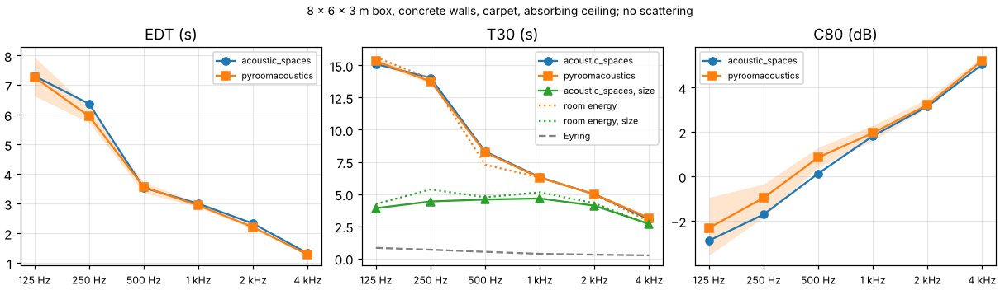

**Diffuse box.** T30 agrees within 5 %; this package stays within 8 % of the room's
energy decay and within 10 % of Eyring's estimate, pyroomacoustics within 11 and 15 %.
From 1 kHz up, pyroomacoustics gives 13 to 21 % longer EDT and 1.7 to 2.2 dB lower C80
than this package, as its
double-counted scattered energy predicts. Barron's revised theory sides with this
package: computed from the simulated energies, as `simulate` prints them, C80 is 0.6 to
1.0 dB below the theory in every band, where pyroomacoustics' (from its impulse
responses) is 1.1 to 3.2 dB below it. From the impulse responses this package's is about
0.5 and 1.2 dB lower again at 250 and 500 Hz (2.0 dB below the theory at 500 Hz), because
the direct sound and the first floor and ceiling reflections interfere within those
octave bands. Surfaces that diffuse fully
scatter no more for their size, so the default gives the same.

| | 125 Hz | 250 Hz | 500 Hz | 1 kHz | 2 kHz | 4 kHz |
|---|---:|---:|---:|---:|---:|---:|
| EDT (s), acoustic_spaces | 0.91 | 0.70 | 0.61 | 0.38 | 0.31 | 0.26 |
| EDT (s), pyroomacoustics | 0.83 | 0.69 | 0.57 | 0.43 | 0.37 | 0.32 |
| EDT (s), pyroomacoustics' spread over 5 runs | 0.13 | 0.09 | 0.04 | 0.02 | 0.03 | 0.02 |
| EDT difference | -8 % | -1 % | -6 % | +13 % | +18 % | +21 % |
| T30 (s), acoustic_spaces | 0.75 | 0.67 | 0.53 | 0.40 | 0.30 | 0.26 |
| T30 (s), pyroomacoustics | 0.71 | 0.65 | 0.54 | 0.41 | 0.31 | 0.26 |
| T30 (s), pyroomacoustics' spread over 5 runs | 0.04 | 0.04 | 0.03 | 0.02 | 0.01 | 0.01 |
| T30 difference | -5 % | -4 % | +2 % | +4 % | +4 % | +2 % |
| C80 (dB), acoustic_spaces | 4.9 | 5.6 | 7.1 | 12.8 | 15.6 | 19.0 |
| C80 (dB), pyroomacoustics | 4.2 | 5.4 | 7.4 | 11.0 | 13.9 | 16.8 |
| C80 (dB), pyroomacoustics' spread over 5 runs | 3.1 | 1.9 | 1.2 | 0.7 | 1.0 | 0.3 |
| C80 difference | -0.7 dB | -0.2 dB | +0.3 dB | -1.8 dB | -1.7 dB | -2.2 dB |
| C80 (dB), Barron's revised theory | 5.3 | 6.8 | 9.1 | 13.6 | 17.1 | 19.8 |
| T30 (s), acoustic_spaces with surface size (default) | 0.75 | 0.67 | 0.53 | 0.40 | 0.30 | 0.26 |
| T30 (s) of the room's energy, vector-based scattering | 0.78 | 0.66 | 0.52 | 0.37 | 0.30 | 0.26 |
| T30 (s) of the room's energy, with surface size | 0.78 | 0.66 | 0.52 | 0.37 | 0.30 | 0.26 |
| Eyring (s) | 0.83 | 0.69 | 0.52 | 0.37 | 0.30 | 0.25 |

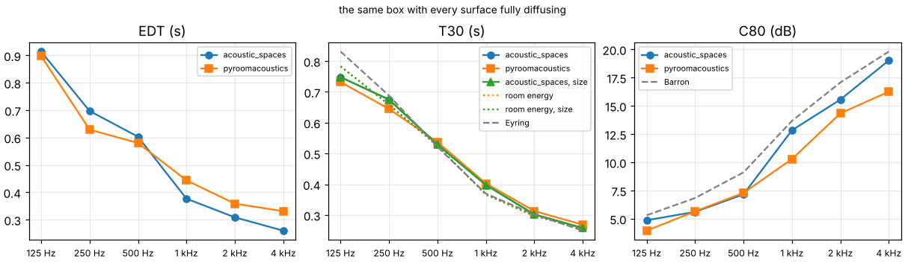

**Example box.** With smooth walls (scattering 0.05), T30 agrees within 4 %, EDT within
7 % and C80 within 1.3 dB. Up to version 2 this package scattered a ray with the
coefficient as probability, and pyroomacoustics' T30 came out 19 to 42 % shorter. The
walls' size halves T30 at 125 and 250 Hz (0.86 s against 1.82 s) and shortens it by
8 to 22 % from 500 Hz up; each run matches the room-energy decay of its model within 11 %.

| | 125 Hz | 250 Hz | 500 Hz | 1 kHz | 2 kHz | 4 kHz |
|---|---:|---:|---:|---:|---:|---:|
| EDT (s), acoustic_spaces | 1.27 | 1.29 | 1.19 | 1.09 | 1.08 | 0.92 |
| EDT (s), pyroomacoustics | 1.30 | 1.20 | 1.12 | 1.14 | 1.08 | 0.86 |
| EDT (s), pyroomacoustics' spread over 5 runs | 0.20 | 0.05 | 0.23 | 0.13 | 0.13 | 0.12 |
| EDT difference | +2 % | -7 % | -6 % | +4 % | +0 % | -6 % |
| T30 (s), acoustic_spaces | 1.82 | 1.76 | 1.57 | 1.52 | 1.44 | 1.23 |
| T30 (s), pyroomacoustics | 1.81 | 1.81 | 1.64 | 1.56 | 1.45 | 1.24 |
| T30 (s), pyroomacoustics' spread over 5 runs | 0.27 | 0.12 | 0.09 | 0.14 | 0.15 | 0.07 |
| T30 difference | +0 % | +3 % | +4 % | +3 % | +1 % | +1 % |
| C80 (dB), acoustic_spaces | 2.7 | 2.5 | 3.3 | 5.1 | 5.1 | 6.3 |
| C80 (dB), pyroomacoustics | 2.9 | 3.4 | 4.6 | 4.8 | 5.2 | 6.5 |
| C80 (dB), pyroomacoustics' spread over 5 runs | 1.2 | 0.7 | 0.6 | 0.7 | 0.7 | 0.7 |
| C80 difference | +0.2 dB | +0.8 dB | +1.3 dB | -0.3 dB | +0.1 dB | +0.2 dB |
| T30 (s), acoustic_spaces with surface size (default) | 0.86 | 0.97 | 1.22 | 1.27 | 1.25 | 1.13 |
| T30 (s) of the room's energy, vector-based scattering | 1.65 | 1.64 | 1.53 | 1.49 | 1.42 | 1.22 |
| T30 (s) of the room's energy, with surface size | 0.90 | 0.93 | 1.29 | 1.28 | 1.36 | 1.18 |
| Eyring (s) | 0.83 | 0.69 | 0.52 | 0.37 | 0.30 | 0.25 |

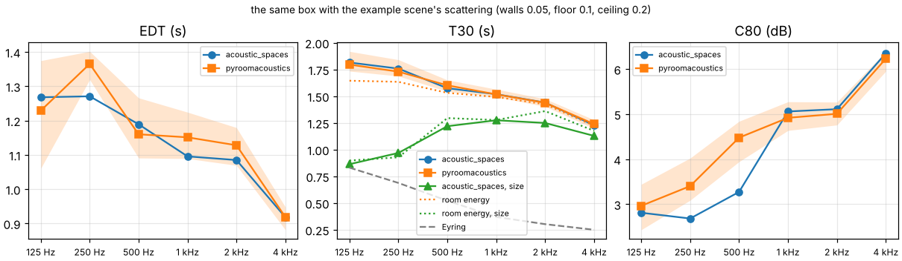

**Lecture hall.** T30 agrees within 3 % and EDT within 5 %; pyroomacoustics' C80 is up to
1.2 dB lower (at 125 Hz), the double-counted scattered energy again. The surfaces' size
shortens T30 by 4 to 16 %, in line with the room-energy decay of that model within 6 %.

| | 125 Hz | 250 Hz | 500 Hz | 1 kHz | 2 kHz | 4 kHz |
|---|---:|---:|---:|---:|---:|---:|
| EDT (s), acoustic_spaces | 1.95 | 1.73 | 1.49 | 1.41 | 1.46 | 1.21 |
| EDT (s), pyroomacoustics | 1.90 | 1.80 | 1.43 | 1.47 | 1.42 | 1.15 |
| EDT (s), pyroomacoustics' spread over 5 runs | 0.30 | 0.23 | 0.12 | 0.05 | 0.10 | 0.07 |
| EDT difference | -2 % | +4 % | -4 % | +4 % | -3 % | -5 % |
| T30 (s), acoustic_spaces | 1.97 | 1.93 | 1.89 | 1.90 | 1.85 | 1.59 |
| T30 (s), pyroomacoustics | 1.96 | 1.95 | 1.90 | 1.96 | 1.87 | 1.59 |
| T30 (s), pyroomacoustics' spread over 5 runs | 0.12 | 0.14 | 0.10 | 0.03 | 0.06 | 0.06 |
| T30 difference | -1 % | +1 % | +0 % | +3 % | +1 % | +0 % |
| C80 (dB), acoustic_spaces | 0.2 | -0.1 | 1.6 | 3.0 | 3.0 | 3.9 |
| C80 (dB), pyroomacoustics | -1.0 | -0.4 | 1.7 | 2.5 | 2.8 | 3.7 |
| C80 (dB), pyroomacoustics' spread over 5 runs | 2.2 | 0.9 | 1.3 | 0.4 | 0.4 | 0.2 |
| C80 difference | -1.2 dB | -0.3 dB | +0.1 dB | -0.6 dB | -0.2 dB | -0.1 dB |
| T30 (s), acoustic_spaces with surface size (default) | 1.88 | 1.74 | 1.59 | 1.70 | 1.74 | 1.53 |
| T30 (s) of the room's energy, vector-based scattering | 1.97 | 1.99 | 1.92 | 1.96 | 1.90 | 1.58 |
| T30 (s) of the room's energy, with surface size | 1.84 | 1.84 | 1.55 | 1.69 | 1.77 | 1.54 |
| Eyring (s) | 1.99 | 1.89 | 1.13 | 0.99 | 0.88 | 0.86 |

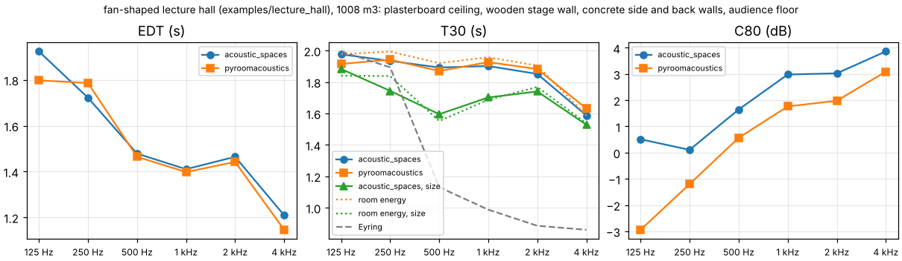

### Conclusions

- With the same scattering model, the programs agree within 5 % on T30 in all four
  rooms, from purely specular to fully diffusing surfaces, and within 8 % on EDT where
  pyroomacoustics' double counting does not lengthen it. That is close to the 5 % and
  1 dB the plan aimed for. With 100,000 rays, pyroomacoustics' own runs differ by up to
  15 % in T30, 21 % in EDT and 3.1 dB in C80, most often at 125 Hz, which is why the tables
  average five of them; this package's numbers move by a few percent with the seed.
- Where the theory is clear (the diffuse box), this package agrees with Eyring (T30
  within 10 %) and with Barron's revised theory (C80 from the energies within 1.0 dB);
  pyroomacoustics counts the scattered energy twice.
- The scattering of a surface's size, which pyroomacoustics lacks, shortens the decay of
  rooms with smooth walls a lot at low frequencies and less at high ones. Measurements,
  not another program, decide whether it helps: in the two measured rooms below it does.

## Measured rooms (BRAS)

The *Benchmark for Room Acoustical Simulation* (BRAS; Aspöck, Brinkmann, Ackermann,
Weinzierl and Vorländer, 2020, [DOI
10.14279/depositonce-6726.3](https://doi.org/10.14279/depositonce-6726.3), CC BY-SA 4.0)
measured real rooms and published their models, the absorption and scattering of their
surfaces, and the impulse responses. Four of its rooms are in `validation/bras` as
scenes (its README says how they were made):

- **CR1**, two coupled rooms, a laboratory of 102 m³ and a reverberation chamber of 121
  m³, with the door between them open by 4.1° and, a scene of its own, by 30.4°, four
  materials. In BRAS's model with the door at 30.4° the door leaf runs 24 mm into the
  wall at its hinge, which leaves the model without an inside; the conversion joins the
  leaf to the wall and the floor;
- **CR2**, a seminar room of 146 m³ with five surface materials;
- **CR3**, a chamber music hall of 3331 m³ with upholstered seating, stage panels and
  structured plaster, seven materials;
- **CR4**, an auditorium of 8657 m³ with eight materials.

In CR2, CR3 and CR4 a dodecahedron loudspeaker stood at two positions and an
omnidirectional microphone at five, giving ten measured responses in each. In CR1 the
loudspeaker stood once in each room (LS1 in the chamber, LS2 in the laboratory) and the
microphone at two positions in the laboratory, giving four. Each scene was simulated as
it stands, with this package's defaults: ray tracing up to the 3rd order, first-order
edge diffraction, 50,000 late rays per band and vector-based scattering with the
scattering of each surface's size, in the air measured on the day. Simulated and
measured parameters were compared pair by pair in just noticeable differences
(`acoustic_spaces.compare`, the same JNDs as `acoustic-spaces compare`) and averaged
over the pairs, in CR1 over each source's. The measured responses were analysed by this
package too. Its octave values, averaged over the ten pairs, are within 3 % of the mean
of the three third-octave averages BRAS publishes for T20, within 5 % for EDT and within
0.8 dB for C80, from 500 Hz to 4 kHz in CR2, CR3 and CR4 (the largest differences are
EDT 4.3 % lower in the hall at 500 Hz and C80 0.8 dB higher in the auditorium at 500 Hz
and 1 kHz; elsewhere within 3.8 % and 0.6 dB). BRAS publishes none for CR1. Below 500 Hz
the octave holds three third-octave bands whose values differ a lot, so averaging them
is not the same analysis. G is compared from seat to seat, as the level of the measured
responses is uncertain by about 3 dB (see [Strength](#strength-g) below).

The tables and plots in this section were made with this version on 29 and 30 October
2026 (the coupled rooms with the door at 30.4° on 2 November), on 4 cores of a cloud
machine without a GPU, where the run times below were measured with each run alone on
the machine (the coupled rooms', the seminar room's and the auditorium's in a second run
on 30 October, which gave the same numbers). The coupled rooms, the seminar room and the
auditorium each run in 2 to 4 minutes and 0.7 to 1.1 GiB (4 to 9 minutes calibrated, 5
to 11 minutes and up to 1.2 GiB in third-octave bands); the hall takes 1.5 hours and
10.0 GiB (5.2 hours and 10.5 GiB calibrated, 3.4 hours and 11.8 GiB in third-octave
bands), nearly all of it the early stage's edge diffraction at one listener (see
[Memory](simulation.md#memory)). 4.0.0 could not run the seminar room or the hall at
their defaults: its early stage asked for 16.4 GiB at once in CR3 and 19.6 GiB in CR2.

BRAS gives two sets of absorption coefficients. The **fitted** set was adjusted until
Eyring's formula gave the measured reverberation time (in CR1 for each of the two rooms
on its own); the scenes use it. The **initial** set is BRAS's estimate before that, from
tables and measurements of the materials, which is the blind case (`--materials
initial`).

Mean absolute difference from 125 Hz to 4 kHz in JNDs (for G in dB, the JND being 1 dB),
and how many of the pair and band values are within one JND: of 60 in CR2, CR3 and CR4,
of 24 in CR1 at each angle of the door (23 for T30 at 4.1°, which one of LS1's responses
does not decay far enough for at 125 Hz). With the fitted absorption:

| | CR1, 4.1° | CR1, 30.4° | CR2 | CR3 | CR4 |
|---|---:|---:|---:|---:|---:|
| EDT | 7.8 (2) | 7.6 (1) | 1.0 (44) | 2.0 (20) | 3.7 (3) |
| T20 | 6.7 (1) | 4.6 (2) | 1.0 (41) | 2.0 (9) | 3.0 (1) |
| T30 | 7.7 (0) | 3.8 (5) | 1.0 (43) | 1.8 (9) | 3.0 (0) |
| C50 | 4.3 (1) | 2.0 (6) | 1.0 (41) | 1.2 (34) | 1.3 (29) |
| C80 | 4.0 (1) | 2.5 (5) | 0.7 (52) | 1.0 (40) | 1.3 (26) |
| D50 | 4.1 (1) | 2.0 (5) | 1.0 (39) | 1.3 (31) | 1.3 (28) |
| Ts | 3.6 (2) | 5.0 (0) | 0.8 (41) | 1.0 (33) | 2.5 (9) |
| G, seat to seat | 1.8 (5) | 0.6 (20) | 0.3 (53) | 0.6 (52) | 0.5 (50) |

With the initial absorption:

| | CR1, 4.1° | CR1, 30.4° | CR2 | CR3 | CR4 |
|---|---:|---:|---:|---:|---:|
| EDT | 16.3 (0) | 13.1 (1) | 5.9 (6) | 4.8 (8) | 4.0 (8) |
| T20 | 11.0 (1) | 6.3 (0) | 6.5 (1) | 5.8 (12) | 3.7 (13) |
| T30 | 5.6 (4) | 8.1 (1) | 6.5 (0) | 5.7 (11) | 3.8 (10) |
| C50 | 6.1 (3) | 2.9 (7) | 1.6 (24) | 1.5 (23) | 1.6 (24) |
| C80 | 6.0 (4) | 3.5 (5) | 1.7 (28) | 1.4 (26) | 1.5 (27) |
| D50 | 5.9 (3) | 2.9 (6) | 1.7 (23) | 1.6 (21) | 1.7 (24) |
| Ts | 12.5 (4) | 5.7 (4) | 3.3 (14) | 2.2 (22) | 2.8 (16) |
| G, seat to seat | 2.9 (2) | 1.2 (10) | 0.3 (54) | 0.6 (51) | 0.5 (50) |

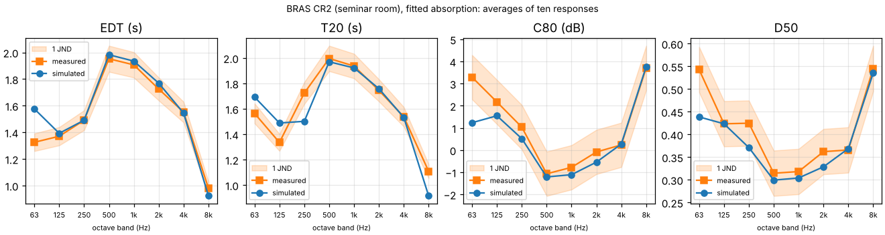

**Seminar room, fitted absorption.** From 500 Hz to 4 kHz the reverberation time is
within 2 % of the measured one (T20 1.92 s against 1.94 s at 1 kHz), well within one
JND, and C50, C80 and D50 are within one JND from 500 Hz up. At 250 Hz and 8 kHz the
simulated decay is 13 and 18 % short, and so is Eyring's formula with the same
absorption and air (1.48 s against 1.72 s measured at 250 Hz, 0.93 s against 1.11 s at 8
kHz), so there the fitted coefficients, averaged onto octaves, do not give the measured
decay even in a diffuse field. At 8 kHz they assume less air absorption than ISO 9613-1
gives at the octave's centre frequency; a measured decay follows the octave's slowest
part, its lowest third (6.3 kHz). Simulated in third-octave bands, which keep both
apart, the two bands come within 4.1 % of the measurement (see the third-octave results
below).

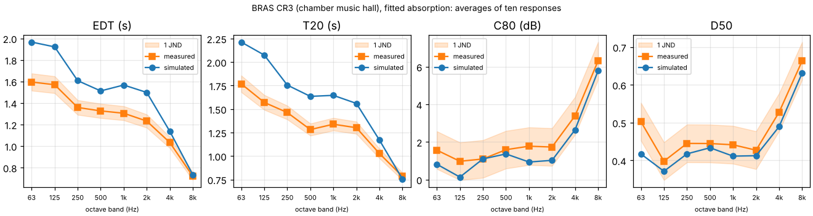

**Chamber music hall, fitted absorption.** The reverberation time comes out 6 to 10 %
long from 250 Hz to 4 kHz (T20 1.47 s against 1.34 s at 1 kHz), 1.3 to 1.9 JNDs, and 11
and 19 % long at 63 and 125 Hz. EDT is within 3.8 % at 125, 250 and 500 Hz and 5 to 14 %
long from 1 to 4 kHz, but 20 % short at 63 Hz, where the early part is stronger than
measured (see the next paragraph). From 125 Hz up, C50, C80 and D50 are
within about one JND, mostly slightly low, as a slightly long decay predicts. Eyring's
formula with the same absorption and air is within 5.1 % of the measurement from 63 Hz
to 4 kHz, as the fitting intends. That the model decays more slowly suggests that in
it sound reaches the absorbing seating a little less often than Eyring's diffuse field
assumes; why the real hall decays as Eyring's formula gives and the model does not is
not traced (the simplified BRAS model, which smooths the hall's details away, is one
candidate).

**The hall's early part at low frequencies.** At 125 Hz C80 is 0.6 dB low and
EDT 3.8 % short; at 63 Hz the early part is too strong (C80 1.1 dB high, EDT 3.6 JNDs
short).

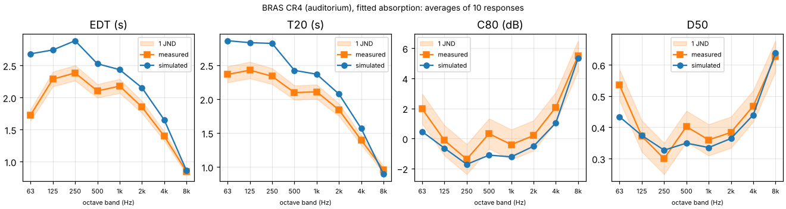

**Auditorium, fitted absorption.** The decay comes out 12 to 21 % long from 125 Hz to 4
kHz (T20 2.37 s against 2.11 s at 1 kHz), 2.5 to 4.2 JNDs, and EDT 12 to 21 % long too.
Eyring's formula with the same absorption and air is within 5 % of the measured T20 from
63 Hz to 4 kHz, so here too the fitting did what it intends; that the model decays
more slowly still suggests that its sound reaches the absorbing surfaces less often
than Eyring's diffuse field assumes, more so than in the hall (see "Calibrated
absorption" below). C50, C80 and D50 are within about
one JND from 125 Hz up (C80 1.4 JNDs low at 500 Hz), and like the hall's mostly low. At
8 kHz the decay is 7 % short, as in the seminar room: Eyring's formula with the same
absorption and air gives 0.82 s against 0.96 s measured.

**What scattering does.** Up to version 2 this package scattered a ray with the
coefficient as probability, and from the surface's own coefficient alone. The hall then
came out 20 to 32 % long, EDT 11 to 24 %, and the seminar room 0 to 10 % long from 250
Hz to 4 kHz. Tracing the total sound energy in each room without listeners, as the
cross-check above does, and fitting T20 to its decay shows what each part of the new
model does (`validation/bras_room_energy.py`: 20,000 rays from LS1,
seed 0). The two vector-based models trace each band with rays of its own; random
scattering, as version 2 did, traces one ray for all bands and re-weights each band by
its own coefficient, which makes it noisier: with another seed its row moves by up to
8 % (the hall at 63 Hz), the others by up to 1.3 %.

| T20 (s) | 63 Hz | 125 Hz | 250 Hz | 500 Hz | 1 kHz | 2 kHz | 4 kHz | 8 kHz |
|---|---:|---:|---:|---:|---:|---:|---:|---:|
| CR2 measured | 1.56 | 1.34 | 1.72 | 2.00 | 1.94 | 1.75 | 1.54 | 1.11 |
| CR2 room energy, random scattering (version 2) | 1.51 | 1.49 | 1.70 | 2.17 | 2.06 | 1.83 | 1.60 | 0.97 |
| CR2 room energy, vector-based scattering | 1.57 | 1.41 | 1.51 | 1.82 | 1.79 | 1.66 | 1.44 | 0.90 |
| CR2 room energy, vector-based with surface size (default) | 1.69 | 1.49 | 1.50 | 1.97 | 1.92 | 1.76 | 1.53 | 0.91 |
| CR2 Eyring | 1.45 | 1.34 | 1.48 | 2.00 | 1.95 | 1.76 | 1.59 | 0.93 |
| CR3 measured | 1.77 | 1.57 | 1.46 | 1.28 | 1.34 | 1.30 | 1.03 | 0.78 |
| CR3 room energy, random scattering (version 2) | 2.11 | 2.01 | 1.77 | 1.60 | 1.63 | 1.56 | 1.18 | 0.74 |
| CR3 room energy, vector-based scattering | 2.11 | 1.95 | 1.69 | 1.51 | 1.52 | 1.43 | 1.11 | 0.74 |
| CR3 room energy, vector-based with surface size (default) | 2.03 | 1.89 | 1.63 | 1.40 | 1.47 | 1.40 | 1.12 | 0.74 |
| CR3 Eyring | 1.79 | 1.65 | 1.49 | 1.28 | 1.33 | 1.33 | 1.06 | 0.71 |

From 500 Hz to 4 kHz, vector-based scattering alone takes the hall from 15 to 25 % long
down to 8 to 18 %, but makes the seminar room 5 to 9 % short. Adding the scattering of
each surface's size brings the seminar room within 2 % of the measurement (and within 4
% of Eyring's diffuse field), and the hall to 8 to 10 % long: one model now fits both
rooms better than either did. The simulated responses decay like these room-energy
curves, within 0.2 % in the seminar room and 4.8 % in the hall in every band. The rest
of the hall's gap is not traced further (see the hall's fitted absorption above). Fitting the
absorption with this tracer instead of Eyring's formula takes up that gap, in the hall
and in the auditorium (see "Calibrated absorption" below).

**Third-octave bands.** BRAS gives its coefficients in third octaves. Averaged onto
octaves, an octave's three thirds decay as one, at their mean absorption, while three
decays at different rates decay together more slowly than that, as the measured octave
does. Simulated with `simulation.bands: third_octave`, which keeps the thirds apart
(`bras_validation.py --bands third_octave`), T20 in each octave band:

| T20 (s) | 63 Hz | 125 Hz | 250 Hz | 500 Hz | 1 kHz | 2 kHz | 4 kHz | 8 kHz |
|---|---:|---:|---:|---:|---:|---:|---:|---:|
| CR2 measured | 1.56 | 1.34 | 1.72 | 2.00 | 1.94 | 1.75 | 1.54 | 1.11 |
| CR2 octave bands (default) | 1.69 | 1.49 | 1.50 | 1.97 | 1.92 | 1.76 | 1.53 | 0.91 |
| CR2 third-octave bands | 1.77 | 1.51 | 1.65 | 1.98 | 1.92 | 1.78 | 1.51 | 1.07 |
| CR3 measured | 1.77 | 1.57 | 1.46 | 1.28 | 1.34 | 1.30 | 1.03 | 0.78 |
| CR3 octave bands (default) | 1.96 | 1.87 | 1.55 | 1.40 | 1.47 | 1.40 | 1.10 | 0.72 |
| CR3 third-octave bands | 2.00 | 1.90 | 1.57 | 1.40 | 1.46 | 1.40 | 1.13 | 0.80 |
| CR4 measured | 2.36 | 2.43 | 2.34 | 2.10 | 2.11 | 1.84 | 1.39 | 0.96 |
| CR4 octave bands (default) | 2.86 | 2.83 | 2.82 | 2.42 | 2.37 | 2.07 | 1.57 | 0.89 |
| CR4 third-octave bands | 2.96 | 2.92 | 2.87 | 2.45 | 2.38 | 2.07 | 1.63 | 1.03 |

The seminar room's decay at 250 Hz and 8 kHz, 13 and 18 % short in octave bands, comes
within 4.1 % of the measurement: there its thirds' absorption, and at 8 kHz the air's,
differ most. The hall's 8 kHz goes from 8 % short to 2 % long, and the auditorium's from
7 % short to 7 % long. From 500 Hz to 2 kHz T20 changes by 0.03 s at most. At 63 and 125
Hz the rooms come out 1 to 5 % longer than in octave bands, and the hall at 4 kHz 10 %
long instead of 7 %. Over 125 Hz to 4 kHz the seminar room's mean T30 difference goes
from 1.0 to 0.9 JNDs; the hall's goes from 1.8 to 2.1 and the auditorium's from 3.0 to
3.5, since their decays were long already and third octaves lengthen them. In the
coupled rooms with the door at 4.1° they lengthen the decay of LS1's sound further (T20
13.8 s at 125 Hz against 12.1 s in octave bands and 6.7 s measured). A third-octave run
takes 10 and 11 minutes for the seminar room and the auditorium instead of 4, and 3.4
hours for the hall instead of 1.5.

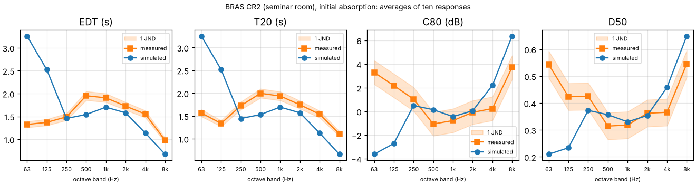

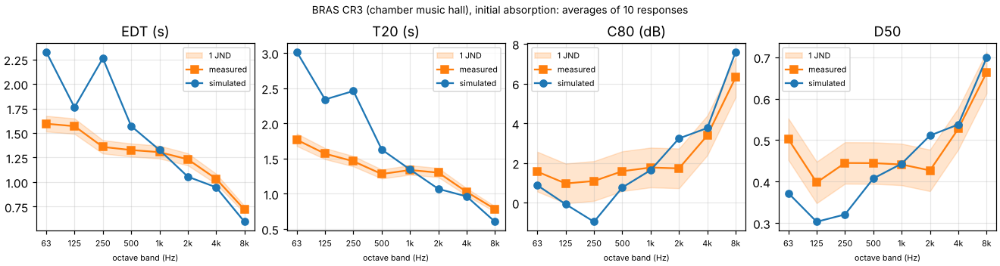

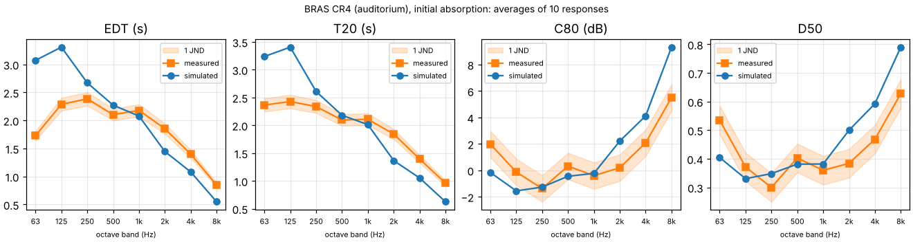

**Initial absorption.** With the absorption estimated before fitting, T20 at 63 and 125
Hz comes out 1.5 to 2.2 times as long as measured in the seminar room and the hall, and
at 250 Hz in the hall too (2.71 s against 1.34 s in CR2 at 125 Hz), and 1.4 times in the
auditorium. The initial coefficients have far less absorption there than the fitted
ones. In real rooms much of it comes from structures that flex, such as panels, windows
and doors, which tables of materials rarely capture. From 500 Hz to 4 kHz the seminar
room's decay is 12 to 29 % short, and at 2 and 4 kHz the hall's is 6 to 18 % short and
the auditorium's 26 and 25 %. The simulation follows Eyring's formula with the same
coefficients within 15 % in every band of the seminar room and the hall (within 3 % from
250 Hz up in the seminar room), and is 15 to 22 % longer in every band of the
auditorium, as with the fitted set, so the error is in the coefficients. This is the
error to expect from tabulated coefficients alone, before a room has been measured.

**Calibrated absorption.** `--calibrate LS1` first fits the absorption of every surface
(`acoustic-spaces calibrate`, see
[Measurements](measurements.md#fitting-materials-to-measurements)). It fits to the T30,
EDT and C80 of the five responses of the first loudspeaker position, starting from the
initial set, with 10,000 rays per band while fitting. Then it simulates the room with
what the fit found, as above, and compares the five responses of the second position,
which the fit did not see. The table gives the mean absolute difference from 125 Hz to 4
kHz in JNDs over those five responses, with how many of their 30 pair and band values
are within one JND. The fitted and initial columns repeat the tables above, which
average all ten responses:

| | CR2 calibrated | CR2 fitted | CR2 initial | CR3 calibrated | CR3 fitted | CR3 initial | CR4 calibrated | CR4 fitted | CR4 initial |
|---|---:|---:|---:|---:|---:|---:|---:|---:|---:|
| EDT | 1.1 (17) | 1.0 | 5.9 | 1.4 (14) | 2.0 | 4.8 | 1.5 (12) | 3.7 | 4.0 |
| T20 | 0.9 (24) | 1.0 | 6.5 | 1.0 (18) | 2.0 | 5.8 | 0.7 (24) | 3.0 | 3.7 |
| T30 | 1.0 (22) | 1.0 | 6.5 | 0.5 (26) | 1.8 | 5.7 | 0.6 (25) | 3.0 | 3.8 |
| C50 | 1.1 (20) | 1.0 | 1.6 | 1.2 (14) | 1.2 | 1.5 | 1.4 (13) | 1.3 | 1.6 |
| C80 | 0.6 (26) | 0.7 | 1.7 | 0.8 (19) | 1.0 | 1.4 | 1.0 (16) | 1.3 | 1.5 |
| D50 | 1.1 (20) | 1.0 | 1.7 | 1.3 (12) | 1.3 | 1.6 | 1.4 (14) | 1.3 | 1.7 |
| Ts | 0.7 (26) | 0.8 | 3.3 | 0.8 (21) | 1.0 | 2.2 | 1.2 (14) | 2.5 | 2.8 |

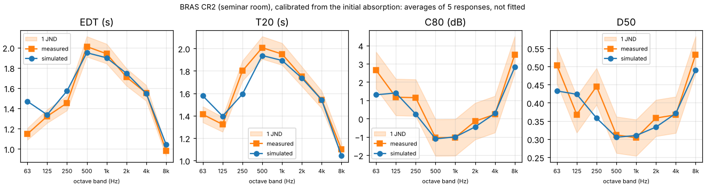

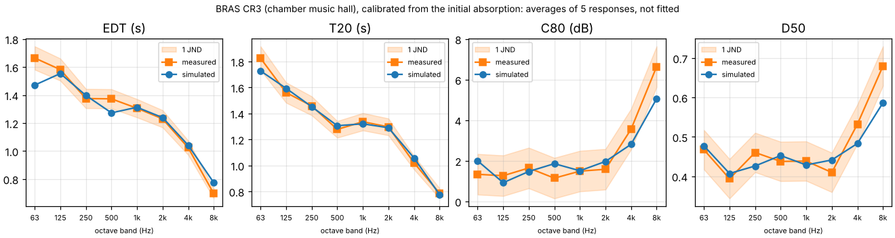

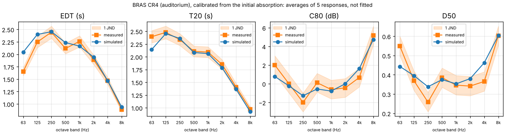

The initial estimates made the decay up to 2.2 times as long. From them, calibration
brings the seminar room to about one JND on responses it did not fit, as BRAS's fitted
set does. In the hall and the auditorium it does better than the fitted set on the
decay. In the hall T30 is within 0.5 JNDs on average, with 26 of the 30 values within
one JND, against 1.8 with the fitted set, T20 within 1.0 against 2.0 and EDT 1.4 against
2.0. In the auditorium T20 and T30 are within 0.7 and 0.6 JNDs, with 24 and 25 of the 30
values within one JND, against 3.0 with the fitted set, and EDT 1.5 against 3.7. The
fit uses the model's own rays rather than Eyring's formula, so it takes up what the
model's sound misses of the absorbing surfaces: from 63 Hz to 4 kHz it found 3 to 23 %
more absorption in all than BRAS's fitted set in the hall, and 18 to 30 % more in the
auditorium. The clarity stays within 0.8 to 1.4 JNDs on average, as with the fitted set
(1.0 to 1.3).

In the seminar room the fit found nearly BRAS's fitted set, though it started from the
initial one. The windows absorb 0.24 and 0.31 at 63 and 125 Hz (BRAS fitted 0.25 and
0.19, initial 0.13 and 0.10), and every other value is within 0.022 of BRAS's. In the
hall it found more absorption than BRAS in the plaster at 125 and 250 Hz (0.22 and 0.20
against 0.11 and 0.15) and in the seating at 63 Hz and 2 kHz (0.29 and 0.58 against 0.17
and 0.41), and less in the seating at 125 and 250 Hz (0.13 and 0.23 against 0.21 and
0.37) and in the structured plaster at 2 kHz (0.10 against 0.14). In the auditorium the
linoleum absorbs 0.23 and 0.28 at 63 and 125 Hz (BRAS fitted 0.15 and 0.10), the brick
wall 0.31 at 500 Hz (0.20) and the wood panels 0.27 at 4 kHz (0.12).

These are what a model needs to match the room, not what each surface absorbs. With one
loudspeaker position and five microphones, the uncertainty the fit reports is above 0.2
for most materials and bands in the hall and the auditorium, and 0.49 or more for all of
them in the seminar room. The measurements fix each band's total absorption, and the
proportions between materials come from the initial estimates. Telling surfaces apart
takes responses that hear them differently, such as sources and microphones near
different surfaces.

Some differences remain:

- **250 Hz in the seminar room.** T30 is 3.1 JNDs short on the second loudspeaker's
  responses, though 1.2 off on average on the first's. The two positions measured 1.70
  and 1.90 s on average. This is near the room's Schroeder frequency, about 230 Hz,
  where a decay depends on where it is measured.
- **8 kHz in the seminar room.** The decay stays 2 JNDs short even with surfaces that
  absorb next to nothing, because in octave bands the air absorbs at the octave's centre
  frequency (see "Third-octave bands" above).
- **63 Hz in the seminar room.** EDT stays 5.9 JNDs long. This is below the room's
  Schroeder frequency, where a geometric model gives an average rather than the room's
  modes: a likely cause, not traced.
- **63 and 125 Hz in the hall.** EDT is 3.7 and 1.6 JNDs short and T20 1.7 and 2.4 JNDs
  long. At 63 Hz the early part is stronger than measured, as with the fitted set (see
  "The hall's early part at low frequencies" above). The hall's Schroeder frequency is
  about 45 Hz.
- **63 Hz in the auditorium.** EDT is 5.1 JNDs long and T30 3.4 JNDs short.

Fitting took 5.3 minutes for the seminar room (three rounds of tracing at the first
position's 10,000 rays per band), 4.4 minutes for the auditorium (four rounds) and 3.7
hours for the hall (four rounds), where nearly all of it is the early stage's edge
diffraction, which fewer rays do not shorten. Simulating again took about 4 minutes in
the seminar room and the auditorium and 89 minutes in the hall.

### Coupled rooms

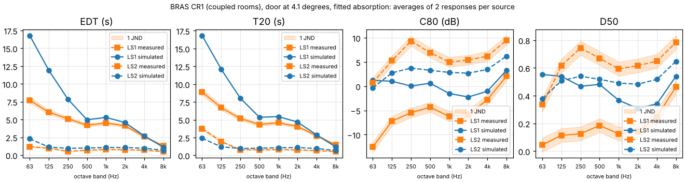

In CR1 the door, open by 4.1°, leaves the rooms joined by a slit: about 4 cm between
the leaf's free end and the jamb, over the door's height, and a wedge above the leaf,
about 0.1 m² in all. In the model, nothing else joins them. The scene's absorption is
BRAS's fitted set, fitted to each room on its own, so the chamber alone decays in 12.4 s
at 125 Hz and 5.5 s at 500 Hz by Eyring's formula, and the laboratory in 1.0 and 0.7 s
(with each room's volume and surface as BRAS's material file gives them).

LS1's sound reaches the microphones in the laboratory from the chamber. Simulated, it
decays in 12.1 s at 125 Hz and 5.4 s at 500 Hz (T20), within 5.3 % of what the diffuse
theory of two coupled rooms gives from 125 Hz to 2 kHz with those Eyring times and an
opening of 0.1 m² (11.7 and 5.4 s; `validation/coupled_rooms.py`). Near that opening
the decay changes little with it, so the simulated decays correspond to openings from
0.04 to 0.33 m² in the same theory. The measured sound decays in 6.7 and 4.3 s: in
the theory the rooms would need to be joined by 1.5 and 1.6 m² at 125 and 250 Hz and
1.0 m² from 500 Hz to 2 kHz, 10 to 16 times the model's opening. The model's door
is a rigid slab, without the transmission BRAS gives no data for, and its rooms meet
nowhere else, so what joins the real rooms that strongly is not in the model. LS1's EDT
and T20 are 2 to 25 JNDs long from 63 Hz to 2 kHz, and C80 4 to 14 dB high.

LS2's sound decays in the laboratory, where the measured decays bend: their EDT is 0.80
s at 1 kHz and their T30 1.41 s, at 125 Hz 0.97 and 4.38 s, the chamber's sound coming
back through the door. The simulated decays are single slopes, so T30 is 5 to 14 JNDs
short from 125 Hz to 1 kHz. Their EDT is 1.1 s at 1 kHz, a third longer than the 0.8 s
Eyring's formula gives for the laboratory with the fitted set, which is what was
measured: as in the hall and the auditorium, the model decays more slowly than Eyring's
diffuse field with the same absorption, here more so.

With the door at 4.1° and calibrated on LS1's responses from the initial set
(`--calibrate LS1`), the fit raised the absorption of the chamber's painted concrete to
4.5 times BRAS's fitted value at 125 Hz and 1.2 to 1.7 times from 250 Hz to 4 kHz, which
brings LS1's EDT within 16 % and its T20 within 11 % from 125 Hz to 4 kHz, and took the
laboratory's absorber down from 0.49 to 0.20 at 1 kHz, as LS1's responses do not pin it
(the fit reports an uncertainty of 0.33 to 6.7 for it). LS2's responses, which the fit
did not see, then decay in 2.2 s at 1 kHz against 0.8 s measured, 55 JNDs off in EDT on
average. A calibration fits the responses it is given; in coupled rooms each room needs
responses of its own.

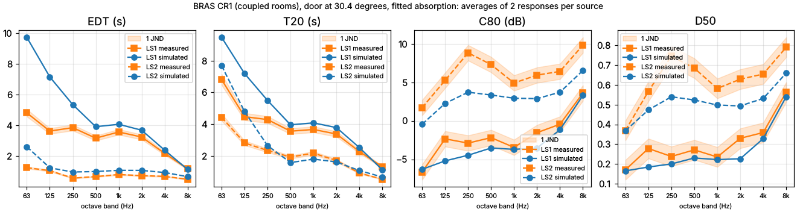

With the door open by 30.4°, the leaf stands in the chamber beside the doorway. LS1's
sound crosses the doorway (2.9 m² beside the box on the leaf) and then goes round the
leaf (about 2.0 m², between the box and the doorway's far side and over the leaf), and
in the same theory two openings crossed in turn, with no absorption between them, act as
one of 1.2 m². Simulated, the sound decays in 7.2 s at 125 Hz and 4.0 s at 500 Hz, 1.5
to 7.3 % faster than the theory with that opening from 125 Hz to 2 kHz (7.3 and 4.2 s):
the simulated decays correspond to openings of 1.2 to 1.6 m². The measured sound decays
in 4.5 and 3.6 s, so the decay comes much closer than with the door at 4.1°: T20 is 11
to 12 % long from 500 Hz to 4 kHz (2.1 to 2.4 JNDs), against 5 to 24 %, and 60 and 28 %
long at 125 and 250 Hz, against 81 and 55 %; C80 is 0.3 to 2.9 dB low from 125 Hz to 4
kHz. In the theory the measured decays need openings of 2.2 to 2.5 m² from 250 Hz to 2
kHz, 0.7 to 1.2 m² more than the simulated ones, and with the door at 4.1° 0.7 to 1.5 m²
more: what the model lacks changes little with the door's angle. At 125 Hz they need 3.6
m², more than the whole doorway (3.2 m²).

LS2's measured decays bend more than with the door at 4.1° (EDT 0.80 s and T30 3.17 s at
1 kHz), and the simulated ones bend too: T30 is within 1.6 JNDs from 500 Hz to 4 kHz,
though 31 and 78 % long at 250 and 125 Hz. EDT is 1.08 s at 1 kHz, as with the door at
4.1°. G from seat to seat, which holds the level of LS1's sound in the laboratory
against LS2's, is within 1 dB in 20 of the 24 values (5 with the door at 4.1°).

The CR1 runs take 2 minutes and 0.7 GiB with the door at either angle (5 minutes and 0.9
GiB in third-octave bands, 4 minutes calibrated, with the door at 4.1°).

### Strength (G)

The measured responses are in pascals. BRAS calibrated the measuring chain to 80 dB at 2
m in front of the dodecahedron at 1 kHz, and corrected each room's level by 6 dB by hand
to meet the expected direct sound. Read with the dodecahedron's directivity (BRAS's
data, averaged over all directions) and 80 dB as the level of the 1 kHz sine, the
measured G is 2.3 to 3.3 dB above classic diffuse theory (10 log10(100/r² + 31,200
T30/V), with the measured T30) at 500 Hz, 1 kHz and 4 kHz in the seminar room and the
hall, and 1.7 to 2.4 dB in the auditorium, and the direct sound is about 2 to 3 dB above
the calibration even in the dodecahedron's loudest direction, in the hall's pairs where
it stands apart. At 2 kHz it is within 0.6 dB of the theory, about 3 dB below the
neighbouring octaves in all three rooms, which the dodecahedron's directivity data do
not explain. The simulated G is within 1.3 dB of the same theory there (0.0 in the
seminar room). Read with 80 dB as the sine's peak instead, which lowers the measured G
by 3 dB, it comes within 1.3 dB of the theory at 500 Hz, 1 and 4 kHz in all three rooms,
and 2.4 to 3.5 dB below it at 2 kHz. Which reading BRAS meant is not stated, so an
absolute G against these responses would test the reading, not the simulation. These
absolute levels come from one-off checks with BRAS's dodecahedron data and measured
responses, and the simulated ones from the fitted runs, which the fixes at 125 Hz leave
as they were from 250 Hz up; no script in the repository makes them yet.

Simulated minus measured G with the first reading, at 500 Hz, 1, 2 and 4 kHz (means over
the pairs, standard deviations 0.2 to 0.9 dB):

| | 500 Hz | 1 kHz | 2 kHz | 4 kHz |
|---|---:|---:|---:|---:|
| CR2 | -2.3 | -3.1 | +0.2 | -2.9 |
| CR3 | -1.3 | -2.1 | +0.1 | -3.2 |
| CR4 | -1.7 | -2.1 | +0.5 | -2.2 |

These are left out of the JND counts. What is compared is G from seat to seat: each
pair's simulated G less the mean over the room's pairs, against each pair's measured
level less its mean, which the level's reference does not touch. From 125 Hz to 4 kHz it
is within one JND (1 dB) in 53 of the 60 values in the seminar room, 52 in the hall and
50 in the auditorium, 0.3 to 0.6 dB off on average. In the coupled rooms, where it holds
the level of the chamber's sound against the laboratory's own, it is 1.8 dB off with the
door at 4.1°, 5 of 24 within 1 dB: the coupling again; with the door at 30.4°, 0.6 dB
off, 20 of 24.

### Interaural cross-correlation

BRAS also measured binaural responses in the seminar room, the hall and the auditorium:
five QSC K8 loudspeakers (LS3 to LS7), one at a time, aimed at FABIAN, a head and torso
simulator 4 to 5 m away in the seminar room and 10 to 11 m in the hall and the
auditorium, facing LS7 with its head straight. `validation/bras_binaural.py` simulates
each loudspeaker with the K8's measured directivity (`validation/bras/QSC_K8.csv`) and
the fitted absorption, renders the response through FABIAN's head-related impulse
responses (every 2°), and compares IACC_E (the first 80 ms) and IACC_L (from 80 ms) with
those of the measured responses, analysed by this package, in JNDs of 0.075 (ISO
3382-1). The late part of a rendered response is noise drawn anew with each seed, and so
are the phases of paths over edges that arrive together, so the simulated values are
means over 10 seeds. From 125 Hz to 4 kHz their standard deviation, averaged over a
room's loudspeakers, is 0.10 at most, and 0.14 for one loudspeaker.
Means over the five loudspeakers, measured / simulated, and how many of the 30
loudspeaker and band values from 125 Hz to 4 kHz are within one JND:

| IACC_E | 125 Hz | 250 Hz | 500 Hz | 1 kHz | 2 kHz | 4 kHz | within 1 JND | mean (JNDs) |
|---|---:|---:|---:|---:|---:|---:|---:|---:|
| CR2 | 0.90 / 0.91 | 0.66 / 0.74 | 0.38 / 0.32 | 0.37 / 0.32 | 0.42 / 0.37 | 0.36 / 0.31 | 18 | 1.1 |
| CR3 | 0.94 / 0.93 | 0.79 / 0.71 | 0.48 / 0.31 | 0.48 / 0.40 | 0.65 / 0.53 | 0.55 / 0.52 | 19 | 1.2 |
| CR4 | 0.96 / 0.96 | 0.87 / 0.85 | 0.86 / 0.81 | 0.81 / 0.83 | 0.87 / 0.87 | 0.87 / 0.87 | 25 | 0.5 |

| IACC_L | 125 Hz | 250 Hz | 500 Hz | 1 kHz | 2 kHz | 4 kHz | within 1 JND | mean (JNDs) |
|---|---:|---:|---:|---:|---:|---:|---:|---:|
| CR2 | 0.90 / 0.89 | 0.54 / 0.67 | 0.14 / 0.18 | 0.11 / 0.09 | 0.07 / 0.08 | 0.06 / 0.07 | 25 | 0.6 |
| CR3 | 0.95 / 0.91 | 0.73 / 0.71 | 0.20 / 0.17 | 0.14 / 0.12 | 0.11 / 0.09 | 0.10 / 0.10 | 26 | 0.6 |
| CR4 | 0.92 / 0.92 | 0.72 / 0.74 | 0.33 / 0.27 | 0.34 / 0.20 | 0.29 / 0.25 | 0.26 / 0.15 | 19 | 1.2 |

IACC_L is within one JND in 19 to 26 of the 30 values; in the auditorium it is 2.0 and
1.4 JNDs low at 1 and 4 kHz, which is not traced. IACC_E is within one JND in 25 in the
auditorium, and in the seminar room within about one JND on average in every band, but
1.0 to 2.2 JNDs low in the hall from 500 Hz to 2 kHz. Split into the direct sound (its
first 5 ms) and the rest of the first 80 ms, and the simulated responses also into their
direct sound, specular reflections, diffracted paths and late part, rendered one at a
time (one seed of the rendering, `validation/bras_iacc_parts.py`):

- **The hall from 500 Hz to 2 kHz.** From LS7 the simulated sound after the first 5 ms
  is about as strong against the direct sound as measured (3.0 dB above it at 1 kHz in
  both, 4.3 and 0.6 dB against 5.8 and 1.3 dB at 500 Hz and 2 kHz), but far less alike
  at the two ears: its IACC is 0.18 at 1 kHz against 0.63 measured, and 0.35 against
  0.73 at 500 Hz. At 1 kHz the direct sound, the specular reflections, the diffracted
  paths and the late part each carry a quarter to a third of the early sound, and the
  diffracted paths and the late part are the least alike at the ears (0.25 and 0.21).
  Why the simulated early sound is less alike at the ears than the measured is not
  traced.
- **The auditorium at 500 Hz.** The simulated sound in the 75 ms after the direct sound
  is 4.4 and 6.7 dB stronger against the direct sound than measured (LS4 and LS5), and
  within 1.2 dB from 1 to 4 kHz. At 500 Hz the specular reflections alone, over the first
  80 ms, are 1.3 dB below the direct sound from both loudspeakers, where all of the
  measured sound after the direct sound is 5.9 and 6.3 dB below it. IACC_E there is
  within one JND on average all the same (0.81 against 0.86); those reflections reach the
  two ears nearly alike (0.89 and 0.90).

### How much a run varies

The late rays are traced in 10 batches by default, which gives each simulated parameter
a standard error: one standard deviation of how much it would change between runs with
other seeds (see [Simulation](simulation.md), late reverberation). `bras_validation.py`
prints the largest over each room's pairs from 125 Hz to 4 kHz, in JNDs. With the fitted
absorption, at 50,000 rays per band:

| largest standard error (JNDs) | CR1, 4.1° | CR1, 30.4° | CR2 | CR3 | CR4 |
|---|---:|---:|---:|---:|---:|
| EDT | 1.08 | 0.24 | 0.12 | 0.56 | 0.48 |
| T20 | 0.42 | 0.28 | 0.07 | 0.34 | 0.36 |
| T30 | 0.22 | 0.23 | 0.05 | 0.25 | 0.20 |
| C50 | 0.46 | 0.15 | 0.06 | 0.23 | 0.15 |
| C80 | 0.57 | 0.14 | 0.05 | 0.22 | 0.20 |
| D50 | 0.52 | 0.11 | 0.06 | 0.25 | 0.17 |
| Ts | 0.88 | 0.28 | 0.06 | 0.14 | 0.20 |

In the seminar room no standard error is above an eighth of a JND. In the hall and the
auditorium EDT's standard error is a third of a JND for a typical pair and band (the
median, 0.33 and 0.28) and half a JND at most, so there a difference from the
measurement below one JND is partly the run's own; decays 2 to 4 JNDs long are not. In
the coupled rooms with the door at 4.1° the largest are those of LS1's sound, which
reaches the laboratory through the slit by the door: EDT 1.08 JNDs at 4 kHz; with the
door at 30.4° none is above 0.28 JNDs. With the initial absorption the hall's largest is
T30's, 0.92 JNDs at one pair at 4 kHz.

## Edge diffraction against the exact solution

`validation/edge_diffraction.py` compares the engine's edge diffraction with the
Biot-Tolstoy-Medwin (BTM) solution for rigid wedges (Svensson, Fred and Vanderkooy,
1999), which writes the diffracted sound as an integral along the edge: first order
over one edge, second order over two in turn, with half the integral when the two edges
share a face. The script integrates both along edges 80 m long, densest where the
shortest path touches them, and checks itself against the UTD for a half-plane, which
is exact far from the edge (within 0.03 dB). Levels are in dB re the direct sound in
free field over the same distance, the energy averaged over the engine's eight
frequencies in each octave band; sources and listeners are in metres from the edge.

Over a thin screen (first order), with the listener 28° to 33° into its shadow, the
engine's UTD is within 0.9 dB of BTM at 63 Hz and 0.06 dB from 1 kHz up; Maekawa's chart
reads up to 1.2 dB high:

| thin screen, engine - BTM (dB) | 63 | 125 | 250 | 500 | 1000 | 2000 | 4000 | 8000 |
|---|---:|---:|---:|---:|---:|---:|---:|---:|
| (-5, 0, -2) to (5, 0, -1), BTM -8.4 to -27.2 dB | -0.50 | -0.27 | -0.13 | -0.05 | -0.02 | -0.00 | -0.00 | +0.00 |
| (-2, 0, -0.2) to (6, 0, -3), BTM -6.9 to -24.6 dB | -0.77 | -0.46 | -0.24 | -0.11 | -0.04 | -0.01 | -0.00 | -0.00 |
| (-3, -1, -1) to (3, 2, -0.5), BTM -6.3 to -23.2 dB | -0.89 | -0.56 | -0.32 | -0.16 | -0.06 | -0.02 | -0.01 | -0.00 |

Over two edges (`second_order`): a block of width w with its top at z = 0, from
x = 0 to w, and two thin screens in a row. Each pair of positions is in line across the
edges and obliquely (the second from (-6, -2, -0.3) to (w + 2, 3, -4)):

| over two edges, engine - BTM (dB) | 63 | 125 | 250 | 500 | 1000 | 2000 | 4000 | 8000 |
|---|---:|---:|---:|---:|---:|---:|---:|---:|
| block 0.3 m, (-3, 0, -1) to (3.3, 0, -1.5) | -1.72 | -1.26 | -0.67 | -0.15 | +0.19 | +0.29 | +0.23 | +0.13 |
| block 0.3 m, oblique | -0.65 | -0.31 | -0.19 | -0.16 | -0.14 | -0.10 | -0.07 | -0.08 |
| block 1 m, (-3, 0, -1) to (4, 0, -1.5) | -0.56 | -0.28 | -0.04 | +0.12 | +0.16 | +0.12 | +0.06 | +0.03 |
| block 1 m, oblique | -0.38 | -0.28 | -0.19 | -0.13 | -0.08 | -0.06 | -0.05 | -0.03 |
| block 3 m, (-3, 0, -1) to (6, 0, -1.5) | -0.21 | -0.07 | +0.01 | +0.05 | +0.04 | +0.02 | +0.01 | +0.00 |
| block 3 m, oblique | -0.28 | -0.20 | -0.13 | -0.09 | -0.06 | -0.04 | -0.02 | -0.03 |
| two screens 1 m apart | -1.86 | -1.23 | -0.74 | -0.37 | -0.12 | -0.00 | +0.01 | +0.01 |
| two screens 2 m apart, the second 0.4 m higher | -1.30 | -0.92 | -0.65 | -0.44 | -0.30 | -0.18 | -0.11 | -0.05 |

With the block's faces absorbing 0.02 the engine's level is below its own for the rigid
block by the loss of the Weyl-van der Pol ground wave along the top, the magnitude of
F(w) worked out by hand (0.01 dB at 63 Hz over 0.3 m to 0.43 dB at 8 kHz over 3 m),
within 0.03 dB in every band, in energy and in pressure. Against BTM for the rigid block
it is then within 1.74 dB, and within 0.64 dB at 63 and 125 Hz in pressure.

The levels themselves run from -9 dB at 63 Hz to -42 dB at 8 kHz. Adding its waves in
energy, the engine is low: up to 1.9 dB at 63 Hz where the edges are close together, as
over a thin screen, and near a shadow boundary in every band. The waves of an edge add
in energy near their boundaries, where the exact solution adds them with their phases.
At a shadow boundary the source is at (-5, 0, -2) and the listener at (5, 0, 1.999), 1
mm into the shadow of a thin screen, of a right-angled corner (the block above, 300 m
wide) or of a wedge open over 225° (the same block with its front face sloping down at
45° towards the source), or at (5, 0, 1), 10.5° into it; the whole early stage
(`early_paths` with the default settings but `coherent_max_band_hz: null`, so that every
band adds in energy, and the air's absorption over the direct distance taken off)
against BTM averaged over 96 frequencies in each band:

| at a shadow boundary, engine in energy - BTM (dB) | 63 | 125 | 250 | 500 | 1000 | 2000 | 4000 | 8000 |
|---|---:|---:|---:|---:|---:|---:|---:|---:|
| thin screen, on the boundary, BTM -4.5 to -5.9 dB | -1.29 | -0.95 | -0.69 | -0.50 | -0.36 | -0.25 | -0.18 | -0.13 |
| thin screen, 10.5° into the shadow, BTM -5.7 to -18.5 dB | -0.99 | -0.68 | -0.45 | -0.28 | -0.15 | -0.08 | -0.03 | -0.02 |
| right-angled corner, on the boundary, BTM -1.8 to -5.6 dB | -2.54 | -2.15 | -1.73 | -1.32 | -0.98 | -0.72 | -0.52 | -0.38 |
| right-angled corner, 10.5° into the shadow, BTM -2.1 to -16.3 dB | -1.96 | -1.50 | -1.05 | -0.66 | -0.37 | -0.18 | -0.07 | -0.03 |
| wedge open over 225°, on the boundary, BTM 0.3 to -5.3 dB | -3.02 | -2.65 | -2.22 | -1.79 | -1.38 | -1.04 | -0.77 | -0.56 |
| wedge open over 225°, 10.5° into the shadow, BTM 0.0 to -15.2 dB | -2.13 | -1.61 | -1.12 | -0.71 | -0.40 | -0.19 | -0.08 | -0.03 |

On the boundary the term of the incident wave continues the direct sound almost wholly,
and the terms of the reflections off the edge's faces, which arrive with it, are part of
the edge's diffracted wave: the two waves add in energy, and their cross term is lost.
Indoors the paths add in energy from 250 Hz up by default, so there the level on the
shadow boundary of a right-angled corner is 1.73 dB low at 250 Hz, 0.98 dB at 1 kHz and
0.38 dB at 8 kHz; behind the blunter wedge open over 225° it is 2.22, 1.38 and 0.56 dB
low, and behind the thin screen 0.69, 0.36 and 0.13 dB (see [Known
issues](#known-issues)). In the 63 and 125 Hz bands the engine adds them in pressure by
default (`simulation.early.coherent_max_band_hz`, see
[Simulation](simulation.md#low-frequencies-early-reflections-in-pressure)), the four
terms of each coefficient and the paths' waves with their phases, and there it is within
0.05 dB of BTM over the thin screen, 0.08 dB at the shadow boundaries and 0.25 dB over
two edges, but for the 0.3 m block in line (0.6 dB):

| engine in pressure - BTM (dB) | 63 | 125 |
|---|---:|---:|
| thin screen, (-5, 0, -2) to (5, 0, -1) | +0.02 | +0.01 |
| thin screen, (-2, 0, -0.2) to (6, 0, -3) | +0.03 | +0.01 |
| thin screen, (-3, -1, -1) to (3, 2, -0.5) | +0.04 | +0.02 |
| thin screen, on the shadow boundary (`early_paths`) | -0.01 | -0.01 |
| thin screen, 10.5° into the shadow (`early_paths`) | +0.02 | +0.01 |
| right-angled corner, on the shadow boundary (`early_paths`) | -0.00 | -0.01 |
| right-angled corner, 10.5° into the shadow (`early_paths`) | +0.06 | +0.03 |
| wedge open over 225°, on the shadow boundary (`early_paths`) | +0.02 | -0.01 |
| wedge open over 225°, 10.5° into the shadow (`early_paths`) | +0.08 | +0.03 |
| block 0.3 m, in line | -0.61 | -0.50 |
| block 0.3 m, oblique | +0.12 | +0.24 |
| block 1 m, in line | +0.11 | +0.11 |
| block 1 m, oblique | +0.13 | +0.06 |
| block 3 m, in line | +0.22 | +0.16 |
| block 3 m, oblique | +0.08 | +0.04 |
| two screens 1 m apart | -0.11 | -0.13 |
| two screens 2 m apart, the second 0.4 m higher | +0.03 | -0.01 |

The textbook UTD for two edges, with the second edge's distance parameter for a
wave from a line, was up to 6 dB low there; the engine takes it from the curvature of
the first edge's wave where it reaches the second.

Along a top absorbing 0.2 to 0.8, the ground wave's loss is too large against the full
wave. The wave solver ran a block 24 m long and 12 m deep whose top alone absorbs (5 cm
cells, the first 50 ms, and a probe 3 m above the top that widened the grid, as with the
grid ending a few cells above the top its matched layer had put the rigid level 0.5 to
0.6 dB high at 125 Hz), the source and the listener 1 m below the plane of the top and
3 m off its edges, and over the 1 m top absorbing 0.5 also 2 and 4 m off them with the
listener 0.5 m below. Over tops 1 and 3 m wide absorbing 0.2, 0.5 and 0.8 it puts the
level at 63 and 125 Hz 0.04 to 2.0 dB below the rigid block's, and the engine is 0.22 to
3.1 dB below that, more as the top absorbs more and is wider (0.22 to 0.38 dB at 0.2,
1.8 to 3.1 dB at 0.8); before these paths took the ground wave it was 9.3 to 15.7 dB
below. The wave solver there is within 0.09 dB of BTM over the rigid blocks and within
0.07 dB of the exact solution over a plane absorbing 0.2 to 0.8 (with the engine's
fitted admittance, source and listener 0.1 m high and 7 m apart), and with 6.2 cm cells
the level over the 3 m top absorbing 0.8 moves by 0.03 and 0.04 dB.

As the source rises through the plane of the 1 m block's top, 3 m in front of it, it
comes into sight of the far corner, and the path over that corner alone takes over
from the path over both; likewise as the listener rises behind the block. The largest
step between positions 1 mm apart, over ±1 cm and exactly in the plane, is 0.62 dB for
the source and 0.72 dB for the listener at 63 Hz with the waves added in energy, 0.01 dB
with them in pressure (the default in that band), and at most 0.07 dB from 1 kHz up.
With `first_order` the level drops from the path over one corner to nothing.

Just over the top, with the source and the listener both a little above its plane and
in sight of each other, the source's wave passes both corners. Each corner's terms take
their part off the direct sound and off its reflection off the top, and the path over
both gives back what they take twice: at grazing incidence the direct sound, the
reflection and the two corners' terms come to nothing, and the path over both is all
there is, half the direct sound at high frequencies. The whole early stage
(`early_paths`, with the paths in pressure up to 500 Hz and the air's absorption over
the direct distance taken off) against BTM with the geometric waves, over a block 10 m
wide with the source 10 m before it and the listener 5 m past it, and over the 1 m
block with both 3 m off, by their heights above the plane of the top:

| just over a block's top, engine - BTM (dB) | 63 | 125 | 250 | 500 |
|---|---:|---:|---:|---:|
| 10 m, both 1 cm above, BTM -5.2 to -5.6 dB: `second_order` | -0.02 | -0.03 | -0.04 | -0.05 |
| `first_order` | -12.63 | -15.33 | -18.10 | -20.66 |
| 10 m, both 0.5 m above, BTM -3.6 to -1.1 dB: `second_order` | -0.02 | +0.01 | +0.03 | +0.04 |
| `first_order` | -6.45 | -4.57 | -2.58 | -0.90 |
| 10 m, 0.5 and 0.05 m above, BTM -4.5 to -3.7 dB: `second_order` | -0.06 | -0.04 | -0.02 | -0.00 |
| `first_order` | -10.33 | -9.54 | -7.59 | -5.31 |
| 10 m, both 1 m above, BTM -2.1 to 2.5 dB: `second_order` | +0.02 | +0.04 | +0.03 | +0.01 |
| `first_order` | -2.65 | -1.02 | +0.18 | +0.72 |
| 10 m, both 2 m above, BTM -1.8 to 3.5 dB: `second_order` | +0.05 | +0.03 | +0.01 | +0.02 |
| `first_order` | +0.06 | +0.65 | +0.52 | -0.08 |
| 1 m, both 5 cm above, BTM -4.4 to -4.9 dB: `second_order` | -1.17 | -0.72 | -0.75 | -0.62 |
| `first_order` | -9.01 | -11.05 | -12.59 | -12.59 |
| 1 m, both 0.3 m above, BTM -3.4 to -1.9 dB: `second_order` | -0.67 | -0.13 | -0.03 | +0.10 |
| `first_order` | -6.51 | -5.55 | -3.76 | -1.89 |

With `second_order` the engine is within 0.06 dB of BTM over the 10 m top, and within
1.2 dB over the 1 m top, whose corners are 0.18 wavelengths apart at 63 Hz. A
centimetre above the 10 m top it is at -5.84 to -5.91 dB from 1 kHz up, 0.22 to 0.28 dB
below BTM, where half the direct sound is -6.02 dB. `first_order` has no path over two
edges and is low by what that path carries (see [Known issues](#known-issues)). From
1 kHz up the scene adds the direct sound and its reflection off the top in energy,
which BTM adds with their phases: half a metre and more above the top the two then
differ by up to 4.5 dB in a band, with either setting. Swapping the source and the
listener leaves every level of the table as it is. Within a millimetre of the plane,
above it or below on either side of the 10 m block, the level is the same within
0.11 dB in every band; with the source or the listener exactly in the plane it differs
by up to 0.8 dB at 63 Hz and 0.29 dB at 500 Hz, and no more from 1 kHz up (at a gable
roof's slope by 1.5 dB at 63 Hz, in a one-off check). Over the 1 m
top it differs by up to 1.7 dB at 63 Hz and 0.8 dB from 1 kHz up between those
positions. With a top absorbing 0.5, the level 1 mm and 1 cm above the plane of the 1 m
top is below the rigid top's by the ground wave's loss over the top (0.9 dB at 63 Hz to
9.3 dB at 8 kHz) within 0.5 dB, as it is just below the plane within 0.12 dB
(`tests/test_diffraction.py`).

Behind the block, with the source still above the plane of its top, the source's wave
passes the near corner on its way to the far one, round which the listener hears it:
the near corner's terms take their part off it, and the path over both carries that.
Over the 10 m block, the source 10 m before it and the listener 5 m past it:

| behind a 10 m block, engine - BTM (dB) | 63 | 125 | 250 | 500 |
|---|---:|---:|---:|---:|
| source 1 cm above, listener 0.5 m below, BTM -6.2 to -8.6 dB: `second_order` | +0.06 | +0.09 | +0.08 | +0.04 |
| `first_order` | +5.67 | +5.81 | +5.87 | +5.88 |
| 1 cm above, 5 m below, BTM -12.2 to -21.5 dB: `second_order` | -0.43 | +0.03 | +0.25 | +0.19 |
| `first_order` | +5.17 | +5.75 | +6.05 | +6.03 |
| 0.5 m above, 2 m below, BTM -8.2 to -13.5 dB: `second_order` | +0.02 | -0.01 | -0.02 | -0.03 |
| `first_order` | +5.09 | +4.93 | +4.65 | +4.23 |
| 2 m above, 2 m below, BTM -6.4 to -9.0 dB: `second_order` | -0.01 | -0.02 | -0.02 | -0.00 |
| `first_order` | +3.38 | +2.55 | +1.43 | +0.10 |

`first_order` has the path over the far corner as if the near one were not there, up to
6 dB too high (see [Known issues](#known-issues)).

Two thin screens in a row with their tops on one line, 10 m apart, the source 10 m
before the first and the listener 5 m past the second: the Fresnel-Kirchhoff integral
over both half-planes (Millington, Hewitt and Immirzi, 1962) leaves, at grazing
incidence and high frequencies, 1/4 + atan(√(a c / (b (a + b + c)))) / (2π) of the free
field for the distances a, b and c along the way: a third for equal ones, where one
edge alone leaves a half and two far apart a quarter, and -9.98 dB here. A wave bent at
the first edge and again, as a wave of its own, at the second does not hold there, as
the second edge stands in the transition zone of the first: BTM's second order and the
product of two UTD coefficients both leave about a quarter, -12 dB. With the source and
the listener 1 mm above the line of the tops the engine (`second_order`, the whole
early stage) is at -10.97 to -11.29 dB from 2 kHz up, 1.0 to 1.3 dB low; 1 mm below
it, where the path over both is all there is, at -12.08 to -12.11 dB, 2.1 dB low (see
[Known issues](#known-issues)). `first_order` is at -30.5 to -36.2 dB above the line
and has nothing below it.
With both exactly on the line no ray finds the direct sound, while the rays that look
for the paths over the tops, which start just off the edges, find those, and each
top's path alone would stand for all of the direct sound. The engine takes the level
there to be the one just above the line: every top on the way takes its term off the
direct sound, as on the lit side of its boundary, by the share its edge gives where
the way passes near its end or beside it, and one top's path carries the direct sound.
The level is that 1 mm above the line within 0.1 dB in every band, and within 0.15 dB
where one of the two screens ends a centimetre beside the way, where both end 10 and
15 cm beside it, and where the way passes through the end of a screen at 45 degrees to
it (`tests/test_diffraction.py`; higher above the end of an oblique screen it is not,
see [Known issues](#known-issues)). A reflection that passes level with the tops is
taken the same way where both tops stand on one leg of it. With a wall beside two
screens, where the reflection off the wall lies between the tops, the terms that make
reflections fade at edges take the product of the two tops' terms for it, the level
just below the line: the whole level is that 1 mm above the line within 0.1 dB (it was
9.3 to 11.3 dB above that). `first_order` has no path over a top and the upright
end of the next screen, which holds the terms of that end's faces on the line: where
a screen ends near the way it is up to 1.2 dB below its level 1 mm above the line at
63 Hz. With one of the two on the line and the other 0.5 m above it, the level is that
with it 1 mm above the line, and 0.5 dB (the source) or 1.0 dB (the listener) above
that with it 1 mm below at 63 Hz, 0.1 dB (the source) or 0.3 dB (the listener) at
2 kHz.

More edges in a row, the source 10 m before the first and the listener 5 m past the
last, both at one height from the plane of the tops (the whole early stage with the
paths in pressure up to 500 Hz):

| edges in a row, `second_order`, level (dB) | 63 | 125 | 250 | 500 | 1000 | 2000 | 4000 | 8000 |
|---|---:|---:|---:|---:|---:|---:|---:|---:|
| two screens 10 m apart, 1 cm above | -8.89 | -9.48 | -9.86 | -9.89 | -10.28 | -10.26 | -10.27 | -10.46 |
| in the plane | -9.34 | -9.90 | -10.32 | -10.42 | -10.87 | -10.91 | -11.00 | -11.28 |
| 1 cm below | -9.91 | -10.58 | -11.06 | -11.41 | -12.17 | -12.25 | -12.34 | -12.46 |
| three screens 5 m apart, 1 cm above | -9.75 | -7.96 | -8.07 | -8.00 | -7.41 | -7.45 | -7.58 | -8.08 |
| in the plane | -9.28 | -7.48 | -7.55 | -7.47 | -6.82 | -6.87 | -7.02 | -7.57 |
| 1 cm below | -9.91 | -10.58 | -11.06 | -11.41 | -12.17 | -12.25 | -12.34 | -12.46 |
| one top 10 m wide, 1 cm above | -5.25 | -5.46 | -5.61 | -5.69 | -5.91 | -5.91 | -5.89 | -5.84 |
| in the plane | -5.17 | -5.43 | -5.60 | -5.73 | -6.02 | -6.02 | -6.02 | -6.02 |
| 1 cm below | -5.23 | -5.50 | -5.71 | -5.86 | -6.09 | -6.17 | -6.27 | -6.40 |
| two tops 5 m wide, 5 m apart, 1 cm above | -7.05 | -6.21 | -6.31 | -6.34 | -6.25 | -6.25 | -6.26 | -6.31 |
| in the plane | -10.94 | -12.29 | -13.19 | -13.97 | -14.38 | -14.53 | -14.78 | -15.55 |
| 1 cm below | -5.26 | -5.52 | -5.71 | -5.85 | -6.08 | -6.16 | -6.27 | -6.39 |
| a 10 m top with a 2 cm slot, 1 cm above | -6.35 | -6.46 | -6.32 | -6.27 | -6.66 | -6.65 | -6.61 | -6.57 |
| in the plane | -7.76 | -9.48 | -10.54 | -11.12 | -11.75 | -11.88 | -11.96 | -12.01 |
| 1 cm below | -5.23 | -5.50 | -5.71 | -5.86 | -6.09 | -6.17 | -6.27 | -6.40 |
| three tops 3 m wide, 2 m apart, 1 cm above | -1.89 | -1.75 | -1.45 | -1.28 | -0.94 | -0.93 | -0.95 | -1.03 |
| in the plane | -8.80 | -4.77 | -4.70 | -4.47 | -3.71 | -3.62 | -3.59 | -3.70 |
| 1 cm below | -5.25 | -5.51 | -5.70 | -5.85 | -6.08 | -6.16 | -6.27 | -6.39 |
| a top 5 m wide, then a screen, 1 cm above | -11.00 | -10.39 | -10.65 | -10.83 | -10.85 | -10.82 | -10.81 | -10.86 |
| in the plane | -11.37 | -12.06 | -11.26 | -10.86 | -10.34 | -10.34 | -10.39 | -10.61 |
| 1 cm below | -10.52 | -11.01 | -11.36 | -11.62 | -12.15 | -12.23 | -12.33 | -12.44 |
| a screen, then a top 5 m wide, 1 cm above | -10.83 | -10.14 | -10.43 | -10.61 | -10.64 | -10.62 | -10.59 | -10.67 |
| in the plane | -13.67 | -14.28 | -14.57 | -14.89 | -14.94 | -15.02 | -15.24 | -15.99 |
| 1 cm below | -10.65 | -11.09 | -11.42 | -11.66 | -12.14 | -12.22 | -12.31 | -12.44 |

Over one top the level is within 0.9 dB of half the direct sound, above its plane, in
it and below. A path over two edges is all the engine has of more edges in a row, and
there is no exact solution here to hold it against. Three screens leave 1.5 to 2.9 dB
more than two from 125 Hz up, a centimetre above their tops, where a screen more
should leave less; a slot 2 cm wide across the 10 m top, far narrower than the
wavelengths up to 500 Hz, lowers the level by 0.6 to 1.1 dB; over three tops in a row
the level is 3.4 to 5.0 dB above that over one. Over a top 5 m wide and then a
screen level with it, 5 m past it, the level a centimetre above their plane is the
same with the source and the listener swapped, within 0.15 dB. Closer to the top or
to the plane two things count. A path over the screen's top reflects off the top's
plane where its own line meets that plane: with the two level, at the screen's top
itself, where the top is not, so that it is no path, whatever the ray that looks for
it meets from its start a millionth of the model's size off the edge; and the
screen's top lies beside the reflection off the top, before the point of reflection
one way round and after it the other, and takes its term on that leg. In six cases from a millimetre to a metre above the plane, the screen 0.1 to 5 m
past the top, the two ways round agree within 0.05 dB (`tests/test_diffraction.py`),
in four of them with every sequence of reflections tested (`method: image_sources`),
as the rays can find the reflection between the top's wall and the screen one way
round only (see [Known issues](#known-issues)). With the screen 0.1 m past the top
and its top a micrometre above the top's plane or below it, the level a centimetre
above is that of a level top within 0.04 dB with `first_order` and, a micrometre
above, within 0.13 dB up to 500 Hz with `second_order` (below the plane and above
500 Hz it is not: see [Known issues](#known-issues)). Where such a screen ends 1 cm to
0.5 m beside the way, the level 1 or 2 mm above the plane is, with `second_order`,
that a centimetre above: between two tops within 0.23 dB (0.39 dB with the way
through the screen's end), and 5 m before a top or 5 m past it within 0.64 dB, both
ways round. A centimetre above, with the screen first and the way a centimetre inside
its end, it is up to 500 Hz 0.5 to 1.2 dB above half the sum of the fields without
the screen and with an endless one (Kirchhoff's approximation for the way through the
screen's end, -6.2 to -6.8 dB), each from the two-dimensional wave calculation of the
[Known issues](#known-issues); `first_order` is 7.4 to 9.3 dB below that. Exactly in
the plane of several flat tops the
level is off by more: 3.9 to 9.2 dB below that a centimetre above the plane of two
tops, 2.5 to 6.9 dB below it over three and 2.8 to 5.3 dB below it over a screen and
then a top, where a top and then a screen is within 1.7 dB of it. It is off within
two millionths of the model's size below the plane too (1.2 mm here), where the rays
that look for paths over edges, which start a millionth of the model's size off the
edges, find paths that are not there: 0.01 mm below the plane of two tops the level
is at +3.3 to +4.1 dB, and below that of three at +9.1 to +10.0 dB. In the bands that
add in energy the levels up to 500 Hz are those of the table within 1.7 dB, but at
63 Hz for three screens above their tops and level with them (2.5 and 2.6 dB higher),
exactly in the plane of a slotted top (2.1 dB lower) and of three tops (4.9 dB
higher). `first_order`
has no path over two edges: a centimetre above two tops it is at -0.4 to -1.5 dB, and
above three at +4.9 to +5.8 dB (see [Known issues](#known-issues)).

At the corner of a thin screen, the quarter of the plane x = 0 below y = 0 and z = 0,
the source at (-5, -3, -1) and the listener walking from (5, 2.5, -2) to (5, 4, -2)
1 cm at a time with `direct` and every band in pressure, the direct sound comes round
the screen's side edge at y = 3. The exact level, BTM over both edges, each from the
corner on (the sound from one edge to the other left out), changes smoothly there; the
engine's steps:

| a screen's corner, `direct` (dB) | 63 | 125 | 250 | 500 | 1000 | 2000 | 4000 | 8000 |
|---|---:|---:|---:|---:|---:|---:|---:|---:|
| largest step, engine | 0.01 | 0.01 | 0.03 | 0.06 | 0.05 | 0.07 | 0.10 | 0.15 |
| largest step, BTM | 0.00 | 0.01 | 0.02 | 0.06 | 0.04 | 0.07 | 0.10 | 0.15 |
| largest difference, engine - BTM | 0.06 | 0.01 | 0.05 | 0.01 | 0.00 | 0.01 | 0.00 | 0.10 |

The path over the top edge still touches it 8 cm from the corner there as the direct
sound appears round the side edge. Each edge's term takes the part of its Fresnel zone
that the edge covers, the two edges sharing it at the corner, so both change smoothly
there. With the terms stopping at the ends, as the UTD has them, the level steps by
2.82 dB at 63 Hz (1.37 dB at 250 Hz) and is up to 1.83 dB off.

The two halves add up so only where the edges are square (within 1°). At any other
angle, and where a screen's top bends, each of an edge's four terms takes the edge's own
part of it as BTM's integrand weights the edge near the point the path touches: by
1 / (t² + v²) with the Fresnel integral's phase, v being how far the term is from its
shadow or reflection boundary in the Fresnel integral's argument t. On its boundary a
term then comes from that point alone, so it keeps its whole step while the point lies
on the edge, and the other edge's term takes it over past the end. A screen in x = 0
with a corner of 45° to 170° at the origin (at 45° also with one edge upright), the
source at (-5, -3, -1) and the listener walking from (5, -1, -2) to (5, 6, -2) 5 cm at
a time across both edges' boundaries, BTM over both edges at 96 frequencies in a band:

| corners of other angles, `direct` (dB) | 63 | 125 | 250 | 500 | 1000 | 2000 | 4000 | 8000 |
|---|---:|---:|---:|---:|---:|---:|---:|---:|
| 45° and 60°, largest difference | 0.09 | 0.07 | 0.06 | 0.07 | 0.03 | 0.03 | 0.08 | 0.10 |
| 120° to 170°, largest difference | 0.05 | 0.08 | 0.07 | 0.04 | 0.05 | 0.12 | 0.10 | 0.17 |

The steps are BTM's within 0.07 dB. With each edge taking the Fresnel integral's share
(halved at 45° to 120°), the level stepped by up to 3.0 dB at 125 Hz at the corner of 45°
with an upright edge and was up to 2.7 dB off; at the other corners it was 0.3 to 1.1 dB
off.

A screen whose top bends: two screens below z = 0 that meet along the z axis, one in
x = 0 for y < 0, the other turned about the z axis by 2, 5, 10 or 14°, away from the
source or towards it. The source is at (-5, -0.5, -1); the listener rises 1 cm at a
time through the top's shadow boundary from z = 0.9 to 1.1 m at (5, -0.5, z) and
(5, 0.3, z), where the line to the source passes the top 0.5 and 0.1 m from the bend,
and walks deep in the shadow from (5, -1, -2) to (5, 3, -2) 5 cm at a time; BTM is taken
over both tops from the bend on:

| a bent screen, `direct` (dB) | 63 | 125 | 250 | 500 | 1000 | 2000 | 4000 | 8000 |
|---|---:|---:|---:|---:|---:|---:|---:|---:|
| across the boundary, largest difference | 0.03 | 0.01 | 0.01 | 0.01 | 0.00 | 0.00 | 0.00 | 0.00 |
| deep in the shadow, largest difference | 0.04 | 0.02 | 0.01 | 0.01 | 0.02 | 0.01 | 0.01 | 0.01 |

Both ways round the steps are BTM's within 0.03 dB. With each top taking the Fresnel
integral's share of its terms, the level 0.1 m from the bend was up to 5.3 dB too high
across the boundary with the bend away from the source, stepping by 5.4 dB, and up to
16.4 dB too low with it towards the source, stepping by 16.6 dB.

Only a thin screen's edges fade so. At the corners of a solid block, where three
right-angled edges meet, the terms still stop at the ends. The block runs from x = 0 to
2 m and y = -10 to 0 m, with its top at z = 0, open underneath and reaching far down.
The source is at (1, 3, 1), and the listener walks from (4, -8, h) to (4, 2, h), 5 cm at
a time, at h = 0.3 and 1.8 m, past where the paths over the block's edges reach its
corners. BTM is taken over each of its edges, from end to end, with the geometric paths:

| a block's corners, `direct` (dB) | 63 | 125 | 250 | 500 | 1000 | 2000 | 4000 | 8000 |
|---|---:|---:|---:|---:|---:|---:|---:|---:|
| 0.3 m up: largest step, engine | 2.25 | 1.83 | 0.99 | 0.29 | 1.11 | 0.48 | 0.07 | 0.08 |
| largest step, BTM | 0.11 | 0.03 | 0.03 | 0.04 | 0.04 | 0.05 | 0.04 | 0.03 |
| largest difference, engine - BTM | 2.29 | 1.50 | 1.62 | 0.46 | 1.44 | 0.59 | 0.14 | 0.14 |
| 1.8 m up: largest step, engine | 2.41 | 2.06 | 0.47 | 1.97 | 0.96 | 0.99 | 0.62 | 0.44 |
| largest step, BTM | 0.04 | 0.03 | 0.04 | 0.04 | 0.04 | 0.04 | 0.05 | 0.11 |
| largest difference, engine - BTM | 1.96 | 1.45 | 0.92 | 1.89 | 0.97 | 0.89 | 0.58 | 0.50 |

Fading the three edges' terms at each corner as at a screen's corner, in a one-off
check, halved the largest steps 0.3 m up (1.17 dB at 63 Hz). But it put the level up to
1.25 dB above BTM at 63 and 125 Hz from y = -4 to 0 m, where stopping is within 0.36 dB.
A model of such corners is an open item on the [roadmap](roadmap.md).

The early stage of a hall 30 x 20 x 10 m with four alcoves along each long wall
(16 vertical edges), with the source and the listener in alcoves out of each other's
sight, takes 44 ms per source and listener on four cores without diffraction (23
paths), 525 ms with `first_order` (979 paths) and 600 ms with `second_order` (993
paths): the median of four timings, each the mean of three runs after a first one,
with nothing else running on the machine (10 November 2026, the middle of three such
medians). The terms that make the other specular paths fade at the edges (next section)
give most of the paths, as each term is a path over its edge, and so is each product of
terms. In a one-off check when they were written, on a run where the early stage took
650 ms with `first_order` and 710 ms with `second_order`, they took about 580 ms of the
first; without them it took 70 ms (71 paths) and 135 ms (86 paths), and 4.0.0 took
about 1.0 and 1.1 s on the same computer.

## Reflections that fade at edges against the exact solution

`validation/edge_fade.py` checks the terms that make every specular path fade in and out
at edges (see [Simulation](simulation.md#edge-diffraction)) where the exact solution is
known: a vertical edge standing on a rigid ground. The ground mirrors the edge into
itself, so the sound is that of an edge infinite in height from the source and from its
image in the ground: the geometric paths of each that reach the listener, plus each
one's BTM term (as above). The source stands 0.5 m up, and a listener 1.5 m up walks
across the edges' boundaries 1 cm at a time:

- the end of a thin screen, with `diffraction: direct`: the reflection off the ground
  crosses the shadow boundary with the direct sound, and only the fade bends it;
- the corner of a building (a right-angled wedge), with `direct` and with
  `first_order`: the listener passes the boundary of the reflection off one wall and
  then the corner's shadow boundary, each with its copy off the ground. With
  `first_order` the edge diffraction bends all of those paths itself, and the fade must
  add nothing to it;
- a strip 2 m wide (a thin screen on the ground), with `direct` and with `first_order`:
  the listener, on the source's side, walks through the reflection off the strip, which
  a face that narrow gives only in part at low frequencies;
- a gap of 4 m between two screens in line, with `direct`: behind one screen's end,
  through the gap and behind the other's.

For the strip and the gap the exact level adds each end's term to the geometric paths
and leaves out the sound diffracted from one end to the other (at the strip it changes
the level by at most 0.1 dB, at 63 to 250 Hz). Everything adds in pressure, as
outdoors, and the exact level is averaged over 96 frequencies in each octave band. The
largest difference from it along each line, in dB:

| largest difference from the exact level (dB) | 63 | 125 | 250 | 500 | 1000 | 2000 | 4000 | 8000 |
|---|---:|---:|---:|---:|---:|---:|---:|---:|
| screen end, `direct`, with the fade | 0.04 | 0.02 | 0.01 | 0.01 | 0.01 | 0.00 | 0.01 | 0.01 |
| without | 5.90 | 5.79 | 5.30 | 3.77 | 5.26 | 4.43 | 3.72 | 3.72 |
| building corner, `direct`, with the fade | 0.08 | 0.05 | 0.02 | 0.01 | 0.01 | 0.01 | 0.02 | 0.04 |
| without | 5.93 | 5.85 | 5.52 | 4.11 | 5.22 | 4.48 | 3.64 | 3.52 |
| building corner, `first_order`, with the fade | 0.08 | 0.05 | 0.02 | 0.01 | 0.01 | 0.01 | 0.02 | 0.04 |
| without | 0.08 | 0.05 | 0.02 | 0.01 | 0.01 | 0.01 | 0.02 | 0.04 |
| 2 m strip, `direct`, with the fade | 0.02 | 0.01 | 0.01 | 0.00 | 0.00 | 0.00 | 0.01 | 0.19 |
| without | 0.90 | 0.54 | 0.97 | 1.71 | 0.18 | 0.64 | 0.41 | 0.45 |
| 2 m strip, `first_order`, with the fade | 0.02 | 0.01 | 0.01 | 0.00 | 0.00 | 0.00 | 0.01 | 0.19 |
| without | 0.42 | 0.27 | 0.29 | 0.14 | 0.01 | 0.01 | 0.01 | 0.19 |
| 4 m gap, `direct`, with the fade | 0.03 | 0.02 | 0.01 | 0.00 | 0.01 | 0.00 | 0.00 | 0.01 |
| without | 7.01 | 5.57 | 5.25 | 3.67 | 6.05 | 4.45 | 3.92 | 3.71 |

With the fade the level changes from one listener to the next as the exact level does:
the largest step along each line is the same as the exact level's to 0.01 dB in every
band, at most 0.20 dB at 8 kHz past the screen's end, but for 8 kHz on the strip, where
it is 0.06 dB and the exact level's 0.13 dB. There the exact level is the one off: its
average over 96 frequencies swings round one over 768 by up to 0.19 dB near y = -1 m,
which makes the strip's 0.19 dB at 8 kHz in the table, and steps by 0.03 dB where it
stepped by 0.13 dB; at every fourth listener along the line the engine is within 0.001
dB of the average over 768. Without the fade the level stepped by up to 8.6 dB past the
screen's end, 7.6 dB past the corner and 9.2 dB past the gap's ends. At the corner with
`first_order` the fade changes the level by less than 0.001 dB: where the edge
diffraction already bends a path, the fade leaves out the terms it adds. On the strip
with `first_order` the edge diffraction bends the reflection off the strip, and the fade
adds its copy off the ground (0.4 dB at 63 Hz).

Behind a barrier 3 m high on a rigid ground (a thin screen across x = 0), with the
source at (-4, 0, 0.5) and a listener at x = 4 m rising from 1 to 8 m 1 cm at a time,
the exact level is that of the geometric paths and of the four paths over the top, from
the source and its image in the ground to the listener and its image, each by BTM. With
`first_order` every path over the top is the edge diffraction's own, and the fade
changes nothing (less than 0.001 dB):

| barrier on a rigid ground, `first_order` (dB) | 63 | 125 | 250 | 500 | 1000 | 2000 | 4000 | 8000 |
|---|---:|---:|---:|---:|---:|---:|---:|---:|
| largest difference, `one_side` | 2.20 | 2.98 | 2.60 | 0.89 | 0.80 | 0.67 | 0.76 | 0.73 |
| largest difference, `both_sides` | 0.03 | 0.02 | 0.03 | 0.01 | 0.03 | 0.05 | 0.04 | 0.05 |
| largest step, `both_sides` | 0.06 | 0.14 | 0.12 | 0.05 | 0.09 | 0.15 | 0.20 | 0.16 |
| largest step, exact | 0.06 | 0.14 | 0.12 | 0.05 | 0.09 | 0.15 | 0.21 | 0.16 |

`one_side` leaves out the fourth path, reflected off the ground before the top and
again after it (see [Outdoor results](#outdoor-results-against-exact-solutions)).
With `both_sides` the level is within 0.05 dB of the exact level in every band, and
steps as it does. Up to 4.0.1 it stepped by 0.35 dB at 63 Hz (`one_side` by 0.33 dB) at
z = 6.5 m, where the listener rises into sight of the reflection off the ground before
the barrier, and was 0.33 dB low on average above (0.38 dB at most): the path over the
top with the reflection off the ground behind it was left out there. Both reflections
come from the source's image in the ground, and the edge diffraction took the one it
found for the geometric wave of both.

Behind a barrier 1 m thick on the same ground (two right-angled edges 1 m apart, 3 m
up), with the source at (-5, 0, 0.5), `second_order` and listeners 5 m behind it, the
exact level is BTM's sound over both edges from the source and its image to the
listener and its image (up to about 4 minutes a listener). The engine minus the exact
level:

| thick barrier, `second_order` (dB) | 63 | 125 | 250 | 500 | 1000 | 2000 | 4000 | 8000 |
|---|---:|---:|---:|---:|---:|---:|---:|---:|
| listener 0.5 m up | -9.85 | -6.96 | +3.01 | -5.66 | -5.54 | -5.18 | -5.08 | -5.40 |
| 1.5 m up | -5.06 | -0.27 | -0.49 | -3.20 | -2.44 | -2.14 | -2.17 | -2.41 |
| 2.5 m up | -1.09 | -5.48 | +3.83 | -2.53 | -2.11 | -1.89 | -1.75 | -1.90 |

A path over two edges takes no reflection off the ground, so of the four paths over
the barrier the engine has one: 1.7 to 5.7 dB low from 500 Hz up, and up to 9.9 dB low
and 3.8 dB high below, where the four interfere. `both_sides`, which pairs reflections
round one edge, and the fade change nothing here (see [Known issues](#known-issues)).

### Round a corner indoors

Indoors the paths that pass an edge reflect off the floor, the ceiling and the walls
several times, and their sounds add in energy above 125 Hz (each band's level is the
sum of its paths'). No exact solution covers a whole room, so the check is that the
level no longer jumps where a path appears or goes: the `gallery` example's visitor
walks away from the guide and round the corner at (8, 8) m, 1 cm at a time from y = 6
to 18 m along x = 3, 4 and 5.5 m (3,603 positions), with reflections up to third order
and `first_order`, as the example has them. The largest step between neighbours, in
dB:

| largest step (dB) | 63 | 125 | 250 | 500 | 1000 | 2000 | 4000 | 8000 |
|---|---:|---:|---:|---:|---:|---:|---:|---:|
| with the fade | 0.06 | 0.10 | 0.02 | 0.03 | 0.04 | 0.05 | 0.07 | 0.13 |
| without | 3.03 | 3.72 | 2.38 | 2.52 | 2.64 | 2.73 | 2.78 | 2.83 |

The largest steps left stand out from their neighbours' by at most 0.08 dB, all at 63
and 125 Hz; from 250 Hz up by at most 0.01 dB. The
largest, 0.08 dB at 125 Hz between y = 13.33 and 13.34 m on x = 5.5 m, and a smaller
one at 63 Hz near y = 9.81 m on x = 4 m come from a path that the corner stops on one
leg while another of its reflection points slides past the end of its face into a
corner of the room: the path is left out there, though its path over the corner still
reflects on the face. The largest on x = 3 m at 125 Hz, 0.02 dB between y = 12.99 and
13.00 m, is a leg that takes the corner's term on the lit side on one side of the step
and not on the other; the others, of up to 0.035 dB (63 Hz, y = 12.00 m on x = 4 m),
are not traced. `validation/walks.py` prints how far the steps stand out on each line,
and where.

Where the edge diffraction already bends every path the early stage follows
(`max_order: 0` with `direct`, `max_order: 1` with `first_order`), the fade changes the
level along x = 4 m by less than 0.05 dB (a one-off check). It had taken away the
terms of reflections off faces the listener was behind, which the early stage follows
nowhere at that order:
2.9 dB less at once at 63 Hz behind the plane of the wall round the corner.

### Along a street

The `street` example's car (see [Vehicles passing by](demos.md#vehicles-passing-by))
passes the pavement, a balcony of the office block, the point 2 m in front of the
offices' wall (`balcony_2m`) and the garden behind the noise barrier.
No exact solution covers a street either, so the check is again that the level does not
jump: the early level, A-weighted with the car's sound power, every 10 cm of the car's
125 m, and again 1 cm apart round each step of 10 cm that is among the four largest for
its listener in some band or in dB(A) (`validation/walks.py`). Outdoors paths
add in pressure in every band, so the level also swings, smoothly, where they go in
and out of step: at 8 kHz, where a centimetre is a quarter of a wavelength, the
garden's level changes by up to 0.75 dB from one centimetre to the next. The late part
is left out, as its rays are drawn at random (the early level repeats to the last
bit): with the scene's rays few of them reach the garden, and in a one-off check two
runs of the same pass without a `seed` (the car's levels of 4.1.0, every metre, as
`passby_demo.py walk` simulates it) put the garden's level up to 2.1 dB(A) apart at one
place (x = -35 m; 0.37 dB(A) rms over the pass), the pavement's and the balcony's up to
0.6 and 0.8 dB(A); their L_Amax came within 0.04 dB on the pavement and in the garden
and 0.17 dB apart on the balcony.

On the pavement, the balcony and `balcony_2m` the early level changes by at most 0.17,
0.16 and 0.13 dB(A) from one 10 cm to the next, and in the garden by at most 1.39 dB(A),
where 1 kHz swings by 2.5 dB at x = 28.8 m and does so smoothly 1 cm apart; without the
fade the garden's level steps by up to 12.1 dB(A) from one 10 cm to the next. The steps
left that stand out by more than 0.1 dB in some band 1 cm apart, but at 8 kHz, where a
centimetre is a quarter of a wavelength and the level swings by up to 0.75 dB from one
to the next (five more at 4 kHz in the garden, at x = 19.40, 19.51, 28.69, 28.72 and
28.88 m, are swings too: in a one-off check 1 mm apart the level there changed by at most
0.08 dB a millimetre at 4 kHz), each the step from 1 cm before x to x, and how far it
stands out in dB(A) and in the same band without the fade (`validation/walks.py`):

| car at x (m) | listener | stands out (dB) | in | dB(A) | without the fade (dB) |
|---:|---|---:|---|---:|---:|
| -41.39 | garden | 1.11 | 1 kHz | 0.55 | 0.00 |
| -39.92 | balcony | 0.16 | 63 Hz | 0.00 | 0.00 |
| -14.07 | garden | 0.80 | 125 Hz | 0.31 | 0.00 |
| 9.99 | garden | 0.83 | 63 Hz | 0.04 | 0.97 |
| 10.01 | balcony_2m | 0.10 | 125 Hz | 0.00 | 0.08 |
| 10.02 | garden | 1.05 | 63 Hz | 0.12 | 0.96 |
| 14.28 | balcony_2m | 0.17 | 125 Hz | 0.00 | 0.04 |
| 15.98 | balcony_2m | 0.16 | 125 Hz | 0.00 | 0.03 |
| 16.01 | balcony_2m | 0.11 | 125 Hz | 0.00 | 0.03 |
| 18.93 | balcony_2m | 0.17 | 125 Hz | 0.03 | 0.00 |
| 25.31 | balcony | 0.14 | 63 Hz | 0.00 | 0.00 |
| 37.20 | garden | 0.52 | 500 Hz | 0.02 | 0.00 |
| 53.96 | pavement | 0.13 | 250 Hz | 0.00 | 0.04 |
| 60.03 | balcony | 0.30 | 63 Hz | 0.05 | 0.00 |
| 60.19 | balcony_2m | 0.33 | 63 Hz | 0.05 | 0.00 |
| 60.70 | pavement | 0.29 | 250 Hz | 0.00 | 0.00 |
| 63.10 | pavement | 0.21 | 63 Hz | 0.00 | 0.00 |
| 65.34 | balcony_2m | 0.22 | 500 Hz | 0.09 | 0.00 |
| 66.62 | balcony | 0.15 | 63 Hz | 0.06 | 0.00 |

The paths over the barrier's top and round its end at x = 44 m, the edge diffraction's
own and the fade's terms of the same paths, fade out past the ends, as the barrier is a
thin screen. The steps left are terms that still stop where the point they diffract at
leaves the end of its edge (see [Known issues](#known-issues-of-the-edge-fade)), where
traced (all but those at 9.99 to 10.02, 14.28, 53.96 and 63.10 m): mostly the fade's
terms of second-order reflections that the barrier's top (x = 14 to 44 m), its end or a
corner of the offices or the houses cuts off, which the edge diffraction (`first_order`)
has no path for, and at 15.98 m the path over the houses' eaves, a solid wedge, at their
end. The largest in dB(A), at -41.39 m, is the term of a reflection off the houses'
front and the offices' façade that reaches the top's end at x = 14 m. The dips at 9.99
and 10.02 m are the next paragraph's. `tests/test_walks.py` walks the garden round three
of the largest steps left and the one at 60.80 m that the fade past the barrier's end
took away in CI, and holds them to 1.5 dB in a band and 0.6 dB(A).

At x = 10.0 m, where the car crosses the plane of the houses' end wall, the sound over
the houses' corner dips by up to 10 dB at 63 Hz within 2 cm (1.0 dB in the garden's
level over 1 cm). It is the edge diffraction's own term, with or without the fade: it
gives the wall's reflection the factor of a plane wave, which for the brick's impedance
turns to -1 at grazing incidence, so that the reflection cancels the incident sound
there. With a rigid wall the dip is gone. A face with an absorption coefficient does the
same in the bands that add in pressure, which take only the phase of that factor: it is
turned over while the incidence cosine is below the fitted admittance, so for a source
(not a listener: the path is then not the same both ways round) that close to the
face's plane. A source 0 to 1 cm above the plane of the top of the 1 m block of
`tests/test_diffraction.py` (absorbing 0.02, admittance 0.0026), 3 m in front of it,
hears the far corner 14.9 to 18.7 dB below the reversed path, and the paths over both
corners (`second_order`), which continue that path there, 2.9 to 6.1 dB below; from about
1 cm up the two agree again. Each of these reflections turns over at its own cosine: the
specular one off the top at its reflection point, those of the paths over each corner at
the source's cosine to that corner. With the source and a listener rising together 3 m
either side of that block, the level at 63 and 125 Hz is therefore above the rigid
block's from the height where the near corner's turns to where the far corner's does: by
up to 16 dB with only the top absorbing 0.2 (9.2 to 12.3 cm, the most at 10.8 cm) and
9.6 dB at 0.5 (31.2 to 41.6 cm), with `second_order` (14.9 and 9.2 dB with
`first_order`). The reflection off the ground takes the
factor of a spherical wave instead (see
[Ground reflection](#ground-reflection-against-the-exact-solution)), as does the wave
along a face from one edge to the next on a path over both; whether that factor would
also be the better one here is not checked.

Where the source or the listener rises through the plane of an absorbing top, the level
steps. Below the plane only the paths over both corners reach, and they take the ground
wave's loss along the top; above it the path over the far corner alone takes none, as
its reflection off the top takes the plane wave's factor (in the bands that add in
energy, its specular share alone). Over the 1 m block, with the source 3 m in front and
the listener 3 m behind and 1.5 m below the top or the other way round, from 1 mm below
the plane to on it, the level steps by up to 2.2 dB at absorption 0.1 and 12.9 dB at 0.5
(at 8 kHz), and over a block 10 m wide by 7.1 and 28.7 dB; before the paths over both
corners took the ground wave these steps were at most 0.47 and 2.58 dB. A listener steps
as much in pressure; a source is then in the dip above. The paths over both corners,
weaker by the ground wave, also take less of the far corner's wave away above the
plane: with absorption 0.5 and the source in it, the level at 8 kHz is 3.5 dB above
the rigid block's in energy. Giving that reflection the spherical wave's factor as well
would change every path over one edge with an absorbing face, and is not done.

A reflection off a face with an absorption coefficient takes, in the bands that add in
pressure, the square root of (1 - the absorption) with the phase of the plane wave's
factor, whatever the size of the face, and near grazing incidence that is wrong for a
large face as for a small one. With a source and a listener 0.1 m above a rigid floor
600 m wide and 10 m apart (incidence cosine 0.020), and a square absorbing 0.5 (fitted
admittance 0.10) centred on the specular point, the phase is turned over and the engine
gives -10.7 dB against the free field at 63 and 125 Hz for a square 1 m, 80 m or 400 m
wide, as by hand (the direct sound and a reflection of the square root of 0.5 turned
over, -10.66 dB). The exact solution over an unbounded plane of that material gives +3.3
and +2.2 dB, and first-order (Born) theory, the square's own scattering added to the
rigid floor's field, +6.0 dB over the 1 m square (and 3.5 and 2.8 dB over the 80 m one).
Moved sideways until the reflection point leaves the 1 m square (from 0.49 to 0.51 m off
the path), the engine's level steps by 16.7 dB, to the rigid floor's +6.0, where Born
theory gives +6.0 dB on both sides.

### Known issues of the edge fade

- **Paths that several events stop.** A path that is not found is followed where one
  edge explains each run of the events that stop it, or two edges explain them between
  them, in at most two runs. Elsewhere it is left out with its terms, as where one of
  its reflection points slides into a corner of the room while the path over the edge
  still reflects on the face, which makes the steps of up to 0.08 dB left round the
  gallery's corner (see above). The edge diffraction's own paths over an edge with a
  reflection before or after it stop where that reflection leaves its face, which the
  fade makes up for where it follows the path. A leg that two obstacles block, or two
  sides of one, is one event, which no one edge explains: behind two barriers 4 m
  apart, a U-shaped or a Z-shaped one, on a rigid ground, the level steps by up to
  2.6 dB in a band from 63 to 250 Hz, along the one line of listeners measured, where
  the reflection off the ground crosses the first one's foot, and behind the U by
  2.0 dB (`second_order`; 9.4 dB with `first_order`) where it lies just behind the
  first side's foot and the path round that side's end leaves its foot.
- **Corners of edges.** Over the edge of a thin screen (a barrier's top and ends, a
  face's free edge) a path's term takes the part of its Fresnel zone that the edge
  covers, as BTM's integral over a finite edge has it (at a free end, a bend or a corner
  that is not square, each of its terms weighted for the term's boundary), so it fades
  out past a free end (see [Edge diffraction against the exact solution](#edge-diffraction-against-the-exact-solution)).
  Elsewhere a term stops where the point it diffracts at leaves the end of its edge, as
  the UTD has no terms for the corners of edges, unless that end lies in a plane the path
  reflects off next to the event, where the edge goes on as its image in the plane (for a
  leg that stops a path, the image's term is found on the leg on the other side of the
  reflection): at the edges of solid wedges, on paths over two edges (`second_order`) and
  for the fade's terms of paths the edge diffraction does not have, such as second-order
  reflections that an edge cuts off. Near a solid block's corners the level steps by up
  to 2.4 dB at 63 Hz and is up to 2.3 dB from BTM (see above); along the street such
  terms step by up to 1.11 dB in one band and 0.55 dB(A) (see above). A path over two
  edges stops likewise where it leaves the end of one of them, while the paths over
  each edge alone fade out past the end: just over the tops of two barriers in a row,
  the source and the listener both within a centimetre of the line of the tops, the
  level steps by 3.5 dB at 63 Hz and 5.5 to 6.2 dB from 1 kHz up where the way passes
  the end of one of the two (by 3.5 to 4.3 dB up to 1 kHz with both 0.1 m above the
  line, and by 2.8 dB at 63 Hz and 0.5 dB or less from 1 kHz up with both 0.5 m above
  it; a one-off check). At the end the level is, by symmetry, midway in pressure between
  those over one barrier and over both: from 2 kHz up the engine is 4.1 dB below that
  just outside the end and 2.0 dB above it just inside. Over the end of a barrier that
  stands oblique to the way, the point where the path over both tops touches that top
  moves along it with the height above the tops: with the way through the end of a
  barrier at 40 degrees to it, 10 m behind a long one, the level is at -6.2 dB (63 Hz)
  and -8.5 dB (8 kHz) up to 2.5 mm above the tops, as over a square end, and from 3 mm
  up at -4.8 and -6.0 dB with the barrier turning one way and at -7.7 and -11.8 dB with
  it turning the other (at 70 degrees from 1 mm up). The fade's terms of a
  reflection that an edge cuts off belong to the reflections the source's rays find,
  so those of the reflection off a second screen and back off the first are there
  with the source on one side and not with the two swapped: level with the tops of two
  screens 10 m apart, a centimetre beside where the first one's top drops by a metre,
  swapping them changes the level by 0.4 to 0.6 dB with `second_order` and, with
  `first_order`, whose level there is 17 to 39 dB down, by up to 8.2 dB. Likewise just
  above a flat top and a screen level with it close past it, where the reflection
  between the top's wall and the screen counts: swapping the source and the listener
  changes the level up to 500 Hz by up to 0.4 dB a centimetre above their plane with
  the screen 0.5 to 2 m past the top and a tenth of a metre above it with the screen
  0.1 m or less past it, and by up to 0.7 dB a metre above it. With
  `method: image_sources`, which tests every sequence of reflections, the two ways
  round agree within 0.05 dB there (0.23 dB a tenth of a metre above with the screen
  1 cm past the top). They do not past the end of a screen 5 m before a top 5 m wide
  and level with it, a centimetre above their plane and 1 or 10 cm inside the screen's
  end: one way round the fade follows the reflections off the top's wall with their
  copies in the top's plane, the other way without them, and the levels are 0.7 to
  1.3 dB apart up to 500 Hz (2.3 to 4.0 dB with `first_order`). A model of those
  corners and terms is an open item on the [roadmap](roadmap.md). `tests/test_walks.py`
  holds the garden's four largest steps to 1.5 dB in a band and 0.6 dB(A).
- **Terms that cancel, in the bands that add in energy.** Indoors paths add in energy
  from 250 Hz up (`coherent_max_band_hz`). Where both edges of a narrow face border its
  reflection, their terms nearly cancel there at low frequencies; added in energy they
  would add up instead. The terms are therefore kept as waves (`engine.clusters` in the
  [API reference](api.md#edge-diffraction)): on the lit side of its boundary a term
  continues its geometric wave as far as it is coherent with it over the band, as it
  arrives later by its detour, and on the dark side, where that wave is gone, by the
  UTD's share, so that deep in a shadow all the terms of an edge are one wave; the rest
  of the term is part of its event's diffracted wave, with the terms of the event's
  other edges and the edge diffraction's paths there. The products of a path's terms
  split term by term, the events the path gets past included. A wave's energy is that
  of its pieces added up in pressure, averaged over each band's frequencies and the
  slices they stand for, never below nothing; the wave of a found path is the path's,
  and where its pieces' cross terms take more than it has, the rest comes off them in
  proportion. Walking the `archway`'s listener behind the wall 1 cm at a time
  (x = 7.6 m, y = 5.3 to 7.8 m), where the reflection off the arch's jamb, 40 cm deep,
  appears, the level steps by at most 0.08 dB from 250 Hz to 1 kHz, between y = 5.39
  and 5.40 m (see the next item), and by at most 0.16 dB from 2 kHz up. The edge
  diffraction's own paths, without the fade, step there by up to 0.73 dB at 63 Hz,
  1.46 dB at 125 Hz and 1.88 dB from 250 Hz up. Averaged over the walk, in a one-off
  check, the level was 0.15 dB below that with every band in pressure
  (`coherent_max_band_hz: 8000`) at 250 Hz, 0.67 and 0.58 dB above it at 500 and
  1000 Hz and 0.11 to 0.43 dB below it from 2 kHz up. Before the paths over two edges
  along an absorbing face took the ground wave, which in pressure they had all but lost,
  it was 0.39, 1.12 and 0.73 dB above it at 250, 500 and 1000 Hz; the rest of the
  difference is not traced.
- **Cut off by a thick end.** Behind the `archway`'s wall the level steps by 0.56 dB at
  63 Hz and 0.27 dB at 125 Hz between y = 5.39 and 5.40 m (at 63 Hz by 0.28 dB more
  to 5.41 m), and by 0.08 dB or less from 250 Hz up, as it did with every band in pressure in a one-off check. Reflections
  that the end of the arch's jamb cuts off are followed while the leg they are cut off
  on hits the end's
  face, and left out once it hits the jamb's face on the far side, 40 cm on, which is a
  face of the end's other corner and not of the edge whose shadow they are in. Letting
  that other corner explain them removed the step but made one of 1.75 dB at y = 5.90 m,
  where a reflection point of one of those paths also leaves its face and the path,
  stopped at two events, is left out at once; so it is not done. The other steps along
  the walk, of up to 0.20 dB at 63 and 125 Hz and 0.07 dB from 250 Hz up, were there in
  pressure too (a one-off check); at y = 6.83 to 6.84 m and 7.00 to 7.01 m, terms of
  cut-off second- and third-order reflections come or go, and why is not traced. The fix would take a term
  over both corners of the end in turn, as `second_order` has for the direct sound,
  which the fade does not have (an open item on the [roadmap](roadmap.md)).
  `tests/test_walks.py` walks the whole line in CI and holds the steps to 0.65 dB at
  63 Hz, 0.5 dB at 125 Hz, 0.1 dB from 250 Hz to 2 kHz and 0.2 dB above.
- **Products of terms.** The terms of a path's events multiply, as the path must get
  past each in turn, an approximation for terms at different edges. Each product is a
  path that arrives later by the detours of all its terms, an approximation too for
  terms bent far from their boundaries; products below -60 dB of their path are left
  out in the bands where paths add in pressure. Where two events meet the same edge, the
  product is a wave bent twice by one edge, which the exact solution does not have. It
  is not checked on its own; behind the corner of the tests' L-shaped room such
  products come 23 dB below the paths over the corner.
- **Order of reflections.** Where the edge diffraction does not bend it, a path of the
  highest order the early stage follows takes no terms for the reflections off the
  edge's faces, behind their planes or in front, as the early stage follows no path
  with one more reflection: near an edge the level is that of the order chosen, as for
  the specular paths.
- **What is checked.** Against exact solutions: vertical edges standing on a rigid
  ground (a screen's end, a building's corner, a 2 m strip and a 4 m gap) with
  `direct`, and the corner and the strip with `first_order` too; a barrier's top on a
  rigid ground, with a reflection off the ground before or after it, with
  `first_order` and with `both_sides`; and a thick barrier with `second_order`, whose
  paths over two edges take no terms of the fade. Only for steps, with no exact level:
  paths of two or more reflections indoors (the gallery, and with `second_order`
  behind the archway) and in a street, walked in CI (`tests/test_walks.py`) and in full
  by `validation/walks.py`. Not checked: surfaces with an impedance against an exact
  solution. Nothing is checked against measurements.

## Ground reflection against the exact solution

`validation/ground_reflection.py` compares the reflection off a porous ground (see
[Outdoor scenes](outdoor.md#ground-impedance)) with the exact solution for a point
source over a locally reacting plane, Sommerfeld's integral as Chien and Soroka (1975)
write it, which the script integrates numerically. The engine reflects with the
Weyl-van der Pol factor Q, the integral's asymptotic form. Levels are those of the
direct sound and its reflection together, in dB over the direct sound in free field.
The grounds follow Miki's model with Nord2000's flow resistivities; the source and the
listener are 2 and 1.2 m high 5 m apart, and 1 and 1.5 m high 20 and 100 m apart.

Q against the exact solution, the largest difference in level at the third-octave
centres from 50 Hz to 5 kHz (in brackets, in dips more than 20 dB deep):

| ground (flow resistivity, kPa s/m²) | 5 m | 20 m | 100 m |
|---|---:|---:|---:|
| snow (12.5) | 0.16 | 0.19 | 0.12 |
| snow 10 cm deep on ice (12.5) | 0.25 | 0.36 (2.2) | 0.41 (0.8) |
| grass (200) | 0.02 | 0.04 | 0.04 |
| gravel (2000) | 0.00 | 0.01 | 0.01 |
| asphalt (20000) | 0.00 | 0.00 | 0.00 |

Q is furthest off over the thin layer of snow, the most reactive of these grounds, and
by more than half a decibel only in its deepest dips.

**Extended reaction.** `--extended` checks grounds whose impedance changes with the
angle of incidence (`impedance.reaction: extended`, see
[Ground impedance](outdoor.md#ground-impedance)): sound also travels sideways inside
them, and a plane wave meeting them at the angle θ from the normal meets the impedance
Zc n / sqrt(n² - sin² θ), n the ground's complex index, and for a layer on a hard
backing that times coth(j k d sqrt(n² - sin² θ)). The exact field of a point source over
such a ground is the Sommerfeld integral with that reflection at every horizontal
wavenumber, which the fast field program (`validation/ffp.py`, exact in still air, see
[Outdoor sound in wind against a fast field program](#outdoor-sound-in-wind-against-a-fast-field-program))
integrates. The engine reflects with Q taking the impedance at the reflection's own
angle; the table gives the largest difference in level from the exact field at the
third-octave centres from 50 Hz to 2 kHz, outside dips more than 20 dB deep, for that
and for Q with the locally reacting impedance, and how much the extended reaction tells
(the exact fields of the two reactions apart), the source 1 m and the listener 1.5 m
high:

| ground (flow resistivity, kPa s/m²) | 20 m: Q at the angle | Q local | reaction tells | 100 m: Q at the angle | Q local | reaction tells |
|---|---:|---:|---:|---:|---:|---:|
| fresh snow (5) | 0.44 | 0.94 | 0.96 | 0.11 | 0.65 | 0.66 |
| snow (12.5) | 0.22 | 0.59 | 0.59 | 0.13 | 0.39 | 0.38 |
| snow 10 cm deep on ice (12.5) | 1.46 | 6.36 | 3.74 | 0.37 | 2.05 | 2.45 |
| forest floor (31.5) | 0.14 | 0.35 | 0.35 | 0.09 | 0.29 | 0.29 |
| grass (200) | 0.06 | 0.09 | 0.10 | 0.04 | 0.09 | 0.11 |

The extended reaction tells by a tenth of a decibel over grass, by 0.3 to 1 dB over
snow and forest floors and by 2.4 to 3.7 dB over the thin layer of snow,
and Q with the impedance at the angle follows it to within half a decibel but over
the layer, where it still misses the exact field by 1.5 dB at 20 m: Q is the
locally reacting plane's spherical wave with the impedance swapped in, and the ground
wave over a layer of extended reaction is not quite that (Li, Attenborough and Heap
1998). The parabolic equation, which takes the impedance at grazing incidence,
against the same exact field at 63 Hz to 2 kHz:

| ground | 100 m | 400 m |
|---|---:|---:|
| fresh snow (5) | 0.06 | 0.05 |
| snow (12.5) | 0.35 | 0.05 |
| snow 10 cm deep on ice (12.5) | 0.84 | 1.05 |
| forest floor (31.5) | 0.37 | 0.27 |
| grass (200) | 0.12 | 0.16 |

The engine's early part over grass (image sources to first order, the direct sound and
its reflection added in pressure, as outdoors by default) against the exact solution:
the paths' energy in each octave band, their interference averaged over the band
(`coherent.total_energy`), against the exact solution's energy averaged over the same
band:

| over grass, exact (dB) | 63 | 125 | 250 | 500 | 1000 | 2000 | 4000 | 8000 |
|---|---:|---:|---:|---:|---:|---:|---:|---:|
| 5 m, heights 2 and 1.2 m | 3.46 | -2.07 | 1.21 | 1.10 | 0.89 | 0.80 | 0.24 | 0.25 |
| 20 m, heights 1 and 1.5 m | 5.46 | 4.00 | -0.49 | -5.28 | 2.46 | 0.19 | 1.65 | 1.93 |
| 100 m, heights 1 and 1.5 m | 5.49 | 2.75 | -6.86 | -16.69 | -7.22 | -0.15 | 4.61 | 2.93 |

| over grass, engine - exact (dB) | 63 | 125 | 250 | 500 | 1000 | 2000 | 4000 | 8000 |
|---|---:|---:|---:|---:|---:|---:|---:|---:|
| 5 m, heights 2 and 1.2 m | -0.01 | +0.00 | -0.00 | -0.01 | -0.01 | -0.01 | +0.01 | -0.03 |
| 20 m, heights 1 and 1.5 m | -0.01 | -0.02 | -0.03 | +0.01 | +0.00 | -0.00 | -0.00 | -0.01 |
| 100 m, heights 1 and 1.5 m | -0.01 | -0.01 | -0.07 | +0.01 | +0.00 | +0.00 | -0.00 | -0.00 |

The ground dip near 500 Hz deepens with distance, as the reflection comes in nearer
grazing. These are band averages. The level a run reports reads the bands up to 500 Hz
through analysis filters instead, whose skirts reach into the neighbouring bands, and
there a sharp dip fills in by up to about 0.9 dB more (the grass table in
[Outdoor results against exact solutions](#outdoor-results-against-exact-solutions)).

The parabolic equation that gives the sound over the open ground in wind and
temperature gradients (see [Outdoor scenes](outdoor.md#wind-and-temperature)), here in
still air against the exact solution (`--parabolic`): the largest difference in level
at the third-octave centres from 63 Hz to 2 kHz, from a source 1 m high to a listener
1.5 m high, and from a source 119 m high (a wind turbine's hub) to one 1.7 m high:

| ground | 25 m | 100 m | 400 m | 178 m, from 119 m | 535 m | 845 m |
|---|---:|---:|---:|---:|---:|---:|
| snow (12.5) | 0.64 | 0.38 | 0.39 | 0.26 | 0.02 | 0.04 |
| snow 10 cm deep on ice (12.5) | 1.81 | 0.97 | 1.05 | 0.41 | 0.06 | 0.08 |
| grass (200) | 0.13 | 0.14 | 0.16 | 0.28 | 0.02 | 0.05 |
| gravel (2000) | 0.12 | 0.15 | 0.19 | 0.45 | 0.02 | 0.10 |
| asphalt (20000) | 0.17 | 0.05 | 0.09 | 0.26 | 0.04 | 0.02 |

It is furthest off over the softest grounds near a low source at low frequencies (the
1.81 dB in a dip 36 dB deep at 160 Hz; the script prints where each row's largest
difference falls), where the field it starts from, which stands for the source and its
image, matters most. From the hub, 178 m away, the direct sound comes in 33 degrees
from the horizontal and the reflection 34, a little steeper than the engine uses the
equation for: it takes it from 1.5 times the source's and the listener's heights
together (181 m here), where the reflection comes in at 33.7 degrees or flatter, and
rays nearer. So the 178 m column shows the equation just outside its range, not what a
run gives there; from 535 m it is within 0.1 dB.

The wave solver fits the ground's admittance with branches without mass (see
[Simulation](simulation.md#low-frequencies-the-wave-solver)). Over grass, against a
rigid ground, with the source and the listener 1 and 1.5 m high 10 m apart, from the
first 25 ms after the reflection, before anything off the grid's edges arrives (the
solver up to its 250 Hz band):

| Hz | 40 | 63 | 80 | 100 | 125 | 160 | 200 | 250 | 315 |
|---|---:|---:|---:|---:|---:|---:|---:|---:|---:|
| exact (dB) | -0.17 | -0.43 | -0.66 | -0.98 | -1.44 | -2.20 | -3.21 | -4.73 | -7.11 |
| wave - exact (dB) | +0.02 | -0.02 | +0.01 | +0.01 | +0.02 | +0.02 | +0.05 | +0.10 | +0.12 |

## Outdoor propagation against measurements (Hannover)

The Hannover wind turbine propagation data (Könecke, Hörmeyer, Bohne and Rolfes, 2021,
[DOI 10.25835/0012136](https://doi.org/10.25835/0012136), CC BY-SA 3.0) measured a wind
turbine 178, 535 and 845 m away, with microphones 1.7 m above a field on one line, in
ten spells of five minutes in different weather, and gives the loss from the nearest
microphone to the two others in the third-octave bands from 80 Hz to 2 kHz, with the
inputs and the result of the authors' parabolic equation model.
`validation/outdoor_propagation.py` downloads the ten cases and builds each as the
authors modelled it: three point sources of equal power 71, 119 and 167 m up across the
rotor, a flat ground of Miki's impedance (200 kPa s/m²), the air measured 53 m up, and
their effective speed of sound c(z) = a0 + alog ln(1 + z / z0) + alin z as a measured
atmosphere, the log term as the wind and the linear one as the temperature. The scene
runs in third-octave bands with this package's defaults outdoors, the three sources'
energies added at each microphone.

Overall is the energy sum of the fifteen band losses, as the data gives it (so it reads
about 15 dB above any one band); then the mean absolute difference from the measured
loss over the bands. Each pair is at 535 m / 845 m, in dB:

| case | weather | overall, measured | published model | this package | mean difference, published model | this package |
|---|---|---|---|---|---|---|
| 1 | light downwind | 22.6 / 27.5 | 21.6 / 26.6 | 23.3 / 28.9 | 1.8 / 3.2 | 1.8 / 2.3 |
| 2 | light downwind | 22.2 / 26.7 | 21.6 / 26.8 | 23.4 / 28.9 | 1.6 / 2.8 | 1.9 / 2.7 |
| 3 | cross/downwind | 20.8 / 26.5 | 21.4 / 26.8 | 23.1 / 28.7 | 1.8 / 2.7 | 2.2 / 2.7 |
| 4 | cross/downwind | 20.6 / 26.3 | 21.3 / 26.9 | 23.1 / 28.6 | 2.0 / 2.7 | 2.4 / 2.7 |
| 5 | cross/upwind | 21.0 / 26.6 | 21.0 / 25.9 | 23.0 / 28.2 | 1.9 / 2.5 | 2.0 / 2.3 |
| 6 | cross/upwind | 20.6 / 25.7 | 20.9 / 26.0 | 22.9 / 28.2 | 1.7 / 2.8 | 2.3 / 2.7 |
| 7 | light upwind | 21.9 / 26.2 | 20.7 / 24.9 | 22.7 / 27.7 | 2.0 / 2.2 | 2.2 / 2.2 |
| 8 | light upwind | 22.2 / 27.0 | 20.5 / 25.1 | 22.6 / 27.9 | 2.2 / 2.2 | 2.3 / 2.1 |
| 9 | strong upwind | 23.1 / 27.4 | 19.9 / 52.3 | 22.0 / 27.8 | 3.2 / 8.3 | 1.9 / 2.6 |
| 10 | strong upwind | 23.1 / 27.2 | 19.9 / 50.0 | 22.1 / 27.9 | 3.1 / 7.7 | 2.0 / 2.5 |

In the eight cases other than strong upwind (light winds, and cross winds in cases 3 to
6), this package is about as close to the measurements as the authors' model: 1.8 to 2.4 dB per band on average at 535 m, 2.1 to 2.7 dB at 845
m, against their 1.6 to 2.2 and 2.2 to 3.2 dB; the spread of the measurements over the
five minutes is 1 to 3 dB. From 80 to 160 Hz this package loses more than was
measured, 2.6 to 6.0 dB on average over those bands at 845 m and up to 4.2 dB at 535 m,
which puts its overall loss at 845 m 0.9 to 2.5 dB above the measured one. With the
same inputs the authors' model loses 3.4 to 5.2 dB less than this package in those
bands, from 4.3 dB less to 1.3 dB more than was measured. This package's parabolic
equation matches the exact solution in still air from the hub within 0.1 dB from
535 m (see [Ground reflection](#ground-reflection-against-the-exact-solution)); what
parts the two models there is not traced. These winds bend
the sound little over these distances: in still air (`--still`) the overall losses
move by 1.1 dB at most and the mean differences by 0.4 dB at most, except downwind at
845 m in cases 1 and 2, which still air matches better (1.4 and 1.8 dB): there the wind
takes 1 to 3 dB more than still air from 100 to 160 Hz and up to 2 dB less at 250 Hz,
as the dip of the ground moves down in frequency when the sound comes in steeper. The field is flat and smooth,
as the authors modelled it, so its material scatters nothing: with the few late rays
that get this far, random scattering would only add noise.

Cases 9 and 10 are strong upwind. The published model puts 845 m deep in a shadow,
50 dB overall where 27 dB was measured, and the authors put the gap down to
turbulence, which scatters sound into a shadow and which neither model has. Here the
engine's rays in the same profile still reach the microphones' height at 845 m from the
two upper sources: in case 9 they reach it up to 690 m from the source 71 m up, but up
to 980 and 1230 m from those 119 and 167 m up (the script prints this for every case
with a shadow), so only the lowest one is in shadow there, and the loss stays within
about 1 dB of the measured one overall.

The data gives no measure of the eddies. With `--turbulence moderate` the overall losses
drop by up to 0.4 dB at 845 m and 0.2 dB at 535 m, as the eddies fill the ground dip a
little; the mean differences move by 0.3 dB at most, better at 845 m in the nine other
cases and 0.2 dB worse in case 8. In cases 9 and 10 the overall loss at 845 m comes to
27.4 and 27.5 dB, against 27.4 and 27.2 measured.

## Turbulence against a parabolic equation through random eddies

`validation/turbulence.py` marches the engine's own parabolic equation (checked against
the exact solution, see
[Ground reflection](#ground-reflection-against-the-exact-solution)) through random
eddies and averages its sound's energy over 16 of them (Gilbert, Raspet and Di 1990):
each is a field of the index of refraction drawn with the von Kármán spectrum, outer
scale 10 m, in the vertical plane through the source and the listener. Both checks
fitted constants of the engine, so they show how well those fits hold over the cases
rather than test it independently.

**The ground dip.** In still air with the `strong` eddies, the level of the direct sound
and its reflection off the ground, 50, 100, 200 and 400 m away at 13 frequencies from
125 Hz to 2 kHz, against the parabolic equation's: the engine's coherence factor, and the
Markov approximation's alone (Clifford and Lataitis 1983), which fills the dip over soft
grounds far more than the parabolic equation does. Mean (largest) absolute difference,
in dB:

| ground | source / listener (m) | engine | Markov alone |
|---|---|---:|---:|
| grass | 2 / 1.5 | 0.75 (3.2) | 2.57 (13.6) |
| grass | 5 / 1.5 | 0.64 (3.8) | 1.61 (7.1) |
| loose soil | 1 / 1 | 1.29 (4.6) | 3.55 (14.1) |
| gravel | 2 / 1.5 | 1.27 (7.0) | 2.06 (11.7) |
| grass | 10 / 2 | 0.58 (2.1) | 0.93 (5.8) |
| asphalt | 10 / 2 | 0.92 (3.5) | 0.86 (3.7) |
| asphalt | 5 / 1.5 | 0.93 (7.2) | 0.91 (7.7) |
| compacted soil | 3 / 3 | 0.75 (3.5) | 1.49 (7.8) |

Over the four soft grounds (grass and loose soil) the engine is 0.8 dB off on average,
against 2.2 for the Markov approximation alone; over the four harder ones (compacted
soil, gravel and asphalt) 1.0 against 1.3.

**Into a shadow.** Over grass, the source 2 m and the listener 1.5 m up, on a sunny day
and upwind in the `windy` preset, deep in the shadow (2.5 to 9 times as far as it
starts), from 250 Hz to 2 kHz: the parabolic equation's level through the eddies against
the engine's, which is the parabolic equation's in still air plus what the eddies
scatter into the shadow. Mean (largest) absolute difference:

| atmosphere | shadow from | `moderate` eddies | `strong` eddies |
|---|---:|---:|---:|
| sunny day | 56 m | 0.8 dB (2.9) | 1.2 dB (3.5) |
| windy, upwind | 31 m | 0.7 dB (2.8) | 0.9 dB (2.5) |

The farthest points with `moderate` eddies, in dB over the free field:

| Hz | sunny day 503 m, still air | through eddies | engine | windy 281 m, still air | through eddies | engine |
|---|---:|---:|---:|---:|---:|---:|
| 250 | -33.3 | -27.1 | -25.9 | -25.8 | -25.7 | -24.8 |
| 500 | -49.2 | -20.4 | -21.8 | -61.1 | -26.3 | -24.8 |
| 1000 | -68.2 | -13.4 | -14.1 | -64.9 | -24.3 | -21.5 |
| 2000 | -61.9 | -11.0 | -11.6 | -58.4 | -19.7 | -21.1 |

At these points, without the eddies the shadow sinks 49 to 68 dB below the free field
from 500 Hz; through them it stays 11 to 26 dB below, and the engine follows within 3 dB.
Only these heights and these two profiles were checked.

**Eddies weaker with height.** `--profile` runs both checks with the structure
parameters given 2 m up (`height_m`, see [Turbulence](outdoor.md#turbulence)) and
falling as z^(-2/3): each field is scaled in height by the square root of that, rising
right down to the roughness length 5 cm above the ground, where it is 12 times as
strong as at 2 m, while the engine takes Cn² no nearer the ground than the eddies'
outer scale, 10 m (0.34 of the value at 2 m). The ground dip, mean (largest) absolute
difference in dB, with a third column for the engine taking Cn² at each pair's mean
height right down to the ground instead:

| ground | source / listener (m) | engine | Markov alone | engine, Cn² down to the ground |
|---|---|---:|---:|---:|
| grass | 2 / 1.5 | 1.26 (8.0) | 2.56 (12.2) | 2.34 (9.9) |
| grass | 5 / 1.5 | 0.89 (5.9) | 1.38 (6.4) | 1.15 (6.1) |
| loose soil | 1 / 1 | 0.90 (4.9) | 3.18 (14.3) | 2.50 (9.1) |
| gravel | 2 / 1.5 | 1.79 (8.3) | 2.16 (9.4) | 2.49 (10.5) |
| grass | 10 / 2 | 0.71 (4.2) | 0.81 (3.8) | 0.62 (2.9) |
| asphalt | 10 / 2 | 1.58 (11.3) | 1.38 (8.7) | 1.17 (9.2) |
| asphalt | 5 / 1.5 | 1.60 (10.3) | 1.52 (8.6) | 1.45 (7.0) |
| compacted soil | 3 / 3 | 1.10 (4.0) | 1.48 (8.0) | 1.37 (6.7) |

Over the four soft grounds the engine is 0.9 dB off on average (0.8 with eddies the
same at every height, 1.7 taking Cn² down to the ground), over the four harder ones 1.5
(1.0 and 1.6). Taking Cn² right down to the ground puts the engine further off over
the soft grounds and no nearer over the harder ones, so the engine keeps the outer
scale, one rule for the coherence, the scattering and the shaking alike.
Into the shadows, with the same profile:

| atmosphere | shadow from | `moderate` eddies | `strong` eddies |
|---|---:|---:|---:|
| sunny day | 56 m | 1.3 dB (4.2) | 1.7 dB (5.8) |
| windy, upwind | 31 m | 1.9 dB (8.7) | 2.9 dB (12.2) |

Deep in the shadow the eddies that scatter and shake sound in are those over the
limiting rays, tens of metres up, where the profile leaves a third to a seventh of the
strength at 2 m: the parabolic equation's level through these eddies is 6 to 10 dB
(sunny day) and 4 to 7 dB (upwind) below that through eddies the same at every height
at the farthest points from 500 Hz, and the engine follows within 1.3 to 2.9 dB on
average (2.8 to 3.3 with Cn² at the geometric mean of the source's and the listener's
heights right down to the ground). Its largest misses are at the nearest points upwind
at 2 kHz, where the field's strong layer at the ground brings the parabolic equation
back within 4 dB of the free field with the `strong` eddies (11 with eddies the same at
every height) while the engine, stopping at the outer scale, stays 16 below: near the
shadow's edge the shaking does feel the eddies right at the ground, and the engine is
low there.

## Vegetation against a particle simulation

`validation/vegetation.py` checks the late rays through vegetation against a particle
simulation written apart from the engine, in numpy: a source in the middle of a box
200 m across whose walls absorb everything, a slab of plants from x = 10 to 40 m across
it, and three receivers, spheres 10 m in radius 50 m from the source, through the slab
(+x), beside it (+y) and behind the source (-x). The particles go straight to their
next scattering, drawn at the medium's rate, and leave in a direction drawn from its
phase function. Both count the energy in the spheres by the length of track through
them, and as the engine's rain does: next-event estimates from every scattering in
foliage, and from every scattering off stems the track the next leg would have through
each sphere, averaged over the turns. Each run also sends the same particles through
empty air, and the table gives its energy less that run's plus the exact free field's,
so the direct sound's own randomness drops out. Energy over the free field's at 50 m,
mean ± standard error of 16 runs of a million particles:

| medium | receiver | reference, spheres | engine, spheres | reference, rain | engine, rain |
|---|---|---|---|---|---|
| none (exact 1.008) | through | 1.008 ± 0.002 | 1.010 ± 0.002 | - | - |
| none (exact 1.008) | beside | 1.003 ± 0.003 | 1.011 ± 0.003 | - | - |
| none (exact 1.008) | behind | 1.009 ± 0.002 | 1.006 ± 0.002 | - | - |
| isotropic | through | 0.997 ± 0.002 | 0.996 ± 0.003 | 0.990 ± 0.002 | 0.988 ± 0.002 |
| isotropic | beside | 1.418 ± 0.002 | 1.420 ± 0.002 | 1.418 ± 0.000 | 1.418 ± 0.000 |
| isotropic | behind | 1.204 ± 0.002 | 1.203 ± 0.001 | 1.202 ± 0.000 | 1.202 ± 0.000 |
| forward | through | 0.737 ± 0.002 | 0.734 ± 0.003 | 0.730 ± 0.001 | 0.732 ± 0.002 |
| forward | beside | 1.103 ± 0.001 | 1.102 ± 0.001 | 1.098 ± 0.000 | 1.098 ± 0.000 |
| forward | behind | 1.030 ± 0.000 | 1.030 ± 0.000 | 1.030 ± 0.000 | 1.030 ± 0.000 |
| stems | through | 0.685 ± 0.003 | 0.682 ± 0.002 | 0.685 ± 0.002 | 0.682 ± 0.001 |
| stems | beside | 1.254 ± 0.001 | 1.253 ± 0.001 | 1.254 ± 0.001 | 1.254 ± 0.001 |
| stems | behind | 1.187 ± 0.001 | 1.185 ± 0.001 | 1.186 ± 0.000 | 1.185 ± 0.000 |
| leaves | through | 0.947 ± 0.003 | 0.950 ± 0.002 | 0.939 ± 0.002 | 0.943 ± 0.002 |
| leaves | beside | 1.529 ± 0.002 | 1.526 ± 0.002 | 1.528 ± 0.001 | 1.527 ± 0.001 |
| leaves | behind | 1.252 ± 0.001 | 1.253 ± 0.001 | 1.251 ± 0.000 | 1.252 ± 0.000 |
| two bands, band 1 | through | 0.994 ± 0.003 | 1.005 ± 0.004 | 0.988 ± 0.002 | 0.991 ± 0.003 |
| two bands, band 1 | beside | 1.418 ± 0.002 | 1.421 ± 0.002 | 1.417 ± 0.000 | 1.417 ± 0.000 |
| two bands, band 1 | behind | 1.203 ± 0.001 | 1.204 ± 0.002 | 1.202 ± 0.000 | 1.202 ± 0.000 |
| two bands, band 2 | through | 0.736 ± 0.002 | 0.743 ± 0.003 | 0.732 ± 0.001 | 0.734 ± 0.003 |
| two bands, band 2 | beside | 1.101 ± 0.001 | 1.103 ± 0.001 | 1.098 ± 0.000 | 1.098 ± 0.000 |
| two bands, band 2 | behind | 1.030 ± 0.000 | 1.030 ± 0.000 | 1.030 ± 0.000 | 1.030 ± 0.000 |

The five media: foliage that scatters every way alike, 0.03 per metre; foliage that
scatters forwards (mean cosine 0.6), 0.02 per metre, and absorbs 0.01; stems, 0.03 per
metre of horizontal travel, turning sound by a mean cosine of -0.3; leaves of 0.25 m²
per m³, 5 cm wide, as the engine works them out in the 4 kHz band
([Leaves](#leaves-against-closed-forms-and-iso-9613-2): 0.0535 per metre scattered
with a mean cosine of 0.14, 0.00075 absorbed); and the first two in two bands at
once, which the engine traces with one set of rays. The engine agrees with the
particles within 1.1 % through the slab (0.4 % with one medium alone) and 0.3 % beside
it and behind the source, with the spheres and with the rain: at most two to three of
their standard errors, and the particles' own runs differ as much from one set of
seeds to another (0.990 and 0.988 through the slab, rain, the same foliage alone and
in two bands). In empty air the two differ by 0.7 % beside the slab (1.003 and 1.011),
each within 0.5 % of the exact 1.008: the runs' own noise. Next to the slab
the rain gives a little less than the spheres in both programs alike (the same with
stems), as it takes
the scattered sound at the sphere's centre and the spheres its mean over the sphere.
Beside and behind the slab the rain is steadier than the spheres. Only a slab was
checked, and against a simulation of the same model, not against measurements
through trees.

## Leaves against closed forms and ISO 9613-2

`validation/leaves.py` checks foliage given as leaves (`foliage: {leaf_area_per_m3,
leaf_width}`, see [Vegetation](outdoor.md#vegetation)), which the engine takes as thin
rigid discs turned every way alike. The disc's scattering cross-section over its area
against its closed forms: small against the wavelength, the dipole of the air the
disc holds back, 16 (kr)⁴ / (81 π²) (from a disc's added mass, 8 ρ r³ / 3, a third of
it turned every way alike); large, twice its mean projected area. In between the
engine bridges the two, as the exact cross-section of a disc about a wavelength
across is not in closed form:

| kr | 0.1 | 0.3 | 1 | 2 | 3 | 5 | 10 | 30 |
|---|---|---|---|---|---|---|---|---|
| dipole | 2.0e-6 | 1.6e-4 | 0.020 | 0.32 | 1.6 | 13 | 200 | 1.6e4 |
| engine | 2.0e-6 | 1.6e-4 | 0.020 | 0.24 | 0.62 | 0.93 | 0.995 | 0.9999 |
| mean cosine | 0 | 0 | 0.01 | 0.12 | 0.31 | 0.46 | 0.50 | 0.50 |

The leaves' absorption, the viscous and thermal boundary layers on their two faces,
matches a rigid wall's in closed form (Morse and Ingard 1968, 6.4) to 1e-12: 3.6e-4
of a leaf's area at 63 Hz, 1.5e-3 at 1 kHz, 4.1e-3 at 8 kHz, as the square root of
the frequency.

Then a wood of leaves 50 m deep over a ground that absorbs everything, the source and
listeners 1.5 m up, the listeners 5, 20 and 50 m behind it: the wood's insertion loss
(the level without it less the level with it, from two runs of the early paths and
10 million late rays per band, the mean of three seeds; the last row of each case is
the largest spread between the seeds behind the wood), compared with ISO 9613-2's
dense-foliage attenuation for 50 m of foliage (Annex A, its rates per metre for 20 to 200 m), and with what the
early paths alone lose (the leaves' extinction):

| leaves | 63 | 125 | 250 | 500 | 1k | 2k | 4k | 8k | |
|---|---|---|---|---|---|---|---|---|---|
| ISO 9613-2, dense foliage | 1.00 | 1.50 | 2.00 | 2.50 | 3.00 | 4.00 | 4.50 | 6.00 | dB |
| 0.1 m²/m³, 5 cm wide | 0.01 | 0.01 | 0.02 | 0.02 | 0.06 | 0.45 | 4.66 | 16.49 | early paths' loss |
| | 0.01 | 0.01 | 0.02 | 0.02 | 0.05 | 0.32 | 2.95 | 8.58 | 5 m behind |
| | 0.01 | 0.01 | 0.02 | 0.02 | 0.05 | 0.36 | 3.46 | 10.23 | 50 m behind |
| | 0.00 | 0.00 | 0.00 | 0.00 | 0.00 | 0.00 | 0.02 | 0.08 | spread over seeds |
| 0.25 m²/m³, 5 cm wide | 0.02 | 0.03 | 0.04 | 0.06 | 0.14 | 1.11 | 11.65 | 41.22 | early paths' loss |
| | 0.02 | 0.03 | 0.04 | 0.06 | 0.12 | 0.79 | 6.96 | 17.37 | 5 m behind |
| | 0.02 | 0.03 | 0.04 | 0.06 | 0.13 | 0.89 | 8.20 | 20.41 | 50 m behind |
| | 0.00 | 0.00 | 0.00 | 0.00 | 0.00 | 0.00 | 0.07 | 0.17 | spread over seeds |
| 0.5 m²/m³, 5 cm wide | 0.04 | 0.06 | 0.08 | 0.12 | 0.29 | 2.23 | 23.30 | 82.45 | early paths' loss |
| | 0.04 | 0.06 | 0.08 | 0.12 | 0.25 | 1.57 | 12.60 | 26.83 | 5 m behind |
| | 0.04 | 0.06 | 0.08 | 0.12 | 0.26 | 1.78 | 14.75 | 30.69 | 50 m behind |
| | 0.00 | 0.00 | 0.00 | 0.00 | 0.00 | 0.01 | 0.13 | 0.95 | spread over seeds |
| 1 m²/m³, 5 cm wide | 0.08 | 0.11 | 0.16 | 0.24 | 0.57 | 4.45 | 46.61 | 164.90 | early paths' loss |
| | 0.08 | 0.11 | 0.16 | 0.23 | 0.49 | 3.13 | 20.44 | 40.50 | 5 m behind |
| | 0.08 | 0.11 | 0.16 | 0.24 | 0.52 | 3.54 | 23.47 | 44.39 | 50 m behind |
| | 0.00 | 0.00 | 0.00 | 0.00 | 0.00 | 0.04 | 0.48 | 1.65 | spread over seeds |
| 0.25 m²/m³, 2 cm wide | 0.02 | 0.03 | 0.04 | 0.06 | 0.08 | 0.14 | 0.58 | 5.92 | early paths' loss |
| | 0.02 | 0.03 | 0.04 | 0.06 | 0.08 | 0.13 | 0.45 | 4.24 | 5 m behind |
| | 0.02 | 0.03 | 0.04 | 0.06 | 0.08 | 0.13 | 0.49 | 4.79 | 50 m behind |
| | 0.00 | 0.00 | 0.00 | 0.00 | 0.00 | 0.00 | 0.00 | 0.02 | spread over seeds |
| 0.25 m²/m³, 10 cm wide | 0.02 | 0.03 | 0.04 | 0.12 | 1.08 | 11.61 | 41.16 | 53.29 | early paths' loss |
| | 0.02 | 0.03 | 0.04 | 0.10 | 0.75 | 6.72 | 15.00 | 18.64 | 5 m behind |
| | 0.02 | 0.03 | 0.04 | 0.11 | 0.86 | 7.97 | 18.03 | 21.81 | 50 m behind |
| | 0.00 | 0.00 | 0.00 | 0.00 | 0.00 | 0.03 | 0.27 | 0.59 | spread over seeds |

The standard's table is empirical, for the foliage of whole woods, so this compares
magnitudes rather than checking against an exact answer. Leaves 5 cm wide at 0.1 m² per
m³, about a wood's trunk space with some foliage in it, take about what the table gives
at 4 kHz (3.0 to 3.5 dB against 4.5) and more at 8 kHz (8.6 to 10.2 against 6); below 1
kHz they take next to nothing, where the table's 1 to 2.5 dB are the standard's
allowance for the whole wood, not what leaves scatter. The loss rises far more steeply
with frequency than the table, and with the leaves' area and width, as measurements in
dense foliage do (Aylor 1972 measured the loss through reeds and corn rising by several
decibels per octave above 500 Hz): a leaf scatters once its size nears the wavelength,
so wider leaves take hold at lower frequencies, and leaves 2 cm wide hardly matter below
8 kHz. What the leaves scatter comes back as late sound, so a listener loses far less
than the early paths do (the extinction row): with 1 m² per m³ the early paths lose 165
dB at 8 kHz and the listener 40 to 44, the rest arriving scattered. Behind dense leaves
at 4 and 8 kHz what arrives is the rare ray that slips through, so the level takes many
rays to settle: with 100,000 rays (`--rays 100000`) it swings by up to 22 dB from one
seed to another at 8 kHz, with 10 million the seeds agree within 1.7 dB. No measurement
of a known leaf area and width was available to check against; the bridge between the
disc's two limits, the discs standing in for real leaves, which flex and hang in clumps,
and the single phase function per band are the model's assumptions.

## The wave solver in wind and temperature against a parabolic equation

`validation/wave_outdoor.py` checks the wave solver's speed of sound per cell against
the engine's parabolic equation (itself within 0.2 dB of the exact solution over grass
in still air from a source 1 m up, see [above](#ground-reflection-against-the-exact-solution)), marched in
the vertical plane through the source and the listener with the effective speed of
sound along it. Both take the same profiles; the wave solver steps the scene in three
dimensions. Over grass (Miki's impedance, 200 kPa s/m²), the source 2 m up, the
listeners 1.5 and 5 m up, 50 to 200 m away: the 63 Hz band from a grid for that band
(8 points per wavelength, 26 to 27.5 million cells), the 125 Hz band from one for it
(32 million cells), up to 100 m. The ground reaches three times the half-width of the
reflection's first Fresnel zone at the farthest listener to either side, and 30 m past
it, so that its edges change little. Levels in dB over the free field, the mean square
of the pressure over the band's slices, wave solver / parabolic equation:

| 63 Hz | 50 m, 1.5 m up | 50 m, 5 m up | 100 m, 1.5 m up | 100 m, 5 m up | 200 m, 1.5 m up | 200 m, 5 m up |
|---|---|---|---|---|---|---|
| still | +5.2 / +5.2 | +4.3 / +4.4 | +5.0 / +5.2 | +4.2 / +4.4 | +5.0 / +5.0 | +4.0 / +4.1 |
| downwind | +5.2 / +5.7 | +3.9 / +4.4 | +5.8 / +6.3 | +4.2 / +4.9 | +6.9 / +7.2 | +5.0 / +5.4 |
| upwind | +4.4 / +4.6 | +4.0 / +4.3 | +3.5 / +3.8 | +3.4 / +3.4 | +1.8 / +1.8 | +1.7 / +1.6 |
| sunny day | +4.9 / +5.1 | +4.3 / +4.4 | +4.5 / +4.8 | +3.9 / +4.1 | +3.9 / +4.0 | +3.3 / +3.3 |
| clear night | +5.1 / +5.4 | +4.1 / +4.4 | +5.2 / +5.6 | +4.1 / +4.6 | +5.6 / +5.8 | +4.4 / +4.6 |

| 125 Hz | 50 m, 1.5 m up | 50 m, 5 m up | 100 m, 1.5 m up | 100 m, 5 m up |
|---|---|---|---|---|
| still | +2.6 / +2.8 | +0.6 / +0.8 | +1.9 / +1.9 | +0.2 / +0.3 |
| downwind | +2.9 / +3.3 | -0.5 / -0.2 | +2.6 / +2.9 | -1.0 / -0.9 |
| upwind | +2.4 / +2.1 | +1.6 / +1.4 | +0.2 / +0.1 | +0.4 / +0.4 |
| sunny day | +2.4 / +2.6 | +0.8 / +1.0 | +1.4 / +1.4 | +0.3 / +0.4 |
| clear night | +3.0 / +3.0 | +0.6 / +0.5 | +2.5 / +2.3 | +0.2 / +0.0 |

The weathers are the presets: downwind and upwind in the `windy` one (5 m/s 10 m up),
`sunny_day` and `clear_night`. The wave solver is within 0.7 dB of the parabolic
equation everywhere, 0.24 dB on average at 63 Hz and 0.17 dB at 125 Hz, and follows
the weather as it does: 1.9 dB louder downwind than in still air at 200 m and 1.5 m up,
3.2 dB quieter upwind (1.0 and 2.3 dB 5 m up). At 63 Hz it comes out a little low
downwind and under the night's inversion (by up to 0.7 dB). Much of that is where the
source and the listeners fall between the cell centres, from which the grid takes them
trilinearly: on those weathers' grids, whose cell the slowest sound on them sets, that
alone takes 0.36 to 0.49 dB off a wave along the ground, against 0.15 to 0.27 dB in
still air (one-off estimates; a cell 0.15 % larger, of the downwind grid reaching 69 m
up instead of 39 m, moved its levels by −0.08 to +0.23 dB, within 0.02 dB of the
estimate, where the taller grid alone moved them by 0.02 dB at most). Upwind, on the
downwind grid, it reads up to 0.6 dB above that estimate, for a reason not traced.
Neither the deep shadow upwind (it
starts a few hundred metres away at these heights) nor reflections off buildings, where
the effective speed of sound along the horizontal from the source stands in for the
flow, were checked (moving air is, [below](#moving-air-in-the-wave-solver)).

## Moving air in the wave solver

`validation/wave_wind.py` checks the wave solver's moving air (`simulation.wave.wind:
moving`, see [How the simulation bends sound](outdoor.md#how-the-simulation-bends-sound))
against exact solutions, and the effective speed of sound beside it, in the 63 Hz band
(40 to 90 Hz, its edges a third of an octave wide) from a grid for that band.

**Free field in a uniform wind.** A wind of 15 m/s over a rigid ground, the source 2 m
up, listeners 1.5 m up 30 m away downwind, upwind, across the wind and at 45 degrees
to it. In a uniform wind each path (the direct sound and the ground's image) is the
convected Green's function, an impulse of height 1 / R* at (R* - M x) / (c (1 - M²)),
R* = √(x² + (1 - M²)(y² + z²)), x along the wind. The grid's own dispersion puts the
still air's sound 0.61 ms late along the grid's axes at 30 m (0.15 ms at 45 degrees),
its level within 0.4 dB of the exact one, and is the same with and without wind, so
each windy run is compared with the still air's run on the same grid, moved by the
exact change of its arrival and scaled by R / R*. Level and arrival over the arrival
(30 ms before to 50 ms after), and the waveform's error:

| 15 m/s, 30 m | downwind | upwind | across | 45 degrees |
|---|---|---|---|---|
| level, effective / moving (dB) | -0.90 / +0.02 | +0.79 / -0.04 | -0.28 / -0.00 | -0.75 / +0.00 |
| arrival, effective / moving (ms) | -0.03 / -0.07 | +0.03 / +0.09 | -0.15 / +0.00 | -0.04 / +0.00 |
| waveform's error, effective / moving (dB) | -19.8 / -30.1 | -20.1 / -28.0 | -22.9 / -65.1 | -21.4 / -45.0 |

Moving air is within 0.05 dB and 0.1 ms of the exact solution in every direction. The
effective speed of sound gets the arrival about right but not the level, up to 0.9 dB
off: a speed of sound that changes with the bearing is not a moving medium.

**A façade downwind.** A rigid building 40 m downwind of the source, its façade across
the wind, 30 m high and 50 m wide, and a listener 10 m upwind of the source, both 2 m
up: the façade sends the sound back against the wind. Ray theory in a uniform wind
gives its arrival (a ray goes at c n + v for its wave normal n; off the façade the wave
keeps its frequency and its wavenumber along the façade), 1.78 ms later than in still
air. Against the still air's run on the same grid:

| Façade echo | later than in still air | off by |
|---|---|---|
| exact (ray theory) | +1.78 ms | |
| effective speed of sound | -8.81 ms | -10.58 ms |
| moving air | +1.80 ms | +0.02 ms |

The effective speed of sound sends the echo back at the speed of sound going away from
the source: over its 40 m back to the source that makes it 80 v / (c² - v²) = 10.2 ms
too soon, and the run gives 10.6 ms. The 0.4 ms between the two is not fully traced:
the effective run's grid steps for the fastest sound, c + v, and the still air's for
c, so the two disperse differently, which accounts for part of it. Moving air gets the
echo within 0.02 ms. The wind is the uniform profile everywhere, the
building included: the check is of the sound in moving air, not of the flow round a
building, which the engine does not compute.

**A wind that grows with height.** The `windy` preset (5 m/s 10 m up, logarithmic) over
grass, downwind and upwind, the scene of [the check above](#the-wave-solver-in-wind-and-temperature-against-a-parabolic-equation),
against the parabolic equation with the effective speed of sound, which holds at
these grazing angles. Levels in dB over the free field, wave solver / parabolic
equation:

| 63 Hz | 50 m, 1.5 m up | 50 m, 5 m up | 100 m, 1.5 m up | 100 m, 5 m up | 200 m, 1.5 m up | 200 m, 5 m up |
|---|---|---|---|---|---|---|
| downwind, parabolic equation | +5.7 | +4.4 | +6.3 | +4.9 | +7.2 | +5.4 |
| downwind, effective | +5.2 | +3.9 | +5.8 | +4.2 | +6.9 | +5.0 |
| downwind, moving | +5.7 | +4.4 | +6.3 | +4.7 | +7.5 | +5.5 |
| upwind, parabolic equation | +4.6 | +4.3 | +3.8 | +3.4 | +1.8 | +1.6 |
| upwind, effective | +4.4 | +4.0 | +3.5 | +3.4 | +1.8 | +1.7 |
| upwind, moving | +4.5 | +4.2 | +3.5 | +3.3 | +1.8 | +1.5 |

Moving air is within 0.31 dB of the parabolic equation, 0.11 dB on average; the
effective speed of sound within 0.70 dB, 0.34 dB on average. Downwind at 50 m and at
100 m 1.5 m up, where the effective speed of sound comes out about 0.5 dB low, moving
air is within 0.03 dB on its own grid, whose 40 cm cells (against 39 cm) take 0.23 to
0.33 dB less off there by the estimate
[above](#the-wave-solver-in-wind-and-temperature-against-a-parabolic-equation); at
100 m 5 m up the effective speed of sound is 0.70 dB low and moving air 0.23 dB.

Moving air takes 3.8 to 4.7 times as long as the effective speed of sound: 15 s
against 3.9 s in the free field (3.2 million cells), 34 s against 7.6 s with the façade
(6 million) and 4.5 minutes against 58 s with the preset (25.8 against 26.8 million),
on 4 cores with nothing else running (10 November 2026).

## Outdoor results against exact solutions

`validation/insertion_loss.py` runs whole outdoor scenes through the results an outdoor
run reports, the level relative to free field and the insertion loss (see
[Outdoor scenes](outdoor.md#results-outdoors)), and compares them with exact solutions.

A thin barrier 3 m high, 10 m from a source 1 m up, with listeners 1.5 m up, 2 to 90 m
behind it, over a ground that absorbs everything: its insertion loss, from the two
runs, against the Biot-Tolstoy-Medwin solution for a half-plane
([Edge diffraction](#edge-diffraction-against-the-exact-solution)), per octave band, and
Maekawa's chart for reference:

| listener | 63 | 125 | 250 | 500 | 1k | 2k | 4k | 8k | |
|---|---|---|---|---|---|---|---|---|---|
| 2 m behind | 8.84 | 11.08 | 13.67 | 16.49 | 19.43 | 22.42 | 25.43 | 28.44 | exact, dB |
| | -0.01 | +0.00 | +0.01 | +0.01 | +0.01 | +0.01 | +0.02 | +0.07 | engine - exact |
| | +0.22 | +0.06 | -0.05 | -0.15 | -0.23 | -0.29 | -0.33 | -0.35 | Maekawa - exact |
| 10 m behind | 8.32 | 10.06 | 12.16 | 14.63 | 17.38 | 20.29 | 23.28 | 26.28 | exact, dB |
| | -0.01 | -0.00 | +0.00 | +0.00 | +0.01 | +0.01 | +0.01 | +0.03 | engine - exact |
| | -1.14 | -1.35 | -1.43 | -1.47 | -1.54 | -1.62 | -1.68 | -1.71 | Maekawa - exact |
| 40 m behind | 8.16 | 9.69 | 11.58 | 13.87 | 16.49 | 19.34 | 22.30 | 25.30 | exact, dB |
| | -0.01 | -0.00 | +0.00 | +0.00 | +0.00 | +0.01 | +0.01 | +0.03 | engine - exact |
| | -1.49 | -1.72 | -1.80 | -1.82 | -1.86 | -1.93 | -2.00 | -2.05 | Maekawa - exact |
| 90 m behind | 8.12 | 9.61 | 11.46 | 13.70 | 16.30 | 19.13 | 22.08 | 25.08 | exact, dB |
| | -0.00 | -0.00 | +0.00 | +0.00 | +0.00 | +0.01 | +0.01 | +0.03 | engine - exact |
| | -1.55 | -1.79 | -1.87 | -1.88 | -1.92 | -1.99 | -2.06 | -2.11 | Maekawa - exact |

The engine agrees within 0.07 dB. Maekawa's chart is within 2.1 dB, giving less loss
than the exact solution from 10 m behind the barrier.

The same barrier on a rigid ground, against the four paths over its top (the source
and its image in the ground, to the listener and its image), each by the exact
solution, and without the barrier the direct sound and its reflection, averaged over
each band. In the bands up to 500 Hz the engine reads the early paths through band
filters, whose skirts let in a little of the neighbouring bands where four paths
interfere, so the table also compares it with the exact solution read through the same
filters (*through the filters*; from 1 kHz up the engine averages each pair of paths'
interference over the band exactly, and the row repeats the one above it). First with
`simulation.early.diffraction_reflections: both_sides`, which takes all four paths:

| listener | 63 | 125 | 250 | 500 | 1k | 2k | 4k | 8k | |
|---|---|---|---|---|---|---|---|---|---|
| 2 m behind | 14.20 | 11.15 | 23.58 | 10.23 | 19.56 | 22.62 | 24.84 | 28.16 | exact, dB |
| | -0.57 | +0.23 | -2.09 | +0.37 | +0.03 | +0.01 | +0.05 | +0.14 | engine - exact |
| | -0.02 | -0.06 | -0.05 | -0.03 | +0.03 | +0.01 | +0.05 | +0.14 | through the filters |
| | -0.00 | +0.00 | +0.00 | +0.00 | -0.00 | -0.00 | -0.00 | -0.01 | without the barrier |
| 10 m behind | 6.30 | 13.89 | 25.20 | 14.79 | 9.06 | 22.30 | 22.66 | 25.94 | exact, dB |
| | +0.05 | -0.04 | -2.24 | -0.06 | +0.01 | +0.00 | +0.04 | +0.07 | engine - exact |
| | -0.04 | -0.07 | -0.04 | -0.04 | +0.01 | +0.00 | +0.04 | +0.07 | through the filters |
| | -0.00 | +0.00 | +0.00 | +0.00 | +0.00 | -0.00 | -0.00 | -0.01 | without the barrier |
| 40 m behind | 4.41 | 8.41 | 18.05 | 18.54 | 18.19 | 15.47 | 21.17 | 24.46 | exact, dB |
| | +0.03 | +0.08 | -0.50 | +0.19 | -0.00 | +0.00 | +0.02 | +0.06 | engine - exact |
| | -0.04 | -0.06 | -0.06 | -0.06 | -0.00 | +0.00 | +0.02 | +0.06 | through the filters |
| | -0.00 | +0.00 | +0.00 | +0.00 | -0.00 | -0.00 | -0.00 | -0.00 | without the barrier |
| 90 m behind | 4.16 | 7.93 | 16.65 | 12.67 | 20.65 | 24.89 | 16.26 | 23.52 | exact, dB |
| | +0.03 | +0.08 | -0.60 | +0.25 | +0.02 | -0.01 | +0.02 | +0.07 | engine - exact |
| | -0.03 | -0.06 | -0.06 | -0.04 | +0.02 | -0.01 | +0.02 | +0.07 | through the filters |
| | -0.00 | +0.00 | +0.00 | +0.00 | -0.00 | -0.00 | -0.00 | -0.00 | without the barrier |

Read alike, the engine is within 0.15 dB of the exact solution at every listener and
band (0.07 dB up to 500 Hz, 0.14 dB at 8 kHz, 0.05 dB elsewhere), and without the
barrier (the direct sound and its reflection, added in pressure) within 0.01 dB. The
2 dB at 250 Hz near the barrier is what the band filters let in from the bands beside
a deep interference dip, as a measured response read through the same filters would
show, not a gap in the model.

Then with the default `one_side`, where a path reflects before or after the edge but
not both, so the path reflected both before and after the barrier, a quarter of the
sound over it, is left out:

| listener | 63 | 125 | 250 | 500 | 1k | 2k | 4k | 8k | |
|---|---|---|---|---|---|---|---|---|---|
| 2 m behind | -2.31 | +1.46 | -3.85 | +0.88 | +0.36 | +0.30 | +0.52 | +0.53 | engine - exact |
| | -1.76 | +1.17 | -1.81 | +0.48 | +0.36 | +0.30 | +0.52 | +0.53 | through the filters |
| 10 m behind | +0.93 | -1.65 | -5.05 | +0.87 | +0.53 | +0.43 | +0.65 | +0.54 | engine - exact |
| | +0.83 | -1.68 | -2.85 | +0.89 | +0.53 | +0.43 | +0.65 | +0.54 | through the filters |
| 40 m behind | +1.71 | +0.72 | -2.68 | +1.78 | +0.40 | +0.26 | +0.72 | +0.62 | engine - exact |
| | +1.64 | +0.57 | -2.25 | +1.54 | +0.40 | +0.26 | +0.72 | +0.62 | through the filters |
| 90 m behind | +1.85 | +1.06 | -2.41 | +1.74 | -0.50 | -0.75 | +0.76 | +0.68 | engine - exact |
| | +1.79 | +0.91 | -1.88 | +1.46 | -0.50 | -0.75 | +0.76 | +0.68 | through the filters |

Without that path the insertion loss comes out 0.3 to 0.8 dB too high from 1 kHz up,
but for 1 and 2 kHz 90 m behind, where it is 0.5 and 0.8 dB too low; in the bands
below, where the four paths interfere, it is up to 3 dB off either way read through
the filters (5 dB against the exact band averages). Over grass and other soft grounds, whose
reflections near grazing are weaker, the path left out should carry less, but no
check here runs `one_side` over such a ground. The sound that goes over the top, down to the ground and over the top again
is left out of both.

A source 1 m over grass and nothing else, the listener 1.5 m up: the level relative to
free field against the exact solution for a locally reacting ground
([Ground reflection](#ground-reflection-against-the-exact-solution)), averaged over each
band:

| distance | 63 | 125 | 250 | 500 | 1k | 2k | 4k | 8k | |
|---|---|---|---|---|---|---|---|---|---|
| 10 m | 5.27 | 3.74 | -1.23 | -1.55 | 1.43 | 0.27 | 1.10 | 0.85 | exact, dB |
| | -0.04 | -0.11 | -0.06 | +0.44 | -0.01 | -0.00 | -0.01 | -0.01 | engine - exact |
| 50 m | 5.52 | 3.58 | -3.02 | -11.16 | -2.05 | 3.84 | 2.74 | 2.43 | exact, dB |
| | -0.07 | -0.15 | -0.03 | +0.85 | +0.00 | -0.00 | -0.00 | -0.00 | engine - exact |
| 200 m | 5.31 | 1.10 | -13.10 | -22.37 | -12.89 | -5.56 | 0.52 | 4.91 | exact, dB |
| | -0.15 | -0.10 | +0.87 | +0.72 | +0.00 | +0.00 | -0.00 | -0.00 | engine - exact |

From 1 kHz up the engine averages each pair of paths' interference over the band
exactly and agrees within 0.01 dB; in the bands up to 500 Hz it reads the early paths
through band filters, whose skirts fill the ground dip by up to 0.87 dB (the ground's
own check above compares the band averages, without the filters). Both results are checked against theory, not against
measurements of a barrier or a ground.

## Outdoor sound in wind against a fast field program

`validation/ffp.py` is a fast field program for sound over a flat ground through a
layered atmosphere, the kind of model the benchmark cases for outdoor sound of
Attenborough and others (J. Acoust. Soc. Am. 97, 1995, 173-191) were solved with,
written apart from the engine to check its parabolic equation in wind and temperature.
It writes the sound field as an integral over the horizontal wavenumber and, for each
wavenumber, solves the vertical problem exactly through a stack of layers in each of
which the speed of sound is constant: the atmosphere as a staircase of layers a quarter
wavelength thick, 1 m at most, halving sixteen times towards the ground, the source,
the listener and the top; the ground an impedance boundary; and above the top, 1000 m
up, where the engine's atmosphere stops changing, homogeneous air that sends nothing
back. The integral follows a contour dipped into the complex plane past the poles near
the real axis, with the Bessel function evaluated exactly rather than by its far-field
form, so the field is right at 100 m as at 10 km. Its Bessel functions are its own (a
power series up to an argument of 17 and the Hankel expansion beyond, 2 × 10⁻¹⁰ apart
where they meet and 2 × 10⁻⁸ off tabulated integrals), so the script needs nothing but
numpy.

In still air it is checked against the exact solution for a source over a locally
reacting ground ([Ground reflection](#ground-reflection-against-the-exact-solution)),
the source 5 m and the listener 1 m up, the level over the free field's:

| | 100 m | 300 m | 1 km | 3 km | 10 km | |
|---|---|---|---|---|---|---|
| 10 Hz, rigid | 6.02 | 6.02 | 6.02 | 6.02 | 6.02 | exact, dB |
| | 0.000 | 0.000 | 0.000 | 0.000 | 0.000 | ffp - exact |
| 10 Hz, grass | 6.04 | 6.12 | 6.26 | 6.43 | 6.51 | exact, dB |
| | 0.000 | 0.000 | 0.000 | 0.000 | 0.000 | ffp - exact |
| 100 Hz, rigid | 5.98 | 6.02 | 6.02 | 6.02 | 6.02 | exact, dB |
| | 0.000 | 0.000 | 0.000 | 0.000 | 0.000 | ffp - exact |
| 100 Hz, grass | 3.12 | 0.72 | -7.95 | -23.91 | -35.29 | exact, dB |
| | 0.000 | 0.000 | 0.000 | 0.000 | -0.001 | ffp - exact |
| 1000 Hz, rigid | 1.72 | 5.61 | 5.98 | 6.02 | 6.02 | exact, dB |
| | 0.000 | 0.000 | 0.000 | 0.000 | 0.000 | ffp - exact |
| 1000 Hz, grass | 1.30 | -6.58 | -16.61 | -26.04 | -36.46 | exact, dB |
| | 0.000 | 0.000 | 0.000 | 0.000 | -0.001 | ffp - exact |

It agrees to 0.001 dB from 10 Hz to 1 kHz and from 100 m to 10 km, over a rigid ground
and over grass. With the speed of sound rising 0.1 m/s per metre of height, halving its
layers changes the level by 0.006 dB at most (100 Hz and 1 kHz, 1 and 10 km out), so the
staircase is converged. In a deep shadow its layers scatter a little sound: the field
has a floor near -60 dB re free field, lower with thinner layers, so nothing is compared
below -60 dB, where nothing is heard anyway. The tables below still print the program's
level there, down to -125 dB: those values are its floor, not the field.

`validation/benchmark_1995.py` runs the benchmark's cases 1 to 3 through the program
and the engine: a source 5 m and a listener 1 m over a ground of flow resistivity
200 kPa s/m² (Delany and Bazley's impedance), 100 m to 10 km apart, in still air
(case 1), with the speed of sound rising 0.1 m/s per metre of height (case 2, downward
refraction: downwind or under an inversion) and falling as much (case 3, upward
refraction: upwind or over sun-warmed ground). The benchmark's gradients go on without
end; the engine's atmosphere stops changing 1000 m up, 100 m/s off the ground's speed,
and the program follows it there. Such a gradient over a kilometre of height is beyond
any weather, so two more cases stop it 100 m up, 10 m/s more or less than at the
ground, as a strong wind blows: the weather the engine is meant for. Case 4, case 3
with turbulence, is not run: the benchmark's eddies have a Gaussian spectrum, the
engine's a von Kármán one, checked in
[Turbulence](#turbulence-against-a-parabolic-equation-through-random-eddies).

First the engine's parabolic equations alone, at the benchmark's pure tones: the
narrow-angle one (`acoustic_spaces.engine.parabolic`, the Green's function parabolic
equation of Gilbert and Di, the default, which gives the engine's sound over the open
ground in the bands up to 2 kHz) and the wide-angle one
(`acoustic_spaces.engine.wide_angle`, see
[The wide-angle parabolic equation](#the-wide-angle-parabolic-equation)); the program's
level re free field and each equation's difference from it (`-`: deeper than -60 dB):

| | 100 m | 200 m | 500 m | 1 km | 2 km | 5 km | 10 km | |
|---|---|---|---|---|---|---|---|---|
| case 1, still air, 10 Hz | 6.00 | 6.02 | 6.04 | 6.06 | 6.08 | 6.12 | 6.12 | ffp, dB |
| | +0.04 | +0.01 | -0.03 | -0.03 | -0.04 | -0.04 | -0.01 | narrow - ffp |
| | -0.02 | -0.00 | +0.00 | +0.00 | +0.00 | -0.00 | +0.03 | wide - ffp |
| case 1, still air, 100 Hz | 4.26 | 3.72 | 2.27 | -0.11 | -4.88 | -16.72 | -24.77 | ffp, dB |
| | -0.03 | -0.02 | -0.00 | +0.02 | +0.02 | -0.05 | -0.10 | narrow - ffp |
| | +0.00 | +0.00 | +0.00 | +0.00 | +0.00 | -0.00 | -0.04 | wide - ffp |
| case 1, still air, 1000 Hz | 0.72 | -3.88 | -11.14 | -16.96 | -22.88 | -30.78 | -36.78 | ffp, dB |
| | -0.03 | -0.04 | -0.05 | -0.05 | -0.05 | -0.05 | -0.05 | narrow - ffp |
| | -0.00 | -0.00 | -0.00 | +0.00 | -0.00 | +0.00 | +0.01 | wide - ffp |
| case 2, downward refraction 0.1/s, 10 Hz | 6.23 | 6.67 | 8.62 | 13.02 | 13.84 | 20.29 | 24.28 | ffp, dB |
| | -0.20 | -0.27 | -0.38 | -0.45 | +0.14 | -6.47 | -2.10 | narrow - ffp |
| | -0.02 | -0.00 | +0.00 | +0.00 | -0.01 | -0.01 | +0.03 | wide - ffp |
| case 2, downward refraction 0.1/s, 100 Hz | 4.60 | 4.84 | 5.51 | 2.81 | 8.72 | 3.92 | 11.89 | ffp, dB |
| | -0.04 | -0.04 | -0.01 | -0.03 | -0.02 | +5.52 | -19.77 | narrow - ffp |
| | +0.00 | +0.00 | -0.00 | -0.00 | -0.01 | -0.02 | -0.01 | wide - ffp |
| case 2, downward refraction 0.1/s, 1000 Hz | 2.13 | 1.71 | 8.30 | 9.25 | 5.31 | -2.51 | -10.13 | ffp, dB |
| | -0.04 | -0.04 | -0.04 | +0.32 | -10.92 | +3.40 | -0.58 | narrow - ffp |
| | -0.00 | -0.00 | -0.00 | -0.00 | -0.01 | -0.05 | -0.11 | wide - ffp |
| case 3, upward refraction 0.1/s, 10 Hz | 5.77 | 5.35 | 3.40 | -1.29 | -13.32 | -41.23 | -77.99 | ffp, dB |
| | +0.28 | +0.21 | +0.21 | +0.47 | -0.06 | -9.08 | - | narrow - ffp |
| | -0.02 | -0.00 | -0.00 | -0.01 | -0.01 | +0.28 | - | wide - ffp |
| case 3, upward refraction 0.1/s, 100 Hz | 3.88 | 2.40 | -3.54 | -16.07 | -44.04 | -64.00 | -98.16 | ffp, dB |
| | -0.02 | -0.01 | +0.01 | +0.04 | -0.12 | - | - | narrow - ffp |
| | -0.00 | -0.00 | -0.01 | -0.01 | -0.05 | - | - | wide - ffp |
| case 3, upward refraction 0.1/s, 1000 Hz | -1.08 | -12.11 | -52.50 | -92.86 | -98.39 | -94.54 | -121.03 | ffp, dB |
| | -0.05 | -0.04 | +7.79 | - | - | - | - | narrow - ffp |
| | -0.00 | -0.00 | -0.02 | - | - | - | - | wide - ffp |
| 0.1/s up to 100 m, 10 Hz | 6.23 | 6.68 | 8.55 | 13.37 | 15.64 | 18.42 | 18.27 | ffp, dB |
| | -0.20 | -0.24 | -0.33 | -0.49 | -0.34 | -0.38 | -0.49 | narrow - ffp |
| | -0.02 | -0.00 | +0.00 | +0.00 | -0.00 | -0.00 | -0.01 | wide - ffp |
| 0.1/s up to 100 m, 100 Hz | 4.60 | 4.84 | 5.51 | 2.80 | -13.83 | -2.11 | -10.57 | ffp, dB |
| | -0.04 | -0.04 | -0.02 | +0.04 | +3.22 | -0.19 | -3.12 | narrow - ffp |
| | +0.00 | +0.00 | -0.00 | -0.00 | +0.02 | -0.00 | +0.00 | wide - ffp |
| 0.1/s up to 100 m, 1000 Hz | 2.13 | 1.71 | 8.30 | 9.25 | 0.48 | -21.83 | -47.12 | ffp, dB |
| | -0.04 | -0.04 | -0.04 | +0.33 | +1.23 | -1.93 | +11.32 | narrow - ffp |
| | -0.00 | -0.00 | -0.00 | -0.00 | -0.00 | -0.00 | +0.02 | wide - ffp |
| -0.1/s up to 100 m, 10 Hz | 5.78 | 5.35 | 3.28 | -0.47 | -9.92 | -44.43 | -69.88 | ffp, dB |
| | +0.28 | +0.24 | +0.32 | +0.28 | +0.22 | +1.42 | - | narrow - ffp |
| | -0.02 | -0.00 | -0.00 | -0.01 | -0.01 | -0.41 | - | wide - ffp |
| -0.1/s up to 100 m, 100 Hz | 3.88 | 2.40 | -3.53 | -16.14 | -45.75 | -102.87 | -98.15 | ffp, dB |
| | -0.02 | -0.01 | -0.02 | +0.10 | -5.79 | - | - | narrow - ffp |
| | -0.00 | -0.00 | -0.01 | -0.02 | +0.07 | - | - | wide - ffp |
| -0.1/s up to 100 m, 1000 Hz | -1.08 | -12.11 | -52.51 | -64.37 | -98.31 | -125.03 | -121.03 | ffp, dB |
| | -0.04 | -0.05 | +0.33 | - | - | - | - | narrow - ffp |
| | -0.00 | -0.00 | -0.01 | - | - | - | - | wide - ffp |

In still air the narrow-angle equation and the program agree within 0.05 dB to 5 km and
0.1 dB at 10 km. At 10 Hz, below the engine's lowest band, the narrow-angle equation is
up to 0.5 dB off in the refracting cases out to 2 km, and further out 0.5 dB downwind
and 1.4 dB upwind with the gradient stopping at 100 m, 2 to 9 dB with the benchmark's
gradients. In
wind the agreement holds as far as the sound reaches the listener at the flat angles a
parabolic equation carries. With the gradient stopping 100 m up, which turns back only
the sound within 14 degrees of the horizontal, the parabolic equation is within 0.05 dB
at 100 Hz and 0.35 dB at 1 kHz up to 1 km downwind, 1 to 3 dB at 2 km, where the bent
paths interfere and the two place a dip a little apart, within 2 dB at 5 km, and 3 dB
at 10 km at 100 Hz (11 dB at 1 kHz, 47 dB down; the engine's 1 kHz band comes from
this equation there too, not compared as a band beyond 2 km). Upwind, in the shadow, it is within 0.1 dB at 100 Hz and 1 kHz until the
sound is 20 dB down (0.33 dB at 1 kHz 500 m, 52 dB down) and strays by up to 6 dB
deeper in (100 Hz, 2 km, 46 dB down; 1.4 dB at 10 Hz, 5 km, 44 dB down), below where the eddies keep a shadow in practice (see
[Turbulence](outdoor.md#turbulence)). With the benchmark's gradient going on to 1000 m,
sound that has risen hundreds of metres comes back down at 17 degrees and more, and
upwind the speed of sound a kilometre up is 100 m/s below the ground's, an index of
refraction of 1.4; the parabolic equation, a narrow-angle one that marches the field
out along the ground and takes the refraction as a phase shift at each step, carries
neither: downwind the two part beyond 1 km at 1 kHz and 2 km at 100 Hz, by 3 to 20 dB
at a pure tone where several bent paths interfere, and upwind it comes out 8 dB too
loud at 1 kHz 500 m into the shadow (0.3 dB with the gradient stopping at 100 m). Such
profiles are beyond any weather; the engine's atmosphere is meant for the gradients
near the ground that make the shadows and the focusing in practice, and within a few
kilometres of the source. The wide-angle equation carries both: within 0.05 dB of the
program in every case, at every tone and to 10 km, wherever the sound is within 40 dB
of free field, but for 0.11 dB at 1 kHz 10 km downwind; deeper in the shadow within
0.07 dB at 100 Hz and 1 kHz, and 0.3 to 0.4 dB at 10 Hz 5 km upwind, 41 to 44 dB down.

Then whole scenes, each case as an outdoor scene: the gradient as a measured
atmosphere (`atmosphere.table`) with the wind along the line of the listeners, the air
at 19.6 °C (343 m/s at the ground) and 50 % humidity, and the engine's defaults
otherwise (the early paths as image sources up to one reflection, 50,000 late rays). The
level relative to free field the engine reports per octave band from 63 Hz to 1 kHz
([Outdoor scenes](outdoor.md#results-outdoors)) against the program averaged over the
band as the engine reads it (eight frequencies per band; 24 at 1 kHz, as the parabolic
equation takes there, and in still air the rays average the paths' interference
exactly), and in the bands up to 500 Hz also against the
program read through the engine's band filters, as the barrier check above is (*through
the filters*). The engine's rays carry the air's absorption along their own paths and the
program runs without it, a difference of the path lengths only, under 0.01 dB here:

**case 1, still air**

| distance | 63 | 125 | 250 | 500 | 1k | |
|---|---|---|---|---|---|---|
| 100 m | 5.17 | 3.15 | -2.31 | -6.43 | 1.37 | ffp, dB |
| | -0.05 | -0.11 | -0.03 | +0.59 | -0.00 | engine - ffp |
| | +0.00 | -0.01 | -0.01 | -0.00 | -0.00 | through the filters |
| 200 m | 5.01 | 2.07 | -6.18 | -11.08 | -2.96 | ffp, dB |
| | -0.08 | -0.14 | +0.17 | +0.54 | -0.00 | engine - ffp |
| | -0.02 | -0.01 | +0.03 | -0.03 | -0.00 | through the filters |
| 500 m | 4.58 | -0.53 | -14.60 | -18.32 | -10.16 | ffp, dB |
| | -0.14 | -0.04 | +0.93 | +0.44 | -0.00 | engine - ffp |
| | -0.04 | +0.05 | +0.16 | -0.11 | -0.00 | through the filters |
| 1 km | 3.85 | -3.98 | -22.32 | -24.12 | -15.97 | ffp, dB |
| | -0.15 | +0.20 | +1.47 | +0.31 | -0.00 | engine - ffp |
| | -0.02 | +0.12 | +0.32 | -0.23 | -0.00 | through the filters |
| 2 km | 2.41 | -9.47 | -28.84 | -30.03 | -21.90 | ffp, dB |
| | -0.10 | +0.81 | +1.30 | +0.11 | -0.00 | engine - ffp |
| | +0.04 | +0.27 | +0.53 | -0.42 | -0.00 | through the filters |

**case 2, downward refraction 0.1/s**

| distance | 63 | 125 | 250 | 500 | 1k | |
|---|---|---|---|---|---|---|
| 100 m | 5.55 | 3.42 | -2.27 | -5.22 | 2.55 | ffp, dB |
| | -0.05 | -0.05 | -0.04 | -0.07 | -0.04 | engine - ffp |
| | +0.00 | +0.06 | -0.04 | -0.68 | -0.04 | through the filters |
| 200 m | 6.21 | 2.97 | -5.67 | -6.00 | 2.28 | ffp, dB |
| | -0.04 | -0.04 | -0.05 | -0.07 | -0.05 | engine - ffp |
| | +0.03 | +0.09 | -0.27 | -0.69 | -0.05 | through the filters |
| 500 m | 9.03 | 1.29 | -2.98 | -2.74 | 5.07 | ffp, dB |
| | -0.03 | -0.04 | -0.06 | -0.05 | -0.06 | engine - ffp |
| | +0.12 | -0.19 | -0.12 | -0.82 | -0.06 | through the filters |
| 1 km | 6.79 | 1.37 | 1.43 | 1.55 | 6.63 | ffp, dB |
| | +0.03 | -0.05 | -0.04 | -0.11 | -0.05 | engine - ffp |
| | -0.22 | -0.15 | +0.12 | -0.19 | -0.05 | through the filters |
| 2 km | 5.93 | 5.97 | -0.51 | 4.14 | 4.18 | ffp, dB |
| | -0.02 | +0.07 | -0.53 | -0.75 | -0.90 | engine - ffp |
| | -0.32 | +0.34 | -1.32 | -0.45 | -0.90 | through the filters |

**case 3, upward refraction 0.1/s**

| distance | 63 | 125 | 250 | 500 | 1k | |
|---|---|---|---|---|---|---|
| 100 m | 4.78 | 2.82 | -2.44 | -7.68 | -0.30 | ffp, dB |
| | -0.01 | -0.02 | -0.09 | -0.06 | -0.04 | engine - ffp |
| | +0.04 | +0.08 | -0.04 | -0.60 | -0.04 | through the filters |
| 200 m | 3.72 | 0.85 | -7.14 | -16.62 | -11.46 | ffp, dB |
| | -0.01 | -0.02 | -0.02 | -0.07 | -0.05 | engine - ffp |
| | +0.05 | +0.11 | -0.11 | -0.53 | -0.05 | through the filters |
| 500 m | -0.84 | -6.20 | -20.67 | -44.90 | -52.70 | ffp, dB |
| | -0.01 | -0.00 | -0.02 | -0.10 | -0.07 | engine - ffp |
| | +0.08 | +0.08 | -0.88 | -2.33 | -0.07 | through the filters |
| 1 km | -10.83 | -19.87 | -43.44 | -90.90 | -100.23 | ffp, dB |
| | -0.01 | +0.01 | +0.02 | - | - | engine - ffp |
| | +0.06 | -0.12 | -3.41 | - | - | through the filters |
| 2 km | -33.35 | -48.82 | -78.33 | -88.90 | -94.67 | ffp, dB |
| | +0.01 | +0.02 | - | - | - | engine - ffp |
| | -0.11 | -0.91 | - | - | - | through the filters |

**0.1/s up to 100 m**

| distance | 63 | 125 | 250 | 500 | 1k | |
|---|---|---|---|---|---|---|
| 100 m | 5.55 | 3.42 | -2.27 | -5.22 | 2.55 | ffp, dB |
| | -0.05 | -0.05 | -0.04 | -0.06 | -0.04 | engine - ffp |
| | +0.00 | +0.06 | -0.04 | -0.68 | -0.04 | through the filters |
| 200 m | 6.21 | 2.97 | -5.67 | -6.00 | 2.28 | ffp, dB |
| | -0.04 | -0.04 | -0.05 | -0.07 | -0.05 | engine - ffp |
| | +0.03 | +0.09 | -0.27 | -0.69 | -0.05 | through the filters |
| 500 m | 9.03 | 1.29 | -2.98 | -2.74 | 5.07 | ffp, dB |
| | -0.03 | -0.03 | -0.06 | -0.05 | -0.06 | engine - ffp |
| | +0.12 | -0.18 | -0.12 | -0.82 | -0.06 | through the filters |
| 1 km | 6.74 | 1.38 | 1.43 | 1.55 | 6.63 | ffp, dB |
| | +0.04 | -0.04 | -0.04 | -0.11 | -0.05 | engine - ffp |
| | -0.21 | -0.14 | +0.13 | -0.19 | -0.05 | through the filters |
| 2 km | 3.80 | -1.16 | -2.85 | -5.93 | 1.15 | ffp, dB |
| | -0.07 | +0.01 | -0.09 | +0.44 | +0.38 | engine - ffp |
| | -0.42 | -0.16 | -0.00 | -0.46 | +0.38 | through the filters |

**-0.1/s up to 100 m**

| distance | 63 | 125 | 250 | 500 | 1k | |
|---|---|---|---|---|---|---|
| 100 m | 4.78 | 2.82 | -2.44 | -7.68 | -0.30 | ffp, dB |
| | -0.02 | -0.02 | -0.03 | -0.07 | -0.04 | engine - ffp |
| | +0.03 | +0.08 | +0.01 | -0.60 | -0.04 | through the filters |
| 200 m | 3.72 | 0.85 | -7.14 | -16.62 | -11.46 | ffp, dB |
| | -0.01 | -0.02 | -0.03 | -0.08 | -0.05 | engine - ffp |
| | +0.05 | +0.11 | -0.12 | -0.53 | -0.05 | through the filters |
| 500 m | -0.84 | -6.20 | -20.66 | -44.81 | -52.68 | ffp, dB |
| | -0.01 | -0.00 | -0.04 | -0.21 | -0.06 | engine - ffp |
| | +0.08 | +0.08 | -0.89 | -2.40 | -0.06 | through the filters |
| 1 km | -10.87 | -19.88 | -43.62 | -66.43 | -66.91 | ffp, dB |
| | -0.02 | -0.09 | +1.46 | - | - | engine - ffp |
| | +0.03 | -0.23 | -1.96 | - | - | through the filters |
| 2 km | -31.61 | -43.55 | -69.69 | -91.23 | -98.25 | ffp, dB |
| | +0.01 | +0.11 | - | - | - | engine - ffp |
| | +0.14 | +0.23 | - | - | - | through the filters |

In still air the early paths are image sources read through the band filters, and the
row *through the filters* is the one to compare: the engine is within 0.04 dB of the program up
to 200 m and within 0.3 dB at 1 km, 0.5 dB at 2 km, where the ground dip at 250 Hz is
29 dB deep and the engine's reflection factor is an approximation (see
[Ground reflection](#ground-reflection-against-the-exact-solution)); from 1 kHz up,
where the rays average the paths' interference over the band exactly, within
0.005 dB. In wind the bands up to 2 kHz come from the parabolic equation, whose band
levels are the averages over its frequencies (eight an octave, 24 from 1 kHz up), and
the engine reports them as
computed, so there the plain average is the row to read: from 63 to 500 Hz within
0.11 dB to 1 km in every case downwind, and upwind with the benchmark's gradient
(upwind with the gradient stopping at 100 m, see below); at 2 km downwind 0.5 to 0.8 dB with the gradient
going on to 1000 m, where the pure tones above show the parabolic equation itself
parting from the program, and 0.1 (0.4 at 500 Hz) with it stopping at 100 m. Upwind
the engine follows the program into the shadow within 0.1 dB to 500 m and 45 dB below
free field (0.21 dB with the gradient stopping at 100 m, at 500 Hz), and within 1.5 dB
at 1 km with the gradient stopping at 100 m (250 Hz,
44 dB down, where the pure tones above show the parabolic equation straying deep in
the shadow); the comparison stops 60 dB down. The 1 kHz band comes from the parabolic
equation too: within 0.07 dB to 1 km, downwind and upwind, and at 2 km downwind 0.9 dB
low with the gradient going on to 1000 m, as the bands below it there, and 0.38 dB high
with it stopping at 100 m.

At the join between the parabolic equation's bands and the rays' each band of the
response keeps its own spectrum into the crossovers, since a blend of spectra that
stand for different sound (the whole field over the ground on one path, each ray's own
on the others) would put a notch in it, and a path that carries nothing in a band is
left out of that band's reading, where its higher bands would count against it. A
ground dip that falls in the crossover above the 2 kHz band is missed (see
[Known issues](#known-issues)).

## The wide-angle parabolic equation

With `simulation.early.parabolic_equation: wide_angle` (`--parabolic-equation
wide_angle`, **Parabolic equation** in the editor) the bands the parabolic equation
gives outdoors in wind or temperature gradients (see
[Wind and temperature](outdoor.md#wind-and-temperature)) come from
`acoustic_spaces.engine.wide_angle` instead of the narrow-angle default: the
split-step Padé parabolic equation of Collins (J. Acoust. Soc. Am. 93, 1993, 1736, as
in his program RAM). It marches the field with the one-way operator of the Helmholtz
equation, exact at every angle in air that does not change along the way, written as a
rational function of ten terms that never amplifies the waves that do not propagate
(RAM's stability constraint), in steps of three wavelengths; the heights are finite
differences of fourth order, twenty points per wavelength, with the ground's impedance
as the lower boundary, also to fourth order, and the field starts as the operator has
it (Collins' self-starter, J. Acoust. Soc. Am. 92, 1992, 2069). The ten tridiagonal
solves of each step run in native code, the frequencies of a band on the run's
threads.

`tests/test_wide_angle.py` checks each part on every change: one step against the
exact exponential of the operator, within 10⁻⁷ for sound up to 45 degrees from the
horizontal and 10⁻¹³ within 18 degrees of it; that it damps the waves that do not
propagate; the starting field's rational function within 10⁻⁸ of its own; the native
solves against dense ones, and on any number of threads bit for bit; in still air the
complex pressure over grass within 0.5 % (0.04 dB, 0.3 degrees) of the exact solution
at 125 and 500 Hz; the field 45 degrees up within 0.15 dB of the exact one, where the
narrow-angle equation's starting field falls 1 dB short; and the benchmark's case 2 at
100 Hz within 0.05 dB of the fast field program to 5 km, where the narrow-angle
equation is 6 dB off.

**The benchmark.** At the 1995 benchmark's pure tones (the table in
[Outdoor sound in wind](#outdoor-sound-in-wind-against-a-fast-field-program)) the
wide-angle equation is within 0.05 dB of the fast field program in every case, from
10 Hz to 1 kHz and from 100 m to 10 km, wherever the sound is within 40 dB of free
field, but for 0.11 dB at 1 kHz 10 km downwind; deeper in the shadow it is within
0.07 dB at 100 Hz and 1 kHz, and 0.3 to 0.4 dB at 10 Hz 5 km upwind, 41 to 44 dB down.
With the benchmark's gradients going on to a kilometre up, where the narrow-angle
equation strays by 3 to 20 dB beyond 1 to 2 km downwind and by 8 dB 500 m into the
shadow upwind at 1 kHz, the wide-angle one stays within 0.11 dB wherever the sound is
within 40 dB of free field (0.28 dB at 10 Hz 5 km upwind, 41 dB down).

**The weather presets.** The gradients the engine is meant for change fastest near the
ground. Both equations against the fast field program in the presets: a source 2 m and
a listener 1.5 m up over the benchmark's ground, at 20 °C, 50 to 300 m apart, the
level re free field (dB) and each equation's difference from it at the octave bands'
centre tones:

| | 50 m | 100 m | 200 m | 300 m | |
|---|---|---|---|---|---|
| `windy`, downwind, 63 Hz | 6.14 | 6.91 | 8.24 | 9.32 | ffp, dB |
| | -0.19 | -0.19 | -0.16 | -0.18 | narrow - ffp |
| | +0.02 | +0.04 | +0.05 | +0.06 | wide - ffp |
| `windy`, downwind, 125 Hz | 4.76 | 5.33 | 5.66 | 4.67 | ffp, dB |
| | +0.10 | +0.10 | -0.02 | -0.11 | narrow - ffp |
| | +0.00 | +0.00 | -0.02 | -0.07 | wide - ffp |
| `windy`, downwind, 250 Hz | -2.27 | -6.77 | -26.18 | -22.74 | ffp, dB |
| | -0.16 | -0.27 | -0.04 | -0.42 | narrow - ffp |
| | -0.07 | -0.15 | -0.05 | -0.18 | wide - ffp |
| `windy`, downwind, 500 Hz | -6.43 | -6.84 | -3.53 | 0.20 | ffp, dB |
| | -0.07 | -0.05 | +0.06 | +0.06 | narrow - ffp |
| | +0.03 | +0.03 | +0.04 | +0.04 | wide - ffp |
| `windy`, downwind, 1 kHz | 3.78 | 5.02 | 3.98 | 3.25 | ffp, dB |
| | +0.00 | -0.02 | +0.01 | +0.01 | narrow - ffp |
| | +0.01 | +0.01 | +0.03 | +0.03 | wide - ffp |
| `windy`, downwind, 2 kHz | -0.02 | 4.78 | -2.11 | 3.92 | ffp, dB |
| | +0.13 | -0.00 | +0.17 | -0.06 | narrow - ffp |
| | -0.00 | +0.00 | +0.02 | +0.01 | wide - ffp |
| `windy`, upwind, 63 Hz | 4.86 | 3.93 | 1.91 | -0.24 | ffp, dB |
| | +0.19 | +0.10 | -0.07 | -0.17 | narrow - ffp |
| | -0.03 | -0.05 | -0.09 | -0.12 | wide - ffp |
| `windy`, upwind, 125 Hz | 3.41 | 1.58 | -2.42 | -6.73 | ffp, dB |
| | -0.23 | -0.31 | -0.37 | -0.48 | narrow - ffp |
| | -0.01 | -0.03 | -0.07 | -0.12 | wide - ffp |
| `windy`, upwind, 250 Hz | -0.29 | -4.13 | -12.53 | -21.73 | ffp, dB |
| | -0.05 | -0.10 | -0.20 | -0.30 | narrow - ffp |
| | +0.02 | +0.01 | -0.01 | -0.05 | wide - ffp |
| `windy`, upwind, 500 Hz | -6.16 | -14.45 | -33.95 | -56.97 | ffp, dB |
| | -0.16 | -0.16 | -0.14 | -0.12 | narrow - ffp |
| | +0.05 | +0.06 | +0.05 | +0.02 | wide - ffp |
| `windy`, upwind, 1 kHz | -2.40 | -21.33 | -75.77 | -89.89 | ffp, dB |
| | -0.15 | -0.21 | - | - | narrow - ffp |
| | +0.01 | +0.02 | - | - | wide - ffp |
| `windy`, upwind, 2 kHz | 1.76 | -39.93 | -105.59 | -100.79 | ffp, dB |
| | -0.15 | -0.36 | - | - | narrow - ffp |
| | +0.00 | +0.04 | - | - | wide - ffp |
| `sunny_day`, 63 Hz | 5.32 | 5.02 | 4.36 | 3.66 | ffp, dB |
| | +0.07 | +0.05 | +0.02 | +0.00 | narrow - ffp |
| | -0.01 | -0.01 | -0.02 | -0.03 | wide - ffp |
| `sunny_day`, 125 Hz | 3.96 | 3.18 | 1.57 | -0.03 | ffp, dB |
| | -0.08 | -0.09 | -0.07 | -0.08 | narrow - ffp |
| | -0.00 | -0.01 | -0.01 | -0.02 | wide - ffp |
| `sunny_day`, 250 Hz | -0.47 | -3.15 | -8.20 | -12.70 | ffp, dB |
| | -0.02 | -0.02 | +0.01 | +0.02 | narrow - ffp |
| | +0.01 | +0.02 | +0.02 | +0.03 | wide - ffp |
| `sunny_day`, 500 Hz | -7.51 | -13.17 | -22.26 | -30.27 | ffp, dB |
| | -0.09 | -0.10 | -0.10 | -0.09 | narrow - ffp |
| | +0.01 | +0.02 | +0.02 | +0.03 | wide - ffp |
| `sunny_day`, 1 kHz | 0.67 | -7.25 | -22.60 | -38.38 | ffp, dB |
| | -0.07 | -0.08 | -0.10 | -0.11 | narrow - ffp |
| | -0.00 | +0.00 | +0.00 | -0.00 | wide - ffp |
| `sunny_day`, 2 kHz | 5.04 | -3.35 | -31.56 | -68.48 | ffp, dB |
| | -0.03 | -0.08 | -0.11 | - | narrow - ffp |
| | -0.00 | +0.00 | +0.00 | - | wide - ffp |
| `clear_night`, 63 Hz | 5.73 | 5.97 | 6.41 | 6.78 | ffp, dB |
| | -0.05 | -0.04 | -0.01 | -0.00 | narrow - ffp |
| | +0.01 | +0.01 | +0.02 | +0.02 | wide - ffp |
| `clear_night`, 125 Hz | 4.39 | 4.37 | 4.18 | 3.78 | ffp, dB |
| | +0.02 | +0.03 | +0.03 | +0.03 | narrow - ffp |
| | +0.00 | +0.00 | +0.01 | +0.00 | wide - ffp |
| `clear_night`, 250 Hz | -1.06 | -3.81 | -10.28 | -17.94 | ffp, dB |
| | -0.07 | -0.07 | -0.13 | -0.28 | narrow - ffp |
| | -0.02 | -0.03 | -0.07 | -0.13 | wide - ffp |
| `clear_night`, 500 Hz | -8.15 | -11.48 | -13.57 | -13.55 | ffp, dB |
| | -0.08 | -0.07 | -0.04 | -0.04 | narrow - ffp |
| | -0.00 | -0.00 | -0.00 | +0.00 | wide - ffp |
| `clear_night`, 1 kHz | 2.67 | 1.04 | 1.68 | 3.96 | ffp, dB |
| | -0.01 | -0.01 | -0.02 | -0.02 | narrow - ffp |
| | +0.00 | +0.00 | +0.00 | +0.00 | wide - ffp |
| `clear_night`, 2 kHz | -0.83 | 4.32 | 5.06 | 3.97 | ffp, dB |
| | -0.11 | -0.05 | -0.04 | -0.04 | narrow - ffp |
| | +0.00 | +0.00 | +0.00 | +0.00 | wide - ffp |

The narrow-angle equation is within 0.10 dB of the program on average and 0.48 dB at
most (125 Hz, 300 m upwind in `windy`), the wide-angle one within 0.03 dB on average
and 0.18 dB at most, where the program is no deeper than 60 dB below free field (-).
Over each band as the engine reads it, the mean energy over its frequencies (eight an
octave, 24 at 1 and 2 kHz), the narrow-angle equation is within 0.07 dB on average and
0.38 dB at most, the
wide-angle one within 0.02 dB and 0.12 dB. In the weather near the
ground both hold, so the narrow-angle equation stays the default, being the faster
of the two.

**Whole scenes.** The benchmark's cases 2 and 3 as whole scenes again (see
[Outdoor sound in wind](#outdoor-sound-in-wind-against-a-fast-field-program)), with
`parabolic_equation: wide_angle`:

**case 2, downward refraction 0.1/s**

| distance | 63 | 125 | 250 | 500 | 1k | |
|---|---|---|---|---|---|---|
| 100 m | 5.55 | 3.42 | -2.27 | -5.22 | 2.55 | ffp, dB |
| | +0.00 | +0.00 | -0.00 | -0.00 | -0.00 | engine - ffp |
| | +0.05 | +0.11 | +0.00 | -0.61 | -0.00 | through the filters |
| 200 m | 6.21 | 2.97 | -5.67 | -6.00 | 2.28 | ffp, dB |
| | +0.00 | +0.00 | -0.00 | -0.00 | -0.00 | engine - ffp |
| | +0.07 | +0.13 | -0.22 | -0.62 | -0.00 | through the filters |
| 500 m | 9.03 | 1.29 | -2.98 | -2.74 | 5.07 | ffp, dB |
| | +0.00 | -0.00 | -0.00 | -0.00 | -0.00 | engine - ffp |
| | +0.15 | -0.15 | -0.06 | -0.76 | -0.00 | through the filters |
| 1 km | 6.79 | 1.37 | 1.43 | 1.55 | 6.63 | ffp, dB |
| | -0.00 | +0.00 | -0.00 | -0.00 | -0.00 | engine - ffp |
| | -0.25 | -0.10 | +0.16 | -0.08 | -0.00 | through the filters |
| 2 km | 5.93 | 5.97 | -0.51 | 4.14 | 4.18 | ffp, dB |
| | -0.01 | -0.00 | -0.00 | -0.00 | -0.00 | engine - ffp |
| | -0.31 | +0.27 | -0.79 | +0.29 | -0.00 | through the filters |

**case 3, upward refraction 0.1/s**

| distance | 63 | 125 | 250 | 500 | 1k | |
|---|---|---|---|---|---|---|
| 100 m | 4.78 | 2.82 | -2.44 | -7.68 | -0.30 | ffp, dB |
| | -0.00 | -0.00 | +0.00 | +0.00 | -0.00 | engine - ffp |
| | +0.04 | +0.10 | +0.04 | -0.54 | -0.00 | through the filters |
| 200 m | 3.72 | 0.85 | -7.14 | -16.62 | -11.46 | ffp, dB |
| | -0.00 | -0.00 | +0.00 | +0.00 | -0.00 | engine - ffp |
| | +0.06 | +0.12 | -0.08 | -0.45 | -0.00 | through the filters |
| 500 m | -0.84 | -6.20 | -20.67 | -44.90 | -52.70 | ffp, dB |
| | -0.01 | -0.01 | -0.00 | +0.01 | +0.01 | engine - ffp |
| | +0.08 | +0.08 | -0.86 | -2.22 | +0.01 | through the filters |
| 1 km | -10.83 | -19.87 | -43.44 | -90.90 | -100.23 | ffp, dB |
| | -0.01 | -0.01 | +0.01 | - | - | engine - ffp |
| | +0.06 | -0.14 | -3.41 | - | - | through the filters |
| 2 km | -33.35 | -48.82 | -78.33 | -88.90 | -94.67 | ffp, dB |
| | -0.03 | -0.03 | - | - | - | engine - ffp |
| | -0.15 | -0.96 | - | - | - | through the filters |

From 63 Hz to 1 kHz the engine's levels are within 0.03 dB of the program's band
averages to 2 km, downwind and upwind (at 1 kHz upwind to 500 m, 53 dB down), where
with the narrow-angle equation they are 0.5 to 0.9 dB off at 2 km downwind.

Each band of the wide-angle equation marches a grid of twenty points per wavelength of
its highest frequency in steps of three wavelengths, ten tridiagonal solves a step,
where the narrow-angle one takes a pair of Fourier transforms a step on a grid half as
fine, in steps of five wavelengths: three to seven times the time (3.6 to 4.4 on one
core for a listener 100 m out, 5.5 to 6.6 at 500 m and 3.3 to 3.7 at 2 km, over grass
in the `windy` preset and over asphalt in `clear_night`), all of it in the bands the parabolic equation gives. Neither equation is checked against measurements
in strong refraction, and neither is combined with a terrain yet (see
[Outdoor scenes](outdoor.md#what-is-not-modelled-yet)).

**Steep sound.** The narrow-angle equation's phase shift at each step strays for sound
that comes in steeply, and its step is not converged: each step also adds an error at
the ground that shrinks with the height step, not the range step, so on its grid of
heights shorter steps add up more of it. From 1 m up to 1.5 m up, 200 m downwind in the
`windy` preset over grass, the 63 Hz band is 0.21 dB under the fast field program in
steps of five wavelengths, 0.21 dB over it in steps of one and 0.93 dB over it in steps
a 32nd as long. So in wind or temperature gradients, with the narrow-angle equation too,
the listeners that the reflection off the ground reaches more than 15 degrees up get the
wide-angle equation's level (in still air the narrow-angle one is exact but at the
ground and keeps them). Against the program in the `windy` preset downwind and upwind
over grass, from sources 5, 10, 30 and 120 m up to a listener 1.5 m up and from 1.5 m up
to 30 m up, from 1.5 times their heights added (10 m at least) to 1 km away, where the
level is above -15 dB re free field, the mean (largest) difference in dB:

| bands | 15° or flatter, narrow-angle | steeper, narrow-angle | steeper, narrow-angle, half its step | steeper, wide-angle |
|---|---|---|---|---|
| octaves, 63 to 500 Hz | 0.09 (0.56) | 0.10 (0.46) | 0.09 (0.37) | 0.01 (0.05) |
| third octaves, 50 to 250 Hz, sources 10 to 120 m up | 0.15 (0.90) | 0.23 (1.65) | 0.15 (0.90) | 0.03 (0.09) |

A quarter of the narrow-angle step leaves the steep points 0.10 (0.40) and 0.18 (0.59)
dB off. In 17 cases outside that set (`clear_night`, `sunny_day` with 3 m/s of wind, and
5 and 10 m/s of wind down- and upwind; over grass and over a ground of 2000 kPa s/m²;
sources 20 to 60 m up, listeners 1.5 and 4 m up; the 63 and 125 Hz octaves and the third
octaves from 80 to 160 Hz) the steep points' octave bands are 0.16 (0.87) dB off with
the narrow-angle equation, 0.17 (0.91) dB at half its step and 0.03 (0.10) dB with the
wide-angle one, their third octaves 0.41 (2.67), 0.33 (2.18) and 0.04 (0.32) dB. In
those cases the narrow-angle equation is about as far off just under 15 degrees, from 10
to 15 degrees up: 0.12 (1.23) dB per octave band and 0.35 (3.02) dB per third octave. So
the level jumps at 15 degrees by the narrow-angle equation's error there: in the 27
geometries of both sets, per octave band from 63 to 500 Hz by 0.12 dB on average and up
to 0.89 dB (125 Hz, from 60 m up to 4 m up, upwind in 10 m/s of wind over the hard
ground), per third octave from 50 to 500 Hz by 0.26 dB and up to 2.2 dB, where the level
is above -15 dB re free field; at the five largest jumps in each kind of band the
wide-angle side is within 0.31 dB of the program and the narrow-angle side up to 2.2 dB
off. Other listeners in the same direction, whose ranges break a run's steps, move a
steep level by less than 0.001 dB, the wide-angle equation being converged at its step,
and a flatter one as before, by up to 0.53 dB per third octave from 50 to 500 Hz and 0.17
dB per octave band (a source 30 m up, downwind in the `windy` preset, listeners 47 m to 1
km away). At 1 and 2 kHz, in a one-off check, the steep points' level is within 0.03 dB
of the program at 32 points: from sources 5, 10 and 30 m up to a listener 1.5 m up and
from 1.5 m up to 30 m up, down- and upwind in the `windy` preset over grass. The steep
listeners' bands take the wide-angle equation's time: about 3.5 times the narrow-angle
one's on one core for three listeners 10 to 20 m up, 30 to 60 m from a source 1 m up
over a lawn in the `windy` preset.

## Terrain against closed forms and the exact wedge

`validation/terrain.py` checks sound over a terrain (`geometry.ground.terrain`, see
[Outdoor scenes](outdoor.md#terrain)) against closed forms and the exact solution for a
wedge, and times it on a large one. The early sound reflects off the mean plane of the
ground and bends over its crests as the uniform theory of diffraction has it, wedge after
wedge, with the ground's reflections off the profile's segments on both sides of each
crest among its terms; the late rays bounce off the terrain's triangles. Levels are in dB
re the direct sound in free field over the same distance, the early paths added in
pressure in every band and the air's attenuation taken off each path over its own length.

**A flat terrain** (every height alike, 101 × 101 points 10 m apart) against the flat
ground: the direct sound and the one reflection have the same distances to the bit and
energies within 2.2e-16, and whole runs (20,000 rays, the same seed) the same level relative
to free field in every band, the two models differing only in how the ground is cut into
triangles.

**A plane sloping up 20 %** against the image source in the tilted plane: the reflected
path's distance is the image's to 2e-9 m and its energy within 1.1e-15 straight up the
slope, and within 2 mm and 7e-5 with the listener 160 m aside, where the ground also
tilts across the profile, which the mean plane, level across it as the standards have
it, leaves out.

**The mean plane** of an uneven profile is CNOSSOS-EU's, the least-squares line of the
whole profile: `tests/test_terrain.py` checks it against ISO/TR 17534-4's test cases
TC05 and TC06 (the plane's slope and height and the equivalent heights of the source and
the receivers over it, to the tables' two decimals), and that the same ground on a 10 m
and on a 5 m grid gives the same reflection.

**A ridge**, two slopes of 0.6 meeting at 241.9 degrees, with the source on one slope
and the listener in its shadow on the other, against the Biot-Tolstoy-Medwin solution
for the rigid wedge ([Edge diffraction](#edge-diffraction-against-the-exact-solution)),
integrated along 640 m of the edge, per octave band; the engine's path is the wedge of
the string pulled taut over the profile, with the reflections off both slopes in its
four terms:

| source, listener (m over the slopes) | 63 | 125 | 250 | 500 | 1k | 2k | 4k | 8k | |
|---|---|---|---|---|---|---|---|---|---|
| 2.0 at 30 m before, 1.5 at 30 m behind | -11.27 | -14.21 | -17.21 | -20.21 | -23.22 | -26.23 | -29.24 | -32.25 | exact, dB |
| | +0.00 | +0.00 | +0.00 | +0.00 | -0.00 | +0.00 | +0.00 | +0.00 | engine - exact |
| 1.0 at 40 m before, 4.0 at 60 m behind | -13.32 | -16.28 | -19.28 | -22.29 | -25.30 | -28.31 | -31.32 | -34.33 | exact, dB |
| | +0.00 | +0.00 | +0.00 | -0.00 | -0.00 | +0.00 | -0.00 | +0.00 | engine - exact |
| 3.0 at 20 m before, 1.5 at 40 m behind, 30 m aside | -9.81 | -12.72 | -15.71 | -18.72 | -21.73 | -24.74 | -27.75 | -30.76 | exact, dB |
| | +0.09 | +0.09 | +0.09 | +0.09 | +0.09 | +0.09 | +0.09 | +0.09 | engine - exact |

The engine agrees within 0.005 dB for the first two pairs and is 0.09 dB high in every
band for the third. A ridge sampled on a grid is the exact wedge, which sits at the
crest with no width and has the slopes for its faces; the uniform theory's four terms, a
high-frequency form of the exact solution, come that close to it here. The third pair is
oblique, 30 m aside of the plane through the source and the crest.

**A smooth hill**, 12 m high with a Gaussian profile 25 m wide at half its height, the
source and the listener 1.5 m up 40 m before and behind its crest, 2.71 m of path
difference over it. A rounded crest has no exact solution, so the sound over it is
compared with the engineering formulas the standards use for the same path
difference: over a soft ground (absorption 0.999), Maekawa's thin screen without
ground reflections (10 lg(3 + 20 N), ISO 9613-2 with C₂ = 40), and over a rigid
ground, ISO 9613-2's figure with C₂ = 20 (10 lg(3 + 10 N)), which stands for the
reflections off a typical ground:

| | 63 | 125 | 250 | 500 | 1k | 2k | 4k | 8k | |
|---|---|---|---|---|---|---|---|---|---|
| soft ground | -11.94 | -14.49 | -17.37 | -20.57 | -23.59 | -26.55 | -29.57 | -32.57 | engine, dB |
| | -13.60 | -16.28 | -19.14 | -22.07 | -25.04 | -28.03 | -31.03 | -34.03 | thin screen, 10 lg(3 + 20 N) |
| | +1.66 | +1.79 | +1.76 | +1.49 | +1.45 | +1.48 | +1.46 | +1.46 | engine - thin screen |
| rigid ground | -6.81 | -14.34 | -16.72 | -14.98 | -19.67 | -23.28 | -25.45 | -28.60 | engine, dB |
| | -11.12 | -13.57 | -16.28 | -19.14 | -22.07 | -25.04 | -28.03 | -31.03 | ISO 9613-2, 10 lg(3 + 10 N) |
| | +4.32 | -0.77 | -0.43 | +4.16 | +2.40 | +1.76 | +2.57 | +2.43 | engine - ISO |

Over the soft ground the engine lets 1.4 to 1.8 dB more over the hill than the thin
screen, evenly across the bands. The engine bends the sound over the wedge of the
hill's chords at the crest, open wider than a half-plane, where Maekawa's chart is for
a thin screen; this check does not separate how much of the difference that makes.
Over the rigid ground the reflections off both flanks join the direct wave, each by way
of the ground near its foot, 0.86 m longer than the straight line to the crest (the
source's image in the flat ground before the hill is that much farther from the crest
than the source): in phase at 63 Hz (5.1 dB more than over the soft ground, 4.3 above
the standard's typical ground), against it near 200 Hz, where that extra path is half
a wavelength (the ground dip: 0.15 and 0.65 dB more than over the soft ground at 125 and
250 Hz, a little below the standard's figure), and from 500 Hz up 3.3 to 5.6 dB more than over the soft ground
(1.8 to 4.2 above the standard), where the waves no longer interfere alike across a
band and add in energy: 6 dB for four of a size, less because the reflected ones come
from images deeper in the shadow. The standard's figure stands for a ground that
reflects less than a rigid one. Both are engineering comparisons, not exact solutions.

**Climbing out of the shadow** behind the same hill over the rigid ground, from 1.5 to
29.5 m up in steps of 0.5 m, the level changes by at most 0.6 dB a step at 63 Hz and
3.0 dB at 8 kHz, where the edge of the shadow is sharpest (the line of sight clears the
hill from 23.2 m up), and never falls by more than 1.8 dB a step, in the ground's
interference and the lit zone's ripples:

| up (m) | 63 | 125 | 250 | 500 | 1k | 2k | 4k | 8k |
|---|---|---|---|---|---|---|---|---|
| 1.5 | -6.81 | -14.34 | -16.72 | -14.98 | -19.67 | -23.28 | -25.45 | -28.60 |
| 4.0 | -9.64 | -14.02 | -16.65 | -16.40 | -19.95 | -23.27 | -25.98 | -29.13 |
| 6.5 | -9.86 | -11.74 | -15.29 | -15.95 | -19.10 | -22.40 | -25.13 | -28.20 |
| 9.0 | -8.00 | -11.19 | -14.31 | -15.17 | -18.31 | -21.72 | -24.51 | -27.59 |
| 11.5 | -6.44 | -10.57 | -13.44 | -14.17 | -17.38 | -20.80 | -23.59 | -26.66 |
| 14.0 | -5.21 | -9.91 | -12.21 | -12.93 | -16.04 | -19.42 | -22.22 | -25.29 |
| 16.5 | -4.36 | -8.72 | -10.61 | -11.22 | -14.06 | -17.34 | -20.11 | -23.17 |
| 19.0 | -3.66 | -7.49 | -8.57 | -8.92 | -11.12 | -13.96 | -16.55 | -19.52 |
| 21.5 | -2.85 | -6.24 | -6.14 | -6.06 | -6.95 | -8.40 | -9.65 | -11.44 |
| 24.0 | -2.06 | -5.01 | -3.52 | -2.95 | -2.20 | -1.46 | +0.32 | +1.17 |
| 26.5 | -1.24 | -3.85 | -1.18 | -0.33 | +0.86 | +0.96 | +0.93 | +0.55 |
| 29.0 | -0.51 | -3.09 | +0.64 | +0.91 | +0.26 | +0.98 | +0.45 | +0.91 |

At 63 Hz the level first falls as the listener rises, from -6.8 dB at 1.5 m to -9.9 at
6.5 m: the reflection off the ground behind the hill, in phase with the wave over the
crest at the ground, lags it more the higher the listener. From there every band rises
through the edge of the shadow, 12.6 dB in the 2.5 m round the line of sight at 8 kHz,
and every band but 125 Hz comes to within 1 dB of free field above it, where the
direct sound, the ground's reflection and the crest's wave ripple together; 125 Hz
stays 3 to 4 dB down (-3.9 and -3.1 dB at 26.5 and 29 m).

**Cost.** Rolling hills 2 km across on a 20 m grid (10,000 cells, 21,233 triangles with
a building): the model builds in 0.3 s, its 8 diffracting edges (the building's) are
found in 0.1 s, the early path over the hills in 0.4 s and a whole run with 20,000 rays
takes 0.8 s, on four cores of a cloud machine with nothing else running. The terrain
costs the late rays nothing
beyond the triangles it adds, and the early sound the profile and the string over it,
once per listener.

## Outdoor scenes on the GPU

The GPU tracer (`simulation.late.device: gpu`, `both` or `auto`) follows the rays bent by
[wind and temperature](outdoor.md#wind-and-temperature), takes them through
[vegetation](outdoor.md#vegetation) and lets them out through the open sky, as the CPU's
does; the wave solver on the GPU steps its grid with the speed of sound per cell. The
tests check each against the CPU, and `validation/outdoor_gpu.py` compares whole runs of
the outdoor examples.

**Chords, ray for ray.** The GPU works in single precision, and its sines, cosines and
arc tangents are only guaranteed to about 11 bits, which moved a few percent of the
chords' ends by metres in a first port: the chords are therefore stepped without
trigonometry (the ray's direction kept as a cosine and sine pair, the turn over a step
summed as a series). 4,000 rays from random places in random directions, half of them
leaving a plane they must not meet again, in four atmospheres (sound speed rising or
falling 0.3/s to 100 m up, a wind of 6 m/s, and a wind of 4 m/s with the speed falling
0.1/s): the GPU's chords turn back where
the CPU's do (every one), point the same way at their ends to 3e-5, and stretch as far
to a part in 5,000 for 99 % of them (the rest end where the chord's tolerance is met a
little sooner or later as the turn gathered along it rounds, by up to 1.2 % where the
wind shears hard just above the ground). Cut to a common length, the two chords are the
same curve: ends within 0.32 mm and times within 4e-6 s, over 400 m.

**Energy and time.** In a field 400 m across under a 200 m sky, 200,000 rays per run,
listeners 100 m off downwind, upwind, across the wind and 60 m up: the energy per
listener and band and the mean time it arrives at, the rays bent up out of the field and
the energy over time the weight window reads, agree with the CPU's within the noise of
the ray count, in a warmer sky (sound bent down), a cooler one (bent up) and a wind with
a cooler sky. The energy over time is compared as what is left of it from each 10 ms
window on: in single precision a ray bent over many chords and bounces arrives a little
sooner or later now and then, and its energy lands in the next window (on every GPU, and
more on Direct3D 12's software GPU in Windows CI). With only mirror reflections in the
warmer sky, one window held 7 % less than the CPU's and the next 4 % more (15 % and 8 %
on Direct3D 12), while what is left from each window on agreed to 0.1 % (0.2 % on
Direct3D 12) wherever it was at least a hundredth of the whole: a shift the weight
window, rounded to quarter octaves, cannot tell. Through a crown of foliage and a stand
of stems, the energy each band loses, the energy scattered on and where it goes, with
and without an atmosphere, agree the same way; a tree belt of 17 media is declined with
its reason and traced on the CPU.

**Whole runs.** `validation/outdoor_gpu.py` simulates the outdoor examples with their own
settings once per device and once more on the CPU with the next seed, and compares the
late sound's level per band and its centre time at every listener (the mean absolute
difference over listeners and bands); the next seed shows how much the ray count's noise
alone moves them:

| Scene | Faces | Rays | Device | Late (s) | Level diff (dB) | Centre time diff (ms) |
|---|---:|---:|---|---:|---:|---:|
| open_air_stage | 12 | 50,000 | cpu, next seed | 0.59 | 4.21 | 6.0 |
| open_air_stage | 12 | 50,000 | gpu | 20.21 | 0.02 | 0.2 |
| tree_belt | 30 | 200,000 | cpu, next seed | 1.12 | 1.20 | 22.3 |
| tree_belt | 30 | 200,000 | gpu | 33.30 | 1.29 | 13.0 |
| hillside | 3,730 | 50,000 | cpu, next seed | 0.34 | 2.04 | 1.9 |
| hillside | 3,730 | 50,000 | gpu | 11.49 | 1.88 | 1.6 |

On SwiftShader, a software Vulkan driver on the container's 4 cores (the CPU runs took
0.3 to 1.1 s), which shows that the two agree, not how fast a GPU is; `python
validation/outdoor_gpu.py` times your own. The GPU rows are from that run, when the
port was added; the CPU's next-seed rows come out the same with this version's code
(the container that checked them has no GPU driver). The tree belt's rows are from when it traced its image sources to the first order; at the second, as it does now, the house's reflection keeps its ground partners, the late sound changes with it, and the next seed differs by 1.32 dB and 20.6 ms (seeds 1 and 2; its GPU row needs a run on a GPU). The tree belt's rays through its foliage and
stems come out as far from the CPU's as the next seed's do. The stage in the wind
agrees to 0.02 dB with the same seed, whose rays start where the CPU's do; the next
seed starts them elsewhere and moves the late sound at the two listeners downwind by
4.2 dB on average (upwind, in the wind's shadow, no late ray arrives in either run).
The stage's eddies play no part in this: they act on the early paths only, and the
script compares the late sound (without them the next seed differs by the same
4.21 dB). On the hillside the GPU was 1.9 dB from the CPU in that run, against the
next seed's 2.0 dB now: the listener in the shadow gets no late rays, the one on the crest about the
same level from every run, and the one on the slope a level that moves by several
decibels with the seed, so one run of each, as here, cannot tell the GPU's difference
from the rays' noise there.

**The wave solver in wind.** The GPU steps the tests' grids with a speed of sound that
grows with height, bending the sound as the rays do, to within 3e-5 of the largest
pressure of the CPU's (single-precision rounding; 2e-3 on Intel Macs, whose GPU drifts
further), its matched layer within 1e-5, and the 63 and 125 Hz bands of a scene whose
sound speed rises from 337 m/s at the ground to 402 m/s at the top of the grid within
1e-5, the two naming the same slowest and fastest speed of sound.

## Weather zones against a Crank-Nicholson parabolic equation

`validation/weather_zones.py` checks the engine where the weather changes on the way
(see [Weather zones](outdoor.md#weather-zones)). The reference is a Crank-Nicholson
parabolic equation written for the script (Salomons, *Computational atmospheric
acoustics*, appendix G): a narrow-angle equation marched in steps of a quarter
wavelength on a grid of a tenth of a wavelength, with the ground's impedance as its
lower boundary, a Gaussian starter and an absorbing layer at the top, which takes the
speed of sound of whichever zone each step lies in. The script first checks the
reference itself: against the exact solution for the reflection off grass in still air
it is within 0.17 dB at 63 to 500 Hz out to 800 m, and against the engine's own
parabolic equation in the `windy` preset over the whole way it is within 0.35 dB to
400 m, 0.5 dB at 63 Hz 800 m out and 1.4 dB at 500 Hz 800 m out, where the two
equations' starters and absorbing layers part.

The source is 2 m high and the listener 1.5 m, over grass (flow resistivity 200 kPa
s/m²), and the weather changes 150 m from the source:

| case | from the source | past 150 m |
|---|---|---|
| shelter downwind | `windy` (5 m/s 10 m up, towards the listener) | 0.5 m/s |
| gust downwind | 0.5 m/s | 5 m/s |
| shelter upwind | 5 m/s towards the source | 0.5 m/s |
| inversion past a lake shore | `neutral` (still air) | `clear_night` (air warming with height) |
| cool water downwind | `windy` | from 100 to 300 m the ground at 12 °C instead of 20 |

**The parabolic equation through the zones.** The engine's parabolic equation marches
through the zones, changing its speed of sound where its path crosses a border. The
level re free field (dB) in pure tones, and in brackets the difference from the
reference of the engine's narrow-angle parabolic equation, its default, and then of
its wide-angle one (see
[The wide-angle parabolic equation](#the-wide-angle-parabolic-equation)):

| case, tone | 100 m | 200 m | 400 m | 800 m |
|---|---|---|---|---|
| shelter downwind, 63 Hz | 6.67 (-0.22, -0.07) | 7.14 (-0.10, -0.08) | 6.65 (-0.08, -0.06) | 5.49 (-0.08, -0.04) |
| shelter downwind, 125 Hz | 3.16 (+0.09, +0.03) | 0.97 (+0.14, +0.03) | -4.63 (+0.04, +0.06) | -15.71 (-0.22, +0.07) |
| shelter downwind, 250 Hz | -21.10 (-0.34, -0.02) | -22.24 (-0.17, +0.00) | -25.09 (-0.24, +0.02) | -28.48 (-0.38, -0.03) |
| shelter downwind, 500 Hz | -4.54 (+0.01, -0.01) | -4.37 (+0.13, +0.03) | -7.94 (+0.10, +0.08) | -9.24 (+0.08, +0.10) |
| gust downwind, 63 Hz | 5.50 (-0.02, -0.04) | 6.09 (-0.14, -0.04) | 7.35 (-0.14, -0.08) | 4.00 (-0.35, -0.11) |
| gust downwind, 125 Hz | 2.41 (+0.02, +0.02) | 1.11 (-0.04, +0.02) | -7.70 (+0.17, -0.09) | -12.62 (+0.03, +0.03) |
| gust downwind, 250 Hz | -10.56 (-0.04, +0.03) | -25.63 (-0.53, -0.09) | -23.87 (+0.39, +0.07) | -17.53 (+0.18, +0.02) |
| gust downwind, 500 Hz | -10.77 (-0.07, -0.01) | -11.59 (-0.12, +0.05) | -2.05 (-0.02, +0.05) | 1.88 (-0.36, -0.36) |
| shelter upwind, 63 Hz | 3.77 (+0.16, +0.05) | 2.59 (+0.01, +0.08) | 1.97 (+0.02, +0.05) | 0.45 (+0.02, +0.02) |
| shelter upwind, 125 Hz | 0.53 (-0.16, +0.07) | -2.60 (-0.26, +0.12) | -5.98 (-0.23, +0.09) | -12.88 (-0.20, +0.06) |
| shelter upwind, 250 Hz | -8.22 (-0.01, +0.07) | -17.69 (+0.08, +0.14) | -29.33 (+0.07, +0.12) | -39.75 (-0.12, -0.07) |
| shelter upwind, 500 Hz | -17.84 (+0.04, +0.20) | -35.34 (+0.02, +0.45) | -47.37 (-0.09, +0.48) | -61.17 (-0.14, +0.42) |
| inversion past a lake shore, 63 Hz | 5.36 (+0.00, -0.04) | 5.43 (-0.03, -0.04) | 5.71 (-0.01, -0.06) | 5.08 (-0.02, -0.07) |
| inversion past a lake shore, 125 Hz | 2.29 (+0.01, +0.02) | 0.69 (-0.00, +0.02) | -3.31 (+0.05, +0.01) | -16.52 (-0.12, -0.01) |
| inversion past a lake shore, 250 Hz | -10.04 (-0.02, +0.03) | -20.50 (-0.19, -0.00) | -27.08 (-0.01, +0.00) | -26.87 (-0.02, +0.05) |
| inversion past a lake shore, 500 Hz | -11.44 (-0.07, -0.00) | -15.67 (-0.11, +0.01) | -14.45 (-0.11, +0.01) | -8.31 (-0.07, +0.03) |
| cool water downwind, 63 Hz | 6.67 (-0.22, -0.07) | 7.70 (-0.23, -0.05) | 8.43 (-0.21, -0.05) | 4.36 (-0.42, -0.03) |
| cool water downwind, 125 Hz | 3.16 (+0.09, +0.03) | 1.03 (+0.18, +0.10) | -14.52 (+0.73, +0.32) | -15.33 (+0.22, +0.18) |
| cool water downwind, 250 Hz | -21.10 (-0.34, -0.02) | -24.13 (-0.18, +0.06) | -21.07 (+0.17, +0.07) | -15.33 (-0.01, -0.04) |
| cool water downwind, 500 Hz | -4.54 (+0.01, -0.01) | -0.95 (-0.07, +0.04) | 3.66 (+0.01, -0.03) | 0.89 (-1.19, -1.20) |

The engine is within 0.15 dB of the reference on average and 1.19 dB at most, at 500
Hz 800 m out over the cool water, where the two equations part by 1.4 dB in the
uniform wind too. The wide-angle equation
is within 0.09 dB on average and 1.20 dB at most, at the same point, where the
engine's two equations agree within 0.01 dB and the reference, a narrow-angle
equation with a Gaussian starter, is the one that parts; elsewhere it is within
0.5 dB, the most 47 dB down in the upwind shadow at 500 Hz. The shelter downwind
bends the sound down over the first 150 m and then lets it spread, 13 dB less than
the uniform wind at 250 Hz 800 m out and 10 dB less at 500 Hz, where the wind would
bring the sound back to the ground; the gust turns still air's ground dip into the
wind's pattern past the border; the inversion past the shore carries 20 dB more than
still air at 500 Hz 800 m out; and the cool water deepens the 125 Hz dip 400 m out by
about 1.5 dB.

**The mean profile along the way.** The early paths bend through one profile, the mean
along their way, each zone's weighted by the length of the way over it. The parabolic
equation through that mean profile against the parabolic equation through the zones,
at 500 Hz, 1 kHz and 2 kHz (averaged over the band's frequencies; the profile the
rays' bands, 4 and 8 kHz, take), from 200 m on (nearer, the way lies under one weather); the level re free
field through the zones, and in brackets the mean profile's difference from it:

| case, band | 200 m | 400 m | 800 m |
|---|---|---|---|
| shelter downwind, 500 Hz | -1.35 (+0.51) | -5.21 (+3.33) | -6.13 (+4.22) |
| shelter downwind, 1 kHz | 3.11 (+1.38) | 3.87 (-0.72) | 4.06 (+1.75) |
| shelter downwind, 2 kHz | 3.45 (+1.84) | 1.96 (+3.60) | 0.33 (+6.57) |
| gust downwind, 500 Hz | -9.12 (+0.72) | -0.49 (+3.32) | -0.93 (+1.97) |
| gust downwind, 1 kHz | 3.22 (+1.28) | 2.24 (+1.25) | -0.88 (-2.71) |
| gust downwind, 2 kHz | 1.75 (+3.78) | -0.30 (+3.55) | -0.33 (-1.23) |
| shelter upwind, 500 Hz | -34.56 (+1.97) | -46.14 | -58.52 |
| shelter upwind, 1 kHz | -62.73 | -77.33 | -89.45 |
| shelter upwind, 2 kHz | -58.80 | -79.26 | -96.83 |
| inversion past a lake shore, 500 Hz | -13.92 (+0.29) | -11.21 (-0.02) | -4.08 (+1.21) |
| inversion past a lake shore, 1 kHz | 1.91 (+2.02) | 5.98 (+2.05) | 3.63 (+3.32) |
| inversion past a lake shore, 2 kHz | 3.67 (-0.13) | 5.80 (+1.65) | 4.04 (+2.48) |
| cool water downwind, 500 Hz | 1.99 (+0.08) | 0.97 (+0.29) | 1.21 (-0.02) |
| cool water downwind, 1 kHz | 3.47 (-0.06) | -0.66 (-0.01) | -2.39 (-0.10) |
| cool water downwind, 2 kHz | 3.11 (+0.18) | 1.89 (-0.34) | -1.10 (-0.11) |

Over the 37 points above -40 dB re free field the mean profile is within 1.6 dB on
average and 6.6 dB at most; the 8 points deeper in the upwind shadow are left out, as
sound there is inaudible next to any other and the parabolic equation itself is at
the floor of its absorbing layer. Over the cool water, which changes the air near the
ground for 200 m, the mean profile is within 0.35 dB. Where the wind changes, or an
inversion sets in past the shore, it gives more sound at most points, mostly 1 to 4 dB
and 6.6 dB at most (2 kHz, 800 m downwind of the shelter), but up to 2.7 dB less at
800 m past the gust and 0.7 dB less at 1 kHz 400 m past the shelter: one profile
cannot both bend the sound down over the first 150 m and let it go straight after,
and bends it a little the whole way instead. That is the cost of the equivalent profile the standards
take (Nord2000, Harmonoise), and a reason the bands up to 2 kHz come from the
parabolic equation, which goes through the zones.

## Barriers and buildings in wind against a full-wave solution

`validation/barrier_wind.py` checks the weather's effect behind barriers and buildings
(see [How the simulation bends sound](outdoor.md#how-the-simulation-bends-sound)): the
level in the weather less the level in still air, which the engine takes from its
parabolic equation with the barriers and buildings inside (a barrier lets nothing
through below its top, a roof is a rigid floor) and puts on the paths it finds in still
air. Two references are written for the script, and the wind is a logarithmic profile
over a roughness of 5 cm, 5 or 10 m/s 10 m up, towards the listener or the source:

- **A full-wave solution**: the Helmholtz equation round a source on an axis, in air
  whose speed of sound changes with height, solved by coupled modes stepping in range
  (Evans 1983): exact in range, a twentieth of the shortest wavelength in height, a
  perfectly matched layer on top of a domain 30 m high (60 m where given). Barriers are
  thin rigid rings round the source and a building a rigid ring block; the wind blows
  through them; 63 to 500 Hz, over rigid ground and over grass (Miki's impedance,
  200 kPa s/m²). Where given it is also solved along a plane, from a line source with
  straight barriers (the two dimensions of the engine's equation, where nothing
  focuses the sound going back between two barriers as a ring does). It checks
  itself: over open rigid ground it is within 0.002 dB of the exact field of the
  source and its image, round the axis and along the plane; a barrier in still air is
  -0.10 to +0.03 dB from a straight barrier's four paths (the uniform theory of
  diffraction) at 125 and 250 Hz as a ring and +0.04 to +0.09 dB along the plane;
  over open ground in 5 m/s of wind it is within 0.25 dB of the engine's parabolic
  equation at each frequency of the 125 Hz band; and deep in the upwind shadow of a
  barrier 4 m high 15 m from a source 1 m up, at 552 Hz, the domain 30 m high is
  within 0.00 dB of one 90 m high 120 m away in 5 m/s of wind (1.2 dB in 10 m/s) but
  1.0 and 10.5 dB off 150 and 200 m away (15 and 45 dB in 10 m/s), and 60 m high within
  0.04 dB in 5 m/s and 1.24 dB in 10 m/s, which is why the cases upwind beyond 120 m
  take it.
- **A parabolic equation started behind the barrier** from the exact field of a rigid
  straight barrier over rigid ground (the four paths), 1 m behind it (within 0.18 dB
  of those paths in still air), and marched in a wind that blows behind the barrier
  only (the engine's equation is given the same), 125 Hz to 8 kHz (from 4 kHz up to
  100 m only): the `windy` preset downwind and upwind, `clear_night` and `sunny_day`,
  barriers 3 and 6 m high 20 and 50 m from a source 1 m up, listeners 50, 100 and 200 m
  away, 1.5 and 4 m up.

The full-wave cases (source 1 m up unless given; listeners 1.5 m up unless given):

| case | on the way | listeners (m away) |
|---|---|---|
| near | barrier 15 m away, 4 m high; also along a plane | 30, 60, 120; 60 at 4 m up |
| far | barrier 100 m away, 4 m high | 110, 130; 130 at 4 m up |
| rail | source 0.5 m up, barrier 4 m away, 3 m high | 25, 50, 100 |
| steep 45 and 60 | source 0.5 m up, barrier 4 m away, 4.5 and 7.43 m high (its top 45 and 60 degrees up from the source) | 15, 30, 60 |
| roof | building 40 to 52 m away, 6 m high | 80, 150 |
| two | barriers 45 and 55 m away, 8 m high; also along a plane | 100, 150 |
| two 40 | barriers 20 and 60 m away, 3 and 5 m high; 125 and 250 Hz; also along a plane | 100, 160 |
| near upwind | as near, upwind only, 5 and 10 m/s, on a domain 60 m high | 60, 120, 200; 120 at 4 m up |

**Against the full-wave solution.** The engine's weather effect less the solution's,
the largest difference (dB) over the listeners and the bands 63 to 500 Hz, at the
engine's own frequencies (the solution's tops on its cells), and the solution's
effects:

| case | reference | ground | 5 m/s downwind | 5 m/s upwind | 8 m/s downwind | 10 m/s downwind | 10 m/s upwind | the effect |
|---|---|---|---:|---:|---:|---:|---:|---|
| near | ring | rigid | 0.32 | 0.62 |  | 0.63 |  | -6.8 to +10.3 |
| near | ring | grass | 0.29 | 0.57 |  | 0.46 |  | -7.3 to +8.3 |
| near | plane | rigid | 0.27 | 0.61 |  | 0.53 |  | -6.9 to +10.4 |
| near | plane | grass | 0.24 | 0.53 |  | 0.45 |  | -7.4 to +8.4 |
| far | ring | rigid | 0.38 | 0.42 |  | 0.67 |  | -11.6 to +2.8 |
| far | ring | grass | 0.47 | 0.41 |  | 0.74 |  | -7.8 to +10.4 |
| rail | ring | rigid | 0.25 | 0.38 |  | 0.27 |  | -6.4 to +3.6 |
| rail | ring | grass | 0.21 | 0.35 |  | 0.25 |  | -6.1 to +9.5 |
| steep 45 | ring | rigid | 0.43 | 0.45 |  | 0.98 |  | -6.8 to +4.1 |
| steep 45 | ring | grass | 0.17 | 0.41 |  | 0.50 |  | -1.1 to +3.5 |
| steep 60 | ring | rigid | 0.54 | 0.53 |  | 0.41 |  | -7.4 to +6.5 |
| steep 60 | ring | grass | 0.10 | 0.40 |  | 0.46 |  | -1.3 to +3.1 |
| roof | ring | rigid | 0.15 | 0.24 |  | 0.32 |  | -6.1 to +9.7 |
| roof | ring | grass | 0.40 | 0.21 |  | 0.51 |  | -6.8 to +8.1 |
| two | ring | rigid | 1.00 | 1.68 |  | 1.49 |  | -6.7 to +17.3 |
| two | ring | grass | 0.87 | 0.75 |  | 1.63 |  | -4.4 to +5.2 |
| two | plane | rigid | 1.00 | 1.63 |  | 1.61 |  | -6.6 to +17.4 |
| two | plane | grass | 0.82 | 0.69 |  | 1.73 |  | -2.2 to +5.3 |
| two 40 | ring | rigid | 2.23 | 0.69 | 4.95 | 0.73 |  | -5.9 to +2.0 |
| two 40 | ring | grass | 1.01 | 0.40 | 1.28 | 1.15 |  | -1.3 to +0.6 |
| two 40 | plane | rigid | 2.19 | 0.75 | 4.91 | 0.77 |  | -5.9 to +2.1 |
| two 40 | plane | grass | 0.96 | 0.36 | 1.21 | 1.06 |  | -1.3 to +0.7 |
| near upwind | ring | rigid |  | 0.71 |  |  | 1.64 | -14.5 to +9.3 |
| near upwind | ring | grass |  | 0.61 |  |  | 1.37 | -18.8 to +2.9 |

Behind one barrier or building the engine is within 0.71 dB in 5 m/s of wind (at 500 Hz
120 m behind the near barrier 4 m up, upwind over rigid ground) and 0.74 dB downwind in
10 m/s. Upwind in 10 m/s it comes out low, by 0.2 to 1.64 dB, the more the higher the
band and the farther the listener (1.64 dB at 500 Hz 120 m away 4 m up, 1.0 to 1.4 dB at
250 Hz 120 and 200 m away): the narrow-angle equation's error, as the sound comes down
steeply into the shadow. Behind a top 45 degrees up from the source it is within
0.98 dB in 10 m/s at 250 Hz over rigid ground, 60 degrees up 0.54 dB. Behind two
barriers 10 m apart it is off by up to 1.73 dB, and 40 m apart by up to 4.95 dB at
250 Hz in 8 m/s downwind over rigid ground (2.23 dB in 5 m/s, 1.28 dB over grass): the
equation marches away from the source only, so nothing goes back and forth between the
barriers in it. Along a plane the solution's effect is within 0.14 dB of the
ring's, so the ring's focusing between the barriers does not explain it. The limits of
the script (`LIMITS`) are these largest errors rounded up to 0.05 dB, so that a change
that makes any of them worse fails. Deeper than 25 dB below still air (listed, not
judged) the engine is off by up to 4.2 dB 39 dB below (500 Hz 200 m away upwind in
10 m/s over grass) and 20 dB 52 dB below.

**Against the started parabolic equation.** The engine's weather effect less the
reference's, the largest difference (dB) over the listeners where the reference is
within 25 dB of still air, at the engine's own frequencies (16 an octave at 4 kHz, 32 at
8 kHz), and the reference's still air against the four paths it starts from:

| case | 125 Hz to 2 kHz | 4 and 8 kHz | starting field |
|---|---:|---:|---:|
| `windy` downwind, barrier 3 m high 20 m away | 0.27 | 0.27 | 0.06 |
| `windy` downwind, 6 m high 20 m away | 0.42 | 0.17 | 0.18 |
| `windy` downwind, 3 m high 50 m away | 0.27 | 0.30 | 0.02 |
| `windy` upwind, 3 m high 20 m away | 0.42 | 0.25 | 0.06 |
| `windy` upwind, 3 m high 50 m away | 0.47 | 0.26 | 0.02 |
| `clear_night`, 3 m high 20 m away | 0.15 | 0.18 | 0.06 |
| `sunny_day`, 3 m high 20 m away | 0.24 | 0.11 | 0.06 |

The engine is within 0.47 dB everywhere (0.5 allowed). Deeper in the upwind shadow,
where the effect is listed but not bounded, it is within 0.81 dB down to 57 dB below
still air, but 6.5 and 17.4 dB off at 2 kHz 72 and 74 dB below.

**The engine end to end.** `simulate`'s early paths (their coherent sum; reflections
off both sides of an edge) in the wind less in still air, against the full-wave
solution's effect, over rigid ground with the barriers and the building 1 km long: the
largest difference (dB) over the listeners and the bands 63 to 500 Hz where the
solution is within 25 dB of still air:

| case | reference | 5 m/s downwind | 5 m/s upwind | 8 m/s downwind | 10 m/s downwind | 10 m/s upwind |
|---|---|---:|---:|---:|---:|---:|
| near | ring | 0.33 | 0.66 |  | 0.64 |  |
| far | ring | 0.41 | 0.43 |  | 0.66 |  |
| rail | ring | 0.26 | 0.38 |  | 0.29 |  |
| steep 45 | ring | 0.44 | 0.45 |  | 1.01 |  |
| steep 60 | ring | 0.53 | 0.51 |  | 0.43 |  |
| roof | ring | 0.15 | 0.24 |  | 0.32 |  |
| two | ring | 1.00 | 1.69 |  | 1.53 |  |
| two 40 | ring | 2.23 | 0.69 | 4.95 | 0.73 |  |
| two 40 | plane | 2.19 | 0.76 | 4.91 | 0.77 |  |
| near upwind | ring |  | 0.71 |  |  | 1.70 |

End to end the engine's difference from the solution is within 0.08 dB of its
parabolic equation's alone, 0.18 dB behind the top 60 degrees up (0.15 dB allowed);
behind the top 45 degrees up it is 1.01 dB off in 10 m/s and behind two barriers
1.69 dB, as its equation is.

**Convergence.** The engine's runs behind barriers take a quarter wavelength's height
step from 1 kHz up (a tenth below) and 8 frequencies a band up to 2 kHz, 16 at 4 kHz and
32 at 8 kHz. The weather's effect from its parabolic equation alone against finer runs
(`--only convergence`), the largest difference (dB) over the listeners and both winds
of 5 m/s: a tenth's step against the quarter's, and 32 frequencies an octave against 8
and 16, 64 against 32. `high` is a barrier 3 m high 10 m from a source 1 m up, with
listeners 25 m away 10 and 14 m up and 40 m away 1.5 m up:

| case | ground | step, 1 and 2 kHz | step, 4 and 8 kHz | frequencies, 63 Hz to 2 kHz | 4 kHz | 8 kHz |
|---|---|---:|---:|---:|---:|---:|
| near | rigid | 0.09 | 0.01 | 0.22 | 0.04 | 0.04 |
| near | grass | 0.07 | 0.05 | 0.08 | 0.07 | 0.03 |
| rail | rigid | 0.16 | 0.08 | 0.13 | 0.06 | 0.13 |
| rail | grass | 0.18 | 0.09 | 0.08 | 0.10 | 0.18 |
| roof | rigid | 0.06 | 0.05 | 0.22 | 0.04 | 0.03 |
| roof | grass | 0.08 | 0.09 | 0.12 | 0.03 | 0.02 |
| steep 60 | rigid | 0.28 | 0.97 | 0.53 | 0.18 | 0.51 |
| steep 60 | grass | 0.23 | 2.19 | 0.40 | 0.21 | 0.13 |
| high | rigid | 0.07 | 0.01 | 0.11 | 0.02 | 0.05 |
| high | grass | 0.04 | 0.01 | 0.09 | 0.02 | 0.02 |

The quarter wavelength's step costs 2 to 2.5 times less than the tenth's and holds
within 0.2 dB but 11 m behind the top 60 degrees up, where it is 0.3 dB off at 1 and
2 kHz and 1.0 and 2.2 dB at 4 kHz over rigid ground and grass. The ground's
interference fringes behind a barrier are dense in frequency: at 8 kHz 16 frequencies an
octave are off by up to 1.8 dB against 32 over rigid ground and 6.4 dB at `high`'s
listener 14 m up, where the fringes fall in step with them (a one-off check), which is
why the 8 kHz band takes 32, within 0.18 dB of 64 but 0.51 dB 11 m behind the steepest
top.

**Steep points behind a building.** Where the sound reaches a point more steeply than 15
degrees the engine's runs take the wide-angle equation, in which a building is two thin
screens at its roof's height with no roof between them (`--only steep`). 60 m from a
source 1 m up, behind a building 20 to 30 m away with its roof 8 m up, in 10 m/s
downwind over rigid ground, the weather's effect steps by 0.24, 0.16, 0.14, 0.25 and
0.60 dB at 125 Hz to 2 kHz between listeners 15 and 15.5 m up, either side of that
angle. From 10 to 24 m up it is within 0.31 dB of the full-wave solution's at 125 Hz and
0.14 dB at 250 Hz; the wide-angle equation alone within 0.09 and 0.15 dB, the
narrow-angle one within 0.45 and 0.09 dB.

**Continuity.** How much the level steps as one thing changes a little, end to end
(`simulate`, the coherent sum of the early paths), the most in any band, in the
`windy` preset down- and upwind and in still air (a one-off check). The scene: a
source 1 m up over hard ground and a barrier 4 m high 15 m away across the way:

| what changes | in the wind (dB) | in still air (dB) | aim (dB) |
|---|---:|---:|---:|
| the wind, from none to 0.01 m/s (0.1 m/s) | 0.024 (0.24) | | 0.2 at 0.1 m/s |
| the barrier's top, 1 mm higher (listeners 40 and 60 m away) | 0.020 | 0.006 | 0.01 |
| a listener 40 m away, 1 cm higher through the line of sight over the top | 0.077 | 0.070 | 0.05 |
| a building's roof 25 to 37 m away, 1 cm higher, from 6 to 6.3 m (listeners 60 and 120 m away, 5 m off its middle) | 0.14 | 0.021 | 0.1 a cell |
| a listener 60 and 120 m away behind a barrier slanted at 63 degrees to the way, 0.01 degrees round, from 0.40 to 0.60 degrees | 0.017 | 0.018 | |
| a listener 2 cm further, where the parabolic equation starts (a 1.5 m barrier 2 m from a source 0.5 m up) | 0.24 | 0.16 | |
| a listener 10 cm across the shadow boundary of a barrier's end, 60 and 120 m away | 7.8 and 19 | 0.42 | 1 |
| a listener 10 cm across a roof edge's shadow boundaries, of the direct sound and of the ground reflection, 28 and 43 m from a source 1 m over the roof (and the source and the listener swapped) | 0.28 and 1.79 | 0.09 and 0.04 | |
| a listener 2 mm across the line of an end below the line of sight seen from above (a barrier 1 m high 30 m away), 100 and 200 m away | 12.8 and 6.3 | 0.02 | |

The wind's effect grows in proportion to the wind (500 Hz, 100 m away and 4 m up),
with no step as it starts. The roof stands at its own height between the parabolic
equation's cells (the field over it mirrored about that height), so as it rises the
weather's effect behind it changes smoothly with it: by up to 0.13 dB a centimetre at
1 kHz downwind and 0.14 dB at 4 to 8 kHz upwind, 0.03 dB a millimetre, and from 63 to
500 Hz by 0.03 dB at most, about as in still air; on the grid it stepped from one cell
to the next by up to 0.50 dB at 1 kHz in the same places. Between two whole
degrees the listener takes both runs' effects, so the level turns smoothly round. The
steps at a barrier's end come from the plane's two dimensions (see
[What is not modelled yet](outdoor.md#what-is-not-modelled-yet)): the paths over the
top take the barrier's effect, past the end too as they fade out there, and the direct
sound and the paths round the end the open ground's. Across the end's shadow boundary
the level steps by at most 1.0 dB from 63 to 500 Hz and 1.6 dB at 1 and 2 kHz, and at
4 and 8 kHz, where the paths round the end keep their legs, by up to 7.8 and 19 dB
downwind; across the line
of an end below the line of sight, where the direct sound goes from the barrier's
effect to the open ground's, by up to 1.2 dB from 63 to 250 Hz and 4.8 dB at 500 Hz to
12.8 dB at 8 kHz above (see [Known issues](#known-issues)). Past a roof's edge, where
the ground reflection comes into view, the open ground's bands go from the rays to the
parabolic equation (see [Known issues](#known-issues)).

## Levels over a long term

`validation/long_term.py` checks how the engine combines weather classes and the
periods of the day (see [Levels over a long term](outdoor.md#levels-over-a-long-term)).
The scene is a source 1 m over grass (Miki's impedance, 200 kPa s/m²) with the same
sound power in every octave band, and listeners 1.5 m up from 50 to 800 m away along
the wind, in four weather classes with shares of the day, the evening and the night as
a weather statistic might give them:

| class | weather | day | evening | night |
|---|---|---|---|---|
| downwind | `windy` (5 m/s 10 m up, towards the listeners) | 30 % | 25 % | 15 % |
| upwind | `windy`, towards the source | 30 % | 25 % | 15 % |
| still | `neutral` (still air) | 40 % | 30 % | 20 % |
| inversion | `clear_night` (air warming with height) | 0 % | 20 % | 50 % |

The downwind class is the scene's own weather, so the four classes take four runs. The
level in each class, each period (12, 4 and 8 hours), over
the long term and L_den (5 dB in the evening, 10 at night), in dB(A):

| | downwind | upwind | still | inversion | day | evening | night | long term | L_den |
|---|---|---|---|---|---|---|---|---|---|
| 50 m | 47.0 | 36.6 | 47.4 | 47.6 | 45.8 | 46.2 | 46.8 | 46.2 | 53.0 |
| 100 m | 41.7 | 21.6 | 38.9 | 41.0 | 38.8 | 39.3 | 40.0 | 39.3 | 46.2 |
| 200 m | 34.3 | 10.5 | 26.3 | 35.7 | 30.0 | 31.9 | 33.7 | 31.9 | 39.6 |
| 400 m | 24.0 | -2.8 | 12.0 | 29.4 | 19.1 | 23.9 | 26.8 | 23.8 | 32.5 |
| 800 m | 12.9 | -20.2 | -1.6 | 20.0 | 7.9 | 14.0 | 17.2 | 13.9 | 22.8 |

**The arithmetic.** The script works the period levels, the long-term levels and L_den
out again from each class's own run: the energy mean over the classes by their shares
(ISO 1996-2, CNOSSOS-EU), over the periods by their hours, and L_den by Directive
2002/49/EC. The engine agrees with it to rounding (0.0 dB at most).

**The meteorological correction.** ISO 9613-2 predicts the level in conditions
favourable to propagation, downwind or under a moderate ground-based inversion such as
clear nights bring, and takes the long-term level from it as L_LT = L_DW - C_met, with
C_met = C_0 (1 - 10 (h_s + h_r) / d_p) beyond d_p = 10 (h_s + h_r) and 0 nearer, where
C_0 lies between 0 and 5 dB by the local weather statistics. The engine's C_met is the
A-weighted level in the favourable classes (downwind and the inversion, combined by
their shares of the whole day) less the long-term level. With C_0 fitted to it at 3.37
dB, within the standard's range:

| distance | engine | ISO 9613-2 | difference |
|---|---|---|---|
| 50 m | 1.03 | 1.68 | -0.65 |
| 100 m | 2.04 | 2.53 | -0.49 |
| 200 m | 3.14 | 2.95 | +0.19 |
| 400 m | 3.46 | 3.16 | +0.30 |
| 800 m | 3.51 | 3.26 | +0.25 |

The engine's correction follows the standard's shape within 0.65 dB, the most at 50 m,
where the standard's formula is only a step past d_p = 25 m and the ground's own
pattern still differs from one weather to the next. This is a check of plausibility,
not of accuracy: the standard's correction is an empirical fit, and the engine's comes
from each class's physics, which the sections above check against a fast field
program and parabolic equations.

## Moving sources against the exact field

`validation/doppler.py` checks walks with Doppler (see
[Moving sources and Doppler](spatial-audio.md#moving-sources-and-doppler)). A source
passes a listener 10 m from its line, from 60 m before it to 60 m past, 1 m up with the
listener 1.5 m up, over a rigid ground, at 30 m/s (a car) and 80 m/s (a train), and a
listener passes a source the same way at 30 m/s; the places are 1 m apart. Here the
field is known exactly: the direct sound and the image source's, each heard at its
retarded time (for a moving source the time t_e it left at, t = t_e + R(t_e) / c; for a
moving listener t - R(t) / c), over the distance then, with the air's absorption, for
a source that keeps its sound as it moves (quasi-static, as the engine's). Pure tones
through the engine are compared with it sample by sample (the waveform's error, the
energy of the difference relative to the field's) and in 20 ms windows (the level's
error, mean and most), away from the walk's ends:

| case | tone | waveform | level | without Doppler: waveform | level |
|---|---|---|---|---|---|
| car, 30 m/s | 250 Hz | -71.3 dB | 0.000 / 0.000 dB | 2.9 dB | 0.73 / 3.42 dB |
| | 1 kHz | -58.0 dB | 0.000 / 0.012 dB | 2.9 dB | 0.76 / 3.54 dB |
| | 4 kHz | -46.0 dB | 0.001 / 0.019 dB | 3.0 dB | 0.96 / 4.13 dB |
| train, 80 m/s | 250 Hz | -68.7 dB | 0.002 / 0.009 dB | 2.9 dB | 1.62 / 2.75 dB |
| | 1 kHz | -56.6 dB | 0.006 / 0.034 dB | 2.9 dB | 1.63 / 3.54 dB |
| | 4 kHz | -39.5 dB | 0.077 / 0.419 dB | 3.1 dB | 2.39 / 12.21 dB |
| passing listener, 30 m/s | 250 Hz | -71.4 dB | 0.000 / 0.000 dB | -0.5 dB | 0.22 / 2.87 dB |
| | 1 kHz | -58.1 dB | 0.000 / 0.001 dB | 1.7 dB | 0.24 / 3.45 dB |
| | 4 kHz | -46.1 dB | 0.000 / 0.005 dB | 2.9 dB | 0.35 / 3.78 dB |

With Doppler the sound follows the field to within 39 dB and its level to within 0.42
dB, both the most for the train at 4 kHz, and there mostly the air's doing, not the
delays': ahead of the train its tone is heard at 5.2 kHz, which the engine's band
filters share between the 4 and the 8 kHz band, each with its own absorption in the
air, where the field here takes the 4 kHz band's all along. The level differs most
where the comparison starts, the train 47 m away. With the field's absorption taken at
the pitch heard instead, through the same band filters (a one-off check, not repeated
by the script), the train at 4 kHz is within 44.9 dB and its level within 0.025 dB. The same
walks crossfaded from place to place, as without Doppler, keep each place's pitch, so
their phase jumps from place to place: the waveform's error is about as large as the
field itself (-0.5 dB or more). Their crossfades keep each band's power however alike
the places sound, so at 30 m/s the level misses by 0.2 to 1.0 dB on average and by 2.9
to 4.1 dB at most. The train, its places 12.5 ms apart and so always crossfading, misses
by 1.6 to 2.4 dB on average and 2.7 to 3.5 dB at most at 250 Hz and 1 kHz; at 4 kHz by
12 dB 0.72 s in, where the field's two paths cancel for a moment (10 dB below its median
level) and the places' do not.

**The sound sent each way.** The same walks with the source sending a tone each way
(an `Emission`, `acoustic_spaces.emission`): 1 + 0.8 cos θ in amplitude, θ from
straight ahead, and turned in phase by 90° times the sine of the elevation, on a grid
2° apart. In the exact field each path carries what is sent the way it leaves the
source, at the time it leaves:

| case | tone | waveform | level |
|---|---|---|---|
| car, 30 m/s | 1 kHz | -57.7 dB | 0.004 / 0.025 dB |
| | 4 kHz | -47.1 dB | 0.005 / 0.060 dB |
| train, 80 m/s | 1 kHz | -56.1 dB | 0.010 / 0.038 dB |
| | 4 kHz | -35.7 dB | 0.080 / 0.423 dB |
| passing listener, 30 m/s | 1 kHz | -57.5 dB | 0.004 / 0.032 dB |
| | 4 kHz | -46.8 dB | 0.005 / 0.086 dB |

With a cardioid directivity on the source, which the emission takes the place of in
the early paths, every number is the same to the digits shown. The level stays within
0.09 dB at 30 m/s and 0.42 dB for the train at 4 kHz, as one signal's does there; the
train's waveform at 4 kHz is 3.8 dB further than one signal's,
as the tone sent ahead weighs the approach more, where the air's absorption at the
pitch heard differs most from the field's (with the field's taken at the pitch heard,
as above, it is within 46.6 dB and its level within 0.012 dB). In one-off checks, not
repeated by the script, the tone sent
louder behind instead (1 - 0.8 cos θ) came within 44.9 dB, and with the amplitude alike
every way (only the phase turning) within 39.5 dB, as one signal; a grid 1° apart
changed the table by 0.4 dB at most, and places 0.5 m apart brought the cases at 30 m/s
within 63 dB and the train at 1 kHz within 60 dB, the train at 4 kHz staying within
36 dB.

**The places.** The car at 1 kHz with its places further apart:

| places apart | waveform | level |
|---|---|---|
| 0.25 m | -93.8 dB | 0.000 / 0.000 dB |
| 1 m | -58.0 dB | 0.000 / 0.012 dB |
| 2 m | -38.7 dB | 0.002 / 0.033 dB |
| 4 m | -18.3 dB | 0.015 / 0.235 dB |

The delays are curves through the places, so the further apart the places, the more
they stray between them; up to 1 m they hardly do.

**A helicopter's places.** A source flying over a listener 150 m up at 63 m/s, from
300 m before it to 300 m past, over the rigid ground, the listener 1.2 m up right under
its track, as in a helicopter's flyover, with its places further apart (the level's
windows from 0.3 s after the first sound arrives):

| places apart | tone | waveform | level |
|---|---|---|---|
| 1 m | 250 Hz | -110.8 dB | 0.000 / 0.000 dB |
| | 1 kHz | -102.3 dB | 0.000 / 0.001 dB |
| | 4 kHz | -88.5 dB | 0.000 / 0.002 dB |
| 4 m | 250 Hz | -81.6 dB | 0.001 / 0.015 dB |
| | 1 kHz | -68.5 dB | 0.002 / 0.047 dB |
| | 4 kHz | -55.3 dB | 0.004 / 0.088 dB |
| 8 m | 250 Hz | -64.0 dB | 0.003 / 0.094 dB |
| | 1 kHz | -50.4 dB | 0.006 / 0.202 dB |
| | 4 kHz | -37.2 dB | 0.018 / 0.308 dB |
| 16 m | 250 Hz | -45.9 dB | 0.013 / 0.819 dB |
| | 1 kHz | -32.2 dB | 0.025 / 0.490 dB |
| | 4 kHz | -19.4 dB | 0.072 / 0.994 dB |

From 150 m up the delays curve far less than from a road 10 m away, so places 4 m
apart follow the field to within 55 dB at 4 kHz, more closely than the car's places 1 m
apart (46.0 dB at 4 kHz); the [flyover demo](demos.md#a-helicopter-flying-over)
simulates its helicopter every 4 m.

**Passing close.** The road's walks again with the walker passing 2 m or 1 m from the
other's line (2.06 and 1.12 m away at the nearest, with their heights), its places 0.25
m apart, heard in mono; at 1 kHz through a cardioid microphone aimed level at the
walker's line; and at the ears of a listener facing along that line, whom the walker
passes on one side (the spherical head; the worse ear's waveform, the level's error
over both). At 70 m/s the walker goes 1.4 m in 20 ms, so here the level's error is in
5 ms windows:

| walker | from the line | tone | waveform | level |
|---|---|---|---|---|
| source, 70 m/s | 2 m | 1 kHz | -67.8 dB | 0.002 / 0.010 dB |
| | | 4 kHz | -52.9 dB | 0.022 / 0.128 dB |
| | | 1 kHz, cardioid | -65.2 dB | 0.002 / 0.010 dB |
| | | 1 kHz, ears | -55.5 dB | 0.002 / 0.058 dB |
| | | 4 kHz, ears | -47.6 dB | 0.023 / 0.129 dB |
| source, 70 m/s | 1 m | 1 kHz | -56.1 dB | 0.002 / 0.010 dB |
| | | 4 kHz | -44.2 dB | 0.023 / 0.130 dB |
| | | 1 kHz, cardioid | -53.3 dB | 0.002 / 0.023 dB |
| | | 1 kHz, ears | -48.9 dB | 0.002 / 0.020 dB |
| | | 4 kHz, ears | -41.1 dB | 0.024 / 0.130 dB |
| source, 30 m/s | 1 m | 1 kHz | -56.6 dB | 0.000 / 0.011 dB |
| | | 4 kHz | -45.1 dB | 0.001 / 0.034 dB |
| | | 1 kHz, cardioid | -53.6 dB | 0.000 / 0.032 dB |
| | | 1 kHz, ears | -48.4 dB | 0.001 / 0.033 dB |
| | | 4 kHz, ears | -41.8 dB | 0.001 / 0.105 dB |
| listener, 30 m/s | 1 m | 1 kHz | -56.8 dB | 0.000 / 0.008 dB |
| | | 4 kHz | -45.3 dB | 0.001 / 0.026 dB |
| | | 1 kHz, cardioid | -53.8 dB | 0.000 / 0.029 dB |
| | | 1 kHz, ears | -50.1 dB | 0.000 / 0.038 dB |
| | | 4 kHz, ears | -41.4 dB | 0.001 / 0.045 dB |

A path's spreading is not in its filter: each sample is divided by the path's delay
then, so the level follows one over the distance through the pass. In mono at 70 m/s
the most is not at the pass but where the comparison starts, 33 m before it, and is the
air's again: the 4 kHz tone is heard at 5.0 kHz there. With the field's absorption
taken at the pitch heard (a one-off check), the level at 70 m/s is within 0.028 dB at 4
kHz and 0.009 dB at 1 kHz, the most at the pass.

What depends on the direction a path arrives from (a microphone's pattern, the ears, a
loudspeaker's panning, the source's directivity) stays in the filter, which is known at
the places and goes in a straight line from each to the next, taken when each place's
sound is heard however many of them go by in 20 ms. Through the cardioid microphone
(each path times 0.5 + 0.5 cos of the angle it arrives at) the level stays within 0.032
dB of the field's in 5 ms windows. A straight line between two places 0.25 m apart
strays from the pattern by 0.026 dB in the direct sound 1.12 m from the capsule (by
hand: an eighth of the step squared times the pattern's curvature over its value).

At the ears a walking source's field is exact too, for ears whose responses depend on
the direction alone, as the engine's do: the head stands still, so each sample of the
pressure at its centre goes through the ears' responses to the direction it arrives
from, and the responses add up where they land.
The engine keeps where each ear's response starts as a delay and takes what passed the
head's centre that much earlier (see
[Moving sources and Doppler](spatial-audio.md#moving-sources-and-doppler)). The level
stays within 0.06 dB at 1 kHz, the most 1.9 m after the pass at 70 m/s, 2 m away, where
the ground's reflection takes the field 15 dB down. At 4 kHz it is within 0.13 dB: at
70 m/s the most is where the comparison starts, as in mono (0.13 dB there too), at 30
m/s (0.105 dB) the far ear's 0.3 m before the pass, the field 12 dB down. With the
places 0.125 m apart the 0.06 dB at 1 kHz and this 0.105 dB are 0.015 and 0.034 dB (a
one-off check, not repeated by the script), so they come mostly from the straight line
between the places. A walking listener's head moves through the field,
which has no exact solution of this kind: its rows compare the engine with its own
model worked out sample by sample, each ear a point its onset further along the path at
the moment it hears, and what arrives there through the rest of the ear's response.

Formats of many channels turn faster with the direction than a cardioid does. In a
one-off check, not repeated by the script (a source passing 1 m from the listener at
70 m/s, the direct sound alone, 1 kHz, against the field through the format's gains
for the direction at each instant), third-order Ambisonics differed from the field by
1.3 % of it over the pass with the places 0.25 m apart (14° apart at the pass, as the
listener sees them), by 0.33 % with 0.125 m and 0.08 % with 0.0625 m; panning to 5.0
by 1.5 %, 0.26 % and 0.14 %.

**The levels.** White noise through the car's walk over grass (Miki's impedance, 200
kPa s/m²), 16 noises up to 18 kHz: the energy of the sound in each octave band over the
pass-by, relative to the source's, against the noise through each place's own impulse
response for the time its sound is heard (Doppler moves the sound in time and pitch but
keeps its energy), and against the sound exposure level `pass_by` gives from the
places' band levels:

| band | rendered | responses | pass-by | early part alone: rendered | responses |
|---|---|---|---|---|---|
| 63 Hz | -25.89 | -25.91 | -26.13 | -25.90 | -25.92 |
| 125 Hz | -27.53 | -27.54 | -27.69 | -27.62 | -27.64 |
| 250 Hz | -32.11 | -32.07 | -32.29 | -32.31 | -32.31 |
| 500 Hz | -34.87 | -34.92 | -34.04 | -34.97 | -34.91 |
| 1 kHz | -29.52 | -29.53 | -29.63 | -29.56 | -29.59 |
| 2 kHz | -30.18 | -30.19 | -30.28 | -30.21 | -30.23 |
| 4 kHz | -30.75 | -30.77 | -30.68 | -30.78 | -30.79 |
| 8 kHz | -31.81 | -31.81 | -31.85 | -31.82 | -31.82 |

The sound keeps the energy of the responses to within 0.07 dB in every band, with its
late part and without. The late part is crossfaded by weights that add up to one, as
the car sends its sound, drawn from one random sequence for every place; the responses
here are drawn from the same one, as otherwise their late parts' chance correlation with
the early sound would differ by up to 0.25 dB in a band (a one-off check). The pass-by's
band levels are within 0.24 dB of the sound, 0.8 dB in the 500 Hz band, where the
ground's dip falls: the pass-by takes the places' band levels, averaged over each band,
where the sound is read through band filters, whose skirts fill a dip (a cause not
checked separately). For a car at 30 m/s over this grass with 94 dB of sound power, the
listener has L_Amax 61.4 dB(A) 2.03 s into the walk, SEL 61.2 dB(A) and L_Aeq 55.2 dB(A)
over 4 s.

**What it leaves out.** The engine's source is quasi-static, as the field it is
compared with: a moving source's convective amplification is left out (its size depends
on the kind of source: a point monopole's far-field pressure goes as (1 − M cos θ)⁻²,
M cos θ its Mach number towards the listener as the sound leaves, so its level as
40 lg 1/(1 − M cos θ), up to 1.6 dB louder straight ahead of it at 30 m/s and 4.0 dB
at 70 m/s, 1.5 and 3.2 dB quieter straight behind), and so is the
Doppler shift of the late part, which is crossfaded. At the ears what is left out is
the amplification at the head's centre: each ear keeps its own Doppler factor over the
centre's, as the exact field above has it (up to 0.15 dB at an ear at 70 m/s, 1 m
away, a one-off check). The ears' responses depend on the direction a sound arrives
from, not on how far its source is: one passing 1 m away is heard through the responses
of a far one. A walking source is
checked against the exact field above; a walking listener's moving head has none, and
is checked against the engine's model worked out sample by sample, as above; and both
against the convolution with a response when the walker stands still (to within 45 dB
at each ear in the tests). A test drives a
source past a listener whose ears' responses start 4 samples apart from one direction
to the next, as a measured set's may, and holds its treble (6 to 16 kHz, frame by
frame) within 0.3 dB of the same walk with ears that start together.

## Helicopter rotors against theory and a certified level

`validation/rotorcraft.py` checks the sound a helicopter's rotors send (see
[Helicopters](outdoor.md#helicopters)): its tones against Gutin's formula and against
the far field summed over the blades in two other ways, the store that keeps them,
the airfoil self-noise against the sample outputs of its authors' code, the blades'
pitch against its closed form, Pegg's broadband noise against his worked example, and
the whole, with either broadband noise, against the certified noise level of the
helicopter it describes, the AS350 B3, flying at 63 m/s (25 °C).

**The tones.** Each harmonic of the blade passing frequency, against:

- Gutin's (1936) formula for a hovering rotor whose thrust and torque act on one
  radius, in 18 directions from the axis;
- the far field's integral over a turn, summed numerically with 4,096 instants a turn
  over the blades' points where they truly are, each a moving force (the lift and the
  drag) or a source (the thickness) on its straight chord, in 24 directions;
- Farassat's formulation 1A in time, the same points each heard at the time it left
  (solved by Newton's method) at an observer 20,000 km away in eight directions, its
  harmonics taken from 1,024 instants a turn. This check shares nothing with the
  closed form but the blade's loads.

| check | rotor | harmonics | most off |
|---|---|---|---|
| Gutin | 3 blades, 41.3 rad/s | 6 | 3 x 10⁻¹⁵ |
| the integral round the turn | main | 12 | 6.5 x 10⁻⁷ |
| | tail | 12 | 1.7 x 10⁻⁴ |
| in time (Farassat 1A) | main | 12 | 7.5 x 10⁻⁶ |
| | tail | 12 | 1.6 x 10⁻⁵ |

"Most off" is the largest difference of a harmonic's complex amplitude, over that
harmonic's loudest in any direction (over the loudest harmonic in the direction, in
time). The tail rotor's 1.7 x 10⁻⁴ comes from the chord's points' radius, taken to
second order: its chord is a fifth of its radius. In time the observer stands so far
away that the blade's radius squared over twice the distance, which the far field
leaves out of the phase, does not count: in a one-off check at 200 km it put the main
rotor 7.5 x 10⁻⁴ off, at 2,000 km 7.4 x 10⁻⁵, falling as one over the distance.

**The store.** A rotor's tones are kept as one period of the sound in each direction
on a grid (`Periodic`); what it sends over 4,000 samples 8.3 s in, each sample a
random direction, against the harmonics summed there:

| rotor | grid | harmonics | rms error | size | made in |
|---|---|---|---|---|---|
| main | 5° | 33 | -44 dB | 11 MB | 2.6 s |
| | 2.5° | 33 | -56 dB | 44 MB | 8.4 s |
| tail | 5° | 31 | -48 dB | 11 MB | 1.8 s |
| | 2.5° | 31 | -59 dB | 42 MB | 5.6 s |

The harmonics kept reach 90 dB under the loudest (`QUIET_DB`). The default grid is 5°
apart.

**Pegg's example.** Pegg's example I (NASA TM-80200, 1979), a hovering transport
helicopter heard 61.6 m from its main rotor, 5° under its disc, and 62.2 m from its
tail rotor, 10° off its axis: the broadband levels come out at 84.50 + S and 82.49 + S
dB (his 84.5 and 82.5), and the peak frequencies at 289 and 545 Hz (his 289 and 544).

**Airfoil self-noise.** Brooks, Pope and Marcolini's report (NASA RP-1218, 1989) gives
two sample outputs of its code: one untripped segment of a 30.48 cm chord at 1.516°
(table D2), and ten tripped segments of 15.24 cm at 5.4° with a rounded tip (D3), both
in a 71.3 m/s flow heard 1.22 m away. Each mechanism's band levels from 100 Hz to 40
kHz, against the tables:

| table | mechanism | most off |
|---|---|---|
| D2 | turbulent boundary layer: pressure side, suction side, angle of attack | 0.006, 0.006, 0.008 dB |
| | laminar boundary layer's vortex shedding | 0.003 dB |
| | total | 0.006 dB |
| D3 | turbulent boundary layer: pressure side, suction side, angle of attack | 0.006, 0.006, 0.006 dB |
| | tip vortex at 7.7° | 0.188 dB |
| | tip vortex at 7.668° | 0.006 dB |

The tables are rounded to 0.001 dB. The tip vortex column is the code's equations at a
tip angle of 7.668°, not at the 7.7° of the table's input; the code as the report
prints it gives 7.7°'s levels, 0.19 dB over the table at 100 Hz and 0.04 dB under it at
40 kHz, so the table may come from another version of it. Neither table has the
trailing edge's bluntness or a stalled section. In one-off checks for the AS350 B3 at
63 m/s, straight down, the bluntness adds under 0.05 dB (its 0.5 mm trailing edges send theirs around
20 kHz) and the 1.5 % of the places round the turn where a section stalls nothing to
0.001 dB; the turbulent boundary layers give 106.8 of the main rotor's 107.5 dB 1 m
away, and the laminar boundary layer's vortex shedding 3 dB of the tail rotor's 89.4.
The directivity's angles are those of the report's figure B3: theta from the chord to
the observer, phi from the span to the observer's projection across the chord.

**The blades' pitch.** The collective and cyclic pitch that carry the trim's thrust
with no flapping, for the main rotor's rigid blades taken from the hub to the tip (no
root cut-out and no tip loss, so that it has a closed form), twisted by -10°, in an
even inflow, against Johnson's closed form (*Helicopter Theory*, 5.6):

| speed | theta_0 | theta_1s | most off |
|---|---|---|---|
| 0 m/s | 15.5675° | 0° | 9 x 10⁻¹² ° |
| 30 m/s | 13.2553° | -1.7615° | 7 x 10⁻¹² ° |
| 63 m/s | 14.5351° | -3.9524° | 1.5 x 10⁻¹¹ ° |

`tests/test_rotorcraft.py` checks the blade sections' sum (`bpm_bands`) against one
done place by place, each section's frame and motion through the air taken from the
disc's own vectors, each mechanism's level with its own directivity and its bands
moved one by one, hovering and at 63 m/s, to 10⁻⁹. In one-off checks against 2,304
places round the turn, the default 144 hold the main rotor's level, on the 5° grid, to 0.01 dB
everywhere below the horizon and to 0.7 dB above it, close to its disc's plane. The
tail rotor's disc is upright, so listeners below the helicopter are close to its
plane: there its level holds to 1.3 dB (0.6 dB with 288 places, 0.3 dB with 576),
because BPM's directivity changes abruptly where a section's chord points at the
listener, an angle where the report itself finds it inaccurate. The tail rotor's
broadband noise of this kind is 36 dB under the helicopter's sound in the
certification's overflight (below). 48 sections instead of 24 changed the levels by
under 0.06 dB.

**The certified level.** The AS350 B3 at its maximum mass of 2,250 kg flying the
overflight of ICAO Annex 16, chapter 11 (14 CFR part 36, appendix J): level, 150 m over
a microphone 1.2 m above grass, at 0.9 V_H, in still air at 25 °C and 70 % humidity at
sea level. The main rotor turns at 394 rpm, the most in powered flight of the AS350 B3
with the Arriel 2B engine (its type certificate data sheet, EASA.R.008, 9.1): the rotor
speed appendix J flies (J36.3(c), J36.105(c)(2)) for that variant's noise record, D73,
which certifies 84.6 dB(A) at 2,250 kg. The type certificate data sheet for noise
(EASA.R.008) gives no airspeed; V_H is taken as Airbus's fast cruise speed, 136 kt, so
63.0 m/s. The direct sound and the ground's reflection (Weyl and van der Pol's, with
Miki's impedance of 200 kPa s/m²), each heard at the time it left the helicopter with
the air's absorption (ISO 9613-1), A-weighted; the slow time weighting finds the points
10 dB under the most, and the sound exposure level is the energy between them:

| part | SEL | L_ASmax | 10 dB down for |
|---|---|---|---|
| all | 88.0 dB(A) | 81.7 dB(A) | 9.4 s |
| main rotor's tones | 63.3 dB(A) | 55.6 dB(A) | 8.9 s |
| tail rotor's tones | 79.8 dB(A) | 72.4 dB(A) | 10.8 s |
| main rotor's broadband noise | 87.3 dB(A) | 81.5 dB(A) | 7.9 s |
| tail rotor's broadband noise | 64.9 dB(A) | 57.8 dB(A) | 11.0 s |
| certified | 84.6 dB(A) | | |

That is with Pegg's broadband noise, the default. With each blade section's own
(`broadband="bpm"`):

| part | SEL | L_ASmax | 10 dB down for |
|---|---|---|---|
| all | 80.1 dB(A) | 72.4 dB(A) | 12.0 s |
| main rotor's broadband noise | 68.6 dB(A) | 62.2 dB(A) | 8.4 s |
| tail rotor's broadband noise | 44.3 dB(A) | 37.4 dB(A) | 10.2 s |

With Pegg's noise the model is 3.4 dB louder than the certified level, nearly all of it
Pegg's broadband noise of the main rotor; with the blade sections' own it is 4.5 dB
quieter, nearly all of it the tail rotor's tones, the main rotor's broadband noise 19 dB
under Pegg's. Self-noise is the noise of a blade in a smooth flow: it leaves out the
blades cutting through the wake of those ahead and through turbulence, which a full-size
rotor in flight makes and which Pegg's fit to measured rotors holds. Pegg's method is a
correlation of the 1970s' measurements: in his own example the band of the broadband
peak (315 Hz) comes out 5.3 dB over the level measured there, though a tone of the tail
rotor in that band is over it alone; the bands where only the broadband noise counts
have no measured level in the report. The tones leave out the loads that change round
the turn, which make a rotor's lower harmonics in forward flight louder than steady
loads do. Some of the AS350 B3's inputs are assumed (the main blades' chord and twist,
the tail rotor's chord and thickness, V_H); `AS350_B3`'s source code says which.

## Sirens and road vehicles against their rules

`validation/urban_sources.py` holds the pass-by demos' police car's siren, the fire
engine's siren and air horn, the car's horn and the train's horn
(`acoustic_spaces.demos.siren`, `acoustic_spaces.demos.horn`,
see [Vehicles passing by](demos.md#vehicles-passing-by)) against what the rules for
sirens and horns ask, with the siren's directivity table in the engine, and compares
the car's sound power by the two versions of CNOSSOS-EU's table.
The siren's level and directivity are those the National Bureau of Standards measured
on a commercial 100 W electronic siren (SP 480-28, 1978): 118 dB(A) 3 m away on its
axis, its yelp averaged over 20 s, 112 dB(A) 50 degrees off it and 107 at 90.

**California's rule** (California Code of Regulations, title 13, section 1028): the
least A-weighted levels of its two classes of siren 3.0 m away from 0 to 50 degrees
off the axis (table I), the wail and the yelp as the engine gives them there over a
ground that takes all the sound:

| degrees off the axis | 0 | 10 | 20 | 30 | 40 | 50 |
|---|---:|---:|---:|---:|---:|---:|
| class A, least (dB(A)) | 120 | 119 | 118 | 117 | 115 | 113 |
| class B, least (dB(A)) | 115 | 114 | 113 | 112 | 110 | 108 |
| wail and yelp (dB(A)) | 118.0 | 116.8 | 115.6 | 114.4 | 113.2 | 112.0 |

The siren is above class B at every angle and 1 to 2 dB under class A: a class B
siren by the rule. The rule takes the average of five peaks of the sweep, NBS the
energy over 20 s, so the rule's reading of the same siren would be at least as high.
Its level on the axis is highest in the 1 kHz octave band, as the rule asks (1 or 2
kHz), and the wail's level in 125 ms falls 2.2 dB(A) within its cycle, where the rule
allows 10 dB(A) under the table. That fall comes from the A-weighting of a sweep from
500 to 1500 Hz through a loudspeaker taken to be flat: the loudspeaker's response is
not in NBS's report.

**The Swiss rule** for priority vehicles' two-tone horns (SR 741.41, annex 11, the
values of DIN 14610): the two tones, 440 and 586.7 Hz, lie within the base frequencies
of 360 to 630 Hz, a fourth apart (the rule: 3:4, -3 to +7 %), with a cycle of 3 s (2.5
to 3.5 s) and no pause. On the axis 2 m away in a free field they give 119.4 dB(A),
where the rule asks 116 to 129 dB(A) on the test bench; 7.00 m in front of the police
car's siren, taken at the car's front, 1.5 m up, over the street's asphalt, the engine
gives 108.1, 108.7 and 110.8 dB(A) 0.5, 1.0 and 1.5 m up, where the rule asks 100 to
115 dB(A) on the vehicle.
The level of the two tones follows from the yelp's sound power, the same in all, as
the loudspeaker is taken to send each pattern with one drive: 128.6 dB(A) against the
yelp's 130.6.

**The fire engine.** Its siren plays the same two tones 6.0 dB louder, 3.0 m up on its
cab's roof, which the demo takes as loud as the Swiss rule lets two tones be on a
vehicle. The engine gives them 112.3 to 114.9 dB(A) 7.00 m in front of the siren, which
the demo takes to be at the vehicle's front, over the street's asphalt, every 0.1 m from
0.5 to 1.5 m up, the loudest 0.8 m up (the rule: 100 to 115 dB(A) 7.00 m in front of the
vehicle; a siren set 0.5 to 2 m back on the roof gives 0.4 to 1.4 dB less there), and
125.4 dB(A) 2 m away on the axis in a free field (the bench: 116 to 129). Its air horn,
1.2 m up, is held against the rule for vehicles' horns (Council Directive 70/388/EEC,
Annex I): on the rule's bench, 2 m in front of it on its axis in a free field, a blast
gives 118.0 dB(A), the most the rule allows (105 to 118, point 1.2.1.6); between 1800
and 3550 Hz it gives 110.2 dB(A) there, where the rule asks 105 at least, and its
loudest component in that band is 6.0 dB over the loudest above 3550 Hz, which the rule
asks it to be over (point 1.2.3.1), from the spectrum of the made blast; each blast is
at its level 0.05 s after it starts (the rule: 0.2 s at most, point 1.2.1.7); 7 m in
front of the vehicle over asphalt, 0.5 to 1.5 m up, it gives 107.9 to 108.6 dB(A), where
the rule asks 93 at least (point 2.1.4). The horn's pitch, its spectrum, its blasts, its
height and its directivity are assumptions, as no measured air horn of a fire engine was
found; the rule bounds them only as above.

**The car's horn.** The street car's pair of disc horns (`--car car_and_horn`), at 360
and 430 Hz, 0.5 m up, against the same rule. On its bench, 2 m in front of it on its
axis in a free field, a blast gives 109.9 dB(A) (the rule: 105 to 118; Hella gives its
S77 110 +/- 3, the air over the 2 m taking the last 0.1 dB of the treble); between 1800
and 3550 Hz it gives 107.6 dB(A) there (the rule: 105 at least), its loudest component
in that band 1.9 dB over the loudest above 3550 Hz (the rule: over); each blast is at
its level 0.02 s after it starts (the rule: 0.2 s at most); 7 m in front of the car over
asphalt, 0.5 to 1.5 m up, it gives 100.4 to 101.3 dB(A), the most 0.5 m up (the rule: 93
at least). Its spectrum is a disc horn's, its harmonics struck alike and shaped by its
tone disc's resonance at 3 kHz, where a single-disc horn's main components are (US
patent 8,689,723), with a Q of 2 (assumed); made as the air horn is, a sawtooth at each
fundamental, it would give only 102.8 dB(A) between 1800 and 3550 Hz, under the rule,
which a horn sold as approved meets. Its blasts, its height and its directivity are
assumed.

**The train's horn.** The railway train's warning horn (`--horn blasts`) sounds the
two notes of the EU's rule for locomotives and passenger trains (TSI LOC&PAS,
Regulation (EU) No 1302/2014, point 4.2.7.2.1), 660 and 370 Hz (the rule: 660 +/- 30
and 370 +/- 20), one after the other. EN 15153-2:2020, which the rule names for the
level, asks each note sounded alone for 101 to 109 dB(C) (L_pCeq) on the vehicle, 25 m
ahead of the train's front on its centre line over an open, flat site. Each note is
made to 109 there with the horn 2.2 m and the microphone 1.5 m over the railway
example's ballast (assumed: the sample of the standard seen leaves out where the
microphone stands, and M. Toward et al., "Sound propagation and audibility of train
horns", ISVR and RSSB, measured train horns 1.5 m up), each harmonic's reflection off
the ballast added in pressure and taken out of its sound power. The engine, which
averages a reflection's interference over each band, gives the high note 108.8 dB(C)
there and the low one 108.9, and 109.6 and 109.1 in a free field. Sounded together as
a chord (`--horn chord`), which EN 15153-2 allows, the two notes are made to 109 dB(C)
together, its level for a group of horns; the engine gives 108.9 dB(C) there and 109.3
in a free field. Toward et al. measured a train horn of 368 Hz over ballast with the
horn from 0.5 to 3.0 m up and
found virtually no difference at 25 m; the low note's A-weighted level there changes by
+1.5 to 0 dB over those heights by its harmonics and by 0 to -0.5 dB in the engine.
A-weighted, the low note is 2.4 dB under its C-weighted level harmonic by harmonic
(Toward et al. take 2 dB off the rules' C-weighted levels for their A-weighted ones)
and 1.4 dB under it by octave bands, as the engine weights it; the high note 0.5 and
1.0 dB. Its blasts, its height on the train and its directivity, the measured siren's,
are assumptions: Toward et al. measured a train horn 1 dB down 30 degrees off its axis,
where the siren is 3.6 dB down, so beside the track the horn may be a few decibels
louder than here.

**The car's table.** CNOSSOS-EU's Table F-1 as amended in 2021, which the road
vehicles take (`acoustic_spaces.demos.road`), against Directive (EU) 2015/996's, which
the car had before acoustic-spaces 4.1.0, at 20 °C:

| speed (km/h) | 30 | 50 | 70 | 90 | 110 | 130 |
|---|---:|---:|---:|---:|---:|---:|
| 2021: sound power (dB(A)) | 92.5 | 98.4 | 103.0 | 106.6 | 109.6 | 112.1 |
| 2015/996 (dB(A)) | 90.4 | 96.0 | 100.4 | 104.0 | 106.9 | 109.4 |
| more by 2021's | +2.1 | +2.5 | +2.6 | +2.7 | +2.7 | +2.7 |

The amendment has the vehicle's point radiate alike every way, where 2015/996 had it
radiate into the half space above the road, and raises the coefficients A. The table
is used as published, in the two copies of it checked against each other (the
consolidated directive and Germany's BUB-D 2021): no measured pass-by is compared with
it here. Measured pass-bys of 75 medium heavy vehicles in France found the 2015
table's levels 3 to 6 dB(A) low (Euronoise 2018, paper 210, which gives its measured
levels in figures only).

## Trains against Schall 03 and the EU's limits

`validation/rail_sources.py` holds the pass-by demos' trains (`acoustic_spaces.demos.rail`,
see [Trains passing by](demos.md#trains-passing-by)) against Schall 03's own way of
reckoning their level, and beside the limits the EU sets for new trains. The engine's
pass is the demo's: each source's front point walked along the track every 1 m with
Schall 03's directivity, its other points that much later and louder or quieter, the
three heights' energies added; the air at Schall 03's 10 °C and 70 %. Schall 03's sum
takes each unit's sound power per metre of track (equation 1) along the same 200 m of
track in pieces of 0.1 m, each a point with its directivity (equation 8) heard over a
sphere (equation 11) through the air of its Tabelle 17 (equation 12), one train an hour,
the SEL 10 lg 3600 dB over its hourly level. It needs none of what the demo assumes:
not where a unit's sources are along it, nor how its points share them. Both read the
data sheets through the same code (equation 1, checked against the gazette by
`tests/test_rail.py`); the directivity Schall 03's sum writes out itself.

**In a free field** (a ground that takes all the sound), where EN ISO 3095 measures a
pass-by:

| train | speed | 7.5 m, 1.2 m up: engine | Schall 03 | 25 m, 3.5 m up: engine | Schall 03 |
|---|---:|---:|---:|---:|---:|
| S-Bahn | 80 km/h | 88.3 | 88.3 | 82.9 | 82.8 |
| regional train | 160 km/h | 98.2 | 98.2 | 92.6 | 92.6 |

(SEL, dB(A)); every octave band within 0.01 dB. The pass in the engine holds the sound
power Schall 03 gives, wherever along the train the demo puts it.

**Over the railway example's ground** (its ballast bed 4 m wide, `gravel`, and the
meadow's `grass` beyond, without its barrier), against Schall 03 with its ground: the
solid angle of the reflection near the source (D_Ω, equation 9, about +3 dB) and the
ground's attenuation (A_gr,B, equation 14, 0 dB this near):

| train | speed | 7.5 m: engine | Schall 03 | 25 m: engine | Schall 03 |
|---|---:|---:|---:|---:|---:|
| S-Bahn | 80 km/h | 87.2 | 91.1 | 80.7 | 84.7 |
| regional train | 160 km/h | 97.1 | 100.9 | 91.5 | 94.5 |

The engine gives 2.9 to 4.0 dB(A) less; by octave band, 7.5 m from the S-Bahn, +2.7,
+2.0, +0.7, -2.1, -5.8, -4.1, -1.0 and -2.3 dB from 63 Hz to 8 kHz. The two reckon the
ground in different ways. Schall 03 adds the reflection's energy, about as much again
as the direct sound's at every frequency. The engine adds the reflection with its phase
(+6 dB where the two arrive together, at 63 and 125 Hz, a dip where they cancel), off
a ground whose impedance it weighs over the reflection's Fresnel zone. Traced at 7.5 m
from the S-Bahn: of the 3.9 dB, 0.7 dB is the ballast taking sound where a hard bed
would not (87.9 dB(A) with the bed hard), 1.2 dB is the dip of a point at the rail top
and its reflection in step with each other at 1 to 2 kHz (89.1 dB(A) with the bed hard
and the reflection's energy added, `coherent_max_band_hz: 63`), and the last 2.0 dB is
the meadow: up to 2 kHz most of the reflection's Fresnel zone lies on the grass beyond
the 4 m bed. Schall 03 puts a train's rolling noise at one point at the rail top; it
comes from its wheels, rails and sleepers, at heights apart, where one point's dip
would not be as deep.

**The TSI's limits.** Each unit of the demo's trains alone at 80 km/h over the example's
ground, 7.5 m from the track 1.2 m above the rail top: the sound exposure of its whole
pass, each of its points walked from 100 m before the listener to 100 m past it (Schall
03's sum over the same 200 m of track), over Tp, the time the unit takes to pass, its
length over its speed (what the script prints as L_pAeq,Tp), beside the limits of
Commission Regulation (EU) No 1304/2014 (the TSI Noise, table 4) for new units there:

| unit | Tp | engine | Schall 03 | limit |
|---|---:|---:|---:|---:|
| electric multiple unit (the S-Bahn, 67.4 m) | 3.03 s | 82.3 | 86.2 | 80 |
| electric locomotive (19.0 m) | 0.86 s | 87.7 | 90.4 | 84 |
| coach (26.4 m) | 1.19 s | 84.0 | 88.0 | 79 |
| freight wagon with composite blocks, not a tank wagon (17.8 m) | 0.80 s | 85.9 | 89.9 | 83 |

(dB(A)). Schall 03's units are 6.2 to 9.0 dB over the limits by its own reckoning, and
2.3 to 5.0 dB over them in the engine. The limits are for new units on a track of low
roughness (EN ISO 3095:2013, 6.2); Schall 03's levels are for units of the German fleet
on rails in average condition, rougher than the TSI's track. That Schall 03 is over the limits says that, not that
either is wrong; no measured pass-by is compared here.

EN ISO 3095:2013 measures a trailer unit, a coach or a wagon, over two identical units
one behind the other, from the middle of the first passing to the middle of the second
(over Tp), or, as an exception, one unit that is acoustically symmetric, at the end of a
train behind a quieter vehicle, from its middle passing until its level is 10 dB under
its maximum (over Tp / 2), as S. Radulović et al., "Pass-by noise measurements using one
versus two identical trailer units within available standard methods" (RAILCON '24,
Niš), quote its figures: for a lone symmetric unit, the table's quantity but for the
tail past those 10 dB. In the engine, two of each unit windowed the first way, or one
windowed the second, give at most 0.2 dB less than the table; one unit from its front
passing to its rear passing, 0.1 dB less for the S-Bahn and 1.1 to 1.7 dB less for the
others.

## Road works against Defra's rows and the EU's limits

`validation/plant_sources.py` holds the road works demo's machines and reversing alarm
(`acoustic_spaces.demos.plant`, see [Road works in the street](demos.md#road-works-in-the-street))
against the data they come from and the EU's limits for outdoor machines. Each machine
is a row of Defra's noise database for construction sites (2005, the data of BS 5228-1
Annex C), its sound power the row's level 10 m away plus 28 dB:

| machine | Defra's row, 10 m away | its octaves, A-weighted and added | the engine, 10 m away | sound power |
|---|---:|---:|---:|---:|
| breaker (table 1, row 9) | 90 | 90.3 | 90.1 | 118.3 |
| generator (table 4, row 87) | 65 | 64.9 | 64.8 | 92.9 |
| dumper (table 4, row 4) | 76 | 75.5 | 75.3 | 103.5 |

(dB(A)). Defra rounds its levels to whole decibels. The engine's is each machine at its
height over a hard ground, its reflection added by its energy, heard 10 m away 1.5 m up
(Defra gives no height): within 0.2 dB of the octaves' sum, as a point over hard ground
radiating into a half sphere gives back.

**The EU's limits.** Stage II of Directive 2000/14/EC (Article 12) lets a new 6 kVA
generator (its electric power taken as 6 kW) send 97 dB(A); Defra's sends 92.9. A
wheeled dumper of 75 kW may send 103 dB(A); Defra's sends 103.5, but Defra's is the
loudest moment of a drive-by on a site and the directive's a test cycle of its own. The
directive's 103 dB(A) for an excavator of 121 kW is for the excavator without its
breaker. Breaking, Defra's sends 118.3 dB(A); Epiroc guarantees 121 dB(A) for its MB
1650 (by 2000/14/EC, measured to EN ISO 3744), a 1650 kg breaker as Defra's.

**The reversing alarm.** In a free field, 1.2 m up facing along its axis, the engine
gives 107.0 dB(A) 1.2 m in front of it while it sounds, the 107 of SAE J994 Type B, and
96.0 dB(A) 1.2 m behind it, 11 dB under, as the siren's directivity it is given has it.
Its sound power in the scene is its average over its beeps and pauses, 3.1 dB under its
sound power while it sounds (108.6 and 111.7 dB(A)).

No measured site is compared here: Defra's levels are averages over the machines it
measured, and the made sounds' time structure (the blows, the firing, the beeps' rate)
is assumed.

## Aircraft noise against Doc 29 Volume 3

`validation/doc29_reference.py` holds `acoustic_spaces.doc29` (see [Aircraft by ECAC
Doc 29](outdoor.md#aircraft-by-ecac-doc-29)) against the reference cases of Doc 29
Volume 3 Part 1 (5th edition, 2026), which ECAC publishes for checking a new
implementation of Volume 2's method: three hypothetical aircraft (a jet with its
engines on the rear fuselage, one with them under the wings, a turboprop), each
arriving and departing on a straight and a curved route, twelve cases. Volume 3 gives
their levels at 18 receptors (its table B-1, which the package holds), every term of
every segment at those receptors and the levels on a grid (the worksheets B-2 and B-3
of its Part 1 workbook, which `--workbook` reads).

**The levels at the receptors.** All 99 within 0.0055 dB of table B-1, which gives them
to 0.01 dB; the largest difference of a case is 0.0036 to 0.0055 dB.

**The grids.** The rms difference δRMS that Volume 3 aims at 0.01 dB or less:

| case | points | δRMS | largest | case | points | δRMS | largest |
|---|---:|---:|---:|---|---:|---:|---:|
| JETFAC | 2732 | 0.0029 | 0.0053 | JETWDC | 3868 | 0.0029 | 0.0059 |
| JETFAS | 2750 | 0.0028 | 0.0053 | JETWDS | 3876 | 0.0029 | 0.0056 |
| JETFDC | 3269 | 0.0029 | 0.0063 | PROPAC | 3042 | 0.0028 | 0.0058 |
| JETFDS | 3273 | 0.0029 | 0.0058 | PROPAS | 3042 | 0.0028 | 0.0056 |
| JETWAC | 2929 | 0.0030 | 0.0099 | PROPDC | 2875 | 0.0030 | 0.0061 |
| JETWAS | 2932 | 0.0030 | 0.0100 | PROPDS | 2870 | 0.0029 | 0.0061 |

(dB.) The grid's levels are given to 0.01 dB, whose rounding alone is 0.0029 dB rms.

**Every segment.** Each case has as many segments as Volume 3's, and each term of its
3516 rows matches to within 0.0014 dB for the baseline level, 0.0008 dB for the speed,
0.0003 dB for the engines' installation, 0.0013 dB for the lateral attenuation and
0.0014 dB for the start-of-roll directivity; the finite segment correction differs by
up to 0.052 dB on a few segments, and their segment levels with it. Two things of
Volume 3's own make those differences, both traced:

- Its ground tracks are 0.0019 % short: the routes in metres were converted to feet
  through nautical miles of 6076 ft (a nautical mile is 6076.1 ft), so a track's end
  100 km out is 1.9 m nearer, and the nodes of a short segment by a turn move by a few
  tenths of a metre.
- It lays the lengths into which eq. 3-3i cuts a climbing or descending segment by
  speed, which are lengths along the segment, along the ground track instead: its
  cuts lie up to 7.3 m farther on than the cuts here.

Cut its way, the segments' places agree within 1.9 m, the finite segment correction
within 0.021 dB, and the levels at the receptors change by at most 0.0005 dB.

Two choices follow Volume 3 where Volume 2 leaves room: the heights that cut the
initial climb and the final approach are Volume 2's in feet (its heights in metres are
rounded: 304.8 m scaled by them gives 37.72 m where Volume 2's example says 37.8 m), and
an arrival's landing threshold is its approach's lowest node above the runway (290.2 m
before touchdown for the jets, 328.1 m for the turboprop). The azimuth of the
start-of-roll directivity is taken in the plane of the runway, as Volume 3 takes it
(straight behind a source 1 m up it is 180 degrees).

What is not checked: the maximum levels (Volume 3 gives none; the tests check them
beside, behind and ahead of segments against Volume 2's equations) and banked turns (the
cases fly them level).

## Flight profiles against Doc 29 Volume 3

The same script holds `acoustic_spaces.doc29.performance`, the flight performance of
Volume 2 Appendix B (see [Aircraft by ECAC Doc 29](outdoor.md#aircraft-by-ecac-doc-29)),
against the reference profiles of Volume 3 Part 2: JETW flying departure and approach
procedures and PROP departure procedures, nine arrivals and seventeen departures (its
tables C-7 and C-8; Volume 3 gives no arrivals of PROP), and the fixed-point profiles
Volume 3 gives for them (D-1 and D-2, which the package holds, to 0.1 ft, kt and lb).
The cases fly from sea level and from 2000 and 5000 ft, at 15 and 40 °C, at sea-level
pressures of 29.92 and 30.71 inHg, into headwinds of -5, 0 and 8 kt; the departures
climb at constant speed, accelerate at a rate of climb or with a share of the thrust,
cut back to climb thrust or deeply to the minimum reduced thrust, and fly level at
constant speed or accelerating; the arrivals descend at constant speed or decelerating,
fly level at constant speed, decelerating or at idle, and descend at idle.

**The profiles.** Every case has as many points as Volume 3's, 314 in all, and every
point's height, true airspeed and corrected net thrust per engine agree to Volume 3's
rounding (within 0.05 ft, kt and lb). The distances along the track agree within
0.15 ft; Volume 3's own distances for the same step differ by as much between cases
(ICAO_A's acceleration from 3787.5 ft is 4678.3 ft long in case 6, 4678.5 ft in case
74, with the same start).

Volume 3's profiles differ from Volume 2's printed equations in three places, and the
package follows Volume 3's:

- A propeller aircraft's thrust at the middle of a climb (eq. B-12 in B6.1.2) takes the
  true airspeed there of the climb's calibrated airspeed, as the jets' thrust takes the
  middle's altitude, not the rms of the two ends' true airspeeds that Volume 2 prints:
  that puts PROP's climbs up to 545 ft farther along at 10,000 ft.
- The deceleration of a Descend-Decel step (eq. B-41) takes the speeds along the path
  over the ground, the true airspeeds less w/cos γ, where Volume 2 prints the true
  airspeeds less w, divided by cos γ: that moves the thrust by up to 9.3 lb.
- An arrival flies at 90 % of the greatest landing weight, as Volume 2 B7 says
  (143,299.8 lb), not at the 143,300 lb of the default weights table (C-5): 0.12 lb.

Volume 3's approach procedures are taken as its table C-6.2 prints them, to 0.1 ft,
kt and degree, which its profiles are computed from: its workbook's steps have more
digits (49.868766 ft where the table prints 49.9), which move the profiles by up to
0.62 ft and 0.86 lb. Its table gives the lengths of the Level-Idle steps in the column
of the descent angle; they are the steps' distances.

What is not checked: the idle steps of an approach away from sea level in the standard
atmosphere, which Appendix B7.1.2 and B7.1.4 adjust so that the aircraft slows as it
does there (all of Volume 3's arrivals are at sea level in the standard atmosphere; the
tests check that the deceleration holds), a runway's gradient (all of its runways are
level; the tests check eq. B-18), a propeller aircraft's approach (Volume 3 gives none),
the noise of these profiles (Volume 3 gives none) and turns (the calculation flies them
straight).

## An aircraft in the engine against Doc 29

`validation/aircraft_noise.py` holds the airport example's flight demo
(`acoustic_spaces.demos.aircraft`, see [Aircraft taking off and
landing](demos.md#aircraft-taking-off-and-landing)) against Doc 29's own levels: JETW's
source (`doc29.source`), simulated in the engine, against its NPD curves in the
scene's air, and the example's flights against Doc 29's sum over the same flight
path's segments. The late rays are seeded, so a run gives these numbers.

**The source against its NPD curves.** JETW flies straight and level at 160 kt, the
NPD curves' speed, over a microphone 1.2 m above grass, at 15,000 lb of thrust an
engine departing and 5,000 lb arriving:

| distance | departure: L_ASmax | SEL | arrival: L_ASmax | SEL |
|---|---:|---:|---:|---:|
| 200 ft (61 m) | 99.8 (102.5) | 104.0 (104.0) | 95.8 (98.4) | 100.0 (101.8) |
| 400 ft (122 m) | 94.2 (95.4) | 100.2 (100.2) | 90.1 (91.2) | 96.1 (98.0) |
| 630 ft (192 m) | 90.2 (90.6) | 97.5 (97.4) | 86.0 (86.5) | 93.3 (95.2) |
| 1000 ft (305 m) | 85.7 (85.8) | 94.5 (94.4) | 81.5 (81.6) | 90.4 (92.1) |
| 2000 ft (610 m) | 78.2 (78.2) | 89.5 (89.3) | 74.2 (74.0) | 85.6 (87.0) |
| 4000 ft (1219 m) | 69.7 (70.0) | 83.7 (83.6) | 66.1 (65.9) | 80.0 (81.4) |

(dB(A); the NPD curves' in brackets, with Doc 29's impedance adjustment.) The engine's
pass is measured as Doc 29 defines its levels (Volume 2's glossary, section 4.1 and its
footnote 15): L_ASmax is the highest of its A-weighted level through a sound level
meter's slow time weighting, and the SEL is taken over the time that level is within 10
dB of it. The source is made to the NPD curves' L_Amax 1000 ft away, raised by the 0.29
dB the slow time weighting takes off a point source's loudest moment there, and the
engine gives it back within 0.1 dB. Nearer, the NPD curves' L_Amax grows faster than one
point source's with one spectrum: at 200 ft the engine reads 2.8 dB (departure) and 2.6
dB (arrival) under them. With no time weighting, the highest level of the places is 2.0
dB over L_ASmax at 200 ft, 1.0 dB at 400 ft, 0.6 dB at 630 ft and less farther out (0.3
dB at 1000 ft, under 0.1 dB at 4000 ft), and the SEL of the whole walk is 0.35 to 0.46
dB over the 10 dB-down one. The departure's SEL is
within 0.3 dB of its NPD curves, the arrival's 1.4 to 1.9 dB under: JETW's arrival
curves have SEL - L_Amax = 10 lg(πd/V) within 0.22 dB out to 1000 ft, the SEL of a point
source's whole pass over its level as it passes, with no time weighting and in air that
absorbs nothing. Measured as Doc 29 defines its levels, that source's SEL - L_ASmax is
1.0 dB more at 200 ft and 0.7 dB less at 1000 ft, and the air takes more off; the
departure's curves are 1.9 to 2.2 dB under 10 lg(πd/V). Volume 3's aircraft are
hypothetical, and its arrival curves seem not to follow those definitions.

**The airport's flights.** The demo's departure and arrival, simulated every 20 m at
each listener, their level following their thrust:

| listener | departure: L_ASmax | SEL | arrival: L_ASmax | SEL |
|---|---:|---:|---:|---:|
| departure_4km | 87.2 (87.2) | 96.0 (96.0) | 49.9 (43.1) | 64.1 (60.7) |
| lateral_450m | 85.1 (85.1) | 95.5 (94.5) | 43.1 (54.4) | 57.3 (68.8) |
| approach_2000m | 51.9 (54.8) | 67.8 (68.6) | 90.6 (91.5) | 96.9 (98.8) |

(dB(A); Doc 29's in brackets.) Where the jet is heard rolling, the walk starts or ends
less than 10 dB under its L_ASmax, so its SEL there is over less than the 10 dB-down
time. Where the jet is heard in the air, they agree within 1.0 dB but for the arrival's
SEL, 1.9 dB under as its NPD curves have it. Where it is heard rolling on the runway
they part, as the two reckon sound running along the ground differently. Doc 29 takes
off its lateral attenuation, 10.9 dB at grazing for a listener ahead of a landing roll
or behind a take-off roll, from measurements and so averaged over their weather, and
behind a take-off roll adds its start-of-roll directivity (5.1 dB down at
approach_2000m). The engine reckons the scene's ground in still air: the hard runway
reflects the sound back up, so the arrival's roll-out is 6.7 dB over Doc 29 at
departure_4km, 2.4 km ahead of it along the runway, while the meadow takes much of it
away from 250 Hz up, so it is 11.3 dB under at lateral_450m, 1 km away across the grass
(at 250 Hz the roll-out's end is 14 dB quieter there than at departure_4km); the
departure's take-off roll is 2.9 dB under at approach_2000m.

## Ground-borne vibration against the FTA's manual

`validation/fta_vibration.py` holds `acoustic_spaces.vibration` (see [Vibration through
the ground](outdoor.md#vibration-through-the-ground)) against the manual it comes from,
the FTA's *Transit Noise and Vibration Impact Assessment Manual* (FTA Report No. 0123,
2018).

**The base curves against figure 6-4.** The manual gives its curves twice: as equations
(table 6-10) and drawn (figure 6-4). The equations, against the figure read by eye to
about half a decibel:

| curve | 10 ft | 100 ft | 300 ft |
|---|---:|---:|---:|
| locomotive-powered trains | 94.6 (94.5) | 78.4 (78.5) | 67.1 (67.0) |
| rapid transit or light rail | 81.6 (81.5) | 67.5 (67.5) | 55.8 (56.0) |
| rubber-tyred vehicles | 75.5 (75.0) | 56.8 (57.0) | 50.6 (50.5) at 200 ft |

(VdB; the figure in brackets. The bus's curve leaves the figure's 50 VdB at about 200
ft.) The figure draws the curves from 10 to 300 ft; fitted as cubics in log10 of the
distance, they turn back up farther out (the bus's past about 1090 ft). `Curve.level`
and `ground_level` refuse distances outside that range (`Curve.level` takes them with
`extend=True`); `Curve.levels`, which the pass-by demos' rumble and shaking take, holds
the 10 ft value nearer and goes on along the curve's slope at 300 ft farther, straight
on in log10 of the distance, as `extend` does.

**The worked example.** Example 6-1 has light rail at 40 mph 125 ft from wood-frame
houses on soil that propagates efficiently, reads the base curve there as 65 VdB, and
adds: 65 - 1.9 for the speed = 63.1; + 10 for the soil - 5 for the coupling = 68.1; +
6 for the floor's resonances - 2 to the first floor = 72.1. From the same reading the
code gives 63.1, 68.1 and 72.1; from the curve itself, 65.43 VdB at 125 ft, 72.5.

**The speed rows.** Table 6-11's adjustments for 20 to 60 mph against 20 log10 of the
speed (eq. 6-4), for rail against 50 mph and buses against 30 mph: all ten within the
table's 0.1 dB.

**The plant's and the damage criteria's levels.** Tables 7-4 and 7-5 give each row's rms
level beside its peak particle velocity, "calculated from the PPV limits using a crest
factor of 4", 12 dB. All 14 rows of plant and the four damage criteria are within the
tables' rounding, 0.5 dB, but for a hydromill in rock: its 0.017 in/s gives 72.6 VdB,
and the table prints 75. The code keeps both as printed.

**The manual's words.** Its text has light rail "70 VdB or more near their tracks"
(73.1 VdB 50 ft out on its curve) and buses and trucks rarely over 70 VdB (69.6 VdB 25
ft out). It also puts heavy diesel locomotives "approximately 5 to 10 dB higher" than
rail transit vehicles; its two curves are 12.3, 11.5 and 10.9 dB apart at 25, 50 and
100 ft.

No measurement is compared here: the curves are the upper range of measurements of
North American systems, and the method gives no spectra.

## Edge diffraction in whole cities

Edge diffraction looks, for the source and for each listener, at every pair of an edge
and a plane they face, for a path that reflects off the plane before or after bending
over the edge. In a city the edges and the planes both grow with the buildings, so the
pairs grow with their square: 900 buildings make 20 million pairs per listener. Most
pairs cannot carry a path.
The ray tests start just off the edge and head for the mirror image of the source or
listener in the plane, so a ray from an edge behind the plane never reaches it, and one
from the rest of the edge meets the plane where the image casts the edge's shadow on
it, to within a margin that the ray's slant sets. Where that shadow misses the box
round the plane's faces, no reflection can happen, and the engine leaves the pair out
before tracing a ray. For a listener's images it also leaves out the paths that would
touch the edge's line beyond its ends or arrive too late. Pairs whose rays graze the
plane, or whose image lies too near it for the margin to hold, are all kept. The exact
tests then run on what is left, as before, so the results do not change.

`validation/city_speed.py` builds cities of n by n blocks 32 m apart, each a building
of random size (12 to 20 m a side) and height (6 to 30 m), with grass in the streets.
A source stands in a street crossing in the middle, 1 m up, and two listeners stand 3
and 5 blocks off. The simulation is the outdoor default: early reflections to the third
order, the direct sound and first-order reflections bending over the edges, and 50,000
rays per band for the late part. Times are from one run (`--sizes 10 20 30 40 60`) on 4
cores of a cloud machine with nothing else running:

| Buildings | Faces | Edges | Build (s) | Simulation (s) | Of it diffraction (s) | Pairs tested | Peak memory |
|---:|---:|---:|---:|---:|---:|---:|---:|
| 100 | 1,012 | 800 | 0.1 | 3.1 | 2.1 | 8.5 % | 0.3 GB |
| 400 | 4,012 | 3,200 | 0.4 | 7.0 | 6.4 | 4.3 % | 0.3 GB |
| 900 | 9,012 | 7,200 | 1.0 | 12.9 | 12.1 | 2.9 % | 0.4 GB |
| 1,600 | 16,012 | 12,800 | 2.1 | 17.9 | 16.9 | 2.7 % | 0.5 GB |
| 3,600 | 36,012 | 28,800 | 5.3 | 48.1 | 46.7 | 3.3 % | 1.8 GB |

Diffraction includes finding the model's edges and where they end, and the terms that
make the other specular paths fade at the edges
([above](#reflections-that-fade-at-edges-against-the-exact-solution)): those terms took
three quarters of the simulation of 900 buildings and half of that of 3,600, and
finding the edges about a fifth of the latter. In a one-off
check when the culling was written, on a run where 900 buildings simulated in 16.6 s
(15.6 s of it diffraction), 1,600 in 21.4 s (20.1 s) and 3,600 in 56.4 s (54.5 s),
they did so without those terms in 2.6 s (1.6 s), 4.8 s (3.6 s) and 24.4 s (22.4 s).
The tested share stays near 3 %: the shadow of a wall facing the source covers a wedge of the city
that widens away from it, and only the ray tests tell whether other buildings hide the
wall. The work therefore still grows with the square of the buildings, and a few
thousand buildings take tens of seconds per source. Tens of thousands need the map cut
down to the area round the sources and listeners, or `diffraction: direct`, whose cost
grows with the edges alone.

**Exactness.** The script's check runs a city of 4 by 4 blocks with the buildings
turned at random angles and paths that reflect on both sides of an edge. It runs two
sources, one in a street and one over the roofs, to two listeners, once as the engine
runs, on one thread and on every core, and once with every pair tested. Every path, its
energy and its spectrum come out the same bit for bit; the early paths took 0.9 s
instead of 3.0 s. When the culling was written, the same comparison over every example
and three test cities, with paths reflecting on one side and on both sides of an edge
and over two edges, found no difference either (a one-off check; the script repeats
the 4 by 4 city). The tests check the culling against
rays traced from random edges to a tilted rectangle of faces, at grazing angles, for
faces that stray from their plane and for planes with only openings.

## Wave-based solver

`validation/wave_solver.py` checks the wave solver against theory: closed forms where
there are any, and for a whole room the sum of its modes. It has two stencils, each at
its stability limit: the standard one (7 points, the six axial neighbours) and the
interpolated isotropic one (19 points, the twelve edge neighbours too), which closed
rooms take. Each check runs with both where both apply. (Each takes its Laplacian
times 1 − 2⁻¹⁸, which slows sound by 2⁻¹⁹: at the limit itself the highest modes, the
7-point stencil's checkerboard and the 19-point one's modes alternating along two
axes, sit on the edge of stability, where a kick grows linearly and single precision's
rounding can take them over it.)

**Speed of sound on the grid.** Waves on the grid travel a little slower the shorter
they are. From the peaks of a rigid 2.4 x 2.4 x 0.2 m box (10 cm cells) ringing for
8 s, against the exact frequencies of its modes and against each stencil's dispersion
relation, 2 − 2 cos ωT = Σ g_k (1 − cos k·d_k) over its links:

| direction | mode | cells per wavelength | 7-point, relation | wave solver | 19-point, relation | wave solver |
|---|---|---:|---:|---:|---:|---:|
| along an axis | (6, 0, 0) | 8.00 | −1.740 % | −1.740 % | −0.672 % | −0.672 % |
| along a diagonal | (4, 4, 0) | 8.49 | −0.387 % | −0.388 % | −0.573 % | −0.573 % |

Both follow their relations within 2e-5. At 8 cells per wavelength the 7-point stencil
is 1.74 % slow along the axes, 0.44 % along the face diagonals and exact along the body
diagonals; the 19-point one is 0.65 to 0.67 % slow in every direction. It needs 5.2
cells per wavelength to be as close as the 7-point one is at 8.

**Modes and their decay.** A 7 x 5 x 3 m box rings for 8 s (10 cm cells). Its walls'
admittance changes with frequency as a material's does on the wave solver's grid: a
constant 0.002 and a branch resonating at 60 Hz (Q 1.5, admittance 0.008 at resonance),
so below 60 Hz they give like a spring and above it weigh like a mass. For each mode
that stands apart from the others, the frequency of its peak and the decay rate of its
envelope match first-order perturbation theory: the decay rate δ = c Re(β)/2 Σ (4/L
along each axis the mode varies, 2/L along the others), β the walls' admittance at the
mode, and the rigid box's frequency moved by −c Im(β)/(4π) times the same sum. With
either stencil the frequencies come out within 0.25 % of theory (the walls move them by
up to 0.5 %), the decay rates, which differ more than fourfold, within 1.8 %:

| mode | rigid box (Hz) | theory (Hz) | 7-point (Hz) | 19-point (Hz) | Re(β) | decay, theory (1/s) | 7-point (1/s) | 19-point (1/s) |
|---|---:|---:|---:|---:|---:|---:|---:|---:|
| (1, 0, 0) | 24.50 | 24.39 | 24.39 | 24.39 | 0.0028 | 0.779 | 0.770 | 0.770 |
| (0, 1, 0) | 34.30 | 34.14 | 34.14 | 34.15 | 0.0039 | 1.185 | 1.167 | 1.168 |
| (1, 1, 0) | 42.15 | 41.93 | 41.91 | 41.91 | 0.0057 | 1.990 | 1.955 | 1.958 |
| (2, 0, 0) | 49.00 | 48.84 | 48.87 | 48.88 | 0.0078 | 2.200 | 2.191 | 2.195 |
| (0, 0, 1) | 57.17 | 57.10 | 56.97 | 56.98 | 0.0098 | 3.407 | 3.442 | 3.445 |
| (0, 2, 1) | 89.30 | 89.56 | 89.55 | 89.54 | 0.0052 | 2.152 | 2.124 | 2.117 |

Each decay rate is the slope of the mode's envelope from 1 s on, over 50 dB at most:
the fastest modes reach the noise floor of single precision before the run ends. The
theory's rates move by up to 0.35 % on the 19-point grid, whose time step is longer.

Axial modes lose energy at walls they meet head-on and at walls they graze, so this
checks absorption at all angles.

**Walls.** A plane wave down a duct (10 cm cells) reflects off its end as
(1 − β)/(1 + β) predicts at normal incidence within 0.004 for β up to 0.5, but returns
0.044 where it predicts nothing (β = 1); grazing its absorbing walls it decays
as exp(−βP/(2A)) per metre (perimeter P, cross-section A), whatever the cell size:

| end admittance β | 0 | 0.1 | 0.25 | 0.5 | 1 |
|---|---:|---:|---:|---:|---:|
| reflection, theory | 1.000 | 0.818 | 0.600 | 0.333 | 0 |
| 7-point stencil (60 to 150 Hz) | 0.998 | 0.817 | 0.601 | 0.336 | 0.044 |
| 19-point stencil | 0.999 | 0.818 | 0.602 | 0.337 | 0.044 |

| walls β = 0.05, 0.6 x 0.6 m duct, amplitude after 10 m | theory | 10 cm cells | 5 cm cells |
|---|---:|---:|---:|
| 7-point stencil | 0.1889 | 0.1900 | 0.1906 |
| 19-point stencil | 0.1889 | 0.1906 | 0.1907 |

**Walls that absorb as their materials do.** The wave solver gives each material an
admittance that changes with frequency: a constant and resonant mass-spring-damper
branches, one at each wave band's centre and one beyond each end, fitted so that the
random-incidence absorption, counted through the analysis's band filters, matches the
material's in every band. At the grid of the 500 Hz band:

| material, 63 to 500 Hz | absorption | fitted | branches |
|---|---|---|---:|
| porous absorber | 0.05, 0.15, 0.40, 0.70 | 0.050, 0.150, 0.400, 0.700 | 6 |
| panel absorber | 0.35, 0.30, 0.15, 0.08 | 0.350, 0.300, 0.150, 0.080 | 5 |
| audience | 0.50, 0.60, 0.75, 0.85 | 0.500, 0.600, 0.750, 0.850 | 6 |
| plaster on concrete | 0.01, 0.01, 0.015, 0.02 | 0.010, 0.010, 0.015, 0.020 | 6 |
| a steep resonance | 0.10, 0.60, 0.25, 0.10 | 0.136, 0.579, 0.253, 0.100 | 4 |

The octave filters overlap, so a band next to a much more absorbing one cannot absorb
much less than it lets through: the steep resonance is met within 0.04. Simulations
report the largest miss as `wave_absorption_miss`. With the porous absorber's fitted
admittance at the end of a duct (5 cm cells, 0.2 m across), against a rigid end's
reflection, which the grid returns whole at every frequency:

| frequency (Hz) | 31.5 | 44 | 63 | 88 | 125 | 177 | 250 | 354 | 500 | 707 |
|---|---:|---:|---:|---:|---:|---:|---:|---:|---:|---:|
| 7-point: normal-incidence absorption, fitted admittance | 0.030 | 0.022 | 0.022 | 0.037 | 0.075 | 0.138 | 0.259 | 0.366 | 0.567 | 0.597 |
| 7-point: the grid's theory | 0.030 | 0.022 | 0.022 | 0.037 | 0.074 | 0.137 | 0.253 | 0.355 | 0.542 | 0.571 |
| 7-point: wave solver | 0.030 | 0.022 | 0.022 | 0.037 | 0.075 | 0.136 | 0.254 | 0.353 | 0.540 | 0.566 |
| 19-point: normal-incidence absorption, fitted admittance | 0.030 | 0.022 | 0.022 | 0.037 | 0.072 | 0.143 | 0.268 | 0.346 | 0.532 | 0.659 |
| 19-point: the grid's theory | 0.030 | 0.022 | 0.022 | 0.036 | 0.072 | 0.142 | 0.262 | 0.338 | 0.509 | 0.651 |
| 19-point: wave solver | 0.030 | 0.023 | 0.022 | 0.037 | 0.073 | 0.140 | 0.265 | 0.341 | 0.507 | 0.647 |

(Each stencil has its own time step, so its own fit.) The wave solver matches the grid's
theory (a plane wave on the grid, the wall half a cell past the last cell centres)
within 0.005 with the 7-point stencil and within 0.007 with the 19-point one, from 30 to
720 Hz. Most of the 19-point stencil's difference is the analysis's: its source reaches
up to waves near the most the grid carries, which travel slowly enough for the windows
that cut out the incident wave and end the runs to cut them. The rigid end, which the
grid returns whole, measures up to 1.1 % from 1 below 500 Hz and 1.3 % at 707 Hz (0.24 %
below 500 Hz with the source's low-pass at 0.2 of the sample rate instead of 0.3), and
with the runs low-passed to 0.15 of the sample rate before the windows the difference
falls to 0.003. The half cell between the last cell centres and the wall takes a little
of the absorption away as the wavelength shortens: within 0.015 (7-point) and 0.013
(19-point) of the fitted admittance's below 360 Hz, 0.027 and 0.025 less at 500 Hz with
14 cells per wavelength. The fit does not correct for it.

**Open models.** Round a model whose air reaches the edge of the grid, the grid grows
by a perfectly matched layer (split-field, its damping growing as the square of the
depth). A rigid 8 x 6 m plate in the open, the source 1.5 m above it, three listeners
round it, 25 to 250 Hz (20 cm cells, the 7-point stencil, the only one with the
matched layer), against a grid 16 m larger all round, from whose
edge nothing comes back in the 90 ms of the runs: what differs, relative to the sound
itself,

| boundary of the grid | listener 1 (dB) | listener 2 | listener 3 | air cells |
|---|---:|---:|---:|---:|
| the grid's edge alone (admittance 1, as in 2.0.0) | −6.5 | −13.5 | −11.0 | 28,380 |
| matched layer, 6 cells | −60.2 | −64.8 | −56.6 | 79,200 |
| matched layer, 8 cells (the default) | −66.6 | −74.0 | −69.7 | 104,076 |
| matched layer, 12 cells | −73.6 | −77.0 | −62.4 | 168,036 |

The edge alone absorbs only sound that meets it head-on. At listener 3, by the plate's
edge 0.9 m from the layer, the 12-cell layer does worse than the 8-cell one: what comes
back there in the first 50 ms falls with the layer's depth, but not later in the run,
for a reason not traced. Runs take 8 cells, which is not a setting. In the layer the sound keeps
falling over 59,409 steps (20 s): 79 dB below the first second's level after one second,
at least 134 dB below it through the second half.

Sound that runs along the layer meets it near grazing, where it sends much more back. In
one-off checks over a rigid plate (open below), the source and the listener 1.5 m above
it, a layer only a few cells above them puts the level below the exact solution over a
rigid plane by 0.64 dB at 125 Hz 20 m away and by 1.7 and 2.1 dB at 63 and 125 Hz 40 m
away (20 cm cells), and at 63 Hz by 3.7 dB 80 m away and 11.1 dB 160 m away (40 cm
cells), where the same runs on far taller grids read 0.36, 0.13 and 0.41, 0.54 and
0.34 dB below it (with 10 cm cells, 20 m away, 0.04 dB); with 5 cm cells, the two 0.1 m
up and 7 m apart, it reads 6.66 dB over the free field at 125 Hz, where the exact value
is 6.02. So the grid reaches past the source and the listeners, on each side, by 15 % of
the farthest a listener lies from the source along that side (none under an outdoor
ground, and in whole cells, so that the grid keeps its place on the model). In the same
checks this brings the plate within 0.06 dB of the far taller grids 10 to 160 m away,
to 5.99 and 5.96 dB over the free field at 63 and 125 Hz with the 5 cm cells, within
0.01 dB of a wider grid at 125 Hz beside the plate's edge, and over the rigid 3 m block
of the edge diffraction checks, at 6.2 cm cells, to −9.00 and −11.21 dB against BTM's
−9.04 and −11.25. One case stays 0.13 and 0.14 dB off at 63 and 125 Hz: the source and
the listener 0.1 m up and 20 m apart with 10 cm cells, whose layer is 0.8 m deep; 12
cells of layer, or 25 % of room, bring it within 0.02 dB.
It costs cells on every side where the model reaches less far than that room, whether
the model's own walls close that side or not: in these checks 2.3 times as many 40 m
away at 20 cm cells, 2.8 and 4.9 times 80 and 160 m away at 40 cm cells and 3 % more
over the block; in a dry layout of a hall 40 x 20 x 4 m open at one end, its listeners
8 to 33 m from the source, 2.1 and 2.4 times as many at 125 and 250 Hz, mostly under
its floor and over its roof. Outdoors, where nothing is added under the ground, only
where the sky (by default 30 m above the highest building) or the ground's edge lies
nearer than that room: 13 % more on the 63 Hz grids of
[the wave solver in wind and temperature](#the-wave-solver-in-wind-and-temperature-against-a-parabolic-equation)
(a sky 30 m up, listeners up to 200 m away), with or without
[moving air](#moving-air-in-the-wave-solver), and none on its 125 Hz grids, on the free
field and façade grids of moving air or on the ground reflection's wave check.

**One run for all bands.** A 7 x 5 x 3 m box whose absorption differs in every band
(0.10 to 0.25 from 63 to 500 Hz), the wave solver up to the 500 Hz band: one run of
868,701 cells and 3,997 steps of the 19-point stencil, 2.8 s on 4 cores with the fit and
the grid's set-up, where 2.0.0 ran one per band. Timed on its own, the same grid runs in
2.9 s with the walls' six branches and in 1.9 s with constant walls: the branches cost
about 50 % more than a run with constant walls, and save three runs.

**Free field.** In a 30 x 24 x 24 m room with 95 % absorption, the direct sound's energy
in the 63 and 125 Hz bands at 1 to 8 m along x from the source is within 0.2 dB of the
free-field level the rays give with the 19-point stencil (−0.05 to +0.04 dB at 63 Hz,
+0.05 to +0.20 dB at 125 Hz), and within 0.35 dB with the 7-point one (−0.05 to −0.13 dB
at 63 Hz, −0.16 to −0.33 dB at 125 Hz). That is for one place of the source within its
cell: the source covers the eight cells round it, weighted trilinearly (see
[Simulation](simulation.md#low-frequencies-the-wave-solver)). Over 18 places within a
cell, with listeners at the same distances along the grid's 26 axes and diagonals (in a
34 m cube, so that no reflection comes sooner after the direct sound than here), the
19-point stencil gives −0.09 to +0.11 dB at 63 Hz and −0.19 to +0.35 dB at 125 Hz, the
7-point one −0.15 to +0.11 dB and −0.55 to +0.24 dB.

**A whole room.** A 7 x 5 x 3 m box with 15 % absorption on every surface, simulated
with the wave solver switched on at its default settings (the 63 and 125 Hz bands,
20 cm cells, the 19-point stencil),
against the sum of the box's modes up to 1.5 kHz, each with its decay rate, all
analysed alike (ISO 3382-1, octave filters):

| model | G 63 Hz (dB) | G 125 Hz | EDT 63 Hz (s) | EDT 125 Hz | T20 63 Hz (s) | T20 125 Hz |
|---|---:|---:|---:|---:|---:|---:|
| sum of the modes | 20.3 | 23.5 | 1.02 | 0.96 | 0.94 | 0.90 |
| wave solver | 21.1 | 22.9 | 1.04 | 0.95 | 0.94 | 0.87 |
| wave solver, 7-point stencil | 21.1 | 22.9 | 1.04 | 0.94 | 0.94 | 0.86 |
| wave solver, 16 cells per wavelength | 20.8 | 23.7 | 1.01 | 0.85 | 0.90 | 0.90 |
| rays only | 25.6 | 21.8 | 0.72 | 0.78 | 0.91 | 0.79 |

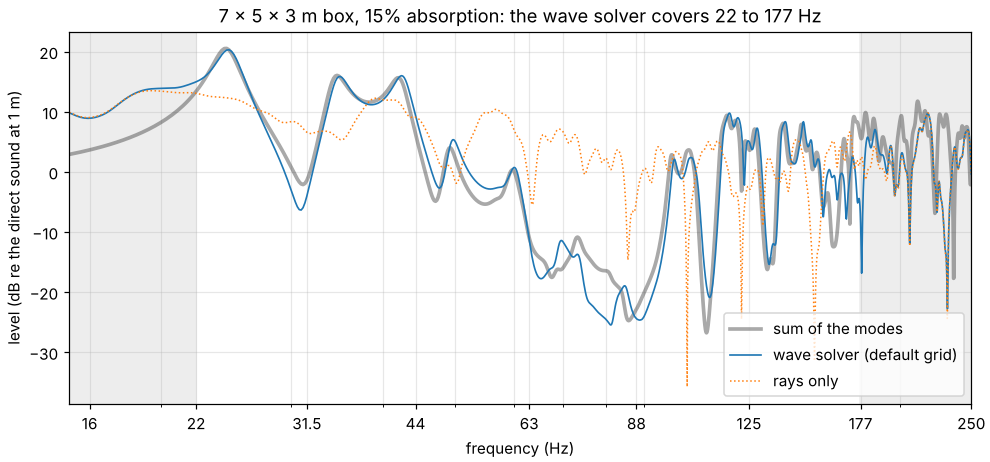

The wave solver follows the modes peak for peak from 22 Hz up. What is left comes
mostly from where the grid puts the walls: within half a cell of the model's, here
6.93 x 4.95 x 2.97 m with 20 cm cells, which moves each mode by up to 1 %. In a room
this sparse in modes, that moves G by up to 1 dB, EDT by up to 12 % and T20 by up to
5 %; more cells per wavelength move the walls but do not make every figure converge.
The two stencils agree within 0.01 s: in this band their dispersion moves the modes
less than the walls' placement does. Rays give the average over the room instead: 5.3 dB more at this seat in the 63 Hz
band, where the listener sits near the nodes of most modes.

**On a GPU.** `validation/wave_gpu.py` computes the wave bands (up to 125 Hz, 0.5 s) of
the first source of three example rooms to every listener on the CPU and on the GPU,
and compares the two. The tests do the same with resonant walls and with the matched
layer, in runs split so that the fields swap both ways between them, with both
stencils. On Mesa's lavapipe, a Vulkan driver that runs on the CPU, with 4 cores (the
19-point stencil):

| room | cells | steps | CPU (s) | GPU (s) | largest difference |
|---|---:|---:|---:|---:|---:|
| studio | 10,350 | 1,016 | 0.2 | 1.5 | 2.8e-7 |
| concert hall | 1,223,312 | 1,016 | 2.9 | 25.4 | 6.8e-7 |
| church | 1,228,682 | 1,016 | 3.5 | 30.1 | 1.5e-6 |

The difference is relative to the largest pressure: the GPU's single-precision
rounding, which stays at that level. Apple's GPU, in CI, rounds further from the CPU:
in the test's nearly closed room with resonant walls the two differ by up to 1.1e-5
after 1,601 steps, in the slow drift such a room builds up. These times are from an
earlier version of the script and include the grid's set-up on the CPU (the same on
both) and, in the first room, the GPU's start-up; the script now prints the set-up on
its own, the CPU's and the GPU's time steps without it, and the speed-up of the steps.
A software driver is no faster than the CPU solver; the script is there to time a
hardware GPU.

## Real-time convolver

The plan's target: a 3 s response with 16 output channels (third-order Ambisonics), fed
by one input in blocks of 128 frames at 48 kHz, without dropouts for 10 minutes. The
benchmark sends 10 minutes of noise (225,000 blocks) through the convolver from Python,
as the playback callback does, on one core of a 4-core x86-64 cloud machine with
nothing else running, and times every block:

| per block | mean | median | 99 % | 99.9 % | max | over the 2.667 ms budget |
|---|---:|---:|---:|---:|---:|---:|
| thread CPU time | 0.127 ms | 0.096 ms | 0.248 ms | 0.295 ms | 1.175 ms | 0 of 225,000 |
| wall-clock time | 0.128 ms | 0.097 ms | 0.250 ms | 0.305 ms | 3.663 ms | 1 of 225,000 |

The response is split into 16 partitions of 128 samples, 14 of 1024 and 16 of 8192, and
the work of the long partitions is spread over the blocks in between. The convolver's
own work (CPU time) never took longer than a block lasts: on average 4.8 % of it, at
most 44 %. In wall-clock time, one block was late (3.7 ms), while no block's own work
took more than 1.2 ms: the thread was kept off the core for a moment. On an earlier
run, on a machine shared with other work, 48 blocks of 225,000 (0.02 %) were late that
way. On a desktop with a real-time audio thread and the usual two or more buffers at
the sound card, such single late blocks are absorbed. Whether a given sound
card plays 10 minutes without a dropout can only be checked on that machine:
`acoustic-spaces play ir.wav --live --block 128 --seconds 600` reports the longest time a block
took and every block the sound card dropped. The output matched offline convolution to 2.6 × 10⁻⁷ of
its peak (single precision).

## Known issues

Reviews of the code found these, but for the one about barriers, which the checks
against the exact solution found, and those about barriers in wind and a leg's shadow,
which their checks found. Each one was checked against the code; the numbers come from
the tests or scripts named, and a number from a one-off check says so. They are open
items on the [roadmap](roadmap.md). The edge fade's own are listed in [Known issues of
the edge fade](#known-issues-of-the-edge-fade).

Results:

- **The first milliseconds of a rendered response.** An impulse response is put
  together from its bands with zero-phase filters (`synthesis.combine_bands`), which
  spread each arrival both ways in time, and what would fall before the response's
  first sample is lost. For an arrival whose level differs from band to band, that
  changes its level in the low bands when it comes in the first milliseconds: a sound
  1.5 dB lower at 125 Hz than at 63 Hz, 4.7 dB at 250 Hz, 10 dB at 500 Hz, 15 dB at
  1 kHz and 20 dB from 2 kHz up gives a G 0.14 dB lower at 63 Hz 2.9 ms in than the
  same sound 200 ms later, and within 0.05 dB in the other bands; a sound of the same
  level in every band does not change (`tests/test_coherent.py`). The echograms, and
  the parameters `simulate` prints and writes from them, are not affected; the
  parameters `analyze` takes from the WAV files are.
- **The early order with vector-based scattering.** Vector-based scattering (the
  default) sends each reflection along the sum of its specular direction and a Lambert
  direction, which leans towards the wall's normal. The detector spheres count each
  reflection's specular share along the exact specular direction, but from where that
  ray met the face: the first order's share is the exact paths', and the later orders'
  leave the walls from other places than the exact paths and bring less energy to the
  listener. The early part replaces orders 1 to 3 with the exact paths, so the total
  depends a little on how many it takes: in a 4 x 3.5 x 3 m box (absorption 0.15,
  scattering 0.3), with the default `early.max_order: 3` it is 0.02 to 0.05 dB lower
  than taking orders 1 to 9, and with `max_order: 0` 0.04 to 0.13 dB lower, while taking
  the first order early or not moves it by under 0.03 dB (from 250 Hz up, four seeds).
  Random scattering keeps the specular share on the specular paths: within 0.02 dB
  either way (the room of `tests/test_scattering.py` with its seed; the test's bounds
  are looser, to allow for other seeds). A lobe centred on the specular direction would
  remove this, but changes the late part's decay, which the default was chosen to match
  in the BRAS rooms.
- **Pairs of paths from 1 kHz up.** In the bands above 500 Hz that add in pressure
  (outdoors, 1 to 8 kHz), the echogram shares each pair of paths' cross term between
  their two time slots, and a slot that would go below zero is set to zero
  (`coherent.pair_energy`). That adds energy where paths cancel; a one-off check over
  the nine outdoor examples, when this was found, put it at hundredths of a decibel at
  most, in a band's response and in the lateral figures of eight behind LF, LFC and
  LG. Impulse responses add the paths in pressure without it.
- **Scattered sound near a listener in bent air.** Where the rays bend in wind or a
  temperature gradient, scatter in plants before they reflect, or reach the listeners
  as secondary sources, the scattered sound of a reflection near a listener comes from
  the few rays that land there, not from the listener's own gather: a run with a far
  source over grass has bursts of it that change with the seed.
- **Paths over two edges take no reflections.** With `second_order` a path over two
  edges reflects nowhere before, between or after them, so behind a thick barrier on a
  hard ground the engine has one of the four paths over it: 1.7 to 5.7 dB low from
  500 Hz up, and off by up to 9.9 dB below (see
  [Reflections that fade at edges](#reflections-that-fade-at-edges-against-the-exact-solution)).
  In sight just over a building's roof the path over both of its edges has no copies
  off the ground either. In a one-off check against the package's wave solver (8
  points per wavelength), with the source and the listener 0.3 to 1.5 m above the roof
  of a building 4 m wide and 2 m high on a rigid ground, the early stage was within
  0.9 dB at 125 Hz for a building 4 m long (three positions) and 1.9 dB high for one
  40 m long (one position); at 63 Hz, where the building is also less than half a
  wavelength high, it was 0.5 to 6.6 dB low for the short building and 6.4 dB high for
  the long one (`first_order`: 3.8 dB low to 7.8 dB high at 63 Hz, 0.9 to 2.4 dB high
  at 125 Hz). The difference at 63 Hz is not traced further; the wave solver
  (`simulation.wave`) is the tool for those bands.
- **Sound that just clears two edges in a row, without paths over two edges.** Each
  edge the direct sound passes takes its terms off it, and with `first_order` (the
  default) or `direct` nothing gives back what two edges in a row take twice: where
  the source and the listener see each other just over both edges of a flat roof, a
  thick wall or two barriers, or along a wall in line with both, the level is too low.
  Over a top 10 m wide, the source 10 m before it and the listener 5 m past it, it is
  12.6 to 20.7 dB low from 63 to 500 Hz a centimetre above the top's plane, 6.4 to
  0.9 dB half a metre above it, 2.6 and 1.0 dB at 63 and 125 Hz a metre above it, and
  within 0.7 dB two metres above it. Behind the top with the source above its plane
  the level is too high, the path over the far corner taking nothing off for the near
  one: by 5.7 to 5.9 dB with the source a centimetre above the plane and the listener
  half a metre below it, 5.1 to 4.2 dB with them 0.5 m above and 2 m below, and 3.4 to
  0.1 dB with both 2 m off it. `second_order` has the path over both and is within
  0.09 dB in all of these (see
  [Edge diffraction against the exact solution](#edge-diffraction-against-the-exact-solution));
  its reflected copies, off a ground, are missing as in the item above.
- **More than two edges in a row near grazing incidence.** A path bends over two edges
  at most (`second_order`), so where sound just clears three edges or more in a row
  (three barriers, two flat roofs of one height, a roof with a slot across it), what
  their terms take off it more than twice is not given back. Just over three screens
  5 m apart the level is 1.5 to 2.9 dB above that over two from 125 Hz up; a 2 cm slot
  across a 10 m top lowers the level by 0.6 to 1.1 dB; over three tops in a row it is
  3.4 to 5.0 dB above that over one. Behind three screens with the source on the line
  of their tops and the listener 0.5 m below it, the path over the last top and the
  paths over each of the others and the last cancel: the level is at -20.8 to -54.3 dB
  where two screens leave -10.7 to -21.7 dB, and with the source 0.5 m above the line
  it is 9.1 dB (63 Hz) to 1.4 dB (8 kHz) below the two screens'. Behind two flat roofs
  5 m wide and 5 m apart, the listener 0.5 m below their plane, the level up to 500 Hz
  is at -21.1 to -32.0 dB with the source a centimetre above the plane, at -18.4 to
  -15.7 dB with it 0.5 m above and at -9.9 to -4.1 dB with it 2 m above, where one roof
  15 m wide, with no gap, leaves -6.2 to -8.6, -5.6 to -6.8 and -3.7 to -2.1 dB; with
  the source below the plane the two are the same. With `first_order`
  the level a centimetre above two tops in a row is at -0.4 to -1.5 dB and above three
  at +4.9 to +5.8 dB, where one top leaves -5.3 to -5.9 dB. There is no exact solution
  for these in the report. One check against a two-dimensional wave calculation turned
  into a point source's (on a 2 cm grid, within 0.05 dB of the exact solution over the
  10 m top), up to 500 Hz, a centimetre above the plane of a flat top and a screen
  level with it: with the top 9 m wide and the screen 1 m past it the level is -6.3
  to -6.9 dB, and `second_order` is 3.2 to 5.8 dB below that (`first_order` 0.3 to
  2.5 dB below it); with the top 5 m wide and the screen 5 m past it, -7.6 to -8.4 dB,
  `second_order` 2.3 to 3.4 dB below (`first_order` within 1.3 dB), either way round
  with the rays' own search for reflections. The level also steps with the height of
  the screen's top at that plane, by 12 to 15 dB over 4 mm: past the 9 m top with
  `second_order` and every sequence of reflections tested (`method: image_sources`),
  it is -13.1 to -16.6 dB with the screen's top from 2 mm to a micrometre below the
  plane, -9.4 to -12.0 dB with it level or up to 0.5 mm above, and -0.4 to -1.8 dB
  from 0.55 mm above, from where the path over the screen's top reflects off the top
  (0.53 mm above, it does so at the top's far edge). Above 500 Hz, where the bands add
  in energy, the level is -10.1 dB with the screen's top level and -5.6 dB with it a
  micrometre above. With it 10 µm to 0.5 mm above the plane, the two ways round are
  also up to 1.0 dB apart (0.4 dB with the rays' own search).
- **Exactly in the plane of several tops in a row.** With the source and the listener
  both exactly in the plane of two flat roofs of one height, or of a roof and a
  barrier's top, the paths over one edge and over two do not add up as they do just
  above it. The level is 3.9 to 9.2 dB below that a centimetre above the plane of two
  tops 5 m apart, 2.5 to 6.9 dB below it over three tops, 1.4 to 5.4 dB below it with
  a 2 cm slot across a 10 m top and 2.8 to 5.3 dB below it over a screen and then a
  top; over a top and then a screen it is within 1.7 dB of it (in pressure up to
  500 Hz and in the bands that add in energy). Within two millionths of the model's
  size below that plane, the rays that look for paths over edges, which start a
  millionth of it off the edges, find paths that the tops hide: the level is then 9.4
  to 9.7 dB above that a centimetre below the plane of two tops, 15 dB above it for
  three tops, and 8.9 to 9.9 dB behind a top and a screen in either order. Within that
  distance above the plane they miss paths that are there: a millimetre above the tops
  of three screens 5 m apart, the last of which ends a centimetre beside the way, the
  path round that end is not found and the level at 63 Hz is 1.5 dB below that 3 mm
  above them. Likewise above a roof 5 m wide and a screen level with it, 5 m before
  the roof or past it, that ends 1 cm to 0.1 m beside the way: the term of the
  screen's upright end for the direct sound is missing up to 1.2 or 1.8 mm above the
  plane, where the level up to 500 Hz is 0.2 to 0.6 dB below that a centimetre above
  (0.5 to 1.1 dB with the way 1 cm outside the end).
- **Reflections level with several tops.** With the source and the listener exactly
  level with the tops of two screens, the level is that just above the line for the
  direct sound and for a first reflection that passes level with the tops too (see
  [Edge diffraction against the exact solution](#edge-diffraction-against-the-exact-solution)).
  The terms that make reflections fade at edges, which have the reflections of second
  order and up, count each top for the whole of one that passes level with both: with
  a wall 2 m behind the source, which sends such reflections off the first screen and
  the wall, the level on the line is 4.6 to 5.7 dB above that 1 mm above it (11.5 to
  13.4 dB above it before, when each top stood for all of the direct sound and of the
  first reflection as well).
- **A way through a corner of a flat top.** Where the straight way between the source
  and the listener, both in the plane of a flat top, passes exactly through a corner
  of the top (a box turned so that only its corner touches the way), no ray finds the
  direct sound and no path over the top's edges stands for it: over the box alone
  there is no sound at all, where a millimetre above the plane the level is at +0.6 to
  -3.0 dB. With a screen on the way too, its paths are all there is: where a screen
  ends on the way 7 m before the corner, the level is 8 to 28 dB below that a
  millimetre above the plane (the screen's paths stood for the direct sound there
  before, within 2.2 dB of it).
- **A slight bend of a barrier.** Where a barrier's top goes on in another across a
  bend of less than a degree in plan, neither edge fades at the joint, and the point a
  path touches can fall past the end of both (no path over the top) or on both (two
  paths). Behind a barrier with a bend of 0.95 degrees, the source 10 m before it and
  the listener 15 m behind it, the level on a strip beside the plane through the bend
  is nothing at all or 6.0 dB too high, as the bend turns: the strip is 1 mm wide with
  both 2 m below the top, and 4.6 cm wide with the listener 20 m below it. Bends of a
  degree or more fade (see
  [Edge diffraction against the exact solution](#edge-diffraction-against-the-exact-solution)).
- **Two separate edges in each other's transition zones.** A path over two edges takes
  the product of the two edges' coefficients, the second's with the curvature of the
  first edge's wave. Where the second edge stands in the transition zone of the first
  and no face joins them (two screens in a row, near grazing incidence over both),
  that leaves too little at high frequencies: a quarter of the free field just below
  the line of two tops 10 m apart, where two knife edges leave 0.317 of it, 2.1 dB low
  from 2 kHz up, and 1.0 to 1.3 dB low just above it. As the source or the listener
  alone crosses the line of the tops, the level steps by 0.5 and 1.0 dB at 63 Hz. The
  corners of one block or wall, joined by a face, are not affected.
- **A barrier's end in wind.** Behind a barrier the paths in the plane take the
  barrier's effect, and the paths over the top past its end, as they fade out there,
  take it too; the direct sound and the paths round the end take the open ground's, in
  the open ground's bands along their way and above them with their legs' own shadows.
  10 cm across the end's shadow boundary in the `windy` preset the level steps by at
  most 1.0 dB from 63 to 500 Hz and 1.6 dB at 1 and 2 kHz (0.42 dB in still air), and
  120 m upwind by at most 0.92 dB in every band, but at 4 and 8 kHz, where the direct
  sound takes the open ground's refraction and the paths round the end their legs', by
  up to 7.8 dB 60 m downwind and 19 dB 120 m downwind, and by 5.2 dB at 4 kHz 60 m
  upwind. Where the end
  stands below the line of sight (a barrier 1 m high 30 m from a source 1 m up), a
  listener 100 or 200 m away crossing the end's line seen from above goes from the
  barrier's effect to the open ground's sound: 2 mm across it the level steps by up to
  1.2 dB from 63 to 250 Hz (0.02 dB in still air), but by up to 4.8 dB from 500 Hz to
  2 kHz and 12.8 dB upwind at 8 kHz (see
  [Barriers and buildings in wind](#barriers-and-buildings-in-wind-against-a-full-wave-solution)).
- **A roof's edge in wind.** Where the paths over edges keep their straight legs (a
  source or a listener on a building, an object of the model file in the way), the bent
  direct sound and its ground reflection are there where the straight ones are, and
  the edges' terms, made for the straight paths, do not follow the bent rays' times and
  levels. Walked in 10 cm steps across a roof edge's shadow boundaries in the `windy`
  preset, down- and upwind (a source 1 m over a roof 6 m high, listeners 1.5 m up 28
  and 43 m away, and the two swapped), the weather's effect steps across the direct
  sound's boundary by at most 0.26 dB in octave bands and 0.63 dB in third octaves.
  Across the ground reflection's, where it comes into view and the open ground's bands
  (up to 2 kHz) go from the rays to the parabolic equation, it steps by up to 1.75 dB
  at 500 Hz and 0.72 dB at 2 kHz (0.42 dB downwind) in octave bands and 3.2 dB at
  400 Hz in third octaves, where with the rays on both sides it would step by 0.61,
  0.14 and 1.2 dB; at 8 kHz by 0.83 dB (1.3 dB in its 10 kHz third octave) either way (a one-off
  check; `tests/test_barriers_in_wind.py` bounds octave bands from 63 to 500 Hz). The
  level itself, in the wind, steps by up to 0.28 and 1.79 dB in octave bands
  ([Continuity](#barriers-and-buildings-in-wind-against-a-full-wave-solution)).
  Blending the rays and the equation there would remove the switch's part.
- **A caustic in the rays' bands.** Over the open ground in wind or a temperature
  gradient the bands above the parabolic equation's (4 and 8 kHz) come from the
  eigenrays, and where two of them merge (a caustic) each is capped at 10 dB over a
  straight path's on one side and both are gone on the other, with no transition
  (Airy) zone between: the level steps by 11.1 and 12.9 dB at 4 and 8 kHz between
  listeners 1 cm apart 119.86 and 119.87 m downwind in the `windy` preset (a source 2 m
  and a listener 1.5 m up over grass), and by 10.5 dB at both between 2.04 and 2.05 m
  up 250 m away in `clear_night` (a source 0.5 m up), where up to 2 kHz the level
  changes by at most 0.05 dB a centimetre (`tests/test_refraction.py`, a one-off check
  at 4 and 8 kHz). With `simulation.early.open_ground_frequencies: rays` the rays give
  1 and 2 kHz too short of half the way to the shadow, and those step at the same
  caustics by 10.5 and 12.0 dB in the wind and by 14.0 and 7.2 dB on the clear night (a
  one-off check).
- **A ground dip in the crossover from the parabolic equation's bands to the rays'.**
  Each band of the response keeps its own spectrum into the crossovers, held past its
  last frequency, so a ground dip that falls in the crossover above the equation's top
  band (2.4 to 3.4 kHz; 0.59 to 0.84 kHz short of half the way to the shadow with
  `open_ground_frequencies: rays`) is missed: 100 m downwind in the benchmark's case 2 the dip at
  2.85 kHz, 12.8 dB deep, comes out 1.3 dB too shallow and the response 2.0 dB too low
  at 3 kHz, off by up to 2.0 dB from 2.75 to 3.2 kHz (`tests/test_ffp.py` checks
  either side of it). More frequencies do not mend it: a model of the hold against the
  program misses by 2.8 dB from the band's last of 8 an octave (2740 Hz) and 2.1 dB
  from the last of 24 (2799 Hz).
- **Coverage maps behind barriers** read the high bands higher than a listener at the
  same point: 130 m behind two barriers over grass by 0.6, 1.3, 3.8 and 13.5 dB at 1,
  2, 4 and 8 kHz, in still air as in 8 m/s of wind, where the weather's effect is the
  same in the map and at the point (a one-off check).
- **A leg from a ground reflection a rounding error above the ground** (10⁻¹⁶ m) has no
  refraction shadow, its shadow's start then being 10²⁸⁴ m out: 120 m upwind of a
  source in the `windy` preset, as a listener moves 10 cm past a barrier's end the
  path reflected off the ground round it lifts the level by up to 65 dB at 8 kHz (a
  one-off check).
- **Near a shadow boundary, in the bands that add in energy.** There the term of the
  edge's incident wave is part of the direct sound's wave, and the terms of the
  reflections off the edge's faces, which arrive with it, are part of the edge's
  diffracted wave, which adds to it in energy: their cross term is lost. On the shadow
  boundary of a right-angled corner the level is 1.73, 1.32 and 0.98 dB low at 250, 500
  and 1000 Hz and 0.72, 0.52 and 0.38 dB at 2, 4 and 8 kHz; behind a blunter edge more,
  2.22, 1.79 and 1.38 dB at 250, 500 and 1000 Hz and 0.56 dB at 8 kHz behind a wedge
  open over 225°; behind a thin screen less, 0.69, 0.50 and 0.36 dB at 250, 500 and 1000
  Hz; 10.5° into the shadow, 1.05 dB at 250 Hz behind the corner, 1.12 dB behind the
  wedge and 0.45 dB behind the screen (see [Edge
  diffraction](#edge-diffraction-against-the-exact-solution)). These bands add in energy
  indoors from 250 Hz up by default; in pressure, as the 63 and 125 Hz bands and
  outdoors every band do by default, the level is within 0.08 dB. Keeping the cross
  term, weighted by how coherent the terms are over the band, would remove it.
  Likewise where the source or the listener crosses the plane of a top that the other
  sees from above: the path over both of its edges continues the path over one below
  the plane and gives back what both edges take above it, and its pieces add up
  differently in energy on the two sides. Half a metre above a 10 m top the level
  steps by up to 1.1 dB as the other of the two crosses the top's plane (by 1.5 dB at
  a gable roof's slope in a one-off check), and by 0.01 dB in pressure. Over a top
  1 m wide absorbing 0.5, the level 0.3 m above its plane was 0.56 dB above the rigid
  top's at 4 kHz (a one-off check).

Models:

- **Collada polygons with holes** (`<ph>`) are read with their holes filled.

Files and runs:

- **No limit on time.** The numbers of rays have no upper bound: a mistyped count runs
  as long as it asks for. (The memory of a run's late part is estimated before it
  starts, and a run whose late part would need more than the computer has is refused.
  The early stage's is not estimated, and in a room of many facets with edge
  diffraction it is most of a run's: BRAS CR3 peaks at 10.0 GiB in its edge fade
  (11.8 GiB in third-octave bands), which in third-octave bands starts each listener
  from less than 0.9 GiB; see [Memory](simulation.md#memory).)

## Not validated yet

- **More measured rooms.** Four rooms have been compared with measurements (see
  [Measured rooms](#measured-rooms-bras)): their ISO 3382-1 parameters and G from seat
  to seat, and in three of them IACC with a dummy head. G's absolute level has not, as
  BRAS's calibration leaves the measured level uncertain by about 3 dB, nor the lateral
  parameters (LF, LFC, LG), stage support and directional decay, which BRAS did not
  measure, nor coupled rooms whose model joins them as the real ones are joined: in
  two-room diffuse theory BRAS's two rooms are joined by about 1 m² more than their
  model from 250 Hz to 2 kHz, with the door ajar (10 to 16 times the model's slit) and
  open alike.
- **Wave effects.** Above the wave solver's bands the simulation is geometric. Edge
  diffraction is modelled (UTD, for the direct sound and first-order reflections, and
  the direct sound over two edges; the fade of every other specular path at edges,
  which leaves some steps, see
  [Known issues of the edge fade](#known-issues-of-the-edge-fade)) and room modes by
  the wave solver, both checked against theory but not against measurements in rooms. Without the wave solver, results below the Schroeder frequency
  of a room (about 2000 √(T/V) Hz) are a statistical average, not the response of one
  point.
- **Source directivity** was not part of the cross-check (both programs ran
  omnidirectional sources). The tests check that every pattern keeps the sound power,
  that SOFA and CSV data come out in the source's frame, and that the direct sound,
  early paths, late rays and particles all follow the same weights.
- **Sound through walls** is checked against diffuse-field theory, not against
  measurements. A wall is one sound reduction index per band for sound from all
  directions: sound passes straight on in its direction, with no flanking paths and no
  dependence on the angle it arrives at, and the wave solver does not model such walls:
  with `simulation.wave.enabled`, a model with one stops with an error (openings are
  fine).
- **Outdoor propagation** is checked against geometry, closed forms, the exact solution
  for the reflection off a ground and one set of measurements, a wind turbine up to 845
  m away in light to strong winds. A terrain is checked against the exact solution for a wedge,
  the flat ground, the image source in a slope and the thin screen's closed forms, not
  against measurements over hills (see
  [Terrain](#terrain-against-closed-forms-and-the-exact-wedge)), and a rounded crest,
  which has no exact solution, is an engineering model; wind and temperature gradients
  cannot be combined with a terrain yet (see
  [Outdoor scenes](outdoor.md#what-is-not-modelled-yet)), and strong ones, where they
  matter most, are compared with a fast field program on the 1995 benchmark cases (see
  [Outdoor sound in wind](#outdoor-sound-in-wind-against-a-fast-field-program)), not
  with measurements; the benchmark's gradients that go on to a kilometre up bend sound
  through angles the engine's default, narrow-angle parabolic equation does not carry,
  so beyond 1 to 2 km its pure tones stray there, though the bands it reports hold to
  2 km, and the wide-angle one carries them (see
  [The wide-angle parabolic equation](#the-wide-angle-parabolic-equation)). Weather that
  changes over the scene is checked against a parabolic equation marched through the
  zones, not against measurements, and a zone's border is a step (see
  [Weather zones](#weather-zones-against-a-crank-nicholson-parabolic-equation)).
  Barriers and buildings in wind are checked against a full-wave solution and a
  parabolic equation started from the exact field, both in the vertical plane with the
  wind blowing through the barrier, not against measurements, wind-tunnel data or
  Nord2000's screen cases (see
  [Barriers and buildings in wind](#barriers-and-buildings-in-wind-against-a-full-wave-solution)).
  Levels over a long term are checked against the formulas they come from and against
  ISO 9613-2's meteorological correction, not against long-term measurements, and are
  only as good as the weather classes and shares given to them (see
  [Levels over a long term](#levels-over-a-long-term)).
  Moving sources are checked against the exact field of a quasi-static source over a
  rigid ground, not against measured pass-bys, and leave out the convective
  amplification of a moving source (see
  [Moving sources](#moving-sources-against-the-exact-field)).
  The road vehicles' sound power is CNOSSOS-EU's table as published, and the siren's
  level and directivity one measured siren's, checked against the rules for sirens, not
  against measured pass-bys (see
  [Sirens and road vehicles](#sirens-and-road-vehicles-against-their-rules)).
  The trains' sound power is Schall 03's as published: a pass in the engine is checked
  against Schall 03's own sum, exact in a free field and 2.9 to 4.0 dB(A) under it over
  the railway example's ground, which the two reckon otherwise, not against measured
  pass-bys (see [Trains](#trains-against-schall-03-and-the-eus-limits)).
  The road works' machines are rows of Defra's database for construction sites as
  published, checked against the rows' own levels and the EU's limits, not against a
  measured site; the reversing alarm's level is its rule's (see
  [Road works](#road-works-against-defras-rows-and-the-eus-limits)).
  A helicopter's tones are checked against theory, its broadband noise against Pegg's
  worked example, and the whole against one certified level, which it is 3.4 dB over
  (see [Helicopter rotors](#helicopter-rotors-against-theory-and-a-certified-level));
  not against measured spectra or directivity.
  Vegetation is checked against a particle simulation of the same model, not against
  measurements through trees; its foliage takes ISO 9613-2's rates, which the
  standard gives for depths of 20 to 200 m, or leaves as thin rigid discs, whose
  cross-section between its two closed-form limits is bridged, not exact, and which
  are compared with the standard's table, not with measurements of leaves.
  Turbulence is checked against a parabolic equation through random eddies in two
  dimensions, with the source and the listener near the ground, not against
  measurements; how much the sound flickers over time is not checked against either.
  Between two moments of the eddies, a tone played through them, standing and along a
  walk with Doppler, is checked to have the response whose paths are delayed half-way
  (in the tests, to within 1 % of the tone's amplitude).
  The wave solver in wind and temperature is checked against the parabolic equation
  over open ground up to 200 m, not against measurements, nor round buildings; its
  moving air against the exact field in a uniform wind and a façade's echo against
  ray theory, with the wind the weather's profile everywhere, not the flow round a
  building (see [Moving air](#moving-air-in-the-wave-solver)).
  The level relative to free field and a barrier's insertion loss are checked against
  exact solutions, not against measurements; the path reflected both before and after
  a barrier is checked over a rigid ground only, and the sound that goes over a
  barrier, down to the ground and over it again is left out (see
  [Outdoor results](#outdoor-results-against-exact-solutions)).
- **Spatial outputs** are checked against closed forms and energy balances, not by
  listening tests.
- **Speed on a hardware GPU.** CI checks the wave solver's and the late stage's GPU
  paths on software and virtual GPUs (Mesa's software Vulkan driver on Linux, Direct3D
  12's WARP on Windows and the virtual machines' Metal GPUs on macOS), which shows
  that they agree with the CPU, not how fast they are; `validation/wave_gpu.py`, `validation/late_gpu.py` and
  `validation/outdoor_gpu.py` time them on your own GPU.

## Reproducing

```sh
python -m pip install pyroomacoustics matplotlib
python validation/pyroomacoustics_crosscheck.py --json results.json --plots docs/validation
python validation/convolver_benchmark.py
python validation/wave_solver.py --plot docs/images/wave.png
python validation/edge_diffraction.py --json diffraction.json
python validation/edge_fade.py --json edge_fade.json
python validation/walks.py --json walks.json   # --walks gallery archway street
python validation/ground_reflection.py --wave --parabolic --extended --json ground.json
python validation/outdoor_propagation.py --json outdoor.json --plots docs/validation
python validation/outdoor_propagation.py --turbulence moderate
python validation/outdoor_propagation.py --still   # the same cases in still air
python validation/turbulence.py --json turbulence.json
python validation/turbulence.py --profile --json turbulence_profile.json
python validation/vegetation.py --json vegetation.json
python validation/leaves.py --json leaves.json
python validation/wave_outdoor.py --json wave_outdoor.json
python validation/wave_wind.py --json wave_wind.json   # --skip-profiles: no parabolic equation
python validation/insertion_loss.py --json insertion_loss.json
python validation/terrain.py --json terrain.json
python validation/ffp.py --json ffp.json
python validation/curved_rays.py --json curved_rays.json   # about 30 min
python validation/benchmark_1995.py --json benchmark.json   # --far: whole scenes to 10 km
python validation/open_ground_frequencies.py --json open_ground.json   # --cache DIR --part K/N to share it
python validation/weather_zones.py --json weather_zones.json   # --only pe or mean
python validation/barrier_wind.py --json barrier_wind.json   # about 4 h; --quick: fewer bands
python validation/long_term.py --json long_term.json
python validation/doppler.py --json doppler.json
python validation/rotorcraft.py --json rotorcraft.json
python validation/urban_sources.py --json urban_sources.json
python validation/rail_sources.py --json rail_sources.json
python validation/plant_sources.py --json plant_sources.json
python validation/doc29_reference.py --workbook doc29-volume3-part1-workbook.xlsx
python validation/aircraft_noise.py --json aircraft_noise.json
python validation/fta_vibration.py
python validation/city_speed.py --json city_speed.json   # --sizes 10 20 30 40 60
python validation/wave_gpu.py   # needs the gpu extra and a GPU driver
python validation/late_gpu.py   # the late stage on each device, and its parameters
python validation/outdoor_gpu.py   # the outdoor examples on each device: levels and centre times
python validation/rays_gpu.py   # the ray searches alone, and whether both find the same faces
python validation/late_memory.py   # the late part's memory against its estimate (Linux)
python validation/bras_validation.py --json bras.json --plots docs/validation
python validation/bras_validation.py --materials initial --plots docs/validation
python validation/bras_validation.py --bands third_octave --json bras_third.json
python validation/bras_validation.py --materials initial --calibrate LS1 --plots docs/validation
python validation/bras_binaural.py path/to/BRAS --json binaural.json   # FABIAN's responses from BRAS
python validation/bras_iacc_parts.py path/to/BRAS CR3 LS7   # one loudspeaker's response in parts
python validation/coupled_rooms.py --results bras.json   # CR1 against two-room diffuse theory
python validation/coupled_rooms.py --scene CR1_DoorAngle3 --results bras.json
python validation/bras_room_energy.py --results bras.json   # what scattering does, rooms' own decay
```

On 4 cores of a cloud machine without a GPU, each run alone on the machine (30 and 31
October 2026), the cross-check takes about 10 minutes, the convolver benchmark half a
minute, the wave solver's checks 1.2 minutes (both stencils), the edge diffraction's 40
seconds, the fade at edges' 53 minutes, the walks' 14, the ground's 5.5 (51 s of them
the wave solver's, 100 s the parabolic equation's), the outdoor measurements' 3.1 (3.0
with turbulence, 20 seconds in still air), the turbulence's 3.9 (3.8 with `--profile`),
the vegetation's 5.2, the leaves' 2.6, the wave solver's outdoors 12.6 and the moving
air's 12.3 (both 10 November), the insertion loss's 1.8, the terrain's 41 seconds
(2 November), the fast field program's 5.7, the benchmark's 55 (much longer with `--far`), the weather zones' 7.2
(46 s of them the parabolic equation's, 6.4 minutes the mean profile's), the long term's
16 seconds, the moving sources' 5.6 minutes, the rotors' 3.3, the sirens' 4 seconds, the
cities' 22 (1.3 minutes with `--sizes 10 20 30 40 60`), each BRAS run of the coupled
rooms, the seminar room or the auditorium 2 to 4 minutes (4 to 9 calibrated, 5 to 11 in
third-octave bands) and of the hall about 1.5 hours (5.2 calibrated, 3.4 in third-octave
bands), the binaural comparison 10 minutes in the seminar room, 6 in the auditorium and
an hour in the hall, a loudspeaker of the hall in parts about 10 minutes, the coupled
rooms against theory under a second, and the rooms' own decay 5.8 minutes. Since then
the open ground's parabolic equation in wind runs up to 2 kHz, which on one core makes
the outdoor measurements take about 15 times as long (case 1), the long term about 5.4
times and the benchmark about 1.6 times; the others listed here do not reach that part
of the engine.
The cross-check's numbers come from 4.0.1 with seed 1;
this version's own are within 0.012 % of them (EDT, whose line fit now starts at the
onset in every response).
pyroomacoustics draws its rays afresh on every run, so the script averages five runs of it
(`--pra-runs`); the means still move by a few percent from one call to the next, and the
differences in the tables with them. Other seeds move this package's numbers by a few
percent.
