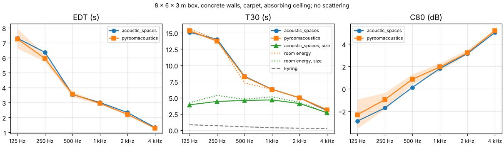
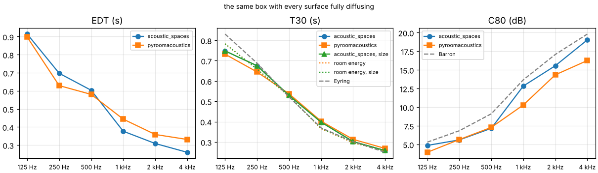
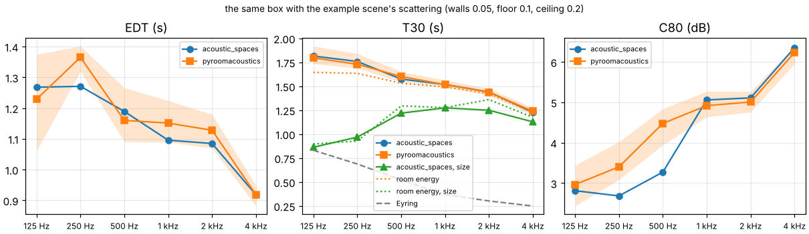
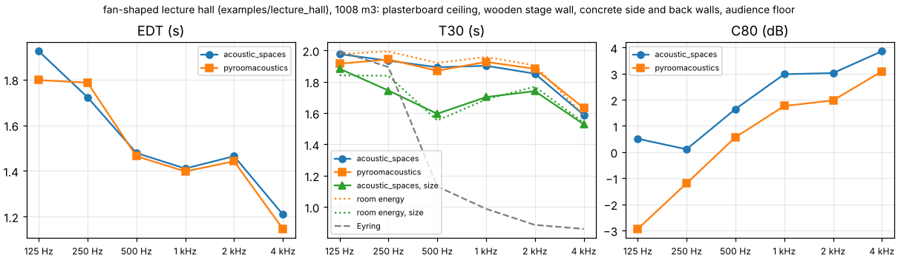
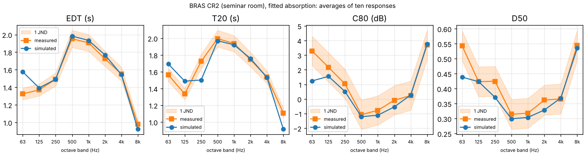
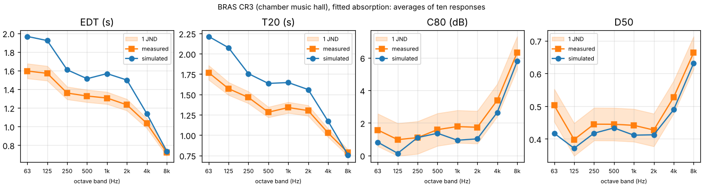
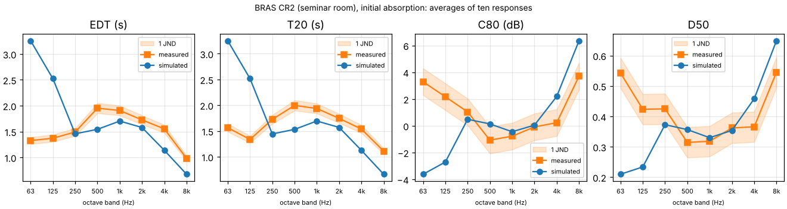
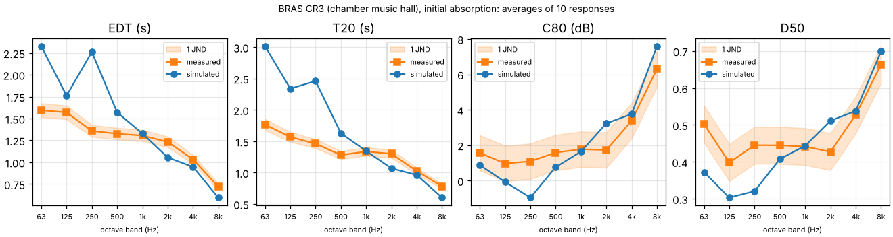
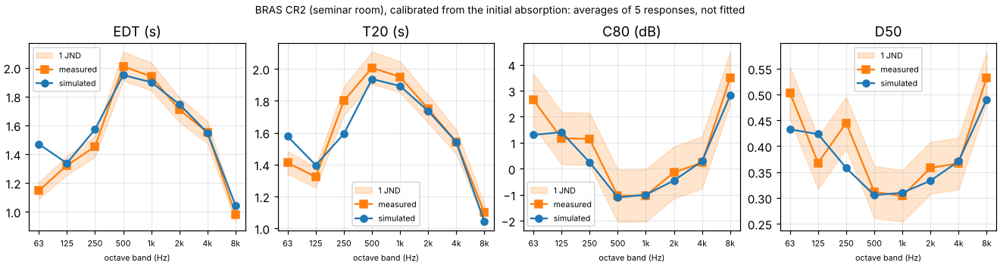
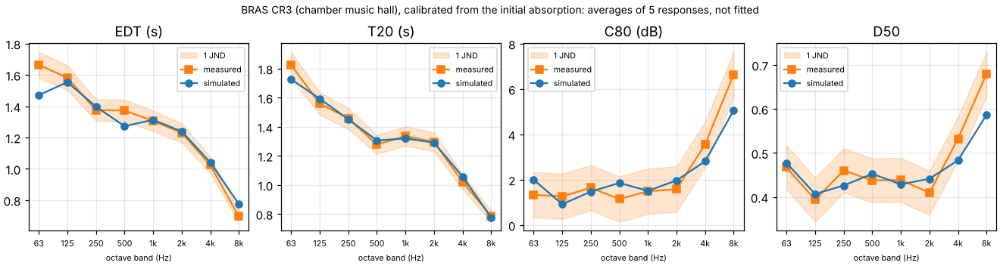

# Validation

This report sums up how far the results of acoustic_spaces can be trusted: what the
test suite checks against theory on every change, how the simulation compares with
another program, [pyroomacoustics](https://github.com/LCAV/pyroomacoustics), and with
measurements in two real rooms, how edge diffraction and the reflection off a porous
ground compare with the exact solution, how sound outdoors compares with measurements
up to 845 m away, how its turbulence compares with a parabolic equation through random
eddies, how its rays through vegetation compare with a separate particle simulation,
how its wave solver in wind and temperature compares with a parabolic equation, and how
much of a block's time the real-time convolver needs. It ends with what has not been validated yet.

## Checks against theory, on every change

The test suite runs on Linux, macOS (Apple silicon and Intel) and Windows for every pull
request and checks:

- an 8 x 6 x 3 m box against analytic image sources up to 4th order (1, 6, 18, 38
  and 66 paths), for both early methods and for symmetric placements where paths
  hit edges and corners: positions, delays and energies agree to rounding;
- T30 in a box with fully diffusing surfaces against Eyring with air absorption:
  within 10 %, and slightly longer as absorption grows, as Kuttruff's correction
  for the spread of free path lengths predicts; also within 10 % with the example's
  uneven absorption (absorbing ceiling and carpet, hard walls) once every surface
  diffuses;
- the decay in the same box with specular walls against its closed form, where each
  direction of travel meets the walls at its own fixed rate: within 10 % with the
  absorption spread evenly, and with the example's, where rays parallel to the floor
  never meet the ceiling and T30 is 5 to 20 times Eyring's estimate;
- G in the same box against Barron's revised theory: within 1 dB;
- the statistical late method against the stochastic one in the same box, with the
  same absorption on every surface and scattering 0.3 and 1: G within 0.7 dB (up to
  0.62 dB at scattering 0.3 and 0.43 dB at 1), C80 within 2.5 dB (higher from 1 kHz up,
  where the rays decay up to 7 % slower than Eyring);
- the late tail of the example box (absorbing ceiling, smooth walls, random
  scattering) from 10k rays with splitting against 1 million rays: within 4 dB on
  average from 0.5 to 2.5 s, and splitting or thinning out every ray keeps the energy
  of plain ray tracing;
- scattering: the energy of an early reflection off a wall against Christensen and
  Rindel's scattering of its size, to rounding; the early paths and the late part
  adding up to what the tracer finds on its own within 5 %, with vector-based and with
  random scattering; a box of tiny surfaces decaying at Eyring's rate within 10 % where
  its smooth walls alone decay far slower; and a box that diffuses the bass and
  reflects the treble decaying at Eyring's rate in the bass only, each band traced with
  rays of its own;
- third-octave bands: statistical runs in third octaves give the octave runs'
  parameters within 1 % or 0.1 dB from 250 Hz up (within 5 % or 0.4 dB at 63 and
  125 Hz, where the early paths add in pressure and three filters weigh their
  interference across an octave a little differently from one), and stochastic ones
  within the tracer's noise; a
  100 Hz third-octave absorber decays at its own Eyring rate (within 3 %) between bands
  that do not; the filter banks sum to their input and sit at -3 dB on the band edges;
- sources: the free-field level 4 m from a source with a sound power per band, a gain
  and an equalizer, against 10 log10(4 π r²) and the air absorption of ISO 9613-1 (to
  rounding), with G unchanged by the feed; a delayed source's response 12.5 ms later
  (600 samples at 48 kHz) with the same parameters, its wave bands too; two alike
  sources together 3 dB louder and as clear as one, and less clear with one of them
  150 ms late; the speech spectra of IEC 60268-16 summing to 0 dB(A); and the STI of
  female speech, weighted to the treble, higher where the bass is blurred;
- line and surface sources: a 40 m line's free-field G at 2 and 4 m equal to the sum
  of its 80 points with their air absorption (to 1e-9 dB), falling 3.31 dB per
  doubling of distance as the continuous line does; an 8 x 8 m Lambert surface within
  0.15 dB of the integral over the continuous square at 1 and 2 m, and silent behind;
  in the shoebox a 3 m line as loud as a point source whose paths add in energy, as
  the line's uncorrelated points' do (within 0.6 dB at 2000 rays per
  band) and its T30 within 10 % of the point source's at 30,000 rays per band;
- coherent arrays (their far-field patterns only: nearer than L² f / c the room's
  warnings say so): a column of 8 omnidirectional elements 20 cm apart against the
  analytic sums of a line array, its directivity index within 0.05 dB in all 24
  third-octave bands (n² over the band mean of the pairs' sin(kr)/kr) and its vertical
  pattern within 0.3 dB of the band-averaged |sin(Nψ/2)/sin(ψ/2)|² wherever that is
  above -15 dB; a steered column's beam within 1 degree of its aim, and the same as
  delays given element by element; two close elements in opposite polarity a dipole
  (4.77 dB); two cardioids splayed ±30 degrees their exact first-order sum; and in a
  simulation, levels ahead of and above a column that differ by its pattern exactly;
- walls and openings: two 5 x 4 x 3 m rooms, 20 % absorbing, with a 12 m² partition
  between them reach the level behind it that diffuse-field theory gives,
  G = 10 log10(1600 π S τ / A²) with Eyring's absorption area A, within 0.4 dB at R =
  30 and 50 dB (0.1 to 0.2 dB at 3000 rays per band), and their level difference
  R + 10 log10(A / S) within 0.5 dB; two such rooms joined by an opening the size of the
  wall give the T30 (within 4 %), G (0.3 dB) and C80 (0.5 dB) of one 10 x 4 x 3 m room;
  and a dry room of 96 m³ opening through a 2 m² doorway into a live one of 192 m³
  decays in the two slopes of the two-room diffuse model, within 1.5 dB of its decay
  curve down to -30 dB and its late reverberation time within 12 % of the model's slow
  mode (within 1 dB to -40 dB and 5 % at 10,000 rays). Particles reach the next room
  straight through an opening and not through a closed door, and the wave solver's air
  flows through the opening. The statistical method follows the two-room model within
  0.3 dB of its decay curve from -20 to -40 dB in both rooms, and comes within 0.4 dB
  of the rays behind the partitions (0.2 dB below them: its field reaches each point
  from the direct sound on, as Barron has it). Coverage maps over both rooms find at
  their points what listeners there find (G, T30 and C80 within 0.01 with the
  statistical method), and the rays' maps the level behind the partitions within
  0.4 dB;
- audience seating: the grazing attenuation against its fit's own figures (17 dB at
  grazing incidence after 11 m, 6.3 dB at 5° and 4.8 dB at 7°, none from 17.8°,
  linear in dB with distance); the direct sound 18 m over seats at 0.95° 21.1 dB down in
  the 500 Hz to 2 kHz bands only, the ceiling reflection untouched; a balcony seat
  shaded only by its own seats and the front stalls the sound skims, not by the stalls
  far below; with the statistical method, a response that loses exactly what its early
  paths lose (the tail does not make it up); and a coverage map less clear and weaker
  over the middle of the seats;
- fitting materials to measurements: a run re-weighted for other absorption against
  the room traced again with it (the same early paths; T30 within 4 %, EDT within 5 %,
  C80 within 0.3 dB and G within 0.1 dB); the absorption a simulated room was given
  recovered from its own responses within 0.05 in every band, and a shoebox's walls
  within 0.015 from 500 Hz up, where the fit's own uncertainty is below 0.05 and above
  0.1 in the bands the measurements leave open; a third-octave material that keeps its
  shape; and the two BRAS rooms (see [Measured rooms](#measured-rooms-bras));
- every ISO 3382-1 parameter on synthetic exponential decays, and the air
  absorption against the ISO 9613-1 table;
- the further parameters against responses whose values are known: LF and LFC of one
  reflection from the side, from 45°, from behind and from above, exact from the
  echogram and within 0.01 from W and Y impulse responses; a third of diffuse late
  energy lateral (a half for LFC); LJ as the G of the late lateral energy; the T30 of
  each axis when front-back sound decays in 2 s and the rest in 1 s, exact from the
  echogram and within 5 % from noise; IACC of 1 for equal ears and ears 0.5 ms apart,
  and below 0.15 from 2 kHz for unrelated ones; stage support of known energies to
  rounding; STIPA of exponential decays against Houtgast's closed form within 0.002,
  and within 0.01 of the STI; U50 against its definition; and the echo criteria of an
  echo as loud as the direct sound 100 ms later within 10 % of the jump of the centre
  time, and below the 10 % audibility mark for a smooth decay;
- spatial outputs: SN3D spherical harmonics against closed forms and orthogonality,
  VBAP gains of unit power that point at the panned direction and are mirrored for a
  mirrored direction, the direct sound's direction in first-order Ambisonics, the mono
  energy kept by panned layouts (direct sound within 1 %, late part within 5 %), a
  binaural render through flat HRTFs equal to the mono response, and the spherical
  head's interaural delay (0.6 ms at the side);
  HRTFs interpolated between measured directions give the measured responses at those
  directions and, round the horizon a degree at a time, an interaural delay that moves
  by less than 50 µs per degree where the nearest measured response jumps by more than
  150 µs, and a ring of directions or half a sphere interpolates within itself and
  takes the nearest response outside; the rotation of a sound field of any order turns
  encoded plane waves exactly (to 1e-9), is orthogonal and composes;
- rendering: the compiled FFT against NumPy, the real-time convolver and the offline
  convolution against direct convolution (float32 and float64 precision), resampling
  of tones within 1e-3 of the exact signal up to 15 kHz with nothing above the new
  Nyquist frequency left, and playback through a simulated sound card block by block;
- edge diffraction: the UTD coefficient against Sommerfeld's exact solution for a
  rigid half-plane (to 1e-8, also exactly on the shadow and reflection boundaries) and
  against the exact eigenmode series for wedges open over 225° to 315° (within
  0.25 dB); a thin screen against Maekawa's chart (within 1.5 dB), the same from either
  side; and the early level across the shadow boundary of an L-shaped room, in
  millimetre steps, continuous within 0.25 dB with first-order reflections where
  specular paths alone drop by more than 5 dB, and across the boundary of a reflection
  off one of the corner's walls within 0.05 dB; over a 1 m thick barrier, the path
  over both corners against the exact BTM solution (within 1 dB, and 0.2 dB from
  500 Hz up, the same both ways round), and the level as the source and the listener
  rise through the plane of its top, continuous within 1 dB (0.1 dB from 1 kHz up); a
  thin screen's diffracted wave in its lit zone, all four terms of the UTD within 0.2 %;
- early reflections in pressure at low frequencies: an impulse response and the
  echogram it came from in a 7.3 x 5.1 x 3 m box, early part alone, G within 0.02 dB,
  C50 within 0.05 dB and Ts within 0.3 ms at 63 and 125 Hz (G 2.1 dB and C50 1.6 dB
  apart when the paths add in energy); a source and a listener 0.3 m above a floor 10 m apart, the direct
  sound and the floor reflection 5.5 dB above the free-field level over a hard floor
  and 4 dB below it over an absorbing one at 63 and 125 Hz, the echogram within 0.3 dB
  of the paths' pressures added; the phase of the reflection factor, none off a hard
  surface and half a turn off an absorbing one at grazing incidence; and a thin
  screen's diffracted wave, with all four terms of the UTD added in pressure, to
  1e-9;
- the wave solver, with both stencils where both apply: the modes of a rigid box
  (within 0.6 Hz), the 19-point stencil's modes along a tube against its dispersion
  relation (within 0.15 %, less than half the 7-point one's error), the 19-point
  stencil stable for 30,000 steps in a rotated room with a cube and a screen in it,
  the reflection off the end
  of a duct for four admittances (within 0.005, and below 0.05 for a matched end, and
  off the inner face of a wall thinner than a cell), and off an end whose admittance
  resonates (within 0.012 of the grid's theory from 30 to 250 Hz); admittances fitted to
  four kinds of material (within 0.01 of their absorption in every band, passive); the
  free-field level of the 63 Hz band (within 1 dB of the rays), the arrival time and
  direction of the direct sound, open models and thin screens (stable, and the sound
  leaves), the matched layer round an open model (what comes back 40 dB down or more,
  against a grid too large for anything to come back; stable for 9,500 steps), one run
  for bands with their own absorption, and the level of the late part across the
  crossover to the rays (flat within 1 dB in sixth octaves);
- the ray tracer against runs stored before its tree was rebuilt
  (`tests/reference/tracer.npz`): the faces and distances the tree finds, the specular
  paths, and every kind of late run on the CPU to single precision, so a change that
  moves a result is seen; the same runs traced on a GPU (in CI, Mesa's software Vulkan
  driver) land within the spread of the CPU's own results over seeds, and the GPU's ray
  searches find the CPU's faces; outdoors the GPU's chords through the atmosphere are
  the CPU's ray for ray, and what its rays bent by the weather or scattered by plants
  bring to each listener agrees within the noise (see
  [Outdoor scenes on the GPU](#outdoor-scenes-on-the-gpu));
- the leak finder: a closed model keeps every ray; a box without its ceiling reports
  one gap of 30 m² (6 x 5 m) with every ray through it, at the ceiling's height; the
  example classroom's two holes, the missing window pane in the east wall (3.6 m², 3.0 x
  1.2 m) and the 3 cm slit along the ceiling's edge (0.27 m²), each with the rays that
  crossed it inside it; a ceiling that lets sound through counted as an opening, not a
  leak; a source outside a closed model named; and no leak in the other examples;
- walkthroughs: the places along a walk every 25 cm, facing forward and turning the
  shorter way round at the set pace; crossfade weights that add up to one and are
  continuous; the late parts of the places between those traced mixed in proportion to
  the distance; one response everywhere equal to the plain convolution (to 1e-12); a
  walking listener, and a walking source heard at a listener; and the gallery walk
  rendered through its places;
- models read from files: a room whose walls' edges run past the floor's corners
  (T-junctions, with or without the zero-area slivers SketchUp exports) cleaned into a
  closed room of the right volume and area; two rooms touching along an edge closed; a
  face given twice leaving the model open, with its odd edges counted; points inside a
  model whichever way its faces point; an IFC office read as one room from its space
  boundaries (closed, 75.6 m³) or as every element, in the file's units; a Collada room
  in inches with its up axis as written, and instanced components placed by their
  nodes; and materials from CATT-Acoustic files and ODEON libraries, the latter as
  ODEON writes it (Windows encodings and six-band tables too);
- outdoor scenes: over a flat ground under the open sky, exactly two paths, the direct
  sound and the ground's reflection, at their distances and with the reflection's
  energy (absorption, spreading and air) to rounding, from both early methods; a
  barrier's top and ends as its only diffracting edges, with the shortest path over its
  top; no edge at the inside corner of an L-shaped building, whichever way its
  footprint runs; points inside buildings refused and left out of coverage maps; and
  responses that run `ir_length_s` past the latest direct sound;
- grounds with an impedance: Miki's and Delany and Bazley's models at their constants,
  the two-parameter model's closed form and a layer's impedance; the spherical wave
  reflected whole off a hard ground, as the plane wave far from grazing and far away,
  and within 0.4 dB of the exact solution over grass, a thin layer of snow and gravel;
  the early part over grass within 0.05 dB of the spherical wave in every octave band,
  however large the ground; the points of a line source added in energy; a ground zone
  far past a reflection's Fresnel zone changing nothing (to 1e-9), one under all of it
  the same as a ground of its own, and the change in between smooth; and the wave
  solver's fit to an impedance within 0.05 of its reflection factor, from normal to
  near grazing incidence, and within 0.01 of its absorption;
- vegetation: ISO 9613-2's dense foliage to its table, a rigid cylinder's scattering
  against the exact series' small and large limits, and the depth through belts, hedges
  mitred at their bends and crowns; the early paths losing exp(-Σ μ l) along their legs
  to 1e-9; the late rays losing what a slab absorbs as Beer-Lambert has it (within
  0.3 %), and upright stems meeting sound by its horizontal share (sound going up
  through a layer of them barely touches them); two bands traced with one set of rays
  as each traced alone
  (within 3 %); the rain of foliage and of stems against the detector spheres; and
  scenes without vegetation unchanged; leaves given by their area and width against a
  thin disc's closed forms (the dipole of a small one to 0.2 %, twice the mean
  projected area of a large one, its mean cosine towards 1/2) and a rigid wall's
  boundary-layer absorption (to 1e-12), per band as the mean over its frequencies,
  wider leaves of the same area taking more where their size nears the wavelength, and
  the early paths through a belt of them losing what the medium says (within 5 %);
- the wave solver in wind and temperature: the grid's own speed of sound in every cell
  giving the run without a speed per cell, to the bit (both stencils, with walls of
  frequency-dependent admittance); 0.8 times it giving sound that comes 1.25 times as
  late and as loud, its velocity as large next to its pressure; sound bent by a speed of
  sound that grows or falls by 65 m/s over 60 m arriving from 5 degrees above or below,
  within 12 % of the eigenrays' angle; and the matched layer stable where the speed of
  sound halves with height and jumps across the grid;
- sweep measurements of synthetic rooms through a distorting loudspeaker, with
  noise and interface latency: from 250 Hz up, the room's response comes back with
  errors 30 dB below it and T30 within 3 %; with a noise floor 55 dB down, T30 stays
  within 5 % of the noise-free value.
- outdoor results: the level relative to free field over grass against the exact
  spherical-wave reflection (within 0.05 dB from 1 kHz up, 0.75 dB in the
  band-filtered dip at 500 Hz), and over an absorbing ground that of free field; a
  barrier's insertion loss the level relative to free field with its sign turned,
  with a reflection back on the source's side that of its image source; the two runs
  sharing their seed, and maps giving the same at their points;
- a terrain: heights read between the grid's nodes bilinearly and past its edge as the
  edge's, from ESRI ASCII grids (north row first) and XYZ points in any order; a flat
  terrain giving the flat ground's early paths to the bit and a plane slope the
  reflection off the image source in it; the sound over a ridge the exact wedge's (UTD
  against the Biot-Tolstoy-Medwin solution, within 0.1 dB over the source's and the
  listener's slopes); a smooth hill's crest bending the sound, the level continuous
  as a listener climbs out of its shadow, over two hills each crest bending it in turn,
  a plane slope screening nothing and a building on the string stopping the path;
  buildings, barriers and vegetation standing on the terrain, zones taking its
  triangles, the extent keeping to it, coverage maps and insertion losses following
  it, footprints read from GeoJSON polygons and multipolygons, their holes built over
  and said so, and `inspect` describing the terrain and the heights over the ground.

## Cross-check against pyroomacoustics

[pyroomacoustics](https://github.com/LCAV/pyroomacoustics) 0.10.1 also simulates rooms
with image sources for the early part and stochastic ray tracing for the rest, which
makes it the open-source program closest to this one. Both simulated the same four
rooms:

- **specular**: an 8 x 6 x 3 m box with painted concrete walls, a carpeted floor and an
  absorbing tile ceiling, every surface reflecting specularly (no scattering);
- **diffuse**: the same box with every surface fully diffusing (scattering 1);
- **example**: the same box with the example scene's scattering: walls 0.05, floor 0.1,
  ceiling 0.2;
- **hall**: the fan-shaped lecture hall of `examples/lecture_hall` (1008 m³) with an
  audience floor (scattering 0.7), plasterboard ceiling, wooden stage wall and concrete
  side and back walls (scattering 0.1 to 0.15).

Both programs got the same absorption and scattering per octave band, the same air
absorption (ISO 9613-1 at 20 °C and 50 %, from this package), image sources up to the
3rd order and 100,000 rays, with one omnidirectional source and four listeners per room.
pyroomacoustics draws its rays afresh on every run, so each room ran five times in it:
the tables give the mean of the five and the spread between the highest and the lowest.
Both scatter vector-based. pyroomacoustics has no scattering from the size of a surface,
so this package left it out for the comparison (`from_size: false`) and ran each room
once more with its default, which adds it. Both sets of impulse responses were analysed
by the same code (`acoustic_spaces.parameters.from_impulse_response`), and EDT, T30 and
C80 were averaged over the four listeners, in the octave bands from 125 Hz to 4 kHz.

### How the two programs differ

Reading the ray tracer of pyroomacoustics 0.10.1 (`libroom_src/room.cpp`) shows two
differences besides the scattering of a surface's size:

- **How the listener receives scattered energy.** Both programs send the scattered share
  of every reflection straight to each listener that can see the reflection point
  ("diffuse rain"). Here the detector sphere then counts only the rest of a ray's
  energy. pyroomacoustics counts all of it at the sphere, so the scattered share reaches
  the listener twice, which raises the reverberant level, lengthens EDT and lowers C80.
- **One direction for all bands.** pyroomacoustics turns a ray by the mean of the bands'
  scattering coefficients; this package traces each band with rays of its own where the
  coefficients differ. In these four rooms they are the same in every band, so this
  makes no difference here.

The cross-check script also traces the total sound energy in each room without any
listener, with either model, and fits T30 to the same stretch of its decay as the
listeners' T30 ("room energy" rows below).

### Results

The figures show EDT, T30 and C80 per band for both programs, the spread of
pyroomacoustics' runs shaded, this package's default with
the scattering of the surfaces' size, the decay of the room's total energy under each
model and, where a diffuse field makes them apply, Eyring's reverberation time and
Barron's revised theory.

**Specular box.** The programs agree: T30 within 3 %, EDT within 5 % and C80 within
1 dB from 250 Hz up. Rays that travel parallel to the floor never meet the absorbing
ceiling, so the decay is many times longer than Eyring's estimate in both. Even a
smooth wall is only 3 m high, though, and scatters what reaches it from far away or at a
grazing angle: with that, T30 comes out 2.7 to 4.7 s instead of 3 to 15 s.

| | 125 Hz | 250 Hz | 500 Hz | 1 kHz | 2 kHz | 4 kHz |
|---|---:|---:|---:|---:|---:|---:|
| EDT (s), acoustic_spaces | 7.29 | 6.30 | 3.55 | 3.01 | 2.33 | 1.33 |
| EDT (s), pyroomacoustics | 6.89 | 6.02 | 3.52 | 2.90 | 2.23 | 1.26 |
| EDT (s), pyroomacoustics' spread over 5 runs | 0.39 | 0.76 | 0.35 | 0.17 | 0.06 | 0.08 |
| EDT difference | -5 % | -5 % | -1 % | -4 % | -5 % | -5 % |
| T30 (s), acoustic_spaces | 15.08 | 14.00 | 8.32 | 6.32 | 4.98 | 3.05 |
| T30 (s), pyroomacoustics | 15.45 | 13.78 | 8.28 | 6.25 | 5.03 | 3.15 |
| T30 (s), pyroomacoustics' spread over 5 runs | 0.29 | 0.28 | 0.14 | 0.15 | 0.04 | 0.04 |
| T30 difference | +2 % | -2 % | +0 % | -1 % | +1 % | +3 % |
| C80 (dB), acoustic_spaces | -2.7 | -1.4 | 0.1 | 1.7 | 3.1 | 5.0 |
| C80 (dB), pyroomacoustics | -1.4 | -1.0 | 0.8 | 2.2 | 3.1 | 5.3 |
| C80 (dB), pyroomacoustics' spread over 5 runs | 2.9 | 0.8 | 1.1 | 0.7 | 0.3 | 0.4 |
| C80 difference | +1.2 dB | +0.4 dB | +0.7 dB | +0.5 dB | +0.0 dB | +0.2 dB |
| T30 (s), acoustic_spaces with surface size (default) | 3.82 | 4.36 | 4.58 | 4.67 | 4.10 | 2.69 |
| T30 (s) of the room's energy, vector-based scattering | 15.60 | 13.99 | 7.29 | 6.28 | 4.98 | 2.87 |
| T30 (s) of the room's energy, with surface size | 4.14 | 5.28 | 4.76 | 5.15 | 4.29 | 2.64 |
| Eyring (s) | 0.83 | 0.69 | 0.52 | 0.37 | 0.30 | 0.25 |



**Diffuse box.** T30 agrees within 5 %; both programs stay within 8 % of the room's
energy decay and within 13 % of Eyring's estimate. From 1 kHz up, pyroomacoustics gives
14 to 25 % longer EDT and 1.5 to 2.3 dB lower C80 than this package, as its
double-counted scattered energy predicts. Barron's revised theory sides with this
package: computed from the simulated energies, as `simulate` prints them, C80 is within
0.7 dB of the theory in every band. From the impulse responses it is up to 1.9 dB lower
at 250 and 500 Hz, in both programs alike, because the direct sound and the first floor
and ceiling reflections interfere within those octave bands. Surfaces that diffuse fully
scatter no more for their size, so the default gives the same.

| | 125 Hz | 250 Hz | 500 Hz | 1 kHz | 2 kHz | 4 kHz |
|---|---:|---:|---:|---:|---:|---:|
| EDT (s), acoustic_spaces | 0.91 | 0.70 | 0.60 | 0.38 | 0.31 | 0.26 |
| EDT (s), pyroomacoustics | 0.85 | 0.71 | 0.58 | 0.43 | 0.35 | 0.32 |
| EDT (s), pyroomacoustics' spread over 5 runs | 0.17 | 0.05 | 0.04 | 0.02 | 0.03 | 0.02 |
| EDT difference | -7 % | +2 % | -4 % | +14 % | +15 % | +25 % |
| T30 (s), acoustic_spaces | 0.75 | 0.67 | 0.53 | 0.40 | 0.30 | 0.26 |
| T30 (s), pyroomacoustics | 0.72 | 0.64 | 0.54 | 0.40 | 0.31 | 0.26 |
| T30 (s), pyroomacoustics' spread over 5 runs | 0.08 | 0.03 | 0.04 | 0.02 | 0.02 | 0.01 |
| T30 difference | -3 % | -5 % | +1 % | +1 % | +2 % | +0 % |
| C80 (dB), acoustic_spaces | 4.9 | 5.6 | 7.2 | 12.8 | 15.6 | 19.0 |
| C80 (dB), pyroomacoustics | 3.6 | 5.2 | 7.3 | 10.8 | 14.1 | 16.7 |
| C80 (dB), pyroomacoustics' spread over 5 runs | 1.9 | 1.0 | 1.0 | 0.5 | 0.9 | 0.2 |
| C80 difference | -1.3 dB | -0.4 dB | +0.1 dB | -2.1 dB | -1.5 dB | -2.3 dB |
| C80 (dB), Barron's revised theory | 5.3 | 6.8 | 9.1 | 13.6 | 17.0 | 19.8 |
| T30 (s), acoustic_spaces with surface size (default) | 0.75 | 0.67 | 0.53 | 0.40 | 0.30 | 0.26 |
| T30 (s) of the room's energy, vector-based scattering | 0.78 | 0.66 | 0.52 | 0.37 | 0.30 | 0.26 |
| T30 (s) of the room's energy, with surface size | 0.78 | 0.66 | 0.52 | 0.37 | 0.30 | 0.26 |
| Eyring (s) | 0.83 | 0.69 | 0.52 | 0.37 | 0.30 | 0.25 |



**Example box.** With smooth walls (scattering 0.05), T30 agrees within 2 %, EDT within
7 % and C80 within 1.2 dB. Up to version 2 this package scattered a ray with the
coefficient as probability, and pyroomacoustics' T30 came out 19 to 42 % shorter. The
walls' size halves T30 at 125 and 250 Hz (0.86 s against 1.82 s) and shortens it by
8 to 22 % from 500 Hz up; each run matches the room-energy decay of its model within 11 %.

| | 125 Hz | 250 Hz | 500 Hz | 1 kHz | 2 kHz | 4 kHz |
|---|---:|---:|---:|---:|---:|---:|
| EDT (s), acoustic_spaces | 1.27 | 1.27 | 1.19 | 1.10 | 1.08 | 0.92 |
| EDT (s), pyroomacoustics | 1.23 | 1.37 | 1.16 | 1.15 | 1.13 | 0.92 |
| EDT (s), pyroomacoustics' spread over 5 runs | 0.31 | 0.08 | 0.18 | 0.14 | 0.11 | 0.07 |
| EDT difference | -3 % | +7 % | -2 % | +5 % | +4 % | +0 % |
| T30 (s), acoustic_spaces | 1.82 | 1.76 | 1.57 | 1.52 | 1.44 | 1.23 |
| T30 (s), pyroomacoustics | 1.80 | 1.73 | 1.60 | 1.52 | 1.44 | 1.24 |
| T30 (s), pyroomacoustics' spread over 5 runs | 0.18 | 0.15 | 0.11 | 0.07 | 0.07 | 0.08 |
| T30 difference | -1 % | -2 % | +2 % | +0 % | +0 % | +1 % |
| C80 (dB), acoustic_spaces | 2.8 | 2.7 | 3.3 | 5.1 | 5.1 | 6.3 |
| C80 (dB), pyroomacoustics | 3.0 | 3.4 | 4.5 | 4.9 | 5.0 | 6.2 |
| C80 (dB), pyroomacoustics' spread over 5 runs | 1.0 | 0.9 | 0.9 | 0.6 | 0.5 | 0.4 |
| C80 difference | +0.2 dB | +0.7 dB | +1.2 dB | -0.1 dB | -0.1 dB | -0.1 dB |
| T30 (s), acoustic_spaces with surface size (default) | 0.86 | 0.97 | 1.22 | 1.27 | 1.25 | 1.13 |
| T30 (s) of the room's energy, vector-based scattering | 1.64 | 1.63 | 1.53 | 1.49 | 1.42 | 1.22 |
| T30 (s) of the room's energy, with surface size | 0.90 | 0.93 | 1.29 | 1.28 | 1.36 | 1.18 |
| Eyring (s) | 0.83 | 0.69 | 0.52 | 0.37 | 0.30 | 0.25 |



**Lecture hall.** T30 agrees within 4 % and EDT within 5 %; pyroomacoustics' C80 is 0.3 to
1.7 dB lower, the double-counted scattered energy again. The surfaces' size shortens T30
by 4 to 15 %, in line with the room-energy decay of that model within 6 %.

| | 125 Hz | 250 Hz | 500 Hz | 1 kHz | 2 kHz | 4 kHz |
|---|---:|---:|---:|---:|---:|---:|
| EDT (s), acoustic_spaces | 1.92 | 1.72 | 1.48 | 1.41 | 1.46 | 1.21 |
| EDT (s), pyroomacoustics | 1.84 | 1.69 | 1.45 | 1.43 | 1.41 | 1.15 |
| EDT (s), pyroomacoustics' spread over 5 runs | 0.13 | 0.07 | 0.13 | 0.12 | 0.12 | 0.11 |
| EDT difference | -5 % | -2 % | -2 % | +1 % | -4 % | -5 % |
| T30 (s), acoustic_spaces | 1.98 | 1.93 | 1.89 | 1.90 | 1.85 | 1.59 |
| T30 (s), pyroomacoustics | 1.98 | 1.97 | 1.97 | 1.98 | 1.92 | 1.59 |
| T30 (s), pyroomacoustics' spread over 5 runs | 0.17 | 0.16 | 0.14 | 0.15 | 0.11 | 0.12 |
| T30 difference | +0 % | +2 % | +4 % | +4 % | +3 % | +0 % |
| C80 (dB), acoustic_spaces | 0.5 | 0.1 | 1.6 | 3.0 | 3.0 | 3.9 |
| C80 (dB), pyroomacoustics | -1.2 | -1.1 | 1.2 | 2.0 | 2.5 | 3.5 |
| C80 (dB), pyroomacoustics' spread over 5 runs | 1.9 | 0.7 | 0.7 | 0.8 | 0.4 | 0.5 |
| C80 difference | -1.7 dB | -1.2 dB | -0.5 dB | -1.0 dB | -0.5 dB | -0.3 dB |
| T30 (s), acoustic_spaces with surface size (default) | 1.88 | 1.74 | 1.60 | 1.70 | 1.74 | 1.53 |
| T30 (s) of the room's energy, vector-based scattering | 1.97 | 1.99 | 1.93 | 1.97 | 1.91 | 1.58 |
| T30 (s) of the room's energy, with surface size | 1.84 | 1.84 | 1.55 | 1.69 | 1.77 | 1.54 |
| Eyring (s) | 1.99 | 1.89 | 1.13 | 0.99 | 0.88 | 0.86 |



### Conclusions

- With the same scattering model, the programs agree within 5 % on T30 in all four
  rooms, from purely specular to fully diffusing surfaces, and within 7 % on EDT where
  pyroomacoustics' double counting does not lengthen it. That is close to the 5 % and
  1 dB the plan aimed for. With 100,000 rays, pyroomacoustics' own runs differ by up to
  11 % in T30, 25 % in EDT and 2.9 dB in C80, most at 125 Hz, which is why the tables
  average five of them; this package's numbers move by a few percent with the seed.
- Where the theory is clear (the diffuse box), this package agrees with Eyring and with
  Barron's revised theory; pyroomacoustics counts the scattered energy twice.
- The scattering of a surface's size, which pyroomacoustics lacks, shortens the decay of
  rooms with smooth walls a lot at low frequencies and less at high ones. Measurements,
  not another program, decide whether it helps: in the two measured rooms below it does.

## Measured rooms (BRAS)

The *Benchmark for Room Acoustical Simulation* (BRAS; Aspöck, Brinkmann, Ackermann,
Weinzierl and Vorländer, 2020,
[DOI 10.14279/depositonce-6726.3](https://doi.org/10.14279/depositonce-6726.3), CC BY-SA
4.0) measured real rooms and published their models, the absorption and scattering of
their surfaces, and the impulse responses. Two of its rooms are in `validation/bras` as
scenes (its README says how they were made):

- **CR2**, a seminar room of 146 m³ with five surface materials;
- **CR3**, a chamber music hall of 3331 m³ with upholstered seating, stage panels and
  structured plaster, seven materials.

In each, a dodecahedron loudspeaker stood at two positions and an omnidirectional
microphone at five, giving ten measured responses. Each scene was simulated as it stands,
with this package's defaults: ray tracing up to the 3rd order, first-order edge
diffraction, 50,000 late rays per band and vector-based scattering with the scattering
of each surface's size, in the air measured on the day. Simulated and measured
parameters were compared pair by pair in just noticeable differences
(`acoustic_spaces.compare`, the same JNDs as `acoustic-spaces compare`) and averaged over
the ten pairs. The measured responses were analysed by this package too. Its octave
values, averaged over the ten pairs, are within 3 % of the mean of the three third-octave
averages BRAS publishes for T20, within 5 % for EDT and within 0.7 dB for C80, from
500 Hz to 4 kHz (the largest differences are in the hall at 500 Hz: EDT 4.3 % lower,
C80 0.6 dB higher; elsewhere within 3.2 % and 0.5 dB). Below that the octave holds three
third-octave bands whose values differ a lot, so averaging them is not the same analysis.
G is left out because the responses have no free-field reference.

BRAS gives two sets of absorption coefficients. The **fitted** set was adjusted until
Eyring's formula gave the measured reverberation time; the scenes use it. The
**initial** set is BRAS's estimate before that, from tables and measurements of the
materials, which is the blind case (`--materials initial`).

Mean absolute difference from 125 Hz to 4 kHz in JNDs, and how many of the 60 pair and
band values are within one JND:

| | CR2 fitted | CR3 fitted | CR2 initial | CR3 initial |
|---|---:|---:|---:|---:|
| EDT | 1.1 (44) | 2.6 (9) | 6.0 (7) | 5.9 (9) |
| T20 | 1.0 (41) | 2.1 (9) | 6.5 (1) | 5.8 (12) |
| T30 | 1.0 (43) | 1.8 (8) | 6.5 (0) | 5.7 (11) |
| C50 | 1.0 (41) | 1.3 (33) | 1.7 (24) | 1.7 (21) |
| C80 | 0.8 (46) | 1.0 (38) | 1.8 (25) | 1.6 (20) |
| D50 | 1.1 (41) | 1.4 (33) | 1.8 (24) | 1.8 (20) |
| Ts | 1.0 (38) | 1.3 (23) | 3.5 (11) | 3.0 (19) |



**Seminar room, fitted absorption.** From 500 Hz to 4 kHz the reverberation time is
within 2 % of the measured one (T20 1.92 s against 1.94 s at 1 kHz), well within one JND,
and C50, C80 and D50 are within one JND from 500 Hz up. At 250 Hz and 8 kHz the simulated
decay is 13 and 18 % short, and so is Eyring's formula with the same absorption and air (1.48 s
against 1.72 s measured at 250 Hz, 0.93 s against 1.11 s at 8 kHz), so there the fitted
coefficients, averaged onto octaves, do not give the measured decay even in a diffuse
field. At 8 kHz they assume less air absorption than ISO 9613-1 gives at the octave's
centre frequency; a measured decay follows the octave's slowest part, its lowest third
(6.3 kHz). Simulated in third-octave bands, which keep both apart, the two bands come
within 4 % of the measurement (see the third-octave results below).



**Chamber music hall, fitted absorption.** The reverberation time comes out 7 to 10 % long
from 250 Hz to 4 kHz (T20 1.47 s against 1.34 s at 1 kHz), one and a half to two JNDs,
and 13 and 20 % long at 63 and 125 Hz; EDT is 5 to 23 % long. From 125 Hz up, C50, C80
and D50 are within about one JND, slightly low, as a slightly long decay predicts. Eyring's formula with the same absorption and air is
within 5 % of the measurement from 63 Hz to 4 kHz, as the fitting intends, so in the
model sound still reaches the absorbing seating a little less often than Eyring's
diffuse field assumes, and than in the real hall, whose details the simplified BRAS
model smooths away.

**What scattering does.** Up to version 2 this package scattered a ray with the
coefficient as probability, and from the surface's own coefficient alone. The hall then
came out 20 to 32 % long, EDT 11 to 24 %, and the seminar room 0 to 10 % long from 250 Hz
to 4 kHz. Tracing the total sound energy in each room without listeners (as in the
cross-check above, each band with rays of its own) and fitting T20 to its decay shows
what each part of the new model does:

| T20 (s) | 63 Hz | 125 Hz | 250 Hz | 500 Hz | 1 kHz | 2 kHz | 4 kHz | 8 kHz |
|---|---:|---:|---:|---:|---:|---:|---:|---:|
| CR2 measured | 1.56 | 1.34 | 1.72 | 2.00 | 1.94 | 1.75 | 1.54 | 1.11 |
| CR2 room energy, random scattering (version 2) | 1.51 | 1.49 | 1.70 | 2.17 | 2.06 | 1.83 | 1.60 | 0.97 |
| CR2 room energy, vector-based scattering | 1.57 | 1.41 | 1.51 | 1.82 | 1.79 | 1.66 | 1.44 | 0.90 |
| CR2 room energy, vector-based with surface size (default) | 1.69 | 1.49 | 1.50 | 1.97 | 1.92 | 1.76 | 1.53 | 0.91 |
| CR2 Eyring | 1.45 | 1.34 | 1.48 | 2.00 | 1.95 | 1.76 | 1.59 | 0.93 |
| CR3 measured | 1.77 | 1.57 | 1.46 | 1.28 | 1.34 | 1.30 | 1.03 | 0.78 |
| CR3 room energy, random scattering (version 2) | 2.11 | 2.01 | 1.77 | 1.60 | 1.63 | 1.56 | 1.18 | 0.74 |
| CR3 room energy, vector-based scattering | 2.11 | 1.95 | 1.69 | 1.51 | 1.52 | 1.43 | 1.11 | 0.74 |
| CR3 room energy, vector-based with surface size (default) | 2.03 | 1.89 | 1.63 | 1.40 | 1.47 | 1.40 | 1.12 | 0.74 |
| CR3 Eyring | 1.79 | 1.65 | 1.49 | 1.28 | 1.33 | 1.33 | 1.06 | 0.71 |

From 500 Hz to 4 kHz, vector-based scattering alone takes the hall from 15 to 25 % long
down to 8 to 18 %, but makes the seminar room 5 to 9 % short. Adding the scattering of
each surface's size brings the seminar room within 2 % of the measurement (and within
4 % of Eyring's diffuse field), and the hall to 8 to 10 % long: one model now fits both rooms better than
either did. The simulated responses decay like these room-energy curves, within 4 % in
every band. The rest of the hall's gap is the model hall itself, as the paragraph above
says. Fitting the absorption with this tracer instead of Eyring's formula takes up that
gap (see "Calibrated absorption" below).

**Third-octave bands.** BRAS gives its coefficients in third octaves. Averaged onto
octaves, an octave's three thirds decay as one, at their mean absorption, while three
decays at different rates decay together more slowly than that, as the measured octave
does. Simulated with `simulation.bands: third_octave`, which keeps the thirds apart
(`bras_validation.py --bands third_octave`), T20 in each octave band:

| T20 (s) | 63 Hz | 125 Hz | 250 Hz | 500 Hz | 1 kHz | 2 kHz | 4 kHz | 8 kHz |
|---|---:|---:|---:|---:|---:|---:|---:|---:|
| CR2 measured | 1.56 | 1.34 | 1.72 | 2.00 | 1.94 | 1.75 | 1.54 | 1.11 |
| CR2 octave bands (default) | 1.69 | 1.49 | 1.50 | 1.97 | 1.92 | 1.76 | 1.53 | 0.91 |
| CR2 third-octave bands | 1.78 | 1.52 | 1.65 | 1.98 | 1.92 | 1.78 | 1.51 | 1.07 |
| CR3 measured | 1.77 | 1.57 | 1.46 | 1.28 | 1.34 | 1.30 | 1.03 | 0.78 |
| CR3 octave bands (default) | 2.00 | 1.88 | 1.57 | 1.40 | 1.47 | 1.40 | 1.10 | 0.72 |
| CR3 third-octave bands | 2.05 | 1.92 | 1.59 | 1.40 | 1.46 | 1.40 | 1.14 | 0.80 |

The seminar room's decay at 250 Hz and 8 kHz, 13 and 18 % short in octave bands, comes
within 4 % of the measurement: there its thirds' absorption, and at 8 kHz the air's,
differ most. The hall's 8 kHz goes from 8 % short to 2 % long. From 500 Hz to 2 kHz
nothing changes. At 63 and 125 Hz both rooms come out 2 to 5 % longer than in octave
bands, and the hall at 4 kHz 11 % long instead of 7 %. Over 125 Hz to 4 kHz the seminar
room's mean T30 difference goes from 1.0 to 0.9 JNDs; the hall's goes from 1.8 to 2.1,
since its decay was long already and third octaves lengthen it. A third-octave run takes
three times as long: 43 minutes for the seminar room instead of 15.





**Initial absorption.** With the absorption estimated before fitting, the decay at 63
and 125 Hz comes out 1.5 to 2.2 times as long as measured in both rooms, and at 250 Hz in
the hall too (T20 2.71 s against 1.34 s in CR2 at 125 Hz). The initial coefficients have
far less absorption there than the fitted ones. In real rooms much of it comes from
structures that flex, such as panels, windows and doors, which tables of materials
rarely capture. From 500 Hz to 4 kHz the seminar room's decay is 13 to 29 % short, and at
2 and 4 kHz the hall's is 7 to 18 % short. The simulation follows Eyring's formula with
the same coefficients within 15 % in every band of both rooms (within 3 % from 250 Hz up
in the seminar room), so the error is in the coefficients. This is the error to expect from tabulated coefficients alone, before a
room has been measured.

**Calibrated absorption.** `--calibrate LS1` first fits the absorption of every surface
(`acoustic-spaces calibrate`, see [Measurements](measurements.md#fitting-materials-to-measurements)). It fits to the T30, EDT and C80 of the
five responses of the first loudspeaker position, starting from the initial set, with
10,000 rays per band while fitting. Then it simulates the room with what the fit found,
as above, and compares the five responses of the second position, which the fit did
not see. The table gives the mean absolute difference from 125 Hz to 4 kHz in JNDs over
those five responses, with how many of their 30 pair and band values are within one
JND. The fitted and initial columns repeat the table above, which averages all ten
responses:

| | CR2 calibrated | CR2 fitted | CR2 initial | CR3 calibrated | CR3 fitted | CR3 initial |
|---|---:|---:|---:|---:|---:|---:|
| EDT | 1.2 (18) | 1.1 | 6.0 | 1.1 (16) | 2.6 | 5.9 |
| T20 | 0.9 (23) | 1.0 | 6.5 | 0.8 (20) | 2.1 | 5.8 |
| T30 | 1.0 (21) | 1.0 | 6.5 | 0.5 (28) | 1.8 | 5.7 |
| C50 | 1.0 (20) | 1.0 | 1.7 | 1.2 (15) | 1.3 | 1.7 |
| C80 | 0.7 (25) | 0.8 | 1.8 | 0.8 (21) | 1.0 | 1.6 |
| D50 | 1.1 (20) | 1.1 | 1.8 | 1.3 (14) | 1.4 | 1.8 |
| Ts | 0.8 (24) | 1.0 | 3.5 | 0.7 (23) | 1.3 | 3.0 |





The initial estimates made the decay up to twice as long. From them, calibration brings
both rooms to about one JND on responses it did not fit. In the seminar room it does as
well as BRAS's fitted set. In the hall it does better: T30 is within 0.5 JNDs on
average, with 28 of the 30 values within one JND, against 1.8 with the fitted set, and
T20 and EDT gain as much. The fit uses the model's own rays rather than Eyring's
formula, so it takes up what the model hall's sound misses of the seating.

In the seminar room the fit found nearly BRAS's fitted set, though it started from the
initial one. The windows absorb 0.25 and 0.19 at 63 and 125 Hz (BRAS fitted 0.25 and
0.19, initial 0.13 and 0.10), and the other values are within 0.03 of BRAS's but for
the plaster at 63 Hz (0.15 against 0.08). In
the hall it found more absorption than BRAS in the seating at 500 Hz (0.50 against
0.38) and in the plaster at 125 and 250 Hz (0.22 and 0.28 against 0.11 and 0.15), and
less in the structured plaster at 2 kHz (0.08 against 0.14).

These are what a model needs to match the room, not what each surface absorbs. With one
loudspeaker position and five microphones, the uncertainty the fit reports is above 0.2
for most materials and bands in the hall, and above 0.4 for all of them in the seminar
room. The
measurements fix each band's total absorption, and the proportions between materials
come from the initial estimates. Telling surfaces apart takes responses that hear them
differently, such as sources and microphones near different surfaces.

Some differences remain:

- **250 Hz in the seminar room.** T30 is 3.2 JNDs short on the second loudspeaker's
  responses, though within 1.4 on the first's. The two positions measured 1.70 and
  1.90 s on average. This is near the room's Schroeder frequency, about 230 Hz, where a
  decay depends on where it is measured.
- **8 kHz in the seminar room.** The decay stays 2 JNDs short even with surfaces that
  absorb next to nothing, because in octave bands the air absorbs at the octave's centre
  frequency (see "Third-octave bands" above).
- **63 Hz.** EDT stays 2 to 6 JNDs off in both rooms. Below the Schroeder frequency a
  geometric model gives an average, not the room's modes.

Fitting took 11 minutes for the seminar room and 8 for the hall: four rounds of tracing
at the first position's 10,000 rays per band. Simulating each room again at 50,000 rays
took 13 to 14 minutes.

## Edge diffraction against the exact solution

`validation/edge_diffraction.py` compares the engine's edge diffraction with the
Biot-Tolstoy-Medwin (BTM) solution for rigid wedges (Svensson, Fred and Vanderkooy,
1999), which writes the diffracted sound as an integral along the edge: first order
over one edge, second order over two in turn, with half the integral when the two edges
share a face. The script integrates both along edges 80 m long, densest where the
shortest path touches them, and checks itself against the UTD for a half-plane, which
is exact far from the edge (within 0.03 dB). Levels are in dB re the direct sound in
free field over the same distance, the energy averaged over the engine's eight
frequencies in each octave band; sources and listeners are in metres from the edge.

Over a thin screen (first order), the engine's UTD is within 0.9 dB of BTM at 63 Hz
and 0.06 dB from 1 kHz up; Maekawa's chart reads up to 1.2 dB high:

| thin screen, engine - BTM (dB) | 63 | 125 | 250 | 500 | 1000 | 2000 | 4000 | 8000 |
|---|---:|---:|---:|---:|---:|---:|---:|---:|
| (-5, 0, -2) to (5, 0, -1), BTM -8.4 to -27.2 dB | -0.50 | -0.27 | -0.12 | -0.05 | -0.01 | -0.00 | +0.00 | +0.00 |
| (-2, 0, -0.2) to (6, 0, -3), BTM -6.9 to -24.6 dB | -0.77 | -0.46 | -0.24 | -0.11 | -0.04 | -0.01 | -0.00 | +0.00 |
| (-3, -1, -1) to (3, 2, -0.5), BTM -6.3 to -23.2 dB | -0.89 | -0.56 | -0.32 | -0.15 | -0.06 | -0.02 | -0.00 | +0.00 |

Over two edges (`second_order`): a block of width w with its top at z = 0, from
x = 0 to w, and two thin screens in a row. Each pair of positions is in line across the
edges and obliquely (the second from (-6, -2, -0.3) to (w + 2, 3, -4)):

| over two edges, engine - BTM (dB) | 63 | 125 | 250 | 500 | 1000 | 2000 | 4000 | 8000 |
|---|---:|---:|---:|---:|---:|---:|---:|---:|
| block 0.3 m, (-3, 0, -1) to (3.3, 0, -1.5) | -1.96 | -1.50 | -0.89 | -0.33 | +0.05 | +0.21 | +0.19 | +0.11 |
| block 0.3 m, oblique | -0.90 | -0.49 | -0.30 | -0.22 | -0.16 | -0.10 | -0.07 | -0.07 |
| block 1 m, (-3, 0, -1) to (4, 0, -1.5) | -0.79 | -0.49 | -0.21 | -0.00 | +0.09 | +0.09 | +0.05 | +0.03 |
| block 1 m, oblique | -0.56 | -0.39 | -0.24 | -0.15 | -0.09 | -0.06 | -0.05 | -0.03 |
| block 3 m, (-3, 0, -1) to (6, 0, -1.5) | -0.42 | -0.25 | -0.11 | -0.02 | +0.01 | +0.01 | +0.01 | +0.01 |
| block 3 m, oblique | -0.40 | -0.25 | -0.15 | -0.10 | -0.06 | -0.04 | -0.02 | -0.03 |
| two screens 1 m apart | -2.74 | -1.96 | -1.30 | -0.75 | -0.34 | -0.11 | -0.03 | +0.00 |
| two screens 2 m apart, the second 0.4 m higher | -2.05 | -1.43 | -0.95 | -0.60 | -0.36 | -0.21 | -0.12 | -0.05 |

The levels themselves run from -9 dB at 63 Hz to -41 dB at 8 kHz. Adding its waves in
energy, the engine is low at low frequencies where the edges are close together, as over
a thin screen: the waves of an edge add in energy near their boundaries, where the exact
solution adds them with their phases. In the 63 and 125 Hz bands the engine adds them in
pressure by default (`simulation.early.coherent_max_band_hz`, see [Simulation](simulation.md#low-frequencies-early-reflections-in-pressure)), the four
terms of each coefficient and the paths' waves with their phases, and there it is within
0.05 dB of BTM over the thin screen and within 0.25 dB over two edges, but for the 0.3 m
block in line (0.6 dB):

| engine in pressure - BTM (dB) | 63 | 125 |
|---|---:|---:|
| thin screen, (-5, 0, -2) to (5, 0, -1) | +0.02 | +0.01 |
| thin screen, (-2, 0, -0.2) to (6, 0, -3) | +0.03 | +0.01 |
| thin screen, (-3, -1, -1) to (3, 2, -0.5) | +0.04 | +0.02 |
| block 0.3 m, in line | -0.61 | -0.50 |
| block 0.3 m, oblique | +0.12 | +0.24 |
| block 1 m, in line | +0.11 | +0.12 |
| block 1 m, oblique | +0.14 | +0.06 |
| block 3 m, in line | +0.23 | +0.16 |
| block 3 m, oblique | +0.08 | +0.04 |
| two screens 1 m apart | -0.11 | -0.12 |
| two screens 2 m apart, the second 0.4 m higher | +0.03 | -0.00 |

The textbook UTD for two edges, with the second edge's distance parameter for a
wave from a line, was up to 6 dB low there; the engine takes it from the curvature of
the first edge's wave where it reaches the second.

As the source rises through the plane of the 1 m block's top, 3 m in front of it, it
comes into sight of the far corner, and the path over that corner alone takes over
from the path over both; likewise as the listener rises behind the block. The largest
step between positions 1 mm apart, over ±1 cm and exactly in the plane, is 0.67 dB for
the source and 0.76 dB for the listener at 63 Hz with the waves added in energy, 0.01 dB
with them in pressure (the default in that band), and at most 0.07 dB from 1 kHz up.
With `first_order` the level drops from the path over one corner to nothing.

The early stage of a hall 30 x 20 x 10 m with four alcoves along each long wall
(16 vertical edges), with the source and the listener in alcoves out of each other's
sight, takes 90 ms per source and listener without diffraction, 120 ms with
`first_order` and 170 ms with `second_order` (86 paths instead of 71).

## Ground reflection against the exact solution

`validation/ground_reflection.py` compares the reflection off a porous ground (see
[Outdoor scenes](outdoor.md#ground-impedance)) with the exact solution for a point
source over a locally reacting plane, Sommerfeld's integral as Chien and Soroka (1975)
write it, which the script integrates numerically. The engine reflects with the
Weyl-van der Pol factor Q, the integral's asymptotic form. Levels are those of the
direct sound and its reflection together, in dB over the direct sound in free field.
The grounds follow Miki's model with Nord2000's flow resistivities; the source and the
listener are 2 and 1.2 m high 5 m apart, and 1 and 1.5 m high 20 and 100 m apart.

Q against the exact solution, the largest difference in level at the third-octave
centres from 50 Hz to 5 kHz (in brackets, in dips more than 20 dB deep):

| ground (flow resistivity, kPa s/m²) | 5 m | 20 m | 100 m |
|---|---:|---:|---:|
| snow (12.5) | 0.16 | 0.19 | 0.12 |
| snow 10 cm deep on ice (12.5) | 0.25 | 0.36 (2.2) | 0.41 (0.8) |
| grass (200) | 0.02 | 0.04 | 0.04 |
| gravel (2000) | 0.00 | 0.01 | 0.01 |
| asphalt (20000) | 0.00 | 0.00 | 0.00 |

Q is furthest off over the thin layer of snow, the most reactive of these grounds, and
by more than half a decibel only in its deepest dips.

The engine's early part over grass (image sources to first order, the direct sound and
its reflection added in pressure, as outdoors by default) against the exact solution,
whose energy is averaged over each octave band, as the engine reads a band:

| over grass, exact (dB) | 63 | 125 | 250 | 500 | 1000 | 2000 | 4000 | 8000 |
|---|---:|---:|---:|---:|---:|---:|---:|---:|
| 5 m, heights 2 and 1.2 m | 3.46 | -2.07 | 1.21 | 1.10 | 0.89 | 0.80 | 0.24 | 0.25 |
| 20 m, heights 1 and 1.5 m | 5.46 | 4.00 | -0.49 | -5.28 | 2.46 | 0.19 | 1.65 | 1.93 |
| 100 m, heights 1 and 1.5 m | 5.49 | 2.75 | -6.86 | -16.69 | -7.22 | -0.15 | 4.61 | 2.93 |

| over grass, engine - exact (dB) | 63 | 125 | 250 | 500 | 1000 | 2000 | 4000 | 8000 |
|---|---:|---:|---:|---:|---:|---:|---:|---:|
| 5 m, heights 2 and 1.2 m | -0.01 | +0.00 | -0.00 | -0.01 | -0.01 | -0.01 | +0.01 | -0.03 |
| 20 m, heights 1 and 1.5 m | -0.01 | -0.02 | -0.03 | +0.01 | +0.00 | -0.00 | -0.00 | -0.01 |
| 100 m, heights 1 and 1.5 m | -0.01 | -0.01 | -0.07 | +0.01 | +0.00 | +0.00 | -0.00 | -0.00 |

The ground dip near 500 Hz deepens with distance, as the reflection comes in nearer
grazing. Read through the analysis filters, whose skirts reach into the neighbouring
bands, a sharp dip fills in by up to about 1 dB more than the band averages show.

The parabolic equation that gives the sound over the open ground in wind and
temperature gradients (see [Outdoor scenes](outdoor.md#wind-and-temperature)), here in
still air against the exact solution (`--parabolic`): the largest difference in level
at the third-octave centres from 63 Hz to 2 kHz, from a source 1 m high to a listener
1.5 m high, and from a source 119 m high (a wind turbine's hub) to one 1.7 m high:

| ground | 25 m | 100 m | 400 m | 178 m, from 119 m | 535 m | 845 m |
|---|---:|---:|---:|---:|---:|---:|
| snow (12.5) | 0.64 | 0.38 | 0.39 | 0.26 | 0.02 | 0.04 |
| snow 10 cm deep on ice (12.5) | 1.81 | 0.97 | 1.05 | 0.41 | 0.06 | 0.08 |
| grass (200) | 0.13 | 0.14 | 0.16 | 0.28 | 0.02 | 0.05 |
| gravel (2000) | 0.12 | 0.15 | 0.19 | 0.45 | 0.02 | 0.10 |
| asphalt (20000) | 0.17 | 0.05 | 0.09 | 0.26 | 0.04 | 0.02 |

It is furthest off over the softest grounds near a low source at low frequencies (the
1.81 dB in a dip 36 dB deep at 160 Hz), where the field it starts from, which stands
for the source and its image, matters most. From the hub, 178 m away comes in 33
degrees from the horizontal, about as steep as it is used (34 degrees); in the engine
the paths come in flatter there, and rays take the steeper ones.

The wave solver fits the ground's admittance with branches without mass (see
[Simulation](simulation.md#low-frequencies-the-wave-solver)). Over grass, against a
rigid ground, with the source and the listener 1 and 1.5 m high 10 m apart, from the
first 25 ms after the reflection, before anything off the grid's edges arrives (the
solver up to its 250 Hz band):

| Hz | 40 | 63 | 80 | 100 | 125 | 160 | 200 | 250 | 315 |
|---|---:|---:|---:|---:|---:|---:|---:|---:|---:|
| exact (dB) | -0.17 | -0.43 | -0.66 | -0.98 | -1.44 | -2.20 | -3.21 | -4.73 | -7.11 |
| wave - exact (dB) | +0.02 | -0.02 | +0.01 | +0.01 | +0.02 | +0.02 | +0.05 | +0.10 | +0.11 |

## Outdoor propagation against measurements (Hannover)

The Hannover wind turbine propagation data (Könecke, Hörmeyer, Bohne and Rolfes, 2021,
[DOI 10.25835/0012136](https://doi.org/10.25835/0012136), CC BY-SA 3.0) measured a wind
turbine 178, 535 and 845 m away, with microphones 1.7 m above a field on one line, in
ten spells of five minutes in different weather, and gives the loss from the nearest
microphone to the two others in the third-octave bands from 80 Hz to 2 kHz, with the
inputs and the result of the authors' parabolic equation model.
`validation/outdoor_propagation.py` downloads the ten cases and builds each as the
authors modelled it: three point sources of equal power 71, 119 and 167 m up across the
rotor, a flat ground of Miki's impedance (200 kPa s/m²), the air measured 53 m up, and
their effective speed of sound c(z) = a0 + alog ln(1 + z / z0) + alin z as a measured
atmosphere, the log term as the wind and the linear one as the temperature. The scene
runs in third-octave bands with this package's defaults outdoors, the three sources'
energies added at each microphone.

Overall is the energy sum of the fifteen band losses, as the data gives it (so it reads
about 15 dB above any one band); then the mean absolute difference from the measured
loss over the bands. Each pair is at 535 m / 845 m, in dB:

| case | weather | overall, measured | published model | this package | mean difference, published model | this package |
|---|---|---|---|---|---|---|
| 1 | light downwind | 22.6 / 27.5 | 21.6 / 26.6 | 23.3 / 28.9 | 1.8 / 3.2 | 1.7 / 2.3 |
| 2 | light downwind | 22.2 / 26.7 | 21.6 / 26.8 | 23.3 / 28.9 | 1.6 / 2.8 | 1.9 / 2.7 |
| 3 | cross/downwind | 20.8 / 26.5 | 21.4 / 26.8 | 23.1 / 28.7 | 1.8 / 2.7 | 2.2 / 2.7 |
| 4 | cross/downwind | 20.6 / 26.3 | 21.3 / 26.9 | 23.1 / 28.6 | 2.0 / 2.7 | 2.3 / 2.6 |
| 5 | cross/upwind | 21.0 / 26.6 | 21.0 / 25.9 | 23.0 / 28.3 | 1.9 / 2.5 | 2.0 / 2.3 |
| 6 | cross/upwind | 20.6 / 25.7 | 20.9 / 26.0 | 22.9 / 28.2 | 1.7 / 2.8 | 2.4 / 2.7 |
| 7 | light upwind | 21.9 / 26.2 | 20.7 / 24.9 | 22.7 / 27.7 | 2.0 / 2.2 | 2.2 / 2.2 |
| 8 | light upwind | 22.2 / 27.0 | 20.5 / 25.1 | 22.7 / 27.9 | 2.2 / 2.2 | 2.3 / 2.1 |
| 9 | strong upwind | 23.1 / 27.4 | 19.9 / 52.3 | 22.0 / 27.8 | 3.2 / 8.3 | 2.0 / 2.6 |
| 10 | strong upwind | 23.1 / 27.2 | 19.9 / 50.0 | 22.1 / 27.9 | 3.1 / 7.7 | 2.0 / 2.5 |

In the eight cases of light winds, this package is about as close to the measurements
as the authors' model: 1.7 to 2.4 dB per band on average at 535 m, 2.1 to 2.7 dB at 845
m, against their 1.6 to 2.2 and 2.2 to 3.2 dB; the spread of the measurements over the
five minutes is 1 to 3 dB. Both lose a few decibels more than was measured from 80 to
160 Hz, this package more (overall 1 to 2.5 dB more loss at 845 m). These winds bend
the sound little over these distances: in still air (`--still`) the overall losses
move by 1.1 dB at most and the mean differences by 0.4 dB at most, except downwind at
845 m in cases 1 and 2, which still air matches better (1.4 and 1.8 dB): there the wind
takes 1 to 3 dB more from 100 to 250 Hz than was measured, the dip of the ground
moving down in frequency as the sound comes in steeper. The field is flat and smooth,
as the authors modelled it, so its material scatters nothing: with the few late rays
that get this far, random scattering would only add noise (up to 1 dB in a band).

Cases 9 and 10 are strong upwind. The published model puts 845 m deep in a shadow,
50 dB overall where 27 dB was measured, and the authors put the gap down to
turbulence, which scatters sound into a shadow and which neither model has. Here the
rays in the same profile reach 845 m from the two upper sources: the shadow starts 690
m away for the source 71 m up, but 980 and 1230 m away for those 119 and 167 m up, so
only the lowest one is in it, and the loss stays within about 1 dB of the measured
one overall.

The data gives no measure of the eddies. With `--turbulence moderate` the overall
losses drop by up to 0.4 dB at 845 m and 0.2 dB at 535 m, as the eddies fill the ground
dip a little; the mean differences move by 0.3 dB at most, better at 845 m in eight
cases and 0.2 dB worse in case 8. In cases 9 and 10 the overall loss at 845 m comes to
27.5 dB, against 27.4 and 27.2 measured.

## Turbulence against a parabolic equation through random eddies

`validation/turbulence.py` marches the engine's own parabolic equation (checked against
the exact solution, see
[Ground reflection](#ground-reflection-against-the-exact-solution)) through random
eddies and averages its sound's energy over 16 of them (Gilbert, Raspet and Di 1990):
each is a field of the index of refraction drawn with the von Kármán spectrum, outer
scale 10 m, in the vertical plane through the source and the listener. Both checks
fitted constants of the engine, so they show how well those fits hold over the cases
rather than test it independently.

**The ground dip.** In still air with the `strong` eddies, the level of the direct sound
and its reflection off the ground, 50, 100, 200 and 400 m away at 13 frequencies from
125 Hz to 2 kHz, against the parabolic equation's: the engine's coherence factor, and the
Markov approximation's alone (Clifford and Lataitis 1983), which fills the dip over soft
grounds far more than the parabolic equation does. Mean (largest) absolute difference,
in dB:

| ground | source / listener (m) | engine | Markov alone |
|---|---|---:|---:|
| grass | 2 / 1.5 | 0.75 (3.2) | 2.57 (13.6) |
| grass | 5 / 1.5 | 0.64 (3.8) | 1.61 (7.1) |
| loose soil | 1 / 1 | 1.29 (4.6) | 3.55 (14.1) |
| gravel | 2 / 1.5 | 1.27 (7.0) | 2.06 (11.7) |
| grass | 10 / 2 | 0.58 (2.1) | 0.93 (5.8) |
| asphalt | 10 / 2 | 0.92 (3.5) | 0.86 (3.7) |
| asphalt | 5 / 1.5 | 0.93 (7.2) | 0.91 (7.7) |
| compacted soil | 3 / 3 | 0.75 (3.5) | 1.49 (7.8) |

Over the five soft grounds the engine is 0.9 dB off on average, against 2.1 for the
Markov approximation alone; over the three hard ones (asphalt and compacted soil) 0.9
against 1.1.

**Into a shadow.** Over grass, the source 2 m and the listener 1.5 m up, on a sunny day
and upwind in the `windy` preset, deep in the shadow (2.5 to 9 times as far as it
starts), from 250 Hz to 2 kHz: the parabolic equation's level through the eddies against
the engine's, which is the parabolic equation's in still air plus what the eddies
scatter into the shadow. Mean (largest) absolute difference:

| atmosphere | shadow from | `moderate` eddies | `strong` eddies |
|---|---:|---:|---:|
| sunny day | 56 m | 0.8 dB (2.9) | 1.2 dB (3.5) |
| windy, upwind | 31 m | 0.7 dB (2.8) | 0.9 dB (2.5) |

The farthest points with `moderate` eddies, in dB over the free field:

| Hz | sunny day 503 m, still air | through eddies | engine | windy 281 m, still air | through eddies | engine |
|---|---:|---:|---:|---:|---:|---:|
| 250 | -33.3 | -27.1 | -25.9 | -25.8 | -25.7 | -24.8 |
| 500 | -49.2 | -20.4 | -21.8 | -61.1 | -26.3 | -24.8 |
| 1000 | -68.2 | -13.4 | -14.1 | -64.9 | -24.3 | -21.5 |
| 2000 | -61.9 | -11.0 | -11.6 | -58.4 | -19.7 | -21.1 |

At these points, without the eddies the shadow sinks 49 to 68 dB below the free field
from 500 Hz; through them it stays 11 to 26 dB below, and the engine follows within 3 dB.
Only these heights and these two profiles were checked.

**Eddies weaker with height.** `--profile` runs both checks with the structure
parameters given 2 m up (`height_m`, see [Turbulence](outdoor.md#turbulence)) and
falling as z^(-2/3): each field is scaled in height by the square root of that, rising
right down to the roughness length 5 cm above the ground, where it is 12 times as
strong as at 2 m, while the engine takes Cn² no nearer the ground than the eddies'
outer scale, 10 m (0.34 of the value at 2 m). The ground dip, mean (largest) absolute
difference in dB, with a third column for the engine taking Cn² at each pair's mean
height right down to the ground instead:

| ground | source / listener (m) | engine | Markov alone | engine, Cn² down to the ground |
|---|---|---:|---:|---:|
| grass | 2 / 1.5 | 1.26 (8.0) | 2.56 (12.2) | 2.34 (9.9) |
| grass | 5 / 1.5 | 0.89 (5.9) | 1.38 (6.4) | 1.15 (6.1) |
| loose soil | 1 / 1 | 0.90 (4.9) | 3.18 (14.3) | 2.50 (9.1) |
| gravel | 2 / 1.5 | 1.79 (8.3) | 2.16 (9.4) | 2.49 (10.5) |
| grass | 10 / 2 | 0.71 (4.2) | 0.81 (3.8) | 0.62 (2.9) |
| asphalt | 10 / 2 | 1.58 (11.3) | 1.38 (8.7) | 1.17 (9.2) |
| asphalt | 5 / 1.5 | 1.60 (10.3) | 1.52 (8.6) | 1.45 (7.0) |
| compacted soil | 3 / 3 | 1.10 (4.0) | 1.48 (8.0) | 1.37 (6.7) |

Over the five soft grounds the engine is 1.1 dB off on average (0.9 with eddies
the same at every height, 1.8 taking Cn² down to the ground), over the three
hard ones 1.4 (0.9 and 1.3). The field's thin layer of stronger
eddies near the ground hardly tells in the parabolic equation: fields scaled only above
2 m and fields scaled only below it fill the dip within 2 dB of the fields weakened
above and strengthened below, and of the same fields the same at every height,
respectively, because the waves average over the layer, which is thinner than their
Fresnel zone, and both the direct sound and its reflection cross it alike; what parts
them is the eddies over the Fresnel zone's height, most of it above the paths. Cn² at
the greater of a pair's mean height and the Fresnel zone's half-width, sqrt(lambda L /
4), does as well (1.1 dB over all the cases against 1.2 at the outer scale); the engine
keeps the outer scale, one rule for the coherence, the scattering and the shaking alike.
Into the shadows, with the same profile:

| atmosphere | shadow from | `moderate` eddies | `strong` eddies |
|---|---:|---:|---:|
| sunny day | 56 m | 1.3 dB (4.2) | 1.7 dB (5.8) |
| windy, upwind | 31 m | 1.9 dB (8.7) | 2.9 dB (12.2) |

Deep in the shadow the eddies that scatter and shake sound in are those over the
limiting rays, tens of metres up, where the profile leaves a third to a seventh of the
strength at 2 m: the parabolic equation's level through these eddies is 4 to 10 dB
(sunny day) and up to 6 dB (upwind) below that through eddies the same at every height
at the farthest points from 500 Hz, and the engine follows within 1.3 to 2.9 dB on
average (2.8 to 3.3 with Cn² at the geometric mean of the source's and the listener's
heights right down to the ground). Its largest misses are at the nearest points upwind
at 2 kHz, where the field's strong layer at the ground brings the parabolic equation
back within 4 dB of the free field with the `strong` eddies (11 with eddies the same at
every height) while the engine, stopping at the outer scale, stays 16 below: near the
shadow's edge the shaking does feel the eddies right at the ground, and the engine is
low there.

## Vegetation against a particle simulation

`validation/vegetation.py` checks the late rays through vegetation against a particle
simulation written apart from the engine, in numpy: a source in the middle of a box
200 m across whose walls absorb everything, a slab of plants from x = 10 to 40 m across
it, and three receivers, spheres 10 m in radius 50 m from the source, through the slab
(+x), beside it (+y) and behind the source (-x). The particles go straight to their
next scattering, drawn at the medium's rate, and leave in a direction drawn from its
phase function. Both count the energy in the spheres by the length of track through
them, and as the engine's rain does: next-event estimates from every scattering in
foliage, and from every scattering off stems the track the next leg would have through
each sphere, averaged over the turns. Each run also sends the same particles through
empty air, and the table gives its energy less that run's plus the exact free field's,
so the direct sound's own randomness drops out. Energy over the free field's at 50 m,
mean ± standard error of 16 runs of a million particles:

| medium | receiver | reference, spheres | engine, spheres | reference, rain | engine, rain |
|---|---|---|---|---|---|
| none (exact 1.008) | through | 1.008 ± 0.002 | 1.010 ± 0.002 | - | - |
| none (exact 1.008) | beside | 1.003 ± 0.003 | 1.011 ± 0.003 | - | - |
| none (exact 1.008) | behind | 1.009 ± 0.002 | 1.006 ± 0.002 | - | - |
| isotropic | through | 0.997 ± 0.002 | 0.995 ± 0.003 | 0.990 ± 0.002 | 0.988 ± 0.002 |
| isotropic | beside | 1.418 ± 0.002 | 1.419 ± 0.002 | 1.418 ± 0.000 | 1.418 ± 0.000 |
| isotropic | behind | 1.204 ± 0.002 | 1.202 ± 0.001 | 1.202 ± 0.000 | 1.202 ± 0.000 |
| forward | through | 0.737 ± 0.002 | 0.734 ± 0.003 | 0.730 ± 0.001 | 0.732 ± 0.002 |
| forward | beside | 1.103 ± 0.001 | 1.102 ± 0.001 | 1.098 ± 0.000 | 1.098 ± 0.000 |
| forward | behind | 1.030 ± 0.000 | 1.030 ± 0.000 | 1.030 ± 0.000 | 1.030 ± 0.000 |
| stems | through | 0.685 ± 0.003 | 0.682 ± 0.002 | 0.685 ± 0.002 | 0.682 ± 0.001 |
| stems | beside | 1.254 ± 0.001 | 1.253 ± 0.001 | 1.254 ± 0.001 | 1.254 ± 0.001 |
| stems | behind | 1.187 ± 0.001 | 1.185 ± 0.001 | 1.186 ± 0.000 | 1.185 ± 0.000 |
| leaves | through | 0.947 ± 0.003 | 0.949 ± 0.002 | 0.939 ± 0.002 | 0.943 ± 0.002 |
| leaves | beside | 1.529 ± 0.002 | 1.525 ± 0.002 | 1.528 ± 0.001 | 1.527 ± 0.001 |
| leaves | behind | 1.252 ± 0.001 | 1.252 ± 0.001 | 1.251 ± 0.000 | 1.252 ± 0.000 |
| two bands, band 1 | through | 0.994 ± 0.003 | 1.004 ± 0.004 | 0.988 ± 0.002 | 0.991 ± 0.003 |
| two bands, band 1 | beside | 1.418 ± 0.002 | 1.421 ± 0.002 | 1.417 ± 0.000 | 1.417 ± 0.000 |
| two bands, band 1 | behind | 1.203 ± 0.001 | 1.203 ± 0.002 | 1.202 ± 0.000 | 1.202 ± 0.000 |
| two bands, band 2 | through | 0.736 ± 0.002 | 0.743 ± 0.003 | 0.732 ± 0.001 | 0.734 ± 0.003 |
| two bands, band 2 | beside | 1.101 ± 0.001 | 1.103 ± 0.001 | 1.098 ± 0.000 | 1.098 ± 0.000 |
| two bands, band 2 | behind | 1.030 ± 0.000 | 1.030 ± 0.000 | 1.030 ± 0.000 | 1.030 ± 0.000 |

The five media: foliage that scatters every way alike, 0.03 per metre; foliage that
scatters forwards (mean cosine 0.6), 0.02 per metre, and absorbs 0.01; stems, 0.03 per
metre of horizontal travel, turning sound by a mean cosine of -0.3; leaves of 0.25 m²
per m³, 5 cm wide, as the engine works them out in the 4 kHz band
([Leaves](#leaves-against-closed-forms-and-iso-9613-2): 0.0535 per metre scattered
with a mean cosine of 0.14, 0.00075 absorbed); and the first two in two bands at
once, which the engine traces with one set of rays. The engine agrees with the
particles within 1 % through the slab (0.4 % with one medium alone) and 0.3 % beside
it and behind the source, with the spheres and with the rain: at most two to three of
their standard errors, and the particles' own runs differ as much from one set of
seeds to another (0.990 and 0.988 through the slab, rain, the same foliage alone and
in two bands). Next to the slab
the rain gives a little less than the spheres in both programs alike, as it takes
the scattered sound at the sphere's centre and the spheres its mean over the sphere.
Beside and behind the slab the rain is steadier than the spheres. Only a slab was
checked, and against a simulation of the same model, not against measurements
through trees.

## Leaves against closed forms and ISO 9613-2

`validation/leaves.py` checks foliage given as leaves (`foliage: {leaf_area_per_m3,
leaf_width}`, see [Vegetation](outdoor.md#vegetation)), which the engine takes as thin
rigid discs turned every way alike. The disc's scattering cross-section over its area
against its closed forms: small against the wavelength, the dipole of the air the
disc holds back, 16 (kr)⁴ / (81 π²) (from a disc's added mass, 8 ρ r³ / 3, a third of
it turned every way alike); large, twice its mean projected area. In between the
engine bridges the two, as the exact cross-section of a disc about a wavelength
across is not in closed form:

| kr | 0.1 | 0.3 | 1 | 2 | 3 | 5 | 10 | 30 |
|---|---|---|---|---|---|---|---|---|
| dipole | 2.0e-6 | 1.6e-4 | 0.020 | 0.32 | 1.6 | 13 | 200 | 1.6e4 |
| engine | 2.0e-6 | 1.6e-4 | 0.020 | 0.24 | 0.62 | 0.93 | 0.995 | 0.9999 |
| mean cosine | 0 | 0 | 0.01 | 0.12 | 0.31 | 0.46 | 0.50 | 0.50 |

The leaves' absorption, the viscous and thermal boundary layers on their two faces,
matches a rigid wall's in closed form (Morse and Ingard 1968, 6.4) to 1e-12: 3.6e-4
of a leaf's area at 63 Hz, 1.5e-3 at 1 kHz, 4.1e-3 at 8 kHz, as the square root of
the frequency.

Then a wood of leaves 50 m deep over a ground that absorbs everything, the source and
listeners 1.5 m up, the listeners 5, 20 and 50 m behind it: the wood's insertion loss
(the level without it less the level with it, from two runs of the early paths and
100,000 late rays per band), compared with ISO 9613-2's dense-foliage attenuation for
50 m of foliage (Annex A, its rates per metre for 20 to 200 m), and with what the
early paths alone lose (the leaves' extinction):

| leaves | 63 | 125 | 250 | 500 | 1k | 2k | 4k | 8k | |
|---|---|---|---|---|---|---|---|---|---|
| ISO 9613-2, dense foliage | 1.00 | 1.50 | 2.00 | 2.50 | 3.00 | 4.00 | 4.50 | 6.00 | dB |
| 0.1 m²/m³, 5 cm wide | 0.01 | 0.01 | 0.02 | 0.02 | 0.06 | 0.45 | 4.66 | 16.49 | early paths' loss |
| | 0.01 | 0.01 | 0.02 | 0.02 | 0.05 | 0.31 | 2.92 | 8.76 | 5 m behind |
| | 0.01 | 0.01 | 0.02 | 0.02 | 0.05 | 0.36 | 3.48 | 10.47 | 50 m behind |
| 0.25 m²/m³, 5 cm wide | 0.02 | 0.03 | 0.04 | 0.06 | 0.14 | 1.11 | 11.65 | 41.22 | early paths' loss |
| | 0.02 | 0.03 | 0.04 | 0.06 | 0.12 | 0.79 | 7.06 | 17.33 | 5 m behind |
| | 0.02 | 0.03 | 0.04 | 0.06 | 0.13 | 0.90 | 8.17 | 19.98 | 50 m behind |
| 0.5 m²/m³, 5 cm wide | 0.04 | 0.06 | 0.08 | 0.12 | 0.29 | 2.23 | 23.30 | 82.45 | early paths' loss |
| | 0.04 | 0.06 | 0.08 | 0.12 | 0.24 | 1.57 | 11.88 | 32.19 | 5 m behind |
| | 0.04 | 0.06 | 0.08 | 0.12 | 0.26 | 1.78 | 14.79 | 30.69 | 50 m behind |
| 1 m²/m³, 5 cm wide | 0.08 | 0.11 | 0.16 | 0.24 | 0.57 | 4.45 | 46.61 | 164.90 | early paths' loss |
| | 0.08 | 0.11 | 0.16 | 0.23 | 0.49 | 3.08 | 20.12 | 36.15 | 5 m behind |
| | 0.08 | 0.11 | 0.16 | 0.24 | 0.51 | 3.37 | 23.22 | 39.98 | 50 m behind |
| 0.25 m²/m³, 2 cm wide | 0.02 | 0.03 | 0.04 | 0.06 | 0.08 | 0.14 | 0.58 | 5.92 | early paths' loss |
| | 0.02 | 0.03 | 0.04 | 0.06 | 0.08 | 0.13 | 0.45 | 4.21 | 5 m behind |
| | 0.02 | 0.03 | 0.04 | 0.06 | 0.08 | 0.13 | 0.50 | 4.78 | 50 m behind |
| 0.25 m²/m³, 10 cm wide | 0.02 | 0.03 | 0.04 | 0.12 | 1.08 | 11.61 | 41.16 | 53.29 | early paths' loss |
| | 0.02 | 0.03 | 0.04 | 0.10 | 0.75 | 6.78 | 15.88 | 19.27 | 5 m behind |
| | 0.02 | 0.03 | 0.04 | 0.11 | 0.85 | 7.99 | 18.41 | 22.07 | 50 m behind |

The standard's table is empirical, for the foliage of whole woods, so this compares
magnitudes rather than checking against an exact answer. Leaves 5 cm wide at 0.1 m²
per m³, about a wood's trunk space with some foliage in it, take about what the table
gives at 4 kHz (3 to 3.5 dB against 4.5) and more at 8 kHz (9 to 10 against 6); below
1 kHz they take next to nothing, where the table's 1 to 3 dB are the standard's
allowance for the whole wood, not what leaves scatter. The loss rises far more
steeply with frequency than the table, and with the leaves' area and width, as
measurements in dense foliage do (Aylor 1972 measured the loss through reeds and corn
rising by several decibels per octave above 500 Hz): a leaf scatters once its size
nears the wavelength, so wider
leaves take hold at lower frequencies, and leaves 2 cm wide hardly matter below
8 kHz. What the leaves scatter comes back as late sound, so a listener loses far less
than the early paths do (the extinction row): with 1 m² per m³ the early paths lose
165 dB at 8 kHz and the listener 36 to 40, the rest arriving scattered. The level
behind dense leaves comes with the late rays' noise, a few tenths of a decibel at
100,000 rays. No measurement of a known leaf area and width was available to check
against; the bridge between the disc's two limits, the discs standing in for real
leaves, which flex and hang in clumps, and the single phase function per band are
the model's assumptions.

## The wave solver in wind and temperature against a parabolic equation

`validation/wave_outdoor.py` checks the wave solver's speed of sound per cell against
the engine's parabolic equation (itself within 0.25 dB of the exact solution over grass
in still air, see [above](#ground-reflection-against-the-exact-solution)), marched in
the vertical plane through the source and the listener with the effective speed of
sound along it. Both take the same profiles; the wave solver steps the scene in three
dimensions. Over grass (Miki's impedance, 200 kPa s/m²), the source 2 m up, the
listeners 1.5 and 5 m up, 50 to 200 m away: the 63 Hz band from a grid for that band
(8 points per wavelength, 23 million cells), the 125 Hz band from one for it (32
million cells), up to 100 m. The ground reaches three times the half-width of the
reflection's first Fresnel zone at the farthest listener to either side, and 30 m past
it, so that its edges change little. Levels in dB over the free field, the mean square
of the pressure over the band's slices, wave solver / parabolic equation:

| 63 Hz | 50 m, 1.5 m up | 50 m, 5 m up | 100 m, 1.5 m up | 100 m, 5 m up | 200 m, 1.5 m up | 200 m, 5 m up |
|---|---|---|---|---|---|---|
| still | +5.2 / +5.2 | +4.3 / +4.4 | +5.0 / +5.2 | +4.2 / +4.4 | +5.0 / +5.0 | +4.0 / +4.0 |
| downwind | +5.2 / +5.8 | +3.9 / +4.4 | +5.8 / +6.3 | +4.2 / +5.0 | +7.0 / +7.2 | +5.0 / +5.4 |
| upwind | +4.4 / +4.6 | +4.0 / +4.3 | +3.5 / +3.8 | +3.4 / +3.4 | +1.7 / +1.8 | +1.6 / +1.6 |
| sunny day | +4.9 / +5.1 | +4.2 / +4.4 | +4.5 / +4.8 | +3.9 / +4.1 | +4.0 / +4.0 | +3.3 / +3.3 |
| clear night | +5.1 / +5.4 | +4.1 / +4.4 | +5.2 / +5.6 | +4.1 / +4.6 | +5.6 / +5.8 | +4.4 / +4.6 |

| 125 Hz | 50 m, 1.5 m up | 50 m, 5 m up | 100 m, 1.5 m up | 100 m, 5 m up |
|---|---|---|---|---|
| still | +2.6 / +2.8 | +0.6 / +0.8 | +1.9 / +1.9 | +0.2 / +0.3 |
| downwind | +2.9 / +3.3 | -0.5 / -0.2 | +2.6 / +2.9 | -1.1 / -0.9 |
| upwind | +2.4 / +2.1 | +1.6 / +1.4 | +0.2 / +0.1 | +0.4 / +0.4 |
| sunny day | +2.4 / +2.6 | +0.8 / +1.0 | +1.4 / +1.4 | +0.3 / +0.4 |
| clear night | +3.0 / +3.0 | +0.6 / +0.5 | +2.5 / +2.3 | +0.2 / +0.0 |

The weathers are the presets: downwind and upwind in the `windy` one (5 m/s 10 m up),
`sunny_day` and `clear_night`. The wave solver is within 0.7 dB of the parabolic
equation everywhere, 0.23 dB on average at 63 Hz and 0.17 dB at 125 Hz, and follows
the weather as it does: 2 dB louder downwind than in still air at 200 m, 3.3 dB
quieter upwind. At 63 Hz it comes out a little low downwind and under the night's
inversion (by up to 0.7 dB), where the wind and the temperature change fastest in the
lowest cells, and comes closer on a finer grid: downwind at 50 m, 63 Hz, 0.44 dB below at 8 points per
wavelength and 0.21 dB at 12 (in a narrower scene). Neither the deep shadow upwind (it
starts a few hundred metres away at these heights) nor reflections off buildings, where
the effective speed of sound along the horizontal from the source stands in for the
flow, were checked.

## Outdoor results against exact solutions

`validation/insertion_loss.py` runs whole outdoor scenes through the results an outdoor
run reports, the level relative to free field and the insertion loss (see
[Outdoor scenes](outdoor.md#results-outdoors)), and compares them with exact solutions.

A thin barrier 3 m high, 10 m from a source 1 m up, with listeners 1.5 m up, 2 to 90 m
behind it, over a ground that absorbs everything: its insertion loss, from the two
runs, against the Biot-Tolstoy-Medwin solution for a half-plane
([Edge diffraction](#edge-diffraction-against-the-exact-solution)), per octave band, and
Maekawa's chart for reference:

| listener | 63 | 125 | 250 | 500 | 1k | 2k | 4k | 8k | |
|---|---|---|---|---|---|---|---|---|---|
| 2 m behind | 8.84 | 11.09 | 13.67 | 16.49 | 19.44 | 22.43 | 25.43 | 28.44 | exact, dB |
| | -0.01 | -0.00 | +0.00 | +0.00 | +0.00 | +0.01 | +0.02 | +0.07 | engine - exact |
| | +0.22 | +0.06 | -0.05 | -0.15 | -0.23 | -0.29 | -0.33 | -0.35 | Maekawa - exact |
| 10 m behind | 8.32 | 10.06 | 12.16 | 14.63 | 17.38 | 20.30 | 23.28 | 26.28 | exact, dB |
| | -0.01 | -0.01 | -0.00 | +0.00 | +0.00 | +0.00 | +0.01 | +0.03 | engine - exact |
| | -1.14 | -1.35 | -1.43 | -1.47 | -1.54 | -1.62 | -1.68 | -1.71 | Maekawa - exact |
| 40 m behind | 8.16 | 9.69 | 11.58 | 13.87 | 16.50 | 19.35 | 22.31 | 25.30 | exact, dB |
| | -0.01 | -0.00 | -0.00 | +0.00 | +0.00 | +0.00 | +0.00 | +0.02 | engine - exact |
| | -1.49 | -1.72 | -1.80 | -1.82 | -1.86 | -1.93 | -2.00 | -2.05 | Maekawa - exact |
| 90 m behind | 8.12 | 9.61 | 11.46 | 13.70 | 16.30 | 19.13 | 22.09 | 25.08 | exact, dB |
| | -0.00 | -0.00 | -0.00 | +0.00 | +0.00 | +0.00 | +0.01 | +0.02 | engine - exact |
| | -1.55 | -1.79 | -1.87 | -1.88 | -1.92 | -1.99 | -2.06 | -2.11 | Maekawa - exact |

The engine agrees within 0.07 dB; Maekawa's chart is within 2 dB.

The same barrier on a rigid ground, against the four paths over its top (the source
and its image in the ground, to the listener and its image), each by the exact
solution, and without the barrier the direct sound and its reflection, averaged over
each band. In the bands up to 500 Hz the engine reads the early paths through band
filters, whose skirts let in a little of the neighbouring bands where four paths
interfere, so the table also compares it with the exact solution read through the same
filters (*through the filters*; from 1 kHz up the engine averages each pair of paths'
interference over the band exactly, and the row repeats the one above it). First with
`simulation.early.diffraction_reflections: both_sides`, which takes all four paths:

| listener | 63 | 125 | 250 | 500 | 1k | 2k | 4k | 8k | |
|---|---|---|---|---|---|---|---|---|---|
| 2 m behind | 14.21 | 11.15 | 23.60 | 10.22 | 19.58 | 22.62 | 24.84 | 28.15 | exact, dB |
| | -0.57 | +0.23 | -2.11 | +0.38 | +0.01 | +0.00 | +0.04 | +0.15 | engine - exact |
| | -0.02 | -0.06 | -0.06 | -0.02 | +0.01 | +0.00 | +0.04 | +0.15 | through the filters |
| | +0.00 | +0.00 | +0.00 | +0.01 | -0.01 | -0.00 | -0.01 | -0.01 | without the barrier |
| 10 m behind | 6.31 | 13.90 | 25.19 | 14.78 | 9.06 | 22.29 | 22.66 | 25.94 | exact, dB |
| | +0.05 | -0.05 | -2.22 | -0.05 | +0.01 | +0.00 | +0.04 | +0.07 | engine - exact |
| | -0.04 | -0.08 | -0.03 | -0.04 | +0.01 | +0.00 | +0.04 | +0.07 | through the filters |
| | +0.00 | +0.00 | +0.00 | +0.01 | +0.00 | -0.00 | +0.00 | -0.02 | without the barrier |
| 40 m behind | 4.41 | 8.42 | 18.06 | 18.55 | 18.19 | 15.47 | 21.19 | 24.47 | exact, dB |
| | +0.03 | +0.08 | -0.51 | +0.18 | +0.00 | +0.01 | +0.00 | +0.05 | engine - exact |
| | -0.04 | -0.07 | -0.07 | -0.06 | +0.00 | +0.01 | +0.00 | +0.05 | through the filters |
| | +0.00 | +0.00 | +0.00 | +0.00 | +0.00 | +0.01 | -0.01 | -0.01 | without the barrier |
| 90 m behind | 4.17 | 7.93 | 16.66 | 12.67 | 20.67 | 24.87 | 16.25 | 23.53 | exact, dB |
| | +0.03 | +0.08 | -0.60 | +0.25 | +0.01 | +0.01 | +0.02 | +0.06 | engine - exact |
| | -0.04 | -0.07 | -0.06 | -0.04 | +0.01 | +0.01 | +0.02 | +0.06 | through the filters |
| | +0.00 | +0.00 | +0.00 | +0.00 | +0.00 | +0.00 | +0.01 | -0.01 | without the barrier |

Read alike, the engine is within 0.15 dB of the exact solution at every listener and
band (0.08 dB up to 500 Hz, 0.15 dB at 8 kHz, 0.04 dB elsewhere), and without the
barrier (the direct sound and its reflection, added in pressure) within 0.02 dB. The
2 dB at 250 Hz near the barrier is what the band filters let in from the bands beside
a deep interference dip, as a measured response read through the same filters would
show, not a gap in the model.

Then with the default `one_side`, where a path reflects before or after the edge but
not both, so the path reflected both before and after the barrier, a quarter of the
sound over it, is left out:

| listener | 63 | 125 | 250 | 500 | 1k | 2k | 4k | 8k | |
|---|---|---|---|---|---|---|---|---|---|
| 2 m behind | -2.31 | +1.46 | -3.87 | +0.89 | +0.34 | +0.30 | +0.51 | +0.54 | engine - exact |
| | -1.77 | +1.17 | -1.81 | +0.49 | +0.34 | +0.30 | +0.51 | +0.54 | through the filters |
| 10 m behind | +0.92 | -1.66 | -5.03 | +0.88 | +0.53 | +0.43 | +0.65 | +0.54 | engine - exact |
| | +0.83 | -1.69 | -2.84 | +0.89 | +0.53 | +0.43 | +0.65 | +0.54 | through the filters |
| 40 m behind | +1.70 | +0.71 | -2.69 | +1.78 | +0.41 | +0.27 | +0.71 | +0.61 | engine - exact |
| | +1.64 | +0.56 | -2.26 | +1.53 | +0.41 | +0.27 | +0.71 | +0.61 | through the filters |
| 90 m behind | +1.85 | +1.05 | -2.42 | +1.74 | -0.52 | -0.74 | +0.77 | +0.67 | engine - exact |
| | +1.78 | +0.91 | -1.88 | +1.46 | -0.52 | -0.74 | +0.77 | +0.67 | through the filters |

Without that path the insertion loss comes out 0.3 to 0.8 dB too high from 1 kHz up,
and in the bands below, where the four paths interfere, up to 3 dB off either way.
Over grass and other soft grounds, whose reflections near grazing are weak, the gap is
smaller. The sound that goes over the top, down to the ground and over the top again
is left out of both.

A source 1 m over grass and nothing else, the listener 1.5 m up: the level relative to
free field against the exact solution for a locally reacting ground
([Ground reflection](#ground-reflection-against-the-exact-solution)), averaged over each
band:

| distance | 63 | 125 | 250 | 500 | 1k | 2k | 4k | 8k | |
|---|---|---|---|---|---|---|---|---|---|
| 10 m | 5.27 | 3.74 | -1.23 | -1.55 | 1.43 | 0.27 | 1.10 | 0.85 | exact, dB |
| | -0.04 | -0.11 | -0.06 | +0.44 | -0.01 | -0.00 | -0.01 | -0.01 | engine - exact |
| 50 m | 5.52 | 3.58 | -3.02 | -11.16 | -2.05 | 3.84 | 2.74 | 2.43 | exact, dB |
| | -0.07 | -0.15 | -0.03 | +0.85 | +0.00 | -0.00 | -0.00 | -0.00 | engine - exact |
| 200 m | 5.31 | 1.10 | -13.10 | -22.37 | -12.89 | -5.56 | 0.52 | 4.91 | exact, dB |
| | -0.15 | -0.10 | +0.87 | +0.72 | +0.00 | +0.00 | -0.00 | -0.00 | engine - exact |

From 1 kHz up the engine averages each pair of paths' interference over the band
exactly and agrees within 0.01 dB; in the bands up to 500 Hz it reads the early paths
through band filters, whose skirts fill the ground dip by up to about 0.9 dB, as in the
ground's own check above. Both results are checked against theory, not against
measurements of a barrier or a ground.

## Outdoor sound in wind against a fast field program

`validation/ffp.py` is a fast field program for sound over a flat ground through a
layered atmosphere, the kind of model the benchmark cases for outdoor sound of
Attenborough and others (J. Acoust. Soc. Am. 97, 1995, 173-191) were solved with,
written apart from the engine to check its parabolic equation in wind and temperature.
It writes the sound field as an integral over the horizontal wavenumber and, for each
wavenumber, solves the vertical problem exactly through a stack of layers in each of
which the speed of sound is constant: the atmosphere as a staircase of layers a quarter
wavelength thick, 1 m at most, halving sixteen times towards the ground, the source,
the listener and the top; the ground an impedance boundary; and above the top, 1000 m
up, where the engine's atmosphere stops changing, homogeneous air that sends nothing
back. The integral follows a contour dipped into the complex plane past the poles near
the real axis, with the Bessel function evaluated exactly rather than by its far-field
form, so the field is right at 100 m as at 10 km. Its Bessel functions are its own (a
power series up to an argument of 17 and the Hankel expansion beyond, 2 × 10⁻¹⁰ apart
where they meet and 2 × 10⁻⁸ off tabulated integrals), so the script needs nothing but
numpy.

In still air it is checked against the exact solution for a source over a locally
reacting ground ([Ground reflection](#ground-reflection-against-the-exact-solution)),
the source 5 m and the listener 1 m up, the level over the free field's:

| | 100 m | 300 m | 1 km | 3 km | 10 km | |
|---|---|---|---|---|---|---|
| 10 Hz, rigid | 6.02 | 6.02 | 6.02 | 6.02 | 6.02 | exact, dB |
| | 0.000 | 0.000 | 0.000 | 0.000 | 0.000 | ffp - exact |
| 10 Hz, grass | 6.04 | 6.12 | 6.26 | 6.43 | 6.51 | exact, dB |
| | 0.000 | 0.000 | 0.000 | 0.000 | 0.000 | ffp - exact |
| 100 Hz, rigid | 5.98 | 6.02 | 6.02 | 6.02 | 6.02 | exact, dB |
| | 0.000 | 0.000 | 0.000 | 0.000 | 0.000 | ffp - exact |
| 100 Hz, grass | 3.12 | 0.72 | -7.95 | -23.91 | -35.29 | exact, dB |
| | 0.000 | 0.000 | 0.000 | 0.000 | -0.001 | ffp - exact |
| 1000 Hz, rigid | 1.72 | 5.61 | 5.98 | 6.02 | 6.02 | exact, dB |
| | 0.000 | 0.000 | 0.000 | 0.000 | 0.000 | ffp - exact |
| 1000 Hz, grass | 1.30 | -6.58 | -16.61 | -26.04 | -36.46 | exact, dB |
| | 0.000 | 0.000 | 0.000 | 0.000 | -0.001 | ffp - exact |

It agrees to 0.001 dB from 10 Hz to 1 kHz and from 100 m to 10 km, over a rigid ground
and over grass. With the speed of sound rising 0.1 m/s per metre of height, halving its
layers changes the level by 0.006 dB at most (100 Hz and 1 kHz, 1 and 10 km out), so the
staircase is converged. In a deep shadow its layers scatter a little sound: the field
has a floor near -60 dB re free field, lower with thinner layers, so nothing is compared
below -60 dB, where nothing is heard anyway.

`validation/benchmark_1995.py` runs the benchmark's cases 1 to 3 through the program
and the engine: a source 5 m and a listener 1 m over a ground of flow resistivity
200 kPa s/m² (Delany and Bazley's impedance), 100 m to 10 km apart, in still air
(case 1), with the speed of sound rising 0.1 m/s per metre of height (case 2, downward
refraction: downwind or under an inversion) and falling as much (case 3, upward
refraction: upwind or over sun-warmed ground). The benchmark's gradients go on without
end; the engine's atmosphere stops changing 1000 m up, 100 m/s off the ground's speed,
and the program follows it there. Such a gradient over a kilometre of height is beyond
any weather, so two more cases stop it 100 m up, 10 m/s more or less than at the
ground, as a strong wind blows: the weather the engine is meant for. Case 4, case 3
with turbulence, is not run: the benchmark's eddies have a Gaussian spectrum, the
engine's a von Kármán one, checked in
[Turbulence](#turbulence-against-a-parabolic-equation-through-random-eddies).

First the engine's parabolic equation alone (`acoustic_spaces.engine.parabolic`, the
Green's function parabolic equation of Gilbert and Di, which gives the engine's sound
over the open ground in the bands up to 500 Hz and in a shadow up to 2 kHz), at the
benchmark's pure tones: the program's level re free field and the parabolic equation's
difference from it (`-`: deeper than -60 dB):

| | 100 m | 200 m | 500 m | 1 km | 2 km | 5 km | 10 km | |
|---|---|---|---|---|---|---|---|---|
| case 1, still air, 10 Hz | 6.00 | 6.02 | 6.04 | 6.06 | 6.08 | 6.12 | 6.12 | ffp, dB |
| | +0.04 | +0.01 | -0.03 | -0.03 | -0.04 | -0.04 | -0.01 | pe - ffp |
| case 1, still air, 100 Hz | 4.26 | 3.72 | 2.27 | -0.11 | -4.88 | -16.72 | -24.77 | ffp, dB |
| | -0.03 | -0.02 | -0.00 | +0.02 | +0.02 | -0.05 | -0.10 | pe - ffp |
| case 1, still air, 1000 Hz | 0.72 | -3.88 | -11.14 | -16.96 | -22.88 | -30.78 | -36.78 | ffp, dB |
| | -0.03 | -0.04 | -0.05 | -0.05 | -0.05 | -0.05 | -0.05 | pe - ffp |
| case 2, downward refraction 0.1/s, 10 Hz | 6.23 | 6.67 | 8.62 | 13.02 | 13.84 | 20.29 | 24.28 | ffp, dB |
| | -0.20 | -0.27 | -0.38 | -0.45 | +0.14 | -6.47 | -2.10 | pe - ffp |
| case 2, downward refraction 0.1/s, 100 Hz | 4.60 | 4.84 | 5.51 | 2.81 | 8.72 | 3.92 | 11.89 | ffp, dB |
| | -0.04 | -0.04 | -0.01 | -0.03 | -0.02 | +5.52 | -19.77 | pe - ffp |
| case 2, downward refraction 0.1/s, 1000 Hz | 2.13 | 1.71 | 8.30 | 9.25 | 5.31 | -2.51 | -10.13 | ffp, dB |
| | -0.04 | -0.04 | -0.04 | +0.32 | -10.92 | +3.40 | -0.58 | pe - ffp |
| case 3, upward refraction 0.1/s, 10 Hz | 5.77 | 5.35 | 3.40 | -1.29 | -13.32 | -41.23 | -77.99 | ffp, dB |
| | +0.28 | +0.21 | +0.21 | +0.47 | -0.06 | -9.08 | - | pe - ffp |
| case 3, upward refraction 0.1/s, 100 Hz | 3.88 | 2.40 | -3.54 | -16.07 | -44.04 | -64.00 | -98.16 | ffp, dB |
| | -0.02 | -0.01 | +0.01 | +0.04 | -0.12 | - | - | pe - ffp |
| case 3, upward refraction 0.1/s, 1000 Hz | -1.08 | -12.11 | -52.50 | -92.86 | -98.39 | -94.54 | -121.03 | ffp, dB |
| | -0.05 | -0.04 | +7.79 | - | - | - | - | pe - ffp |
| 0.1/s up to 100 m, 10 Hz | 6.23 | 6.68 | 8.55 | 13.37 | 15.64 | 18.42 | 18.27 | ffp, dB |
| | -0.20 | -0.24 | -0.33 | -0.49 | -0.34 | -0.38 | -0.49 | pe - ffp |
| 0.1/s up to 100 m, 100 Hz | 4.60 | 4.84 | 5.51 | 2.80 | -13.83 | -2.11 | -10.57 | ffp, dB |
| | -0.04 | -0.04 | -0.02 | +0.04 | +3.22 | -0.19 | -3.12 | pe - ffp |
| 0.1/s up to 100 m, 1000 Hz | 2.13 | 1.71 | 8.30 | 9.25 | 0.48 | -21.83 | -47.12 | ffp, dB |
| | -0.04 | -0.04 | -0.04 | +0.33 | +1.23 | -1.93 | +11.32 | pe - ffp |
| -0.1/s up to 100 m, 10 Hz | 5.78 | 5.35 | 3.28 | -0.47 | -9.92 | -44.43 | -69.88 | ffp, dB |
| | +0.28 | +0.24 | +0.32 | +0.28 | +0.22 | +1.42 | - | pe - ffp |
| -0.1/s up to 100 m, 100 Hz | 3.88 | 2.40 | -3.53 | -16.14 | -45.75 | -102.87 | -98.15 | ffp, dB |
| | -0.02 | -0.01 | -0.02 | +0.10 | -5.79 | - | - | pe - ffp |
| -0.1/s up to 100 m, 1000 Hz | -1.08 | -12.11 | -52.51 | -64.37 | -98.31 | -125.03 | -121.03 | ffp, dB |
| | -0.04 | -0.05 | +0.33 | - | - | - | - | pe - ffp |

In still air the two agree within 0.05 dB to 5 km and 0.1 dB at 10 km; at 10 Hz, below
the engine's lowest band, the parabolic equation is 0.2 to 0.5 dB off in every case. In
wind the agreement holds as far as the sound reaches the listener at the flat angles a
parabolic equation carries. With the gradient stopping 100 m up, which turns back only
the sound within 14 degrees of the horizontal, the parabolic equation is within 0.05 dB
at 100 Hz and 0.35 dB at 1 kHz up to 1 km downwind, 1 to 3 dB at 2 km, where the bent
paths interfere and the two place a dip a little apart, within 2 dB at 5 km, and 3 dB
at 10 km at 100 Hz (11 dB at 1 kHz, 47 dB down, a band the engine's rays give
downwind anyway). Upwind, in the shadow, it is within 0.1 dB until the sound is 20 dB
down and strays by 6 dB (100 Hz, 2 km, 46 dB down) to 8 dB (1 kHz, 500 m, 52 dB down)
deeper in, below where the eddies keep a shadow in practice (see
[Turbulence](outdoor.md#turbulence)). With the benchmark's gradient going on to 1000 m,
sound that has risen hundreds of metres comes back down at 17 degrees and more, and
upwind the speed of sound a kilometre up is 100 m/s below the ground's, an index of
refraction of 1.4; the parabolic equation, a narrow-angle one that marches the field
out along the ground and takes the refraction as a phase shift at each step, carries
neither: downwind the two part beyond 1 km at 1 kHz and 2 km at 100 Hz, by 3 to 20 dB
at a pure tone where several bent paths interfere, and upwind it comes out 8 dB too
loud at 1 kHz 500 m into the shadow (0.3 dB with the gradient stopping at 100 m). Such
profiles are beyond any weather; the engine's atmosphere is meant for the gradients
near the ground that make the shadows and the focusing in practice, and within a few
kilometres of the source.

Then whole scenes, each case as an outdoor scene: the gradient as a measured
atmosphere (`atmosphere.table`) with the wind along the line of the listeners, the air
at 19.6 °C (343 m/s at the ground) and 50 % humidity, and the engine's defaults
otherwise (the early paths as image sources up to one reflection, 200 late rays). The
level relative to free field the engine reports per octave band from 63 Hz to 1 kHz
([Outdoor scenes](outdoor.md#results-outdoors)) against the program averaged over the
band as the engine reads it (eight frequencies per band; 24 at 1 kHz, where the rays
average the paths' interference exactly), and in the bands up to 500 Hz also against the
program read through the engine's band filters, as the barrier check above is (*through
the filters*). The engine's rays carry the air's absorption along their own paths and the
program runs without it, a difference of the path lengths only, under 0.01 dB here:

**case 1, still air**

| distance | 63 | 125 | 250 | 500 | 1k | |
|---|---|---|---|---|---|---|
| 100 m | 5.17 | 3.15 | -2.31 | -6.43 | 1.37 | ffp, dB |
| | -0.05 | -0.11 | -0.03 | +0.59 | -0.00 | engine - ffp |
| | +0.00 | -0.01 | -0.01 | -0.00 | -0.00 | through the filters |
| 200 m | 5.01 | 2.07 | -6.18 | -11.08 | -2.96 | ffp, dB |
| | -0.08 | -0.14 | +0.17 | +0.54 | -0.00 | engine - ffp |
| | -0.02 | -0.01 | +0.03 | -0.03 | -0.00 | through the filters |
| 500 m | 4.58 | -0.53 | -14.60 | -18.32 | -10.16 | ffp, dB |
| | -0.14 | -0.04 | +0.93 | +0.44 | -0.00 | engine - ffp |
| | -0.04 | +0.05 | +0.16 | -0.11 | -0.00 | through the filters |
| 1 km | 3.85 | -3.98 | -22.32 | -24.12 | -15.97 | ffp, dB |
| | -0.15 | +0.20 | +1.47 | +0.31 | -0.00 | engine - ffp |
| | -0.02 | +0.12 | +0.32 | -0.23 | -0.00 | through the filters |
| 2 km | 2.41 | -9.47 | -28.84 | -30.03 | -21.90 | ffp, dB |
| | -0.10 | +0.81 | +1.30 | +0.11 | -0.00 | engine - ffp |
| | +0.04 | +0.27 | +0.53 | -0.42 | -0.00 | through the filters |

**case 2, downward refraction 0.1/s**

| distance | 63 | 125 | 250 | 500 | 1k | |
|---|---|---|---|---|---|---|
| 100 m | 5.55 | 3.42 | -2.27 | -5.22 | 2.55 | ffp, dB |
| | -0.05 | -0.05 | -0.04 | -0.07 | +0.04 | engine - ffp |
| | +0.00 | +0.06 | -0.04 | -0.68 | +0.04 | through the filters |
| 200 m | 6.21 | 2.97 | -5.67 | -6.00 | 2.28 | ffp, dB |
| | -0.04 | -0.04 | -0.05 | -0.07 | -0.23 | engine - ffp |
| | +0.03 | +0.09 | -0.27 | -0.69 | -0.23 | through the filters |
| 500 m | 9.03 | 1.29 | -2.98 | -2.74 | 5.07 | ffp, dB |
| | -0.03 | -0.04 | -0.06 | -0.05 | -1.78 | engine - ffp |
| | +0.12 | -0.19 | -0.12 | -0.82 | -1.78 | through the filters |
| 1 km | 6.79 | 1.37 | 1.43 | 1.55 | 6.63 | ffp, dB |
| | +0.03 | -0.05 | -0.04 | -0.11 | +0.48 | engine - ffp |
| | -0.22 | -0.15 | +0.12 | -0.19 | +0.48 | through the filters |
| 2 km | 5.93 | 5.97 | -0.51 | 4.14 | 4.18 | ffp, dB |
| | -0.02 | +0.07 | -0.53 | -0.75 | -0.77 | engine - ffp |
| | -0.32 | +0.34 | -1.32 | -0.45 | -0.77 | through the filters |

**case 3, upward refraction 0.1/s**

| distance | 63 | 125 | 250 | 500 | 1k | |
|---|---|---|---|---|---|---|
| 100 m | 4.78 | 2.82 | -2.44 | -7.68 | -0.30 | ffp, dB |
| | -0.01 | -0.02 | -0.09 | -0.06 | -0.17 | engine - ffp |
| | +0.04 | +0.08 | -0.04 | -0.60 | -0.17 | through the filters |
| 200 m | 3.72 | 0.85 | -7.14 | -16.62 | -11.46 | ffp, dB |
| | -0.01 | -0.02 | -0.02 | -0.07 | -0.05 | engine - ffp |
| | +0.05 | +0.11 | -0.11 | -0.53 | -0.05 | through the filters |
| 500 m | -0.84 | -6.20 | -20.67 | -44.90 | -52.70 | ffp, dB |
| | -0.01 | -0.00 | -0.02 | -0.10 | -0.07 | engine - ffp |
| | +0.08 | +0.08 | -0.88 | -2.33 | -0.07 | through the filters |
| 1 km | -10.83 | -19.87 | -43.44 | -90.90 | -100.23 | ffp, dB |
| | -0.01 | +0.01 | +0.02 | - | - | engine - ffp |
| | +0.06 | -0.12 | -3.41 | - | - | through the filters |
| 2 km | -33.35 | -48.82 | -78.33 | -88.90 | -94.67 | ffp, dB |
| | +0.01 | +0.02 | - | - | - | engine - ffp |
| | -0.11 | -0.91 | - | - | - | through the filters |

**0.1/s up to 100 m**

| distance | 63 | 125 | 250 | 500 | 1k | |
|---|---|---|---|---|---|---|
| 100 m | 5.55 | 3.42 | -2.27 | -5.22 | 2.55 | ffp, dB |
| | -0.05 | -0.05 | -0.04 | -0.06 | +0.04 | engine - ffp |
| | +0.00 | +0.06 | -0.04 | -0.68 | +0.04 | through the filters |
| 200 m | 6.21 | 2.97 | -5.67 | -6.00 | 2.28 | ffp, dB |
| | -0.04 | -0.04 | -0.05 | -0.07 | -0.23 | engine - ffp |
| | +0.03 | +0.09 | -0.27 | -0.69 | -0.23 | through the filters |
| 500 m | 9.03 | 1.29 | -2.98 | -2.74 | 5.07 | ffp, dB |
| | -0.03 | -0.03 | -0.06 | -0.05 | -1.78 | engine - ffp |
| | +0.12 | -0.18 | -0.12 | -0.82 | -1.78 | through the filters |
| 1 km | 6.74 | 1.38 | 1.43 | 1.55 | 6.63 | ffp, dB |
| | +0.04 | -0.04 | -0.04 | -0.11 | +0.48 | engine - ffp |
| | -0.21 | -0.14 | +0.13 | -0.19 | +0.48 | through the filters |
| 2 km | 3.80 | -1.16 | -2.85 | -5.93 | 1.15 | ffp, dB |
| | -0.07 | +0.01 | -0.09 | +0.44 | -0.97 | engine - ffp |
| | -0.42 | -0.16 | -0.00 | -0.46 | -0.97 | through the filters |

**-0.1/s up to 100 m**

| distance | 63 | 125 | 250 | 500 | 1k | |
|---|---|---|---|---|---|---|
| 100 m | 4.78 | 2.82 | -2.44 | -7.68 | -0.30 | ffp, dB |
| | -0.02 | -0.02 | -0.03 | -0.07 | -0.17 | engine - ffp |
| | +0.03 | +0.08 | +0.01 | -0.60 | -0.17 | through the filters |
| 200 m | 3.72 | 0.85 | -7.14 | -16.62 | -11.46 | ffp, dB |
| | -0.01 | -0.02 | -0.03 | -0.08 | -0.05 | engine - ffp |
| | +0.05 | +0.11 | -0.12 | -0.53 | -0.05 | through the filters |
| 500 m | -0.84 | -6.20 | -20.66 | -44.81 | -52.68 | ffp, dB |
| | -0.01 | -0.00 | -0.04 | -0.21 | -0.11 | engine - ffp |
| | +0.08 | +0.08 | -0.89 | -2.40 | -0.11 | through the filters |
| 1 km | -10.87 | -19.88 | -43.62 | -66.43 | -66.91 | ffp, dB |
| | -0.02 | -0.09 | +1.46 | - | - | engine - ffp |
| | +0.03 | -0.23 | -1.96 | - | - | through the filters |
| 2 km | -31.61 | -43.55 | -69.69 | -91.23 | -98.25 | ffp, dB |
| | +0.01 | +0.11 | - | - | - | engine - ffp |
| | +0.14 | +0.23 | - | - | - | through the filters |

In still air the early paths are image sources read through the band filters, and the
row *through the filters* is the one to compare: the engine is within 0.04 dB of the program up
to 200 m and within 0.3 dB at 1 km, 0.5 dB at 2 km, where the ground dip at 250 Hz is
29 dB deep and the engine's reflection factor is an approximation (see
[Ground reflection](#ground-reflection-against-the-exact-solution)); from 1 kHz up,
where the rays average the paths' interference over the band exactly, within
0.005 dB. In wind the bands up to 500 Hz come from the parabolic equation, whose band
levels are the averages over its eight frequencies, and the engine reports them as
computed, so there the plain average is the row to read: within 0.11 dB to 1 km in
every case, downwind as upwind, and at 2 km downwind 0.5 to 0.8 dB with the gradient
going on to 1000 m, where the pure tones above show the parabolic equation itself
parting from the program, and 0.1 (0.4 at 500 Hz) with it stopping at 100 m. Upwind
the engine follows the program into the shadow within 0.1 dB to 500 m and 45 dB below
free field, and within 1.5 dB at 1 km with the gradient stopping at 100 m (250 Hz,
44 dB down, where the pure tones above show the parabolic equation straying deep in
the shadow); the comparison stops 60 dB down. The 1 kHz band comes from the rays: within
0.5 dB but for 1.8 dB at 500 m downwind, under a caustic (the rays' own check allows
1.5 dB there, see [Outdoor scenes](outdoor.md#how-the-simulation-bends-sound)), and
1 dB at 2 km, where the bent paths crowd.

This comparison found two faults at the join between the parabolic equation's bands
and the rays', fixed in the same change (see the changelog): the response had a notch
up to 3 dB deep around 700 Hz (around 2.8 kHz in the penumbra of a shadow), as the
join blended spectra that stand for different sound, the whole field over the ground
on one path and each ray's own on the others, and the 500 Hz band of the level
relative to free field came out 0.5 to 1.2 dB too low, as the silent paths' higher
bands counted against its reading. Each band of the response now keeps its own
spectrum into the crossovers, and a path that carries nothing in a band is left out
of that band's reading; rooms change by under a hundred-thousandth of the response's
peak, and the still-air tables above by up to 0.2 dB in one cell.

## Terrain against closed forms and the exact wedge

`validation/terrain.py` checks sound over a terrain (`geometry.ground.terrain`, see
[Outdoor scenes](outdoor.md#terrain)) against closed forms and the exact solution for a
wedge, and times it on a large one. The early sound reflects off the mean plane of the
ground and bends over its crests as the uniform theory of diffraction has it, wedge after
wedge, with the ground's reflections off the profile's segments on both sides of each
crest among its terms; the late rays bounce off the terrain's triangles. Levels are in dB
re the direct sound in free field over the same distance, the early paths added in
pressure in every band and the air's attenuation taken off each path over its own length.

**A flat terrain** (every height alike, 101 × 101 points 10 m apart) against the flat
ground: the direct sound and the one reflection have the same distances to the bit and
energies within 2e-16, and whole runs (20,000 rays, the same seed) the same level relative
to free field in every band, the two models differing only in how the ground is cut into
triangles.

**A plane sloping up 20 %** against the image source in the tilted plane: the reflected
path's distance is the image's to 2e-9 m and its energy within 1e-15 straight up the
slope, and within 2 mm and 7e-5 with the listener 160 m aside, where the ground also
tilts across the profile, which the mean plane, level across it as the standards have
it, leaves out.

**A ridge**, two slopes of 0.6 meeting at 241.9 degrees, with the source on one slope and
the listener in its shadow on the other, against the Biot-Tolstoy-Medwin solution for the
rigid wedge ([Edge diffraction](#edge-diffraction-against-the-exact-solution)), per
octave band; the engine's path is the wedge of the string pulled taut over the profile,
with the reflections off both slopes in its four terms:

| source, listener (m over the slopes) | 63 | 125 | 250 | 500 | 1k | 2k | 4k | 8k | |
|---|---|---|---|---|---|---|---|---|---|
| 2.0 at 30 m before, 1.5 at 30 m behind | -11.27 | -14.21 | -17.21 | -20.22 | -23.23 | -26.23 | -29.19 | -32.26 | exact, dB |
| | +0.00 | +0.00 | +0.00 | +0.00 | +0.00 | -0.00 | -0.06 | +0.00 | engine - exact |
| 1.0 at 40 m before, 4.0 at 60 m behind | -13.31 | -16.28 | -19.28 | -22.29 | -25.30 | -28.11 | -31.50 | -34.26 | exact, dB |
| | -0.00 | +0.00 | +0.00 | +0.00 | +0.00 | -0.21 | +0.18 | -0.07 | engine - exact |
| 3.0 at 20 m before, 1.5 at 40 m behind, 30 m aside | -9.82 | -12.73 | -15.72 | -18.72 | -21.73 | -24.77 | -27.73 | -30.73 | exact, dB |
| | +0.10 | +0.09 | +0.09 | +0.09 | +0.09 | +0.12 | +0.07 | +0.06 | engine - exact |

The engine agrees within 0.1 dB up to 1 kHz and 0.21 dB above, where the two slopes'
reflections interfere with the direct wave within a band: a ridge sampled on a grid is
the exact wedge, because the wedge sits at the crest with no width, its faces are the
slopes and the uniform theory's four terms are the exact solution's away from its
boundaries. The third pair is oblique, 30 m aside of the plane through the source and
the crest.

**A smooth hill**, 12 m high with a Gaussian profile 25 m wide at half its height, the
source and the listener 1.5 m up 40 m before and behind its crest, 2.71 m of path
difference over it. A rounded crest has no exact solution, so the sound over it is
compared with the engineering formulas the standards use for the same path
difference: over a soft ground (absorption 0.999), Maekawa's thin screen without
ground reflections (10 lg(3 + 20 N), ISO 9613-2 with C₂ = 40), and over a rigid
ground, ISO 9613-2's figure with C₂ = 20 (10 lg(3 + 10 N)), which stands for the
reflections off a typical ground:

| | 63 | 125 | 250 | 500 | 1k | 2k | 4k | 8k | |
|---|---|---|---|---|---|---|---|---|---|
| soft ground | -11.94 | -14.49 | -17.37 | -20.57 | -23.59 | -26.55 | -29.57 | -32.57 | engine, dB |
| | -13.60 | -16.28 | -19.14 | -22.07 | -25.04 | -28.03 | -31.03 | -34.03 | thin screen, 10 lg(3 + 20 N) |
| | +1.66 | +1.79 | +1.76 | +1.49 | +1.45 | +1.48 | +1.46 | +1.46 | engine - thin screen |
| rigid ground | -6.81 | -14.34 | -16.72 | -14.98 | -19.67 | -23.28 | -25.45 | -28.60 | engine, dB |
| | -11.12 | -13.57 | -16.28 | -19.14 | -22.07 | -25.04 | -28.03 | -31.03 | ISO 9613-2, 10 lg(3 + 10 N) |
| | +4.32 | -0.77 | -0.43 | +4.16 | +2.40 | +1.76 | +2.57 | +2.43 | engine - ISO |

Over the soft ground the engine lets 1.4 to 1.8 dB more over the hill than the thin
screen, evenly across the bands: the crest is the wedge of the hill's chords, open
wider than a half-plane, which bends more sound into its shadow. Over the rigid ground
the reflections off both flanks join the direct wave, each by way of the ground near
its foot, about 0.85 m longer than the straight line to the crest: in phase at 63 Hz
(5.1 dB more than over the soft ground, 4.3 above the standard's typical ground),
against it at 125 and 250 Hz, where that extra path is near half a wavelength (the
ground dip: 0.2 to 0.7 dB more than over the soft ground, a little below the
standard's figure), and from 500 Hz up 3.3 to 5.6 dB more than over the soft ground
(1.8 to 4.2 above the standard), where the waves no longer interfere alike across a
band and add in energy: 6 dB for four of a size, less because the reflected ones come
from images deeper in the shadow. The standard's figure stands for a ground that
reflects less than a rigid one. Both are engineering comparisons, not exact solutions.

**Climbing out of the shadow** behind the same hill over the rigid ground, from 1.5 to
29.5 m up in steps of 0.5 m, the level changes by at most 0.6 dB a step at 63 Hz and
3.0 dB at 8 kHz, where the edge of the shadow is sharpest (the line of sight clears the
hill from 23.2 m up), and never falls by more than 1.8 dB a step, in the ground's
interference and the lit zone's ripples:

| up (m) | 63 | 125 | 250 | 500 | 1k | 2k | 4k | 8k |
|---|---|---|---|---|---|---|---|---|
| 1.5 | -6.81 | -14.34 | -16.72 | -14.98 | -19.67 | -23.28 | -25.45 | -28.60 |
| 4.0 | -9.64 | -14.02 | -16.65 | -16.40 | -19.95 | -23.27 | -25.98 | -29.13 |
| 6.5 | -9.86 | -11.74 | -15.29 | -15.95 | -19.10 | -22.40 | -25.13 | -28.20 |
| 9.0 | -8.00 | -11.19 | -14.31 | -15.17 | -18.31 | -21.72 | -24.51 | -27.59 |
| 11.5 | -6.44 | -10.57 | -13.44 | -14.17 | -17.38 | -20.80 | -23.59 | -26.66 |
| 14.0 | -5.21 | -9.91 | -12.21 | -12.93 | -16.04 | -19.42 | -22.22 | -25.29 |
| 16.5 | -4.36 | -8.72 | -10.61 | -11.22 | -14.06 | -17.34 | -20.11 | -23.17 |
| 19.0 | -3.66 | -7.49 | -8.57 | -8.92 | -11.12 | -13.96 | -16.55 | -19.52 |
| 21.5 | -2.85 | -6.24 | -6.14 | -6.06 | -6.95 | -8.40 | -9.65 | -11.44 |
| 24.0 | -2.05 | -5.02 | -3.53 | -2.94 | -2.20 | -1.46 | +0.32 | +1.17 |
| 26.5 | -1.18 | -3.93 | -1.16 | -0.31 | +0.85 | +0.96 | +0.93 | +0.55 |
| 29.0 | -0.37 | -3.25 | +0.79 | +0.79 | +0.24 | +0.99 | +0.46 | +0.90 |

At 63 Hz the level first falls as the listener rises, from -6.8 dB at 1.5 m to -9.9 at
6.5 m: the reflection off the ground behind the hill, in phase with the wave over the
crest at the ground, lags it more the higher the listener. From there every band rises
through the edge of the shadow, 12 dB in the 2.5 m round the line of sight at 8 kHz,
to within 1 dB of free field above it, where the direct sound, the ground's reflection
and the crest's wave ripple together.

**Cost.** Rolling hills 2 km across on a 20 m grid (10,000 cells, 21,233 triangles with
a building): the model builds in 3.9 s, its 8 diffracting edges (the building's) are found in
0.1 s, the early path over the hills in 0.3 s and a whole run with 20,000 rays takes
0.6 s, on four cores of the test container. The terrain costs the late rays nothing
beyond the triangles it adds, and the early sound the profile and the string over it,
once per listener.

## Outdoor scenes on the GPU

The GPU tracer (`simulation.late.device: gpu`, `both` or `auto`) follows the rays bent by
[wind and temperature](outdoor.md#wind-and-temperature), takes them through
[vegetation](outdoor.md#vegetation) and lets them out through the open sky, as the CPU's
does; the wave solver on the GPU steps its grid with the speed of sound per cell. The
tests check each against the CPU, and `validation/outdoor_gpu.py` compares whole runs of
the outdoor examples.

**Chords, ray for ray.** The GPU works in single precision, and its sines, cosines and
arc tangents are only guaranteed to about 11 bits, which moved a few percent of the
chords' ends by metres in a first port: the chords are therefore stepped without
trigonometry (the ray's direction kept as a cosine and sine pair, the turn over a step
summed as a series). 4,000 rays from random places in random directions, half of them
leaving a plane they must not meet again, in four atmospheres (sound speed rising or
falling 0.3/s to 100 m up, a wind of 6 m/s, and a wind of 4 m/s with the speed falling
0.1/s): the GPU's chords turn back where
the CPU's do (every one), point the same way at their ends to 3e-5, and stretch as far
to a part in 5,000 for 99 % of them (the rest end where the chord's tolerance is met a
little sooner or later as the turn gathered along it rounds, by up to 1.2 % where the
wind shears hard just above the ground). Cut to a common length, the two chords are the
same curve: ends within 0.32 mm and times within 4e-6 s, over 400 m.

**Energy and time.** In a field 400 m across under a 200 m sky, 200,000 rays per run,
listeners 100 m off downwind, upwind, across the wind and 60 m up: the energy per
listener and band and the mean time it arrives at, the rays bent up out of the field
and the energy over time the weight window reads, agree with the CPU's within the
noise of the ray count, in a warmer sky (sound bent down), a cooler one (bent up) and
a wind with a cooler sky. Through a crown of foliage and a stand of stems, the energy
each band loses, the energy scattered on and where it goes, with and without an
atmosphere, agree the same way; a tree belt of 17 media is declined with its reason
and traced on the CPU.

**Whole runs.** `validation/outdoor_gpu.py` simulates the outdoor examples with their own
settings once per device and once more on the CPU with the next seed, and compares the
late sound's level per band and its centre time at every listener (the mean absolute
difference over listeners and bands); the next seed shows how much the ray count's noise
alone moves them:

| Scene | Faces | Rays | Device | Late (s) | Level diff (dB) | Centre time diff (ms) |
|---|---:|---:|---|---:|---:|---:|
| open_air_stage | 12 | 50,000 | cpu, next seed | 0.59 | 4.21 | 6.0 |
| open_air_stage | 12 | 50,000 | gpu | 20.21 | 0.02 | 0.2 |
| tree_belt | 30 | 200,000 | cpu, next seed | 1.12 | 1.20 | 22.3 |
| tree_belt | 30 | 200,000 | gpu | 33.30 | 1.29 | 13.0 |
| hillside | 3,730 | 50,000 | cpu, next seed | 0.34 | 1.16 | 0.8 |
| hillside | 3,730 | 50,000 | gpu | 11.49 | 1.88 | 1.6 |

On SwiftShader, a software Vulkan driver on the container's 4 cores (the CPU runs took
0.4 to 1.0 s), which shows that the two agree, not how fast a GPU is; `python
validation/outdoor_gpu.py` times your own. The tree belt's rays through its foliage and
stems come out as far from the CPU's as the next seed's do. The stage in the wind
agrees to 0.02 dB: its late sound is the rain of a flat ground, which 50,000 rays sum
closely, while the next seed also redraws the eddies, which move the levels in the
wind's shadow by several dB on their own (the GPU run shares the CPU's eddies). On the
hillside the late sound at the listener on the slope is a handful of rays, so the mean
difference between CPU seeds ranges from 0.3 to 2.3 dB over six of them, and the GPU's
two seeds fall inside that range against every one (0.2 to 2.1 dB); the listener in
the shadow gets no late rays at all, and the one on the crest the same level from every
run within 0.02 dB.

**The wave solver in wind.** The GPU steps the tests' grids with a speed of sound that
grows with height, bending the sound as the rays do, to within 3e-5 of the largest
pressure of the CPU's (single-precision rounding; 2e-3 on Intel Macs, whose GPU drifts
further), its matched layer within 1e-5, and the 63 and 125 Hz bands of a scene whose
sound speed rises from 337 m/s at the ground to 402 m/s at the top of the grid within
1e-5, the two naming the same slowest and fastest speed of sound.

## Wave-based solver

`validation/wave_solver.py` checks the wave solver against theory: closed forms where
there are any, and for a whole room the sum of its modes. It has two stencils, each at
its stability limit: the standard one (7 points, the six axial neighbours) and the
interpolated isotropic one (19 points, the twelve edge neighbours too), which closed
rooms take. Each check runs with both where both apply.

**Speed of sound on the grid.** Waves on the grid travel a little slower the shorter
they are. From the peaks of a rigid 2.4 x 2.4 x 0.2 m box (10 cm cells) ringing for
8 s, against the exact frequencies of its modes and against each stencil's dispersion
relation, 2 − 2 cos ωT = Σ g_k (1 − cos k·d_k) over its links:

| direction | mode | cells per wavelength | 7-point, relation | wave solver | 19-point, relation | wave solver |
|---|---|---:|---:|---:|---:|---:|
| along an axis | (6, 0, 0) | 8.00 | −1.740 % | −1.740 % | −0.672 % | −0.672 % |
| along a diagonal | (4, 4, 0) | 8.49 | −0.387 % | −0.387 % | −0.573 % | −0.573 % |

Both follow their relations within 2e-5. At 8 cells per wavelength the 7-point stencil
is 1.74 % slow along the axes, 0.44 % along the face diagonals and exact along the body
diagonals; the 19-point one is 0.65 to 0.67 % slow in every direction. It needs 5.2
cells per wavelength to be as close as the 7-point one is at 8.

**Modes and their decay.** A 7 x 5 x 3 m box rings for 8 s (10 cm cells). Its walls'
admittance changes with frequency as a material's does on the wave solver's grid: a
constant 0.002 and a branch resonating at 60 Hz (Q 1.5, admittance 0.008 at resonance),
so below 60 Hz they give like a spring and above it weigh like a mass. For each mode
that stands apart from the others, the frequency of its peak and the decay rate of its
envelope match first-order perturbation theory: the decay rate δ = c Re(β)/2 Σ (4/L
along each axis the mode varies, 2/L along the others), β the walls' admittance at the
mode, and the rigid box's frequency moved by −c Im(β)/(4π) times the same sum. With
either stencil the frequencies come out within 0.25 % of theory (the walls move them by
up to 0.6 %), the decay rates, which differ fivefold, within 1.7 %:

| mode | rigid box (Hz) | theory (Hz) | 7-point (Hz) | 19-point (Hz) | Re(β) | decay, theory (1/s) | 7-point (1/s) | 19-point (1/s) |
|---|---:|---:|---:|---:|---:|---:|---:|---:|
| (1, 0, 0) | 24.50 | 24.39 | 24.39 | 24.39 | 0.0028 | 0.779 | 0.770 | 0.770 |
| (0, 1, 0) | 34.30 | 34.14 | 34.14 | 34.15 | 0.0039 | 1.185 | 1.167 | 1.168 |
| (1, 1, 0) | 42.15 | 41.93 | 41.91 | 41.91 | 0.0057 | 1.990 | 1.956 | 1.958 |
| (2, 0, 0) | 49.00 | 48.84 | 48.87 | 48.88 | 0.0078 | 2.200 | 2.191 | 2.195 |
| (0, 0, 1) | 57.17 | 57.10 | 56.97 | 56.98 | 0.0098 | 3.407 | 3.442 | 3.445 |
| (0, 2, 1) | 89.30 | 89.56 | 89.55 | 89.54 | 0.0052 | 2.152 | 2.124 | 2.117 |

Each decay rate is the slope of the mode's envelope from 1 s on, over 50 dB at most:
the fastest modes reach the noise floor of single precision before the run ends. The
theory's rates move by up to 0.35 % on the 19-point grid, whose time step is longer.

Axial modes lose energy at walls they meet head-on and at walls they graze, so this
checks absorption at all angles.

**Walls.** A plane wave down a duct (10 cm cells) reflects off its end as
(1 − β)/(1 + β) predicts at normal incidence, and grazing its absorbing walls it decays
as exp(−βP/(2A)) per metre (perimeter P, cross-section A), whatever the cell size:

| end admittance β | 0 | 0.1 | 0.25 | 0.5 | 1 |
|---|---:|---:|---:|---:|---:|
| reflection, theory | 1.000 | 0.818 | 0.600 | 0.333 | 0 |
| 7-point stencil (60 to 150 Hz) | 0.998 | 0.817 | 0.601 | 0.336 | 0.044 |
| 19-point stencil | 0.999 | 0.818 | 0.602 | 0.337 | 0.044 |

| walls β = 0.05, 0.6 x 0.6 m duct, amplitude after 10 m | theory | 10 cm cells | 5 cm cells |
|---|---:|---:|---:|
| 7-point stencil | 0.1889 | 0.1900 | 0.1906 |
| 19-point stencil | 0.1889 | 0.1906 | 0.1907 |

**Walls that absorb as their materials do.** The wave solver gives each material an
admittance that changes with frequency: a constant and resonant mass-spring-damper
branches, one at each wave band's centre and one beyond each end, fitted so that the
random-incidence absorption, counted through the analysis's band filters, matches the
material's in every band. At the grid of the 500 Hz band:

| material, 63 to 500 Hz | absorption | fitted | branches |
|---|---|---|---:|
| porous absorber | 0.05, 0.15, 0.40, 0.70 | 0.050, 0.150, 0.400, 0.700 | 6 |
| panel absorber | 0.35, 0.30, 0.15, 0.08 | 0.350, 0.300, 0.150, 0.080 | 5 |
| audience | 0.50, 0.60, 0.75, 0.85 | 0.500, 0.600, 0.750, 0.850 | 6 |
| plaster on concrete | 0.01, 0.01, 0.015, 0.02 | 0.010, 0.010, 0.015, 0.020 | 6 |
| a steep resonance | 0.10, 0.60, 0.25, 0.10 | 0.136, 0.579, 0.253, 0.100 | 4 |

The octave filters overlap, so a band next to a much more absorbing one cannot absorb
much less than it lets through: the steep resonance is met within 0.04. Simulations
report the largest miss as `wave_absorption_miss`. With the porous absorber's fitted
admittance at the end of a duct (5 cm cells, 0.2 m across), against a rigid end's
reflection, which the grid returns whole at every frequency:

| frequency (Hz) | 31.5 | 44 | 63 | 88 | 125 | 177 | 250 | 354 | 500 | 707 |
|---|---:|---:|---:|---:|---:|---:|---:|---:|---:|---:|
| 7-point: normal-incidence absorption, fitted admittance | 0.030 | 0.022 | 0.022 | 0.037 | 0.075 | 0.138 | 0.259 | 0.366 | 0.567 | 0.597 |
| 7-point: the grid's theory | 0.030 | 0.022 | 0.022 | 0.037 | 0.074 | 0.137 | 0.253 | 0.355 | 0.542 | 0.571 |
| 7-point: wave solver | 0.030 | 0.021 | 0.023 | 0.037 | 0.074 | 0.137 | 0.253 | 0.352 | 0.541 | 0.565 |
| 19-point: normal-incidence absorption, fitted admittance | 0.030 | 0.022 | 0.022 | 0.037 | 0.072 | 0.143 | 0.268 | 0.346 | 0.532 | 0.659 |
| 19-point: the grid's theory | 0.030 | 0.022 | 0.022 | 0.036 | 0.072 | 0.142 | 0.262 | 0.338 | 0.509 | 0.651 |
| 19-point: wave solver | 0.030 | 0.022 | 0.022 | 0.036 | 0.072 | 0.142 | 0.263 | 0.338 | 0.509 | 0.651 |

(Each stencil has its own time step, so its own fit.) The wave solver matches the
grid's theory (a plane wave on the grid, the wall half a cell past the last cell
centres) within 0.006 with the 7-point stencil and within 0.001 with the 19-point one,
from 30 to 720 Hz. That half cell takes a little of the absorption away as the
wavelength shortens: within 0.015 (7-point) and 0.009 (19-point) of the fitted
admittance's below 360 Hz, 0.026 and 0.023 less at 500 Hz with 14 cells per
wavelength. The fit does not correct for it.

**Open models.** Round a model whose air reaches the edge of the grid, the grid grows
by a perfectly matched layer (split-field, its damping growing as the square of the
depth). A rigid 8 x 6 m plate in the open, the source 1.5 m above it, three listeners
round it, 25 to 250 Hz (20 cm cells, the 7-point stencil, the only one with the
matched layer), against a grid 16 m larger all round, from whose
edge nothing comes back in the 90 ms of the runs: what differs, relative to the sound
itself,

| boundary of the grid | listener 1 (dB) | listener 2 | listener 3 | air cells |
|---|---:|---:|---:|---:|
| the grid's edge alone (admittance 1, as in 2.0.0) | −6.5 | −13.5 | −11.0 | 28,380 |
| matched layer, 6 cells | −60.2 | −64.8 | −56.6 | 79,200 |
| matched layer, 8 cells (the default) | −66.6 | −74.0 | −69.7 | 104,076 |
| matched layer, 12 cells | −73.6 | −77.0 | −62.4 | 168,036 |

The edge alone absorbs only sound that meets it head-on. In the layer the sound keeps
falling over 59,409 steps (20 s): 79 dB below the first second's level after one second,
175 dB below after 18.

**One run for all bands.** A 7 x 5 x 3 m box whose absorption differs in every band
(0.10 to 0.25 from 63 to 500 Hz), the wave solver up to the 500 Hz band: one run of
868,701 cells and 3,997 steps of the 19-point stencil, 7.8 s on 4 cores with the fit and
the grid's set-up, where 2.0.0 ran one per band. The run itself takes 7.0 s, against
5.0 s for the same grid with constant walls: the branches cost about 40 % more than a
run with constant walls, and save three runs.

**Free field.** In a 30 x 24 x 24 m room with 95 % absorption, the direct sound's
energy in the 63 and 125 Hz bands at 1 to 8 m is within 0.2 dB of the free-field level
the rays give with the 19-point stencil (−0.07 to +0.04 dB at 63 Hz, +0.05 to +0.20 dB
at 125 Hz), and within 0.35 dB with the 7-point one (−0.05 to −0.13 dB at 63 Hz, −0.16
to −0.33 dB at 125 Hz).

**A whole room.** A 7 x 5 x 3 m box with 15 % absorption on every surface, simulated
with the wave solver switched on at its default settings (the 63 and 125 Hz bands,
20 cm cells, the 19-point stencil),
against the sum of the box's modes up to 1.5 kHz, each with its decay rate, all
analysed alike (ISO 3382-1, octave filters):

| model | G 63 Hz (dB) | G 125 Hz | EDT 63 Hz (s) | EDT 125 Hz | T20 63 Hz (s) | T20 125 Hz |
|---|---:|---:|---:|---:|---:|---:|
| sum of the modes | 20.3 | 23.5 | 1.02 | 0.96 | 0.94 | 0.90 |
| wave solver | 21.1 | 22.9 | 1.04 | 0.95 | 0.94 | 0.87 |
| wave solver, 7-point stencil | 21.1 | 22.9 | 1.04 | 0.93 | 0.94 | 0.86 |
| wave solver, 16 cells per wavelength | 20.8 | 23.7 | 1.01 | 0.84 | 0.90 | 0.90 |
| rays only | 25.6 | 21.8 | 0.71 | 0.77 | 0.91 | 0.79 |


The wave solver follows the modes peak for peak from 22 Hz up. What is left comes
mostly from where the grid puts the walls: within half a cell of the model's, here
6.93 x 4.95 x 2.97 m with 20 cm cells, which moves each mode by up to 1 %. In a room
this sparse in modes, that moves G by up to 1 dB, EDT by up to 12 % and T20 by up to
5 %; more cells per wavelength move the walls but do not make every figure converge.
The two stencils agree within 0.02 s: in this band their dispersion moves the modes
less than the walls' placement does. Rays give the average over the room instead: 5.3 dB more at this seat in the 63 Hz
band, where the listener sits near the nodes of most modes.

**On a GPU.** `validation/wave_gpu.py` computes the wave bands (up to 125 Hz, 0.5 s) of
the first source of three example rooms to every listener on the CPU and on the GPU,
and compares the two. The tests do the same with resonant walls and with the matched
layer, in runs split so that the fields swap both ways between them, with both
stencils. On Mesa's lavapipe, a Vulkan driver that runs on the CPU, with 4 cores (the
19-point stencil):

| room | cells | steps | CPU (s) | GPU (s) | largest difference |
|---|---:|---:|---:|---:|---:|
| studio | 10,350 | 1,016 | 0.2 | 1.5 | 2.8e-7 |
| concert hall | 1,223,312 | 1,016 | 2.9 | 25.4 | 6.8e-7 |
| church | 1,228,682 | 1,016 | 3.5 | 30.1 | 1.5e-6 |

The difference is relative to the largest pressure: the GPU's single-precision
rounding, which stays at that level. Apple's GPU, in CI, rounds further from the CPU:
in the test's nearly closed room with resonant walls the two differ by up to 1.1e-5
after 1,601 steps, in the slow drift such a room builds up. These times are from an
earlier version of the script and include the grid's set-up on the CPU (the same on
both) and, in the first room, the GPU's start-up; the script now prints the set-up on
its own, the CPU's and the GPU's time steps without it, and the speed-up of the steps.
A software driver is no faster than the CPU solver; the script is there to time a
hardware GPU.

## Real-time convolver

The plan's target: a 3 s response with 16 output channels (third-order Ambisonics), fed
by one input in blocks of 128 frames at 48 kHz, without dropouts for 10 minutes. The
benchmark sends 10 minutes of noise (225,000 blocks) through the convolver from Python,
as the playback callback does, on one core of a shared 4-core x86-64 cloud machine, and
times every block:

| per block | mean | median | 99 % | 99.9 % | max | over the 2.667 ms budget |
|---|---:|---:|---:|---:|---:|---:|
| thread CPU time | 0.298 ms | 0.239 ms | 0.736 ms | 0.903 ms | 2.055 ms | 0 of 225,000 |
| wall-clock time | 0.304 ms | 0.241 ms | 0.763 ms | 1.531 ms | 6.874 ms | 48 of 225,000 |

The response is split into 16 partitions of 128 samples, 14 of 1024 and 16 of 8192, and
the work of the long partitions is spread over the blocks in between. The convolver's
own work (CPU time) never took longer than a block lasts: on average 11 % of it, at most
77 %. In wall-clock time, 48 blocks (0.02 %) were late because the shared machine took
the core away; on a desktop with a real-time audio thread and the usual two or more
buffers at the sound card, such single late blocks are absorbed. Whether a given sound
card plays 10 minutes without a dropout can only be checked on that machine:
`acoustic-spaces play ir.wav --live --block 128 --seconds 600` reports the longest time a block
took and every block the sound card dropped. The output matched offline convolution to 2.6 × 10⁻⁷ of
its peak (single precision).

## Not validated yet

- **More measured rooms.** Two rooms have been compared with measurements, by their
  ISO 3382-1 parameters. G, the spatial outputs and the parameters that need directions
  (LF, IACC, stage support, directional decay; BRAS also has binaural responses) and
  BRAS's auditorium, CR4, whose SketchUp file no free reader opens, have not.
- **Wave effects.** Above the wave solver's bands the simulation is geometric. Edge
  diffraction is modelled (UTD, for the direct sound and first-order reflections, and
  the direct sound over two edges) and room modes by the wave solver, both checked
  against theory but not against measurements in rooms. Without the wave solver, results below the Schroeder frequency
  of a room (about 2000 √(T/V) Hz) are a statistical average, not the response of one
  point.
- **Source directivity** was not part of the cross-check (both programs ran
  omnidirectional sources). The tests check that every pattern keeps the sound power,
  that SOFA and CSV data come out in the source's frame, and that the direct sound,
  early paths, late rays and particles all follow the same weights.
- **Sound through walls** is checked against diffuse-field theory, not against
  measurements. A wall is one sound reduction index per band for sound from all
  directions: sound passes straight on in its direction, with no flanking paths and no
  dependence on the angle it arrives at, and the wave solver does not model such walls:
  with `simulation.wave.enabled`, a model with one stops with an error (openings are
  fine).
- **Outdoor propagation** is checked against geometry, closed forms, the exact solution
  for the reflection off a ground and one set of measurements, a wind turbine up to 845
  m away in light winds. A terrain is checked against the exact solution for a wedge,
  the flat ground, the image source in a slope and the thin screen's closed forms, not
  against measurements over hills (see
  [Terrain](#terrain-against-closed-forms-and-the-exact-wedge)), and a rounded crest,
  which has no exact solution, is an engineering model; wind and temperature gradients
  cannot be combined with a terrain yet (see
  [Outdoor scenes](outdoor.md#what-is-not-modelled-yet)), and strong ones, where they
  matter most, are compared with a fast field program on the 1995 benchmark cases (see
  [Outdoor sound in wind](#outdoor-sound-in-wind-against-a-fast-field-program)), not
  with measurements; the benchmark's gradients that go on to a kilometre up bend sound
  through angles the engine's parabolic equation does not carry, so beyond 1 to 2 km
  its pure tones stray there, though the bands it reports hold to 2 km.
  Vegetation is checked against a particle simulation of the same model, not against
  measurements through trees; its foliage takes ISO 9613-2's rates, which the
  standard gives for depths of 20 to 200 m, or leaves as thin rigid discs, whose
  cross-section between its two closed-form limits is bridged, not exact, and which
  are compared with the standard's table, not with measurements of leaves.
  Turbulence is checked against a parabolic equation through random eddies in two
  dimensions, with the source and the listener near the ground, not against
  measurements; how much the sound flickers over time is not checked against either.
  The wave solver in wind and temperature is checked against the parabolic equation
  over open ground up to 200 m, not against measurements, nor round buildings.
  The level relative to free field and a barrier's insertion loss are checked against
  exact solutions, not against measurements; the path reflected both before and after
  a barrier is checked over a rigid ground only, and the sound that goes over a
  barrier, down to the ground and over it again is left out (see
  [Outdoor results](#outdoor-results-against-exact-solutions)).
- **Spatial outputs** are checked against closed forms and energy balances, not by
  listening tests.
- **Speed on a hardware GPU.** CI checks the wave solver's and the late stage's GPU
  paths on Mesa's software Vulkan driver, which shows that they agree with the CPU, not
  how fast they are; `validation/wave_gpu.py`, `validation/late_gpu.py` and
  `validation/outdoor_gpu.py` time them on your own GPU.

## Reproducing

```sh
python -m pip install pyroomacoustics matplotlib
python validation/pyroomacoustics_crosscheck.py --json results.json --plots docs/validation
python validation/convolver_benchmark.py
python validation/wave_solver.py --plot docs/images/wave.png
python validation/edge_diffraction.py --json diffraction.json
python validation/ground_reflection.py --wave --parabolic --json ground.json
python validation/outdoor_propagation.py --json outdoor.json --plots docs/validation
python validation/outdoor_propagation.py --turbulence moderate
python validation/turbulence.py --json turbulence.json
python validation/turbulence.py --profile --json turbulence_profile.json
python validation/vegetation.py --json vegetation.json
python validation/leaves.py --json leaves.json
python validation/wave_outdoor.py --json wave_outdoor.json
python validation/insertion_loss.py --json insertion_loss.json
python validation/terrain.py --json terrain.json
python validation/ffp.py --json ffp.json
python validation/benchmark_1995.py --json benchmark.json   # --far: whole scenes to 10 km
python validation/wave_gpu.py   # needs the gpu extra and a GPU driver
python validation/late_gpu.py   # the late stage on each device, and its parameters
python validation/outdoor_gpu.py   # the outdoor examples on each device: levels and centre times
python validation/rays_gpu.py   # the ray searches alone, and whether both find the same faces
python validation/bras_validation.py --json bras.json --plots docs/validation
python validation/bras_validation.py --materials initial --plots docs/validation
python validation/bras_validation.py --bands third_octave --json bras_third.json
python validation/bras_validation.py --materials initial --calibrate LS1 --plots docs/validation
```

The cross-check takes about 20 minutes on 4 cores, the benchmark about 2 minutes, the
wave solver's checks about 3.5 minutes (both stencils), the ground's about 7.5 (1.5 of
them the wave solver's, 2 the parabolic equation's), the outdoor measurements' about 2.5
(3 with turbulence), the turbulence's about 7, the vegetation's about 6, the wave
solver's outdoors about 18, the outdoor results' about 3, the terrain's about 4.5, the
leaves' about 2, the fast field program's about 4, the benchmark's about 55 (much
longer with `--far`) and each BRAS
run about 30 minutes (85 in third-octave bands, or half that per room with
`--scenes CR2`, 46 calibrated). The cross-check's numbers come from 3.0.0 with seed 1.
pyroomacoustics draws its rays afresh on every run, so the script averages five runs of it
(`--pra-runs`); the means still move by a few percent from one call to the next, and the
differences in the tables with them. Other seeds move this package's numbers by a few
percent.
